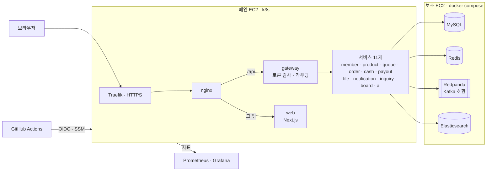

<div align="center">

<!-- TODO: 로고 이미지 (docs/assets/logo.png) -->

# 크루런 (CrewRun)

**러닝 대회 참가권과 굿즈를 사고파는 마켓플레이스**

대회 주최자는 참가권을 등록해 팔고, 러너는 크루와 함께 신청합니다.
예매가 몰려도 줄을 세워 받고, 판매 대금은 대회 일정에 맞춰 두 번에 나눠 정산합니다.

[서비스 바로가기](https://crewrun.duckdns.org)

<!-- TODO: 시연 영상 · 발표 자료 링크 -->

</div>

<!-- TODO: "핵심 화면" 절. 참가 신청 · 결제, 크루 파티, 판매자 대시보드, 정산 화면을 GIF나 사진 1장씩 (docs/assets/) -->

## 주요 기능

- **예매:** 대기열로 줄을 세우고, 차례가 온 사람만 신청 · 주문 · 결제로 넘어갑니다.
- **결제:** 토스 간편결제로 캐시를 충전하고 캐시로 결제합니다.
- **크루:** 크루를 만들어 파티로 함께 신청합니다.
- **판매자:** 대회 등록, 키트 배송, 문의 답변, 기록증 심사를 대시보드 한곳에서 처리합니다.
- **정산:** 판매 대금을 1차 정산과 최종 정산으로 나눠 지급하고, 지급 전에 대사로 금액을 맞춥니다.
- **크루런 AI:** 판매자 대시보드 브리핑과 기록증 심사를 돕습니다.

## 아키텍처



- 서비스는 호스트에 포트를 열지 않고 `gateway`를 거쳐서만 부를 수 있습니다.
- 서비스 사이의 이벤트는 Kafka(Redpanda)로 주고받습니다.
- 배포는 바뀐 앱만 이미지를 빌드해 하나씩 교체합니다. ([infra/README.md](infra/README.md), [k8s/README.md](k8s/README.md))

## 기술 스택

| 영역 | 기술 |
|---|---|
| 백엔드 | Java 25, Spring Boot 4.1, Gradle 멀티 모듈 |
| 프론트엔드 | Next.js 16, React 19, TypeScript, Tailwind CSS 4, TanStack Query, Zustand |
| 데이터 | MySQL 8.4, Redis 8.2, Redpanda(Kafka 호환), Elasticsearch 9.4 (nori) |
| 인프라 | AWS EC2, k3s, Traefik, nginx, GitHub Actions, GHCR |
| 관측 | Prometheus, Grafana |
| 테스트 | JUnit, Vitest, MSW, Playwright, Storybook, k6 |
| 협업 | Linear, GitHub, Claude Code |

## 시작하기

Docker Desktop만 있으면 전체 서비스를 한 번에 띄울 수 있습니다.

```bash
git clone https://github.com/prgrms-be-adv-devcourse/beadv8_5_BSB_MONO.git
cd beadv8_5_BSB_MONO/backend
cp .env.example .env                           # 값 채우기는 backend/README.md 참고
docker compose --profile app up -d --build     # 인프라와 서비스 전체 실행
docker compose --profile app ps                # 서비스가 healthy면 http://localhost 접속
```

- 로컬 확인은 Chrome으로 합니다. Safari는 `http://localhost`에서 로그인이 유지되지 않을 수 있습니다.
- 코드를 고치며 개발하려면 [docs/SETUP.md](docs/SETUP.md)와 [backend/README.md](backend/README.md)를 봅니다.

## 우리가 푼 문제

### 1. 예매가 몰릴 때 어디서 막히는지 재기

- **문제:** 예매 오픈에 요청이 몰리면 어디가 먼저 막히는지 몰랐습니다.
- **해결:** 운영 서버(2 vCPU · 7.6GB, k3s)에 대기열 → 주문 → 결제 흐름으로 부하를 주고 지표를 모았습니다. 게이트웨이가 CPU를 가장 많이 써서, nginx와 게이트웨이 사이 연결을 keep-alive로 다시 쓰게 했습니다.
- **수치:** 병목은 조회 경로의 CPU였습니다. 조회는 약 100 RPS까지 안정적이었고 330 RPS에서 무너졌습니다. 예매 완결은 약 20 TPS였습니다. DB 커넥션풀과 메모리는 끝까지 여유가 있었고 OOM은 0건이었습니다.
- 자세히: [docs/loadtest/main-scenario/README.md](docs/loadtest/main-scenario/README.md), [PR 639](https://github.com/prgrms-be-adv-devcourse/beadv8_5_BSB_MONO/pull/639)

### 2. 대기열로 줄 세우기

- **문제:** 예매 요청이 상품 · 주문 서비스에 한꺼번에 몰리면 서비스가 버티지 못합니다.
- **해결:** Redis ZSet 두 개(기다리는 줄, 입장한 줄)로 줄을 관리하고, 확인하고 넣는 일은 Lua로 한 번에 처리했습니다. 입장 판정은 상품 서비스를 부르지 않고 Kafka로 받은 대회 복제본으로 합니다.
- **수치:** 3초마다 종목당 20명을 입장시킵니다(초당 약 6.7명). 입장한 사람은 10분 안에 결제합니다.
- 자세히: [PR 146](https://github.com/prgrms-be-adv-devcourse/beadv8_5_BSB_MONO/pull/146), [PR 624](https://github.com/prgrms-be-adv-devcourse/beadv8_5_BSB_MONO/pull/624)

### 3. 결제가 몰려도 DB 연결이 바닥나지 않게 하기

- **문제:** 결제 20건을 동시에 보내면 90%가 30초 뒤 실패했습니다. 결제 한 건이 DB 연결을 두 개 쥐고, 잠금을 건 채 다른 서비스를 HTTP로 부르고 있었습니다.
- **해결:** 앞 조회에 읽기 전용 트랜잭션을 붙여 연결을 바로 돌려주고, HTTP 호출을 잠금 밖으로 뺐습니다. 예치금 결제 호출은 동시에 4개로 제한하고, 자리를 못 받으면 돈이 빠지기 전에 바로 거절합니다.
- **수치:** 시제품 측정에서 「결제 확인 중」이 30~40초 이어지던 것이 실패 구간 약 20초, p95 1.4~2.2초로 줄었습니다.
- 자세히: [PR 480](https://github.com/prgrms-be-adv-devcourse/beadv8_5_BSB_MONO/pull/480), [PR 536](https://github.com/prgrms-be-adv-devcourse/beadv8_5_BSB_MONO/pull/536)

### 4. 결제 화면을 벗어나도 다시 결제하기

- **문제:** 새로고침이나 뒤로 가기를 하면 새 멱등 키가 가서, 이미 만든 주문과 부딪혀 409가 났습니다.
- **해결:** 신청서 하나에 주문은 하나이므로, 키가 달라도 그 신청서의 결제 전 주문을 찾아 돌려줍니다. 프론트는 고치지 않았습니다.
- 자세히: [PR 789](https://github.com/prgrms-be-adv-devcourse/beadv8_5_BSB_MONO/pull/789)

### 5. 토스가 느려도 결제는 멈추지 않게 하기

- **문제:** 토스 승인이 4초 걸리면 충전이 요청 쓰레드 200개를 다 차지해, 토스를 부르지 않는 결제까지 멈췄습니다.
- **해결:** 충전 확정의 동시 개수를 100개로 제한하고, 넘치면 토스를 부르기 전에 429로 거절합니다.
- **수치:** 토스 4초 · 충전 초당 50건에서 결제 p99가 5,282ms에서 175ms로 줄었습니다. 대가로 토스가 느릴 때는 충전의 절반 가까이를 거절합니다.
- 자세히: [PR 688](https://github.com/prgrms-be-adv-devcourse/beadv8_5_BSB_MONO/pull/688)

### 6. 두 번에 나눠 주는 정산과 대사

- **문제:** 대회 전에 환불이 생길 수 있어 판매 대금을 한 번에 지급할 수 없습니다. 또 참가권 20만 장으로 정산을 만들면 Full GC가 28번 돌았습니다.
- **해결:** 1차 정산과 최종 정산으로 나눠 지급하고, 지급 전에 대사로 주문 판매와 정산 내역을 맞춥니다. 정산 줄은 1000개씩 저장하고, 대사는 참가권 ID를 비트맵으로 받아 XOR 한 번으로 비교합니다.
- **수치:** 20만 장 기준으로 정산 생성이 30.9초에서 23.4초로 줄었고 Full GC는 28번에서 0번이 됐습니다. 판매 내역 응답 크기는 2.0MB에서 0.53MB로 줄었습니다.
- 자세히: [PR 330](https://github.com/prgrms-be-adv-devcourse/beadv8_5_BSB_MONO/pull/330), [PR 582](https://github.com/prgrms-be-adv-devcourse/beadv8_5_BSB_MONO/pull/582), [PR 698](https://github.com/prgrms-be-adv-devcourse/beadv8_5_BSB_MONO/pull/698)

### 7. 크루런 AI: 대시보드 브리핑과 기록증 심사

- **문제:** 판매자는 오늘 먼저 할 일을 여러 화면에서 찾아야 했고, 기록증은 한 장씩 눈으로 확인해야 했습니다.
- **해결:** 브리핑은 모델을 부르지 않고 조회한 숫자로 문장을 만듭니다. 대시보드를 열 때마다 불리므로 빠르고, 숫자를 잘못 말할 위험이 없습니다. 기록증은 브라우저 OCR로 칸을 채우고, 서버가 Kafka로 받아 원본을 다시 읽어 판정합니다.
- **수치:** AI 서비스의 메모리가 512Mi라 기록증은 한 번에 한 장씩 읽습니다.
- 자세히: [PR 515](https://github.com/prgrms-be-adv-devcourse/beadv8_5_BSB_MONO/pull/515), [PR 645](https://github.com/prgrms-be-adv-devcourse/beadv8_5_BSB_MONO/pull/645)

## 팀

| GitHub | 맡은 일 |
|---|---|
| [@jieunsse](https://github.com/jieunsse) | 프론트엔드, 회원, 게이트웨이, 게시판, 문의 |
| [@Dawit-lee](https://github.com/Dawit-lee) | 주문 · 결제, 크루런 AI, 알림 |
| [@bbangHo](https://github.com/bbangHo) | 정산, 기록증 심사 |
| [@ksoheee](https://github.com/ksoheee) | 예치금(캐시) |
| [@khb3025](https://github.com/khb3025) | 상품 · 검색, 대기열, 파일, 인프라(k3s · 배포) |

## 협업 방식

- **이슈:** Linear로 이슈를 만들고 PR과 연결합니다. ([docs/LINEAR.md](docs/LINEAR.md))
- **커밋:** Conventional Commits를 따르고 commitlint가 검사합니다.
- **PR:** 템플릿과 CI(백엔드 · 프론트엔드)를 통과해야 머지합니다.
- **AI 협업:** 팀 컨벤션을 `.claude/rules`에 두어 Claude Code가 같은 규칙으로 작업합니다.

## 문서

| 문서 | 내용 |
|---|---|
| [docs/SETUP.md](docs/SETUP.md) | 개발 환경 설정 (도구, 환경변수, MCP) |
| [backend/README.md](backend/README.md) | 백엔드 실행, 컨테이너 구성 |
| [docs/policy](docs/policy) | 서비스 정책 |
| [docs/erd](docs/erd) | ERD |
| [infra/README.md](infra/README.md) · [k8s/README.md](k8s/README.md) | 운영 서버, 배포 |
| [docs/loadtest](docs/loadtest) | 부하 테스트 |
