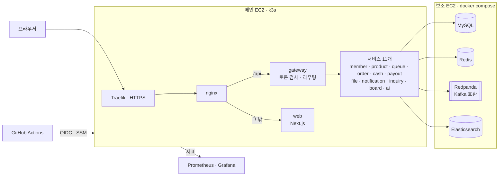

<!-- TODO: 로고 이미지 (docs/assets/logo.png) -->

# 크루런 (CrewRun)

**러닝 대회 참가권과 굿즈를 사고파는 마켓플레이스**

대회 주최자는 참가권을 등록해 팔고, 러너는 크루와 함께 신청합니다.
예매가 몰려도 줄을 세워 받고, 판매 대금은 대회 일정에 맞춰 두 번에 나눠 정산합니다.

[서비스 바로가기](https://crewrun.duckdns.org) · [시연 영상](TODO) · [발표 자료](TODO)

## 핵심 화면

<!-- TODO: 화면마다 GIF나 사진 1장 (docs/assets/) -->

| 참가 신청 · 결제 | 크루 파티 |
|---|---|
| TODO | TODO |

| 판매자 대시보드 | 정산 |
|---|---|
| TODO | TODO |

## 주요 기능

- **예매:** 대기열로 줄을 세우고, 차례가 온 사람만 신청 · 주문 · 결제로 넘어갑니다.
- **결제:** 토스 간편결제로 캐시를 충전하고 캐시로 결제합니다.
- **크루:** 크루를 만들어 파티로 함께 신청합니다.
- **판매자:** 대회 등록, 키트 배송, 문의 답변, 기록증 심사를 대시보드 한곳에서 처리합니다.
- **정산:** 판매 대금을 1차 정산과 최종 정산으로 나눠 지급하고, 지급 전에 대사로 금액을 맞춥니다.
- **크루런 AI:** 판매자 대시보드 브리핑과 기록증 심사를 돕습니다.

## 아키텍처

- 서비스는 호스트에 포트를 열지 않고 `gateway`를 거쳐서만 부를 수 있습니다.
- 서비스 사이의 이벤트는 Kafka(Redpanda)로 주고받습니다.
- 배포는 바뀐 앱만 이미지를 빌드해 하나씩 교체합니다. ([infra/README.md](infra/README.md), [k8s/README.md](k8s/README.md))

## 기술 스택

| 영역 | 기술 |
|---|---|
| 백엔드 | Java 25, Spring Boot 4.1, Gradle 멀티 모듈 |
| 프론트엔드 | Next.js 16, React 19, TypeScript, Tailwind CSS 4, TanStack Query, Zustand |
| 데이터 | MySQL 8.4, Redis 8.2, Redpanda(Kafka 호환), Elasticsearch 9.4 (nori) |
| 인프라 | AWS EC2, k3s, Traefik, nginx, GitHub Actions, GHCR |
| 관측 | Prometheus, Grafana |
| 테스트 | JUnit, Vitest, MSW, Playwright, Storybook, k6 |
| 협업 | Linear, GitHub, Claude Code |

## 우리가 푼 문제

<!-- TODO: 파트 담당자가 "문제 · 해결 · 수치" 3줄로 채웁니다. 아래 1번만 실측 수치입니다. -->

### 1. 예매가 몰릴 때 어디서 막히는지 재기

- **문제:** 예매 오픈에 요청이 몰리면 어디가 먼저 막히는지 몰랐습니다.
- **해결:** 운영 서버(2 vCPU · 7.6GB, k3s)에 대기열 → 주문 → 결제 흐름으로 부하를 주고 지표를 모았습니다.
- **수치:** 병목은 조회 경로의 CPU였습니다. 조회는 약 100 RPS까지 안정적이었고 330 RPS에서 무너졌습니다. 예매 완결은 약 20 TPS였습니다. DB 커넥션풀과 메모리는 끝까지 여유가 있었고 OOM은 0건이었습니다.
- 자세히: [docs/loadtest/main-scenario/README.md](docs/loadtest/main-scenario/README.md)

### 2. 대기열과 자리 확보 동시성

- **문제:** TODO (queue · order 담당)
- **해결:** TODO
- **수치:** TODO

### 3. 두 번에 나눠 주는 정산과 대사

- **문제:** 대회 전에 환불이 생길 수 있어 판매 대금을 한 번에 지급할 수 없었습니다.
- **해결:** 1차 정산과 최종 정산으로 나눠 지급하고, 지급 전에 대사로 주문 금액과 정산 금액을 맞췄습니다.
- **수치:** TODO

### 4. 결제 재진입 멱등 처리

- **문제:** TODO (cash · order 담당)
- **해결:** TODO
- **수치:** TODO

### 5. 크루런 AI: 대시보드 브리핑과 기록증 심사

- **문제:** TODO (ai 담당)
- **해결:** TODO
- **수치:** TODO

## 팀

<!-- TODO: 이름 · 사진 · 맡은 일을 각자 확인합니다. 아래 "맡은 일"은 커밋 수로 짐작한 값입니다. -->

| 이름 | GitHub | 맡은 일 |
|---|---|---|
| TODO | [@jieunsse](https://github.com/jieunsse) | 프론트엔드, member, gateway, board, inquiry |
| TODO | [@Dawit-lee](https://github.com/Dawit-lee) | order, ai, notification |
| TODO | [@bbangHo](https://github.com/bbangHo) | payout |
| TODO | [@ksoheee](https://github.com/ksoheee) | cash |
| TODO | [@khb3025](https://github.com/khb3025) | product, queue, file, 인프라(k3s · 배포) |

## 협업 방식

- **이슈:** Linear로 이슈를 만들고 PR과 연결합니다. ([docs/LINEAR.md](docs/LINEAR.md))
- **커밋:** Conventional Commits를 따르고 commitlint가 검사합니다.
- **PR:** 템플릿과 CI(백엔드 · 프론트엔드)를 통과해야 머지합니다.
- **AI 협업:** 팀 컨벤션을 `.claude/rules`에 두어 Claude Code가 같은 규칙으로 작업합니다.

## 문서

| 문서 | 내용 |
|---|---|
| [docs/SETUP.md](docs/SETUP.md) | 개발 환경 설정 (도구, 환경변수, MCP) |
| [backend/README.md](backend/README.md) | 백엔드 실행, 컨테이너 구성 |
| [docs/policy](docs/policy) | 서비스 정책 |
| [docs/erd](docs/erd) | ERD |
| [infra/README.md](infra/README.md) · [k8s/README.md](k8s/README.md) | 운영 서버, 배포 |
| [docs/loadtest](docs/loadtest) | 부하 테스트 |
