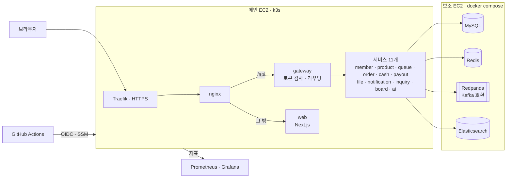

<div align="center">

# 크루런 (CrewRun)

**러닝 대회 참가권과 굿즈를 사고파는 마켓플레이스**

주최자는 대회를 등록해 참가권을 팝니다.<br>
러너는 혼자서, 또는 크루와 함께 신청합니다.


[서비스 바로가기](https://crewrun.duckdns.org)

</div>

## 👥 팀

| 사진 | GitHub | 맡은 일 |
|---|---|---|
|  | [@jieunsse](https://github.com/jieunsse) | 프론트엔드, 회원, 게이트웨이, 게시판, 문의 |
|  | [@Dawit-lee](https://github.com/Dawit-lee) | 주문 · 결제, 크루런 AI, 알림 |
|  | [@bbangHo](https://github.com/bbangHo) | 정산, 기록증 심사 |
|  | [@ksoheee](https://github.com/ksoheee) | 예치금 |
|  | [@khb3025](https://github.com/khb3025) | 상품 · 검색, 대기열, 파일, 인프라(k3s · 배포) |

## 📚 목차

- [주요 기능](#-주요-기능)
- [아키텍처](#-아키텍처)
- [기술 스택](#-기술-스택)
- [시작하기](#-시작하기)
- [우리가 푼 문제](#-우리가-푼-문제)
- [협업 방식](#-협업-방식)
- [CI/CD](#-cicd)
- [향후 개선](#-향후-개선)
- [문서](#-문서)

## ✨ 주요 기능

**예매**

- 신청이 몰리면 대기열에 줄을 세웁니다.
- 차례가 된 사람만 신청하고 결제합니다.

**결제**

- 토스 간편결제로 예치금을 충전합니다.
- 충전한 예치금으로 결제합니다.

**크루**

- 크루원끼리 파티를 만들어 같은 대회에 함께 신청합니다.

**판매자**

- 대회 등록, 키트 배송, 문의 답변, 기록증 심사를 대시보드에서 처리합니다.

**정산**

- 판매 대금을 두 번에 나눠 지급합니다.
- 지급하기 전에 주문 금액과 정산 금액이 같은지 확인합니다.

**크루런 AI**

- 판매자에게 오늘 할 일을 알려 줍니다.
- 기록증 심사를 돕습니다.

## 🧱 아키텍처



- 브라우저의 요청은 모두 `gateway`를 거칩니다.
- 서비스는 외부에서 직접 호출할 수 없습니다.
- 서비스끼리는 Kafka(Redpanda)로 이벤트를 주고받습니다.
- 배포할 때는 코드가 바뀐 서비스만 새로 빌드해 교체합니다.
- 자세한 구성은 [infra/README.md](infra/README.md)와 [k8s/README.md](k8s/README.md)에 있습니다.

## 🧰 기술 스택

| 분류 | 기술 |
|---|---|
| **프론트엔드** |         |
| **백엔드** |          |
| **AI** |   -000000?logo=ollama&logoColor=white)   |
| **메시징 / 이벤트** | -E2403E?logo=apachekafka&logoColor=white)  |
| **데이터베이스 / 저장소** |   -005571?logo=elasticsearch&logoColor=white)  |
| **인프라 / 클라우드** |        |
| **모니터링** |     |
| **테스트** |         |
| **CI / CD** |  |
| **협업 도구** |        |

## 🚀 시작하기

Docker Desktop을 설치한 뒤 아래 명령을 순서대로 실행합니다.

```bash
git clone https://github.com/prgrms-be-adv-devcourse/beadv8_5_BSB_MONO.git
cd beadv8_5_BSB_MONO/backend
cp .env.example .env                           # .env에 넣을 값은 backend/README.md에 있습니다
docker compose --profile app up -d --build     # 전체 서비스를 실행합니다
docker compose --profile app ps                # 모든 서비스가 healthy인지 확인합니다
```

- 모든 서비스가 healthy가 되면 Chrome에서 http://localhost 를 엽니다.
- Safari에서는 로그인이 유지되지 않을 수 있습니다.
- 코드를 고치며 개발하려면 [docs/SETUP.md](docs/SETUP.md)와 [backend/README.md](backend/README.md)를 봅니다.

## 🧩 우리가 푼 문제

### 1. 예매가 몰리면 어디가 먼저 막히는지 재기

**문제**

- 예매가 열리는 순간 요청이 몰리면 어느 서비스가 먼저 느려지는지 몰랐습니다.

**해결**

- 운영 서버(CPU 2개, 메모리 7.6GB)에 실제 예매 순서대로 부하를 걸었습니다.
- 순서는 대기열 → 주문 → 결제입니다.
- 게이트웨이가 CPU를 가장 많이 썼습니다.
- nginx가 요청마다 게이트웨이와 연결을 새로 맺고 있었습니다.
- 맺은 연결을 끊지 않고 다시 쓰도록(keep-alive) 바꿨습니다.

**결과**

- 가장 먼저 막힌 곳은 조회 요청을 처리하는 CPU였습니다.
- 조회는 초당 약 100건까지 안정적이었고, 초당 330건에서 응답하지 못했습니다.
- 예매는 초당 약 20건을 결제까지 끝냈습니다.
- DB 연결과 메모리는 끝까지 남았습니다.
- 메모리가 부족해 죽은 서비스는 없었습니다.

자세히: [docs/loadtest/main-scenario/README.md](docs/loadtest/main-scenario/README.md), [PR 639](https://github.com/prgrms-be-adv-devcourse/beadv8_5_BSB_MONO/pull/639)

### 2. 대기열로 줄 세우기

**문제**

- 예매 요청이 상품 서비스와 주문 서비스에 한꺼번에 몰리면 두 서비스가 버티지 못합니다.

**해결**

- 대기열 서비스를 따로 두고, 차례가 된 사람만 주문으로 보냅니다.
- 줄은 Redis에 두 개 둡니다. 하나는 기다리는 줄이고, 하나는 입장한 줄입니다.
- 줄에 있는지 확인하고 넣는 일을 Lua 스크립트 하나로 처리합니다.
- 대회가 판매 중인지는 상품 서비스에 묻지 않습니다. Kafka로 받아 둔 대회 정보를 봅니다.

**결과**

- 3초마다 종목별로 20명씩 입장합니다.
- 입장한 사람은 10분 안에 결제해야 합니다.

자세히: [PR 146](https://github.com/prgrms-be-adv-devcourse/beadv8_5_BSB_MONO/pull/146), [PR 624](https://github.com/prgrms-be-adv-devcourse/beadv8_5_BSB_MONO/pull/624)

### 3. 결제가 몰려도 DB 연결이 모자라지 않게 하기

**문제**

- 결제 20건을 동시에 보내면 90%가 30초 뒤에 실패했습니다.
- 결제 한 건이 DB 연결을 두 개씩 잡고 있었습니다.
- DB 잠금을 건 채로 다른 서비스를 호출해서, 응답이 올 때까지 잠금이 풀리지 않았습니다.

**해결**

- 결제 대상을 조회한 뒤 DB 연결을 바로 반납하게 했습니다.
- 다른 서비스는 잠금을 푼 뒤에 호출합니다.
- 주문 서비스가 예치금 서비스에 보내는 결제 요청을 동시에 4건으로 제한했습니다.
- 1초 안에 순서가 오지 않은 요청은 예치금을 차감하기 전에 거절합니다.
- 거절당한 회원은 같은 주문으로 다시 결제합니다.

**결과**

- 제한하기 전에는 「결제 확인 중」 화면이 30~40초 이어졌습니다.
- 제한한 뒤에는 결제 요청의 95%가 1.4~2.2초 안에 끝났습니다.
- 운영에 넣기 전에 실험용 코드로 잰 값입니다.

자세히: [PR 480](https://github.com/prgrms-be-adv-devcourse/beadv8_5_BSB_MONO/pull/480), [PR 536](https://github.com/prgrms-be-adv-devcourse/beadv8_5_BSB_MONO/pull/536)

### 4. 결제 화면을 벗어나도 다시 결제하기

**문제**

- 결제 화면에서 새로고침하거나 뒤로 가면 다시 결제할 수 없었습니다.
- 주문 요청에는 중복 요청을 막는 키가 붙습니다.
- 화면을 다시 열면 이 키가 새로 만들어졌습니다.
- 서버는 키가 다르면 새 주문 요청으로 보고, 이미 주문이 있다며 거절했습니다.

**해결**

- 신청서 하나에는 주문이 하나만 있습니다.
- 그래서 키가 달라도 그 신청서의 결제 전 주문을 찾아 돌려줍니다.
- 프론트엔드 코드는 바꾸지 않았습니다.

자세히: [PR 789](https://github.com/prgrms-be-adv-devcourse/beadv8_5_BSB_MONO/pull/789)

### 5. 토스가 느려도 결제는 멈추지 않게 하기

**문제**

- 예치금을 충전할 때는 토스의 승인을 기다립니다.
- 토스 승인이 4초씩 걸리자, 충전 요청이 서버의 요청 처리 스레드 200개를 모두 차지했습니다.
- 그래서 토스와 상관없는 예치금 결제까지 멈췄습니다.

**해결**

- 동시에 처리하는 충전을 100건으로 제한했습니다.
- 100건을 넘는 충전은 토스를 호출하기 전에 거절합니다.

**결과**

- 토스 승인이 4초 걸리고 충전이 초당 50건 들어오는 조건에서 쟀습니다.
- 결제 요청의 99%가 끝나는 시간이 5,282ms에서 175ms로 줄었습니다.
- 대신 처리한 충전은 22,005건에서 12,419건으로 줄었습니다.

자세히: [PR 688](https://github.com/prgrms-be-adv-devcourse/beadv8_5_BSB_MONO/pull/688)

### 6. 두 번에 나눠 지급하는 정산

**문제**

- 대회가 열리기 전에는 환불이 생길 수 있어, 판매 대금을 한 번에 지급할 수 없습니다.
- 참가권 20만 장을 한 번에 정산하면 메모리가 모자라 Full GC가 28번 일어났습니다.

**해결**

- 정산을 1차 정산과 최종 정산으로 나눠 지급합니다.
- 지급하기 전에 주문 서비스의 판매 내역과 정산 내역을 비교합니다. 이 비교를 대사라고 부릅니다.
- 정산 내역은 메모리에 모두 올리지 않고 1,000줄씩 저장합니다.
- 대사할 때는 참가권 ID를 비트맵으로 받아 XOR 연산 한 번으로 비교합니다.
- XOR 결과에 남은 비트가 두 내역에서 서로 다른 참가권입니다.

**결과 (참가권 20만 장)**

- 정산 생성 시간: 30.9초 → 23.4초
- Full GC: 28번 → 0번
- 주문 서비스가 보내는 판매 내역 크기: 2.0MB → 0.53MB

자세히: [PR 330](https://github.com/prgrms-be-adv-devcourse/beadv8_5_BSB_MONO/pull/330), [PR 582](https://github.com/prgrms-be-adv-devcourse/beadv8_5_BSB_MONO/pull/582), [PR 698](https://github.com/prgrms-be-adv-devcourse/beadv8_5_BSB_MONO/pull/698)

### 7. 크루런 AI: 대시보드 브리핑과 기록증 심사

**문제**

- 판매자는 오늘 할 일을 알려면 배송 화면과 정산 화면을 따로 열어야 했습니다.
- 기록증은 판매자가 한 장씩 직접 확인해야 했습니다.

**해결**

- 대시보드 브리핑은 AI 모델을 호출하지 않습니다.
- 조회한 숫자를 정해진 문장에 넣어 만듭니다.
- 그래서 대시보드를 열면 바로 보이고, 숫자가 틀리지 않습니다.
- 기록증은 참가자의 브라우저가 먼저 글자를 읽어(OCR) 입력 칸을 채웁니다.
- 참가자가 제출하면 서버가 원본 사진을 다시 읽어 판정합니다.
- AI 서비스의 메모리가 512Mi라, 요청을 Kafka에 쌓아 두고 한 장씩 읽습니다.

자세히: [PR 515](https://github.com/prgrms-be-adv-devcourse/beadv8_5_BSB_MONO/pull/515), [PR 645](https://github.com/prgrms-be-adv-devcourse/beadv8_5_BSB_MONO/pull/645)

## 🤝 협업 방식

- **이슈:** Linear에 이슈를 만들고 PR과 연결합니다. 규칙은 [docs/LINEAR.md](docs/LINEAR.md)에 있습니다.
- **커밋:** Conventional Commits 형식으로 씁니다. 형식이 틀리면 commitlint가 커밋을 막습니다.
- **PR:** 본문은 템플릿에 맞춰 씁니다. CI를 통과해야 머지할 수 있습니다.
- **AI 협업:** 팀 규칙을 `.claude/rules`에 적어 두었습니다. Claude Code도 이 규칙을 읽고 작업합니다.

## 🔄 CI/CD

| 워크플로 | 하는 일 |
|---|---|
| `backend-ci` · `frontend-ci` | PR마다 바뀐 쪽(백엔드·프론트엔드)의 빌드와 테스트를 돌립니다. |
| `pr-rules` · `linear-sync` | PR 브랜치 이름·본문 양식을 검사하고, PR을 Linear 이슈에 붙입니다. |
| `dev-main-sync` | 매일 05:00(KST) `dev`를 `main`으로 머지합니다. |
| `k8s-cd` | `main`에 들어오면 운영에 배포합니다. |
| `data-node-cd` | 데이터 EC2의 Compose 구성을 손으로 실행해 배포합니다. |

`k8s-cd`는 아래 순서로 배포합니다.

1. 직전 `main` 커밋 이후 소스가 바뀐 앱을 고릅니다.
2. 바뀐 앱만 이미지를 빌드해 GHCR에 커밋 SHA 태그로 올립니다. 안 바뀐 앱은 태그만 새로 붙입니다.
3. OIDC로 AWS에 들어가 SSM으로 메인 EC2의 배포 스크립트를 실행합니다. 키를 저장하지 않고, 22번 포트도 쓰지 않습니다.
4. 바뀐 앱만 하나씩 교체합니다. 한꺼번에 바꾸면 메모리가 넘칩니다.
5. 배포 뒤 스키마 드리프트를 검사합니다. 빈 MySQL에 Flyway를 돌린 결과와 운영 DB를 비교하고, 다르면 Slack으로 알립니다.

되돌릴 때는 예전 `main` 커밋 SHA를 넣고 다시 실행하면, 빌드 없이 그 이미지로 배포합니다.

## 🔭 향후 개선

<details>
<summary>향후 개선 계획</summary>

| 개선 | 내용 |
|---|---|
| AI 폴백 모델 | 지금은 모델 하나만 씁니다. 모델이 응답하지 않을 때 다른 모델로 넘깁니다. (CRU-164) |
| 회원 대회 추천 챗봇 | 지금 챗봇은 판매자·관리자용입니다. 회원에게 맞는 대회를 추천하는 챗봇을 더합니다. |
| 정답 묶음 평가 | 질문과 기대 답을 묶어 두고, 챗봇 답의 품질을 고칠 때마다 자동으로 잽니다. |
| 답 스트리밍 | 챗봇 답을 다 만든 뒤 보내지 않고, 쓰는 대로 화면에 흘려 보냅니다. |
| 파티 대기열 입장권 | 파티로 신청할 때도 입장권(토큰)으로 대기열 차례를 확인합니다. |
| 프로필 사진 변경 | 회원이 프로필 사진을 바꿀 수 있게 합니다. (CRU-163) |

</details>

## 📄 문서

- 문서 목록은 [docs/README.md](docs/README.md)에 모았습니다.
- 이 파일에는 문서의 위치와 한 줄 설명만 있습니다.
- 사람과 AI는 이 파일에서 필요한 문서를 찾아 그 문서만 읽습니다.

자주 찾는 문서는 아래와 같습니다.

- 로컬에서 실행하기: [docs/SETUP.md](docs/SETUP.md), [backend/README.md](backend/README.md)
- 정책: [docs/policy](docs/policy)
- 운영 서버와 배포: [infra/README.md](infra/README.md), [k8s/README.md](k8s/README.md)
- 부하 테스트와 측정 결과: [docs/loadtest](docs/loadtest), [docs/measurements](docs/measurements)
