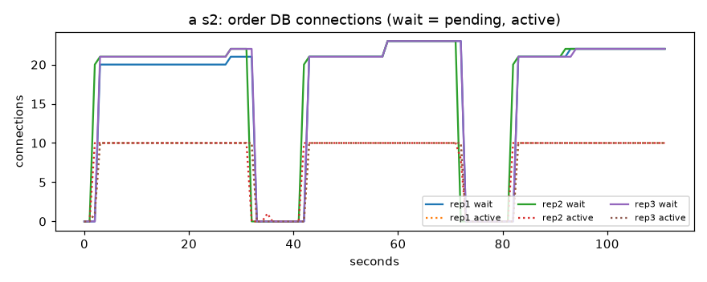
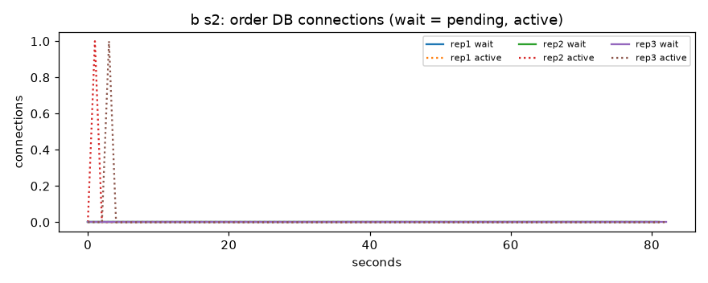
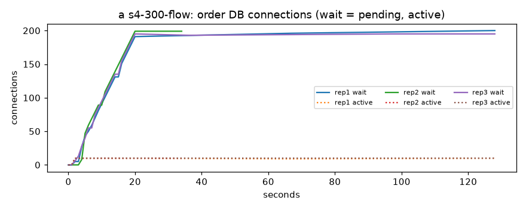
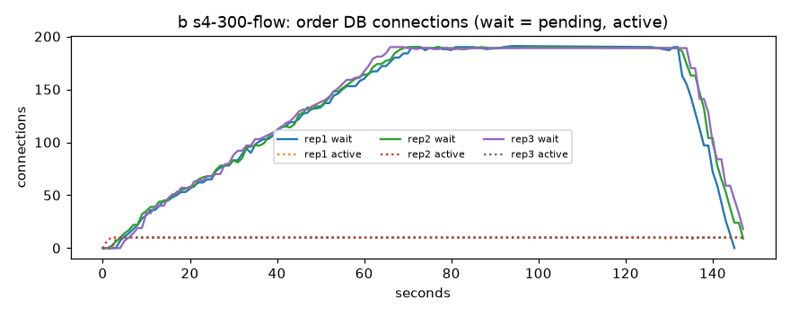
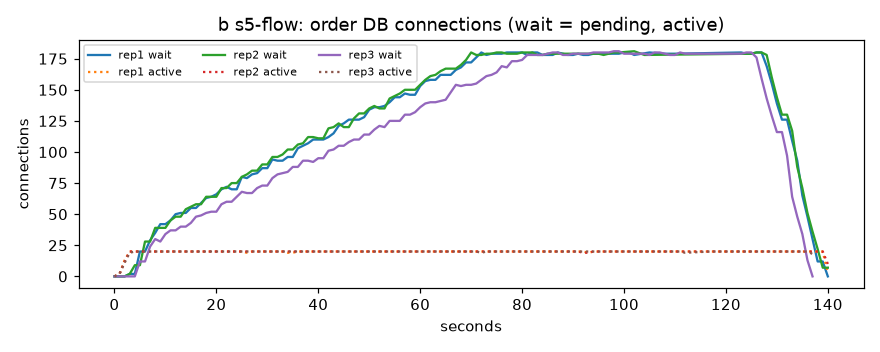

# 주문 결제 잠금 측정 결과: A(고치기 전) 대 B(BUK-213 연결 수정) (2026-11-14)

판정 기준과 시나리오는 [2026-11-13-결제-잠금-판정기준.md](2026-11-13-결제-잠금-판정기준.md)를 따랐어요.
반복마다 값과 그래프는 [자동 정리](2026-11-14-결제-잠금-자동정리.md)에 있어요.

## 1. 조건

| 항목 | 값 |
|---|---|
| A | `452f07d6` (PR #478 측정 도구, 결제 코드는 dev 그대로) |
| B | `8a612a6e` (#478 + BUK-213 PR #480을 합친 임시 브랜치 `measure/tmp-buk213-run`) |
| 실행 | GitHub Actions run 43461470590, A·B 번갈아 3회, 13개 시나리오 |
| 자원 | 주문 CPU 1 / 1GB, 예치금 0.5 / 768MB, 상품 0.5 / 1GB, MySQL 1 / 2GB |
| 주문 DB 연결 수 | 10 (S5만 20) |

이번 B는 C안(「결제 중」 먼저 커밋, 잠금 밖 HTTP)이 아니에요. 결제 한 건이 연결 두 개를 잡던 문제(판정 기준 7장)만 고친 코드예요.

## 2. 숫자 (반복 3회 중앙값)

결제 시간 단위 ms. 실패율은 결제 요청만 셌어요.

| 시나리오 | A p50 | A p95 | A 결제 실패 | B p50 | B p95 | B 결제 실패 |
|---|---|---|---|---|---|---|
| S1-1 (종목 1, 초당 4명) | 29 | 63 | 0% | 30 | 62 | 0% |
| S1-5 (종목 5, 초당 20명) | 15 | 92 | 0% | 17 | 90 | 0% |
| S2 (20건 동시, 옵션 20개) | 30,023 | 30,045 | 86.7% | 95 | 154 | 0% |
| S3 (20건 동시, 같은 옵션) | 30,014 | 30,069 | 73.3% | 146 | 285 | 0% |
| S4 0.1초 흐름 | 115 | 123 | 0% | 115 | 130 | 0% |
| S4 0.1초 몰림 | 30,009 | 30,138 | 81.7% | 215 | 285 | 0% |
| S4 0.3초 흐름 | 30,656 | 60,001 | 67.6% | 4,065 | 9,019 | 0% |
| S4 0.3초 몰림 | 30,009 | 30,335 | 76.7% | 502 | 669 | 0% |
| S4 0.5초 흐름 | 59,319 | 60,001 | 87.3% | 10,214 | 17,465 | 0% |
| S4 0.5초 몰림 | 30,012 | 30,691 | 76.7% | 805 | 1,080 | 0% |
| S5 흐름 (연결 20, 0.3초) | 32,221 | 60,001 | 53.2% | 4,092 | 7,259 | 0% |
| S5 몰림 (연결 20, 0.3초) | 993 | 1,627 | 0% | 363 | 396 | 0% |

- 60,001ms는 k6 요청 제한(60초)에 걸린 값이에요.
- 흐름 시나리오의 「건너뜀」(k6가 사람을 다 못 들여보낸 수): A S4 0.3초 1,665명, B 314명. 둘 다 명목 부하(2,400명)보다 덜 걸렸어요. B는 0.5초에서 963명이에요.

그래프 (점선 활성 연결, 실선 연결 대기):

- S2: A  B 
- S4 0.3초 흐름: A  B 
- S5 흐름(연결 20): B 

## 3. 판정

### 변경 전(A) 「문제 있음」

| 번호 | 값 | 맞음 |
|---|---|---|
| P1 연결 대기 > 0이 30초 넘게 | 21초로 셌지만 지표가 빠졌어요 (아래) | 판정 못 함, 보인 표본은 모두 대기 89~199 |
| P2 S4 0.3초 p95 > 2초 | 60,001ms | 예 |
| P3 S4 0.3초 결제 실패 > 1% | 67.6% | 예 |
| P4 S3 p95 ≥ S2 p95 × 3 | 1.0배 | 아니오 (둘 다 30초 제한에 걸림) |

A는 지연이 없어도 동시 결제 20건이면 30초 기다린 뒤 실패해요. 평소 흐름(S1)은 괜찮아요.

P1 지표가 빠진 이유: 주문이 바쁘면 Prometheus가 1초 안에 `/actuator/prometheus`를 받지 못해 표본이 빠졌어요.
A S4 0.3초 흐름은 151초 중 22개만 남았어요. 남은 표본은 대기 89~199라서 실제로는 30초를 넘었을 거예요(추정).

### B를 A와 견줌 (G1~G4)

| 번호 | 값 | 맞음 |
|---|---|---|
| G1 S4 0.3초 연결 대기 최대 50% 이상 줄어듦 | A 199 → B 190 | 아니오 |
| G2 S3 p95가 A의 절반 이하 | 30,069 → 285ms | 예 |
| G3 실패율이 A보다 높지 않음 | 모든 시나리오 0% | 예 |
| G4 정확성 | 모두 통과 (아래) | 예 |

### 정확성 (반복 3회 모두)

| 확인 | A | B |
|---|---|---|
| C1 돈 합계 차이 | 0 | 0 |
| C2 이중 차감 | 0 | 0 |
| C3 상한 초과·판매 수 어긋남 | 0 | 0 |
| C4 결제 완료 = 예치금 결제 = 판매된 자리 | 5,779 / 5,757 / 5,788 모두 같음 | 11,348 / 11,375 / 11,396 모두 같음 |
| C5 멈춘 결제 | 0 | 0 |
| 만료로 취소된 예치금 결제 | 회당 193~200건 | 0건 |

A의 만료 취소 약 200건은 예치금은 빠졌는데 주문이 30초 제한으로 실패한 결제예요. 결제 기한 뒤 만료 정리가 돈을 돌려줘 C1은 맞지만, 그동안 회원 돈이 묶여 있었어요.

## 4. 해석

1. **BUK-213(#480)이 「30초 멈춤」을 없앴어요.** 동시 결제 20건이 30초 → 0.1~0.3초로 줄고 실패가 0이 됐어요. A의 숫자 대부분은 「잠근 채 HTTP」가 아니라 이 연결 두 개 문제였어요.
2. **B에도 「잠근 채 HTTP」 문제가 남아 있어요.** 예치금이 0.3초 이상 느려지면 흐름에서 결제 p95가 9초(0.5초면 17초)로 늘고, 연결 대기가 190까지 쌓여요. 실패는 없지만 사람을 다 들여보내지 못했어요.
3. **원인은 키트 옵션 판매 수 줄 잠금으로 봐요(추정).**
   - 결제는 판매 수 줄을 잠근 채 예치금·상품 HTTP를 불러요(`OrderPayUseCase.payLocked`, B 코드 144~153줄).
   - 흐름에서는 옵션 5개에 초당 20건이라 옵션 하나에 초당 4건이에요. 예치금이 0.3초면 한 건이 줄을 0.35초쯤 쥐어 옵션 하나가 초당 3건 정도만 처리해요. 들어오는 것(4건)보다 적어 줄이 끝없이 길어져요. 0.1초면 초당 6건 넘게 처리해 괜찮았어요.
   - 연결 수를 20으로 늘려도(S5) p95가 9초 → 7초로 조금만 나아졌어요. 연결이 아니라 줄 잠금에서 기다린다는 뜻이에요.
   - 확인 못 함: MySQL 줄 잠금 대기 시간은 재지 않았어요. 위는 처리량 계산과 S5 결과로 미룬 추정이에요.
4. 이것은 C안이 없애려는 바로 그 문제예요. C안을 만든 뒤 같은 도구로 B 자리에 C안을 넣어 G1을 다시 봐요.

## 5. 상품·예치금 쪽 (측정 근거가 있는 것만)

### 상품

- 상품이 갓 뜬 뒤 첫 1분 동안 결제 p95가 1.5~1.9초예요(A·B 같음). 짧은 확인 run(43457755506)에서는 이 첫 호출이 주문의 상품 호출 제한(2초)에 걸려 예열 결제 3%가 실패했어요(`HttpRaceCourseAdapter` 경고). 전체 run에서는 실패 0%였어요.
  → 상품 배포 직후 첫 요청이 느려요. 배포 뒤 예열 요청이나 준비 확인(readiness)을 두면 좋아요. 급하지는 않아요.
- 그 밖에 상품 HTTP가 느려지거나 실패한 기록은 없어요.

### 예치금

- 예치금 쪽 오류·실패는 없었어요.
- 예치금 응답 시간이 곧 주문 결제 처리량이에요(4장 3번). 0.1초면 괜찮고 0.3초부터 줄이 쌓여요. 예치금 결제 API 응답 시간(p95)을 지표로 보이게 하면 좋아요. 이번 측정은 지연을 일부러 넣은 것이라, 실제 예치금 응답 시간은 재지 않았어요.
- 예치금은 결제마다 보관 지갑 줄을 잠가 한 줄로 서요. 이번 숫자에서 이것이 문제로 드러나지는 않았어요(지연 없는 S2 동시 20건 p95 0.15초).

## 6. 한계

- 운영 절대값이 아니라 같은 조건에서 A·B를 견준 숫자예요.
- 바쁜 구간에서 Prometheus 표본이 빠졌어요(3장). 「대기>0 초」는 A와 B S4 0.5초 흐름에서 실제보다 작아요.
- B는 C안이 아니에요. C안 측정은 아직 안 했어요.
