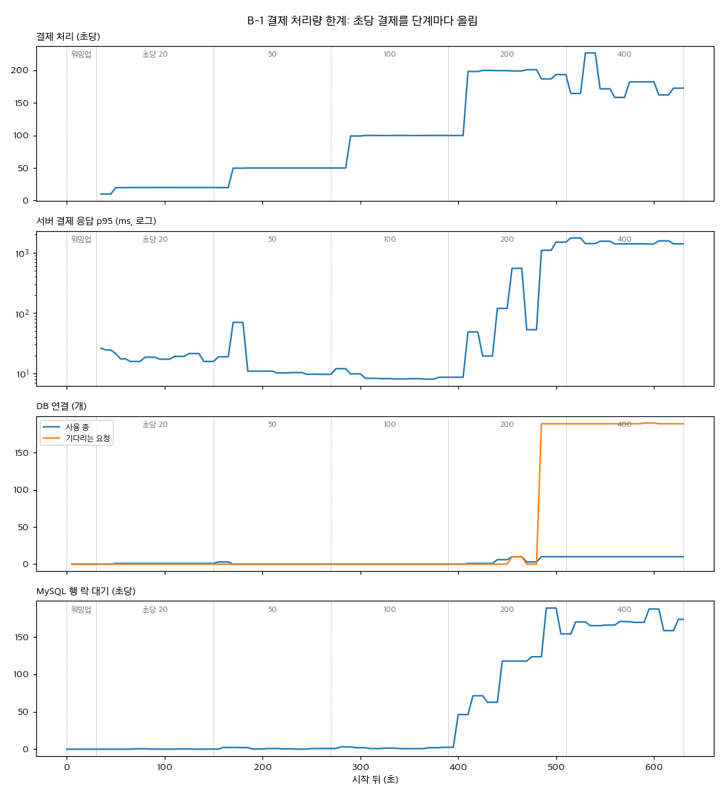
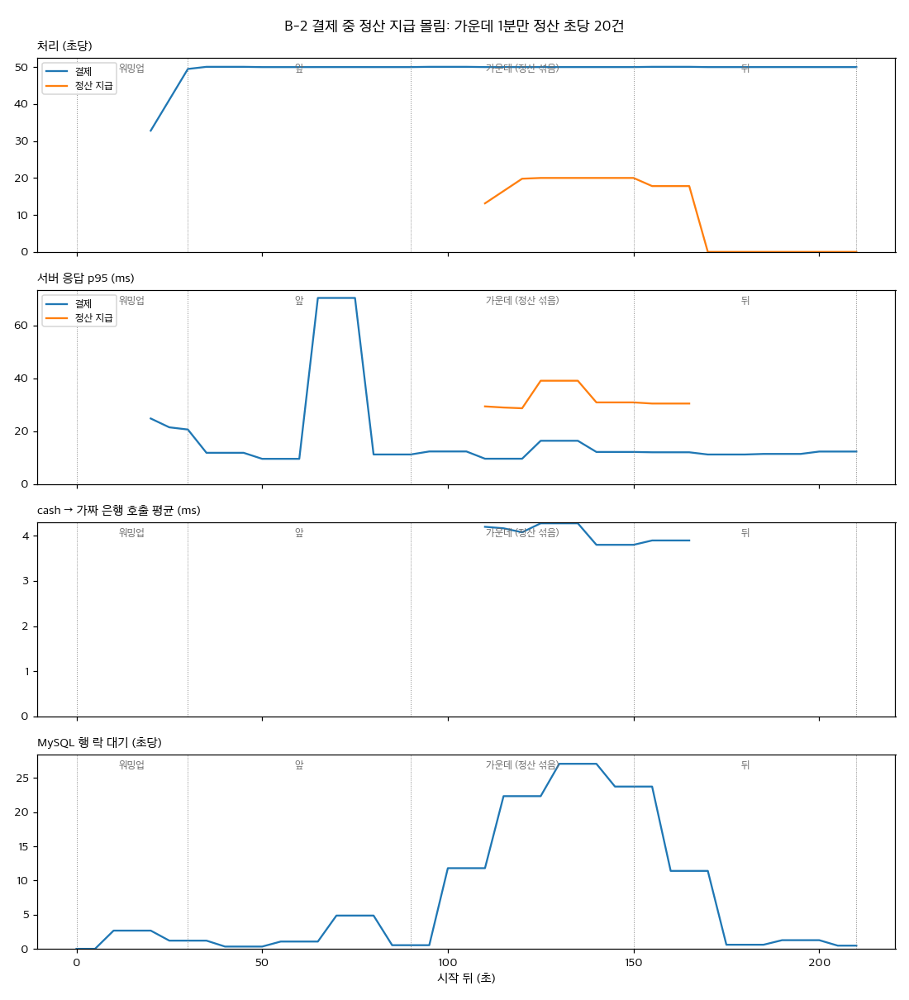
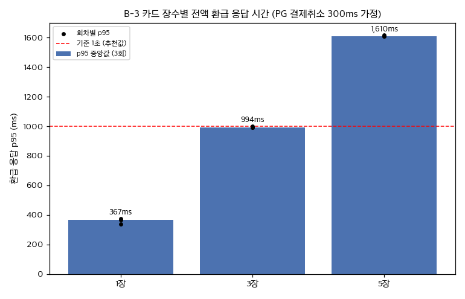
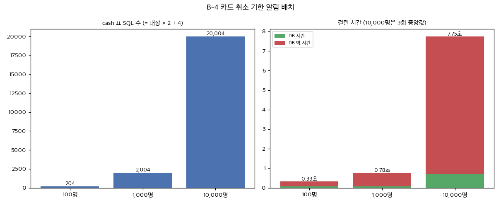

# 예치금(cash) 부하 측정 (2026-11-16)

예치금 서비스 한 곳에 직접 부하를 걸어요.
운영 서버의 절대 성능이 아니라, 맥 한 대에서 cash만 띄워 잰 숫자예요. 같은 조건으로 다시 잴 수 있게 실행 조건과 원본을 함께 남겨요.

시나리오 A(대회 접수 오픈)는 게이트웨이부터 결제까지 전체 흐름을 봤어요. 그때 결제는 초당 4건이라 cash에는 부하가 거의 없었어요.
시나리오 B는 cash API를 직접 불러 cash 한 곳의 한계를 봐요. 판정 기준은 측정 전에 정해 적어 두고, 숫자를 보고 바꾸지 않았어요.

- 스크립트와 실행 안내: [`backend/loadtest/scenario-b/README.md`](../../backend/loadtest/scenario-b/README.md)
- 원본(k6 요약·확인 SQL 출력·맥 기록): [`backend/loadtest/scenario-b/results/`](../../backend/loadtest/scenario-b/results/)
- 함께 보면 좋은 측정: [주문 결제 잠금 A·B](2026-11-14-결제-잠금-A-B.md) 5장 「예치금」. 거기서는 동시 20건이라 예치금의 홀딩 지갑 잠금이 문제로 드러나지 않았어요.
- Linear: BUK-11

## 1. 한 줄 결론

- **B-1:** 초당 결제 100건까지는 p95 9ms예요. 200건부터 처리량이 초당 약 190건에서 막히고 p95가 4.4초(400건에서 10.3초)로 늘어요.
  그때 DB 연결 10개가 모두 차고 요청 약 190개가 연결을 기다려요. 결제의 57%가 행 락을 기다렸고 cash CPU는 8% 아래였어요.
- **B-2:** 결제 초당 50건에 정산 지급 초당 20건을 섞어도 결제 p95는 13ms로 앞뒤 구간(16ms·12ms)과 같아요. 이 정도 부하에서는 정산이 결제를 늦추지 않아요.
- **B-0:** 같은 정산 번호로 동시에 50번 요청하면 9건이 500을 받아요. 돈은 맞았어요(어긋난 금액·건수 0).
- **B-3:** 환급 응답 시간이 카드 장수에 비례해요. 3장부터 기준(p95 1초)에 닿아요(3장 0.99초, 5장 1.61초).
- **B-4:** 기한 알림 배치의 SQL 수가 대상 수 × 2 + 4로 늘어요. 다만 10,000명일 때 걸린 7.75초 중 DB 시간은 0.7초예요.

| | 무엇을 봤나 | 결과 | 판정 |
|---|---|---|---|
| B-0 | 같은 주문·같은 정산 동시 요청, 결제→환불·정산 섞기 | 같은 정산 50번 동시에 **9건이 500 오류**. 돈은 맞음 | 실패 |
| B-1 | 초당 결제를 20→400건으로 올림 | 초당 100건까지 p95 9ms. **초당 약 190건에서 막히고** p95 4.4초(200건)·10.3초(400건) | 실패 |
| B-2 | 결제 중 정산 지급이 몰림 | 정산이 섞인 동안 결제 p95 13ms (앞 16ms, 뒤 12ms) | 통과 |
| B-3 | 카드 1·3·5장 회원의 전액 환급 | p95 367ms · 994ms · **1.61초**. 장수에 비례 | 5장 실패 |
| B-4 | 카드 취소 기한 알림 배치 | 10,000명에 **SQL 20,004개, 7.75초**. 그중 DB 시간 0.7초 | 실패 |

돈 확인(원장 합, 중복 원장, 잔액과 마지막 원장)은 모든 실행에서 어긋남 0이었어요. 데드락·락 대기 시간 초과도 0이었어요.

## 2. 실행 조건

| 항목 | 값 |
|---|---|
| 코드 | B-0·B-1·B-3·B-4: `cd397860`(그때의 dev) + 측정 도구와 cash 측정용 설정 두 개. 측정 때는 커밋 전이었고, 뒤에 `13ec6886`·`a2658682`로 커밋했어요 |
| | B-2: `a8480649` (최신 dev를 합치고 cash HTTP 클라이언트가 `RestClient.Builder`를 받게 바꾼 뒤) |
| 측정용 설정 | 가짜 PG 결제취소 지연(`cash.clients.pg.fake-cancel-delay`, 기본 0), 기한 알림 cron(`cash.withdrawal.deadline-notice.cron`, 기본 매일 09:00) |
| 들어오지 않은 PR | B-0·B-1·B-3·B-4 때 #514(내부 API 키), #525(지갑 음수 방지), #532(결제 금액 확인). 셋 다 메모리 안 비교만 더해 DB·네트워크 호출은 같아요. B-2 때는 #514가 들어와 있었어요 |
| 컴퓨터 | 맥 한 대(10코어, 16GB), Docker에 6GB |
| 띄운 것 | cash만 bootRun(`run-env.sh`: dev·monitoring 프로필, 로그 info, 추적 샘플링 0.1). MySQL·Kafka·Redis·모니터링은 compose |
| 부르는 곳 | k6가 cash API를 직접 불러요. 게이트웨이·주문은 거치지 않아요 |

**모든 시나리오 공통**

- 테스트 회원은 900001번대만 만들고 지워요(`sql/01-seed.sql`, `sql/99-cleanup.sql`). 다른 로컬 데이터와 홀딩·시스템 지갑 잔액은 그대로 둬요.
- 결제 회원 1,000명(900001~901000)은 지갑마다 1,000만 원(잔액 상한)을 넣어 잔액 부족이 나지 않게 해요. 판매자는 50명(990001~990050)이에요.
- 주문·정산 번호는 `900,000,000 + 실행 번호(RUN) × 1,000,000 + 순번`이라 실행끼리 겹치지 않아요.
- 실행마다 끝나고 `verify.sh`로 돈을 확인해요. 다섯 가지 모두 0이어야 통과예요.
  1. 돈 보존: 이번 실행의 원장 합 + 은행으로 나간 정산 대금 = 0
  2. 결제와 회원 원장: 결제됨이면 회원 원장 합이 −결제액, 환불됨이면 0
  3. 중복 원장: 같은 주문에 같은 방향 원장이 두 줄 이상
  4. 정산과 홀딩 원장: 홀딩에서 빠진 금액 = 송금 기록 금액
  5. 잔액과 마지막 원장: 지갑 잔액 = 마지막 원장의 거래 후 잔액
- MySQL 락 통계(데드락, 락 대기 시간 초과, 행 락 대기 횟수·시간)는 실행 전후 누적값 차이로 봐요.

시나리오마다 조건이 조금 달라요.

| | B-0·B-3·B-4 | B-1 | B-2 |
|---|---|---|---|
| 시각 | 15:27~15:37 | 15:48~15:59 | 17:29~17:33 |
| 다른 프로젝트 컨테이너 5개 | 떠 있음 | 멈춤 | 멈춤 |
| 가짜 PG 결제취소 지연 | 300ms | 없음(기본값) | 없음(기본값) |
| 기한 알림 배치 | 매분 0초 | 매일 09:00(기본값) | 매일 09:00(기본값) |
| 맥 상태 (5초마다 기록) | 메모리 여유 33~44% (`2026-11-16-mac.log`) | 메모리 여유 32~55%, CPU 여유 최저 37% (`2026-11-16-b1-mac.log`) | 메모리 여유 33~44%, CPU 여유 최저 50% (`2026-11-16-b2-mac.log`) |

## 3. 판정 기준 (측정 전에 정함)

근거 없이 고른 값에는 「추천값(미확정)」을 붙였어요. 팀 공통 응답 시간 기준은 아직 정해지지 않았어요.

| 대상 | 기준 | 근거 |
|---|---|---|
| 결제 | p99 < 1초 | 주문이 예치금 응답을 2초까지 기다려요(`order.clients.timeout`). 넘으면 주문이 503으로 끝나요. 그 절반 |
| 결제 | p95 2초 이상이면 경보 | 기획 건강 지표 H7 |
| 돈 | 어긋난 금액·건수 0, 데드락·락 대기 시간 초과 0 | 건강 지표 H5(중복 결제 0)·H6(예치금 장부 불일치 0원) |
| 결제 | p95 < 200ms | 추천값(미확정). 시나리오 A의 결제 p95 약 60ms의 세 배쯤 |
| 환급 | p95 < 1초 | 추천값(미확정). 화면에서 기다리는 요청이라 시나리오 A의 쓰기 기준(근거 기록 없음)과 같은 값 |
| 결제·환급 | 실패 < 1% | 추천값(미확정). 시나리오 A와 결제 잠금 측정(`2026-11-13-결제-잠금-판정기준.md`)이 같은 값을 써요 |
| 결제 | 버려진 반복 0 | 추천값(미확정). 목표 속도를 못 따라가면 생겨요. 처리량 천장의 신호 |
| 배치 | 대상이 10배일 때 SQL이 10배로 늘지 않음 | 추천값(미확정). 운영 기준이 없어 대상 수에 비례하는지를 봐요 |

## 4. B-1 결제 처리량 한계 (RUN 12, 15:48~15:59)

**어떻게 쟀나** (`b1-payment-ramp.js`)

| 항목 | 값 |
|---|---|
| 부르는 API | 결제 `POST /internal/v1/cash/payments/{주문 번호}` (주문 서비스가 부르는 내부 API) |
| 요청 | 결제 회원 1,000명 중 무작위 1명, 결제 1건 1만 원, 주문 번호는 매번 새로 |
| 부하 | 도착 속도를 고정해 보내요(k6 `constant-arrival-rate`). 응답이 느려도 정해진 속도로 계속 보내요 |
| 단계 | 워밍업 초당 10건 30초(판정에서 뺌) → 초당 20 · 50 · 100 · 200 · 400건을 2분씩 |
| 단계를 고른 이유 | 운영에서 초당 몇 건이 오는지 정해지지 않아, 시나리오 A의 결제(초당 4건)의 5배부터 100배까지 올려 천장을 찾았어요 |
| VU(동시 사용자 수) | 단계마다 목표의 2배를 미리 만들고 4배까지 늘려요. 응답이 2초까지 늘어도 버티게 잡았어요. 모자라면 버려진 반복으로 보여요 |
| 성공 판정 | 응답 200이고 `outcome`이 결제됨(PAID) |
| 보는 숫자 | k6: 단계별 p50·p95·p99, 실패율, 버려진 반복. 서버: 처리량, DB 연결, 행 락 대기, CPU |

B-0·B-3·B-4보다 늦게, 다른 프로젝트 컨테이너 5개를 멈추고 쟀어요. cash는 PG 지연·알림 cron 없이(기본값) 새로 띄웠어요.

| 목표 (초당) | 실제 처리 (초당) | p50 | p95 | p99 | 실패 | 버려진 반복 | 판정 |
|---|---|---|---|---|---|---|---|
| 20 | 20.0 | 11ms | 19ms | 56ms | 0% | 0 | 통과 |
| 50 | 50.0 | 8ms | 12ms | 74ms | 0% | 0 | 통과 |
| 100 | 100.0 | 7ms | 9ms | 16ms | 0% | 0 | 통과 |
| 200 | **196.7** | 18ms | **4.4초** | **5.2초** | 0% | 약 640 | **실패** (p95 2초 경보선도 넘음) |
| 400 | **171.7** | 9.4초 | **10.3초** | **10.3초** | 0% | 약 26,640 | **실패** |

- 실제 처리는 서버가 센 초당 결제 수(`http_server_requests_seconds`)예요. 400건을 보내도 200건 때보다 덜 처리했어요. 기다리는 요청이 늘수록 처리량이 떨어져요.
- 버려진 반복은 모두 27,282건이에요. 스크립트가 단계별로 나누지 못해(태그 문제, 지금은 고침) 목표 건수 − 보낸 건수로 나눴어요.
- 실패가 0%인 건 cash가 결국 다 처리했기 때문이에요. 실제 흐름에서는 주문이 2초에 끊으므로, 초당 200건부터 결제 상당수가 503으로 끝나요.

**단계별 서버 상태** (Prometheus, 단계 끝 10초는 뺌)

| 목표 (초당) | DB 연결 사용 최대 | DB 연결을 기다린 요청 최대 | 연결 얻는 시간 평균 | 행 락 대기 (초당) | 행 락 평균 대기 | cash CPU 최대 |
|---|---|---|---|---|---|---|
| 20 | 1 | 0 | 0.2ms | 0.2 | 41ms | 1.9% |
| 50 | 0 | 0 | 0ms | 0.5 | 31ms | 3.0% |
| 100 | 0 | 0 | 0ms | 1.3 | 8ms | 4.5% |
| 200 | **10** (전부) | **189** | **294ms** | **127** | 38ms | 6.9% |
| 400 | **10** (전부) | **190** | **1.1초** | **171** | 52ms | 7.6% |

- 실행 전후 MySQL 누적값 차이: 행 락 대기 37,177번(결제 65,423건의 57%), 기다린 시간 합 1,687초. 데드락·락 대기 시간 초과 0.



그래프는 서버 지표(Prometheus, 15초마다 수집, 30초 구간 비율)라 k6 숫자보다 15~20초쯤 늦게 바뀌어요. 서버 p95는 Tomcat 작업 스레드가 요청을 잡은 뒤부터 잰 값이에요. 스레드(최대 200개)를 기다린 시간이 빠져서 k6 p95보다 작아요. 초당 400건에서 서버 p95는 약 1.4초, k6 p95는 10.3초예요.
- 돈 확인 5가지 모두 0 (결제 65,423건 모두 완료).

**읽은 것과 아직 모르는 것**

- CPU는 8% 아래라 계산이 막힌 게 아니에요. 요청이 DB 연결(10개)을 기다리고, 연결을 가진 요청은 행 락을 기다려요.
- 결제마다 회원 지갑과 홀딩 지갑을 잠가요. 회원은 1,000명 중 무작위라 같은 회원끼리 겹칠 일은 드물어요.
  그래서 기다린 행은 대부분 홀딩 지갑으로 **보여요**. 다만 어느 행에서 기다렸는지 행 단위로 확인하지는 않았어요(`performance_schema.data_lock_waits`를 부하 중에 찍어야 해요).
- 홀딩 지갑 한 행에서 결제가 한 줄로 선다면, 처리량 천장 = 1 ÷ (홀딩 지갑을 잡고 있는 시간)이에요. 초당 약 190건이면 한 건이 약 5ms 잡고 있는 셈이에요.
- DB 연결 10개도 함께 막혀요. 다만 연결이 락을 기다리느라 묶인 것이라, 연결 수만 늘려서는 천장이 오르지 않을 거라고 봐요(재 보지 않음).

## 5. B-2 결제 중 정산 지급 몰림 (RUN 13, 17:29~17:33)

**어떻게 쟀나** (`b2-payment-with-payout.js`)

| 항목 | 값 |
|---|---|
| 부르는 API | 결제 `POST /internal/v1/cash/payments/{주문 번호}`, 정산 지급 `POST /internal/v1/cash/payouts/{정산 번호}` |
| 결제 | B-1과 같은 요청을 초당 50건. 워밍업 30초 뒤 앞·가운데·뒤 1분씩 |
| 정산 지급 | 가운데 1분만 초당 20건. 판매자 50명 중 무작위, 최종 정산, 대금 1만 원·수수료 1천 원 |
| 고른 이유 | 결제와 정산 지급이 같은 홀딩 지갑 행을 잠가요. 정산은 운영에서 04:00 배치로 몰려 와요. 결제 초당 50건은 B-1에서 여유 있던 속도예요. 정산 초당 20건은 추천값(미확정)이고, 실제 정산 배치가 초당 몇 건을 보내는지는 확인하지 않았어요 |
| 은행 | cash 안의 가짜 은행을 HTTP로 불러요. 송금은 모두 바로 성공해요 |
| 성공 판정 | 결제는 200·결제됨, 정산은 200 |
| 보는 숫자 | k6: 구간(앞·가운데·뒤)별 결제 p50·p95·p99. 서버: 결제·정산 처리량과 p95, 은행 호출 시간, 행 락 대기 |

cash HTTP 클라이언트를 `RestClient.Builder`로 바꾼 뒤라 cash → 가짜 은행 호출 시간이 따로 보여요.

| 구간 | 결제 p50 | 결제 p95 | 결제 p99 | 결제 최대 | 판정 (p95 < 200ms, p99 < 1초) |
|---|---|---|---|---|---|
| 앞 (정산 없음) | 7.8ms | 15.9ms | 86ms | 329ms | 통과 |
| **가운데 (정산 초당 20건)** | 7.0ms | **13.2ms** | 31ms | 127ms | 통과 |
| 뒤 (정산 없음) | 8.3ms | 11.9ms | 25ms | 125ms | 통과 |

- 결제 10,503건·정산 지급 1,201건 모두 성공, 버려진 반복 0이에요.
- 돈 확인 5가지 모두 0이에요. 실행 전후 행 락 대기 1,641번, 기다린 시간 합 13.2초, 데드락·락 대기 시간 초과 0이에요.

**구간별 서버 상태** (Prometheus, 구간 끝 10초는 뺌)

| 구간 | 결제 처리 (초당) | 결제 서버 평균 | 정산 서버 평균 | 은행 호출 평균 · 최대 | 행 락 대기 (초당) | 행 락 평균 대기 | DB 연결 사용·대기 최대 | cash CPU 최대 |
|---|---|---|---|---|---|---|---|---|
| 앞 | 50.0 | 12.6ms | - | - | 2.7 | 48ms | 1 · 0 | 2.5% |
| 가운데 | 50.0 | 7.9ms | 20.2ms | 4.0ms · 42ms | **25.4** | 4.9ms | 1 · 0 | 4.4% |
| 뒤 | 50.0 | 8.5ms | - | - | 0.9 | 28ms | 0 · 0 | 2.9% |

**읽은 것과 아직 모르는 것**

- 정산이 섞인 동안 행 락 대기는 초당 2.7번 → 25.4번으로 늘었지만, 한 번 기다리는 시간은 평균 4.9ms라 결제 응답에 드러나지 않았어요.
- 정산 한 건은 서버에서 평균 20ms 걸리고 그중 은행 호출이 평균 4ms예요. 은행은 홀딩 지갑 잠금을 잡지 않은 채 불러요(`CashPayoutUseCase`: 기록 → 은행 → 결과 반영).
- 이 부하에서 홀딩 지갑을 잠그는 일은 초당 약 90번(결제 50 + 정산마다 기록·결과 반영 2번 × 20)이에요. B-1의 천장(초당 약 190번)의 절반쯤이라 여유가 있어요.
  정산이 이보다 많이 몰리거나 결제가 초당 100건을 넘을 때 어떻게 되는지는 재지 않았어요.
- 앞 구간 결제 서버 평균(12.6ms)이 뒤(8.5ms)보다 높은 것은 워밍업 직후라서로 보여요(확인 안 함).



그래프는 서버 지표라 k6 구간보다 15~20초쯤 늦게 바뀌어요. 앞 구간 결제 p95가 잠깐 70ms로 튄 곳은 k6 앞 구간 p99(86ms)와 같은 때예요.

## 6. B-0 돈 정합성 (RUN 11)

**어떻게 쟀나** (`b0-integrity.js`)

| 묶음 | 내용 | 기대 |
|---|---|---|
| 같은 주문 동시 결제 | 회원 1명, 같은 주문 번호로 결제 100번을 한꺼번에 (VU 100개가 1번씩) | 100번 모두 결제됨으로 답하고 돈은 한 번만 빠짐 |
| 같은 정산 동시 지급 | 판매자 1명, 같은 정산 번호로 지급 50번을 한꺼번에 (10초 뒤 시작) | 1번만 송금. 나머지는 이미 지급됨(200) 또는 처리 중(503) |
| 결제→환불 섞기 | 초당 30건, 결제가 되면 바로 환불, 1분 (20초 뒤 시작) | 모두 성공, 원장 합 0 |
| 정산 지급 섞기 | 초당 10건, 정산 번호는 매번 새로, 1분 (위와 같이) | 모두 성공 |

판정은 응답이 아니라 `verify.sh`(돈 확인 5가지)로 해요. 응답이 모두 200이어도 돈이 두 번 빠졌을 수 있어서예요.

| 확인 | 결과 | 판정 |
|---|---|---|
| 돈 보존·결제 원장·중복 원장·정산 원장·잔액 (5가지) | 모두 0 | 통과 |
| 데드락·락 대기 시간 초과 | 0 · 0 | 통과 |
| 같은 주문 결제 100개 동시 | 100건 모두 200·결제됨, 돈은 한 번만 빠짐 | 통과 |
| **같은 정산 지급 50개 동시** | **41건 200 또는 503, 9건 500** | **실패** |
| 결제→환불 1,800건, 정산 지급 600건 섞기 | 모두 200 | 통과 |

- 행 락 대기: 1,463번, 합 10.1초 (실행 전후 차이)
- 같은 날 스모크(RUN 1)에서도 50건 중 49건이 500이었어요. 처음 정산이 은행을 부르는 동안 나머지가 몰린 경우예요.

**500의 원인 (로그와 코드로 확인)**

로그에는 `Duplicate entry '<정산 번호>-FEE' for key cash_payout_transfer...`가 남아요.
`CashPayoutUseCase.recordRequestLocked`가 홀딩 지갑을 잠그기 전에 판매자 조회(`resolveSellerMemberId`, 일반 SELECT)를 먼저 해요.
MySQL(REPEATABLE READ)은 트랜잭션의 첫 일반 SELECT 때 읽기 기준 시점을 잡아요. 그래서 잠금을 기다렸다가 얻은 뒤에도, 앞 요청이 그 사이 커밋한 송금 기록이 보이지 않아요.
→ 같은 송금 기록을 다시 넣으려다 유니크 키에 걸려 500이 나요. 유니크 키가 막아서 돈이 두 번 나가지는 않아요.

같은 주문 결제는 잠금을 먼저 잡고 그 뒤에 결제 기록을 읽어서 이 문제가 없어요.

## 7. B-3 환급 카드 장수별 응답 시간 (3회, 회원 30명씩, 동시 10명)

**어떻게 쟀나** (`b3-withdrawal.js`, `seed-withdrawal.sh`)

| 항목 | 값 |
|---|---|
| 부르는 API | 전액 환급 `POST /api/v1/cash/withdrawals` (회원 화면에서 부름, `X-Member-Id`·`Idempotency-Key` 헤더) |
| 데이터 | 카드 1장·3장·5장 회원을 30명씩. 카드 충전은 장마다 1만 원, 하루 전에 승인돼 모두 결제취소 기한 안이에요. 잔액 = 장수 × 1만 원 |
| 요청 | 계좌 정보 없이 보내요. 모두 카드로 돌려줄 수 있어서 카드 결제취소만 나가요 |
| 부하 | 장수마다 동시 10명이 30명을 나눠 처리(k6 `shared-iterations`), 장수끼리는 30초 간격 |
| PG | 가짜 PG 결제취소에 300ms 지연을 넣어요(`CASH_CLIENTS_PG_FAKE_CANCEL_DELAY=300ms`). 실제 PG처럼 시간이 걸리게 한 가정값이에요 |
| 반복 | 3번. 환급하면 잔액이 0이 되므로 매번 시드부터 다시 넣어요 |
| 보는 숫자 | 장수별 p50·p95, 실패율, 환급·결제취소 완료 건수 |

암호화된 PG 결제 키는 SQL로 만들 수 없어서, 909999번 회원으로 충전 API를 한 번 불러 앱이 만든 암호문을 다른 충전 기록에 복사해요(가짜 PG는 키 값을 보지 않아요).

| 카드 장수 | 1회 p95 | 2회 p95 | 3회 p95 | p95 중앙값 | 중앙값(3회 중앙값) | 판정 (p95 < 1초, 추천값) |
|---|---|---|---|---|---|---|
| 1장 | 367ms | 337ms | 374ms | **367ms** | 333ms | 통과 |
| 3장 | 991ms | 1,000ms | 994ms | **994ms** | 969ms | 경계 (2회에서 넘음) |
| 5장 | 1.62초 | 1.61초 | 1.61초 | **1.61초** | 1.60초 | 실패 |

- 실패 0건, 90건 모두 환급 완료(카드 결제취소 270건 완료)
- 응답 시간 ≈ 장수 × 300ms(가짜 PG 지연) + 약 35ms. 결제취소를 한 장씩 차례로 부르는 코드(`CashWithdrawalUseCase`)와 맞아요.
- 실제 Toss 결제취소 시간은 재지 않았어요. 300ms는 가정이에요.



## 8. B-4 카드 취소 기한 알림 배치

**어떻게 쟀나** (`b4-notice.sh`, `seed-notice.sh`)

| 항목 | 값 |
|---|---|
| 대상 | 카드 결제취소 마지막 날이 정확히 3일 뒤인 충전(1만 원)이 하나씩 있는 회원 100 · 1,000 · 10,000명. 잔액도 1만 원 |
| 실행 | 원래 매일 09:00인 배치를 매분 0초로 바꿔(`CASH_WITHDRAWAL_DEADLINE_NOTICE_CRON`) 한 번 돌 때를 재요 |
| 걸린 시간 | Spring이 예약 작업마다 남기는 기록(`tasks_scheduled_execution_seconds`)의 실행 전후 차이. 회원마다 알림을 Kafka로 보내는 시간도 들어 있어요 |
| SQL 수·DB 시간 | 배치 2초 전에 MySQL 문장 통계(`performance_schema`)를 비우고, 한 번 실행한 몫의 cash 표 문장만 세요 |
| 반복 | 100·1,000명은 1번, 10,000명은 3번 |
| 시드 날짜 | 승인일 = 오늘 + 4일 − 1년이라, 시드를 넣은 날에만 대상이 돼요 |

| 대상 | 걸린 시간 | cash 표 SQL 수 | 그중 DB 시간 |
|---|---|---|---|
| 100명 | 0.33초 | 204 | 83ms |
| 1,000명 | 0.78초 | 2,004 | 79ms |
| 10,000명 (3회) | 7.04 · 7.75 · 8.18초 (중앙값 **7.75초**) | 20,004 | 709 · 680 · 869ms |

- SQL 수 = 대상 × 2 + 4예요. 회원마다 지갑 조회 1번(`SELECT ... cash_wallet`)과 충전 조회 1번(`SELECT ... cash_wallet_charge`)이 나가요.
  → 기준(대상이 10배일 때 SQL이 10배로 늘지 않음, 추천값)으로 보면 **실패**예요.
- **10,000명일 때 걸린 시간 중 DB 시간은 약 10%예요.** 나머지 약 7초가 어디에 쓰이는지는 아직 확인하지 않았어요.
  같은 배치가 회원마다 알림 메시지를 Kafka로 보내므로 그 시간일 수 있지만, 추적으로 확인하기 전까지는 짐작이에요.
  → SQL을 줄여도 걸린 시간은 크게 줄지 않을 수 있어요. 고치기 전에 시간이 어디에 쓰이는지 먼저 봐야 해요.
- 걸린 시간은 Spring이 예약 작업마다 남기는 기록(`tasks_scheduled_execution_seconds`)이에요. 알림을 Kafka로 보내는 시간도 들어 있어요.
- SQL 수는 배치 직전에 MySQL 문장 통계(`performance_schema`)를 비우고 한 번 실행한 몫만 셌어요.



## 9. 발견한 문제

### 문제 1. 결제가 초당 약 190건에서 막힘 (B-1)

- **보인 것:** 초당 200건부터 DB 연결 10개가 모두 차고, 연결을 기다리는 요청이 190개까지 쌓여요. 결제의 57%가 행 락을 기다렸어요. CPU는 8% 아래예요.
  → 계산이 느린 게 아니라 줄을 서서 기다려요.
- **원인 (추정):** 결제마다 회원 지갑과 홀딩 지갑(주문 대금을 정산 전까지 맡아 두는 지갑) 행을 잠가요(`CashSupport.lockCustomerAndHoldingWallets`). 회원은 1,000명 중 무작위라 서로 겹칠 일이 드물어요.
  그래서 기다린 행은 대부분 홀딩 지갑으로 보여요. 모든 결제가 이 한 행에서 한 줄로 서면, 처리량 천장은 1 ÷ (한 건이 잠금을 쥐는 시간)이에요. 초당 190건이면 약 5ms씩 쥐는 셈이에요.
- **확인 못 함:** 어느 행에서 기다렸는지 행 단위로는 보지 않았어요. 연결 수를 늘려 보지도 않았어요.
- **개선을 확인할 숫자:** 초당 200·400건 단계의 실제 처리량, p95·p99, 행 락 대기 (초당)

### 문제 2. 같은 정산을 동시에 지급하면 500 오류 (B-0)

- **보인 것:** 로그에 `Duplicate entry '<정산 번호>-FEE' for key cash_payout_transfer...`가 남아요.
- **원인 (코드로 확인):** 정산 지급(`CashPayoutUseCase.recordRequestLocked`)이 홀딩 지갑을 잠그기 **전에** 판매자 조회(일반 SELECT)를 먼저 해요.
  MySQL은 트랜잭션의 첫 일반 SELECT 때 읽기 기준 시점을 잡아요. 그래서 잠금을 기다렸다가 얻은 뒤에도, 앞 요청이 그 사이 저장한 송금 기록이 보이지 않아요.
  → 같은 송금 기록을 또 넣으려다 유니크 키에 걸려 500이 나요.
- **영향:** 유니크 키가 막아서 돈이 두 번 나가지는 않아요. 하지만 정산 서비스는 「이미 지급됨」 대신 서버 오류를 받아요.
  같은 주문 결제는 잠금을 먼저 잡고 결제 기록을 읽어서 이 문제가 없어요.
- **개선을 확인할 숫자:** 같은 정산 50번 동시 지급에서 500이 0건인지

### 문제 3. 환급 응답 시간이 카드 장수에 비례 (B-3)

- **보인 것:** 응답 시간 ≈ 장수 × PG 결제취소 시간이에요. 5장이면 1.6초예요.
- **원인 (코드로 확인):** 환급(`CashWithdrawalUseCase`)이 카드 결제취소를 한 장씩 차례로 불러요. 지갑 잠금은 PG를 부르는 동안 잡고 있지 않아요.
- **확인 못 함:** 실제 Toss 결제취소 시간은 재지 않았어요. 300ms는 가정이에요.
- **개선을 확인할 숫자:** 장수별 p95 (5장이 1장과 비슷해지는지)

### 문제 4. 기한 알림 배치의 SQL이 대상 수만큼 늘어남 (B-4)

- **보인 것:** SQL 수 = 대상 × 2 + 4예요. 회원마다 지갑 조회 1번과 충전 조회 1번이 나가요(`CashCardCancelDeadlineNoticeUseCase` → `CashRefundableChargeQueryUseCase`).
- **다만:** 10,000명일 때 7.75초 중 DB 시간은 0.7초(약 10%)예요. 나머지 약 7초가 어디에 쓰이는지는 아직 몰라요.
  회원마다 알림을 Kafka로 보내는 시간일 수 있지만 짐작이에요.
  → SQL만 줄여서는 걸린 시간이 크게 줄지 않을 수 있어요. 고치기 전에 추적으로 시간이 어디에 쓰이는지 먼저 봐야 해요.
- **개선을 확인할 숫자:** 10,000명일 때 SQL 수, 걸린 시간, DB 시간

B-2(결제 중 정산 몰림)에서는 문제가 보이지 않았어요(5장).

## 10. 한계

- 맥 한 대에서 cash만 띄우고 직접 부른 숫자예요. 운영의 네트워크·서버 크기와 다르고, 운영에서 초당 몇 건이 오는지도 정해지지 않았어요.
- 시나리오마다 조건(2장의 두 번째 표)이 달라요. 다시 잴 때는 시나리오마다 같은 조건을 맞춰요.
- B-1·B-2는 한 번만 쟀어요. B-3·B-4(10,000명)는 3번 쟀어요.
- B-2는 다른 시나리오와 코드가 달라요(최신 dev + `RestClient.Builder`). 결제 경로는 바뀌지 않았어요.

## 11. 다음 할 일

| 할 일 | 이유 |
|---|---|
| B-1 기다린 행 확인 | 부하 중에 MySQL 잠금 대기(`performance_schema.data_lock_waits`)를 찍어 홀딩 지갑인지 확정해요 |
| B-4 시간이 쓰이는 곳 확인 | 추적(Tempo)으로 배치 한 번의 구간을 나눠 봐요 |
| 문제 1~4 이슈 만들기 | 숫자로 확인된 것만 이슈로 만들어요. 문제 1·4는 위 확인을 먼저 해요 |

## 12. 다시 내는 법

[`README.md`](../../backend/loadtest/scenario-b/README.md) 「실행 순서」대로 해요. 이번에 쓴 순서와 번호예요.

1. B-0: `k6 run -e RUN=11 ...b0-integrity.js` → `verify.sh 11`
2. B-3: `seed-withdrawal.sh` → `b3-withdrawal.js`, 3번 (매번 시드부터)
3. B-4: `b4-notice.sh` 100 · 1000 · 10000 · 10000 · 10000
4. B-1: 다른 프로젝트 컨테이너를 모두 멈추고, cash를 PG 지연·알림 cron 없이 새로 띄운 뒤 `k6 run -e RUN=12 ...b1-payment-ramp.js` → `verify.sh 12`
5. B-2: B-1과 같은 조건으로 cash를 새로 띄운 뒤 `k6 run -e RUN=13 -e INTERNAL_API_KEY=... ...b2-payment-with-payout.js` → `verify.sh 13` (#514 뒤로는 내부 API 키가 필요해요)
6. 끝나면 `sql/99-cleanup.sql`로 정리해요. 홀딩·시스템 지갑 잔액도 테스트 전으로 돌아가요.

원본은 `results/`의 `2026-11-16-*` 파일이에요(k6 요약 json·txt, 확인 SQL 출력, B-4 출력, 맥 기록).

그래프는 `graph.py`로 만들어요(matplotlib 필요). B-1·B-2는 로컬 Prometheus에서 읽어서, 보관 기간(15일)이 지나면 다시 그릴 수 없어요.

```bash
python3 loadtest/scenario-b/graph.py b1 "2026-11-16 15:48:31" ../docs/measurements/img/2026-11-16-예치금-부하
python3 loadtest/scenario-b/graph.py b2 "2026-11-16 17:29:45" ../docs/measurements/img/2026-11-16-예치금-부하
python3 loadtest/scenario-b/graph.py b3 loadtest/scenario-b/results/2026-11-16 ../docs/measurements/img/2026-11-16-예치금-부하
python3 loadtest/scenario-b/graph.py b4 loadtest/scenario-b/results/2026-11-16 ../docs/measurements/img/2026-11-16-예치금-부하
```
