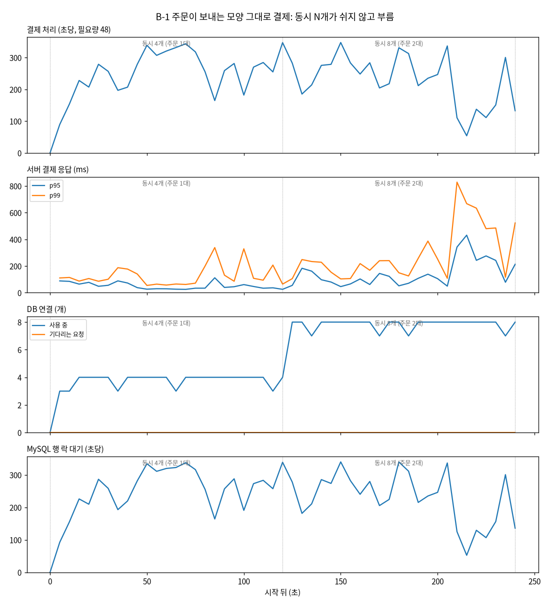
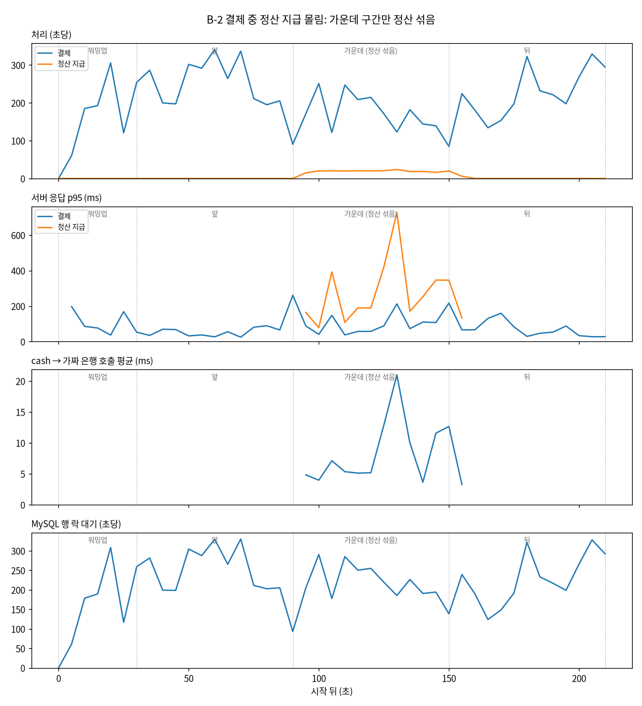
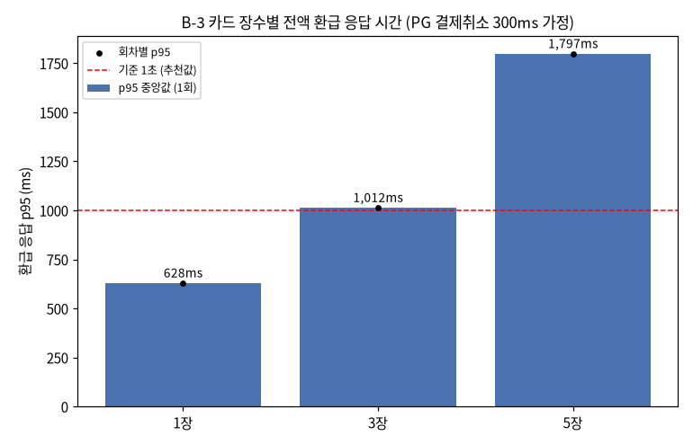
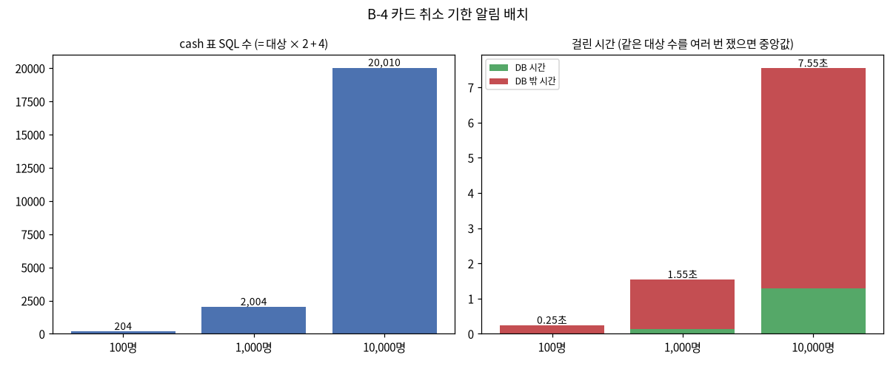
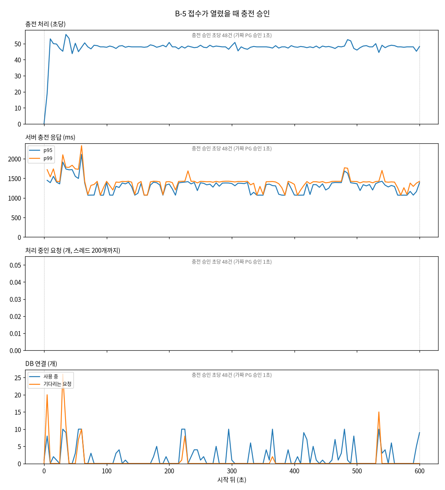

# 예치금(cash) 부하 측정: 지금 코드 기준선 (2026-11-17)

예치금을 고치기 전, 지금 코드(A)를 자원을 묶은 컨테이너에서 3번 잰 결과예요. 고친 뒤 A·B를 번갈아 다시 재서 이 숫자와 비교해요.
판정 기준은 측정 전에 커밋한 [판정 기준 문서](2026-11-16-예치금-부하-판정기준.md)를 그대로 썼어요. 숫자를 보고 기준을 바꾸지 않았어요.
맥에서 먼저 잰 [연습 측정](2026-11-16-예치금-부하.md)은 다른 컨테이너와 자원을 나눠 써서 비교에 쓰지 않아요.

- 실행: GitHub Actions [`cash-load-test` 실행 43900024578](https://github.com/prgrms-be-adv-devcourse/beadv8_5_BSB_MONO/actions/runs/43900024578) (PR #566에 라벨을 붙여 시작)
- 원본: [`backend/loadtest/scenario-b/results/2026-11-17-a/`](../../backend/loadtest/scenario-b/results/2026-11-17-a/) (k6 요약, 돈 확인 SQL, 락 통계, B-4 출력, 결과 정리 `summary.md`)
  - 예치금 로그(회차마다 약 200MB)와 그래프 원본은 Actions 아티팩트 `cash-load-results`에만 있어요. 2026-12-17에 지워져요.
- 그래프: 3회차 것을 [`img/2026-11-17-예치금-부하-기준선/`](img/2026-11-17-예치금-부하-기준선/)에 옮겼어요.
- Linear: BUK-11

## 1. 한 줄 결론

- **결제는 예상 트래픽에서 버텨요.** 주문 1대(동시 4개)에서 초당 259건, 2대(동시 8개)에서 초당 225건을 p99 250ms 아래로 처리해요. 필요한 양은 초당 48건이에요.
- **충전 승인도 버텨요.** 초당 48건을 10분 동안 보내도 p95 1.31초(가짜 PG 승인 1초 포함), 실패 0이에요.
- **돈은 세 번 모두 맞았어요.** 중복 원장·중복 충전·잔액 어긋남·데드락·락 대기 시간 초과가 모두 0이에요.
- 문제 있음은 다섯 개예요. 그중 셋(P4·P5·P6)은 연습에서 찾은 문제가 그대로 다시 나온 거예요.

| 번호 | 무엇 | 중앙값 | 판정 |
|---|---|---|---|
| P1 | B-1 결제 동시 4개 (주문 1대) | 초당 259건, p99 128ms | 통과 |
| P2 | B-1 결제 동시 8개 (주문 2대) | 초당 225건, p99 243ms | 통과 |
| P3 | B-2 정산 지급이 섞인 1분의 결제 | p99 227ms, 처리량이 앞 1분의 **72%** | **문제 있음** |
| P4 | B-0 같은 정산 50번 동시 지급 | 서버 오류(500) **9건** (세 번 모두 9건) | **문제 있음** |
| P5 | B-3 카드 5장 환급 p95 | **1.80초** | **문제 있음** |
| P6 | B-4 기한 알림 대상 100 → 10,000명 | SQL 204 → 20,004개 (**98배**) | **문제 있음** |
| P7 | B-5 충전 승인 초당 48건 | p95 1.31초, 실패 0% | 통과 |
| P8 | 어느 시나리오든 결제 p95 2초 이상 | B-0에서 **4.58초** | **문제 있음** |

P1·P2가 통과해서, 판정 기준 3-1대로 결제 잠금(홀딩 지갑)은 고치지 않아요.

## 2. 실행 조건

| 항목 | 값 |
|---|---|
| 코드 | `825e563e` (PR #566 머리. 이 브랜치의 측정 도구와 측정용 설정 포함) |
| 실행 머신 | GitHub Actions `ubuntu-latest` 한 대 (4 CPU, 16GB). A 3번을 한 머신에서 차례로 |
| 걸린 시간 | 00:46~02:17 (1시간 31분). 이미지 빌드 2분, 측정 1시간 29분 |
| 자원 제한 | 예치금 0.5 CPU·768MB, MySQL 1 CPU·2GB, Redpanda 0.25 CPU, Redis·mysqld-exporter 0.1 CPU, Prometheus 0.25 CPU, k6 1 CPU (`container/compose.load.yml`) |
| 예치금 설정 | 운영 프로필. 회원·PG는 가짜. 가짜 PG 승인 1초, 결제취소 300ms. 기한 알림 배치는 매분 0초 |
| 데이터 | 회차마다 빈 DB로 띄우고 시드를 넣어요 (`sql/01-seed.sql`, `seed-*.sh`) |
| 순서 | 예열(동시 2개 30초) → B-0 → B-1(동시 4·8개 각 2분) → B-2(1분씩 앞·가운데·뒤) → B-3 → B-4(100·1,000·10,000명) → B-5(초당 48건 10분) → B-5 한계(1,000명 동시). 1회차만 끝에 B-1 한계 |
| 돈 확인 | 시나리오마다 끝나고 `verify.sh`(C1~C6), 회차 끝에 락 통계(C7) |
| 판정 | 회차마다 값을 내고 3회의 중앙값으로 판정해요. 돈 확인만은 3회 모두 통과해야 해요 (`container/report.py`) |

## 3. 시나리오별 숫자 (3회)

| 항목 | 1회 | 2회 | 3회 | 중앙값 |
|---|---|---|---|---|
| B-1 동시 4개 처리량 (초당) | 259 | 224 | 266 | 259 |
| B-1 동시 4개 p95 / p99 (ms) | 51 / 128 | 64 / 174 | 51 / 99 | 51 / 128 |
| B-1 동시 8개 처리량 (초당) | 214 | 246 | 225 | 225 |
| B-1 동시 8개 p95 / p99 (ms) | 116 / 279 | 101 / 238 | 127 / 243 | 116 / 243 |
| B-2 앞 1분 결제 p95 (ms) | 75 | 64 | 57 | 64 |
| B-2 정산 섞인 1분 결제 p95 / p99 (ms) | 167 / 333 | 84 / 227 | 84 / 215 | 84 / 227 |
| B-2 정산 섞인 1분 처리량 ÷ 앞 1분 | 0.58 | 0.79 | 0.72 | 0.72 |
| B-0 같은 정산 동시 지급 500 (건) | 9 | 9 | 9 | 9 |
| B-0 결제 p95 (ms) | 4,319 | 4,579 | 5,177 | 4,579 |
| B-0 정산 지급 실패 (건, 판정 없음) | 91 | 84 | 129 | 91 |
| B-3 카드 1장 / 3장 / 5장 p95 (ms) | 480 / 1,094 / 1,596 | 519 / 1,027 / 1,815 | 628 / 1,012 / 1,797 | 519 / 1,027 / 1,797 |
| B-4 100명: SQL 수, 걸린 시간 | 204, 0.18초 | 204, 0.16초 | 204, 0.25초 | 204, 0.18초 |
| B-4 1,000명: SQL 수, 걸린 시간 | 2,004, 1.16초 | 2,004, 1.57초 | 2,004, 1.55초 | 2,004, 1.55초 |
| B-4 10,000명: SQL 수, 걸린 시간, DB 시간 | 20,004, 7.67초, 1.30초 | 20,004, 7.87초, 1.28초 | 20,010, 7.55초, 1.29초 | 20,004, 7.67초, 1.29초 |
| B-5 충전 p95 / p99 (ms) | 1,309 / 1,598 | 1,329 / 1,515 | 1,279 / 1,560 | 1,309 / 1,560 |
| B-5 실패율, 버려진 반복 | 0%, 0 | 0%, 0 | 0%, 0 | 0%, 0 |
| B-5 한계 p95 / 가장 느린 응답 (ms, 기록만) | 6,650 / 7,362 | 20,630 / 21,076 | 5,600 / 5,906 | 6,650 / 7,362 |
| B-5 한계 실패율 (기록만) | 0% | 0% | 0% | 0% |

돈 확인 C1~C7은 모든 회차, 모든 시나리오에서 0이에요. 회차 전체 행 락 대기는 11만~15만 번, 가장 오래 기다린 한 번은 0.86~1.59초였어요.

## 4. 시나리오별로 본 것

### B-1. 결제 동시 4·8개



- 동시 4개일 때 DB 연결 4개, 8개일 때 8개를 쓰고, 연결을 기다리는 요청은 0이에요. → 줄은 DB 연결이 아니라 행 락에서 서요.
- 초당 행 락 대기가 결제 처리량과 거의 같아요. 결제마다 홀딩 지갑 한 행을 잠그니 거의 모든 결제가 한 번씩 기다려요.
- 동시 8개로 늘려도 처리량은 오르지 않고(259 → 225) p99만 두 배가 돼요. 홀딩 지갑 한 행이 천장이에요.
- 그래도 천장이 필요량(초당 48건)의 4배 넘게 높아서 고치지 않아요.

**B-1 한계(1회차만, 판정 안 함).** 도착 속도를 올리면 초당 200건 단계에서 실제 처리량이 초당 171건, 400건 단계에서 175건에서 멈췄어요.
다만 이 측정은 아래 6장 1번 문제(기한 알림 배치가 매분 1만 명씩 돎)와 겹쳤어요. 초당 100건 단계의 p95 1.69초도 그 영향일 수 있어요. 고친 도구로 다시 재야 해요.

### B-2. 결제 중 정산 지급이 몰릴 때 (P3 문제 있음)



- 정산 지급(초당 20건)이 섞인 1분 동안 결제 처리량이 초당 120~250건에서 65~175건으로 떨어져요(3회차 그래프). → 3회 중앙값으로 앞 1분의 72%예요.
- 같은 동안 정산 지급의 p95는 1.3초까지 올라요. 가짜 은행 호출은 평균 40ms 아래라, 느려진 곳은 은행이 아니에요.
- 결제 p99는 227ms라 1초 기준에는 닿지 않았어요. 처리량 조건(80%)으로만 문제 있음이에요.

### B-0. 같은 요청이 동시에 몰릴 때 (P4·P8 문제 있음)

- 같은 주문 100번 동시 결제, 같은 충전 50번 동시 승인은 세 번 모두 맞게 끝났어요(한 번만 결제·충전됨).
- 같은 정산 50번 동시 지급은 세 번 모두 9건이 500이에요. 로그에 `Duplicate entry '<정산 번호>-FEE'`가 9번 남았어요.
- 결제→환불(초당 30건)과 정산 지급(초당 10건)을 함께 보낸 1분 동안 요청이 쌓였어요. k6의 가상 사용자가 200명 상한에 닿았고, 회차마다 276~358번은 요청을 보내지 못하고 버려졌어요.
  - 결제 p95가 4.3~5.2초예요. B-1·B-2에서는 결제 p95가 51~167ms라, 결제가 느려지는 건 B-0의 이 1분뿐이에요.
  - 정산 지급 84~129건이 실패했어요. 실패 건수가 회차마다 로그의 「송금 결과를 알 수 없습니다」 건수와 정확히 같아요.
    → 가짜 은행 호출이 5초 제한을 넘어 결과를 모름으로 두고 503을 답했어요. 돈은 맞았어요(C1~C5 0).

### B-3. 카드 장수별 전액 환급 (P5 문제 있음)



- 1장 0.52초, 3장 1.03초, 5장 1.80초로 장수에 비례해요. 3장부터 1초에 닿아요.
- 이번에는 앞에 버리는 예열 환급 10건을 넣어 1장 값이 막 띄운 직후의 느림으로 부풀지 않게 했어요(판정 기준 6장).

### B-4. 카드 취소 기한 알림 배치 (P6 문제 있음)



- SQL 수가 대상 × 2 + 4예요. 연습과 같아요.
- 10,000명일 때 7.67초 중 DB 시간은 1.29초(17%)예요. 나머지 6.4초가 어디에 쓰이는지는 아직 몰라요.
- 이번 측정에서는 알림이 Kafka로 한 건도 나가지 않고 바로 실패했어요(6장 3번). 그래서 걸린 시간에 실제 전송 시간은 들어 있지 않아요. → 알림이 제대로 나가면 더 길어질 수 있어요.

### B-5. 충전 승인 초당 48건 10분



- 10분 내내 초당 48건을 따라가고, 응답은 1.07~1.4초 사이예요. 가짜 PG 승인 1초를 빼면 예치금이 쓰는 시간은 0.1~0.4초예요.
- DB 연결 10개가 몇 번 다 차고 기다리는 요청이 최대 26개까지 생겼어요. 그때 무엇이 함께 돌았는지는 확인하지 않았어요. 매분 도는 기한 알림 배치(6장 1번)일 수 있어요.

**B-5 한계(1,000명 동시, 돈만 판정).** 세 번 모두 실패 0, 돈 확인 통과예요. 가장 느린 응답은 5.9초, 7.4초, 21.1초였어요.
2회차만 21초인 이유는 확인하지 못했어요. 그때(01:51:21~01:51:43)는 매분 0초에 도는 배치와 시각이 겹치지 않았어요.

## 5. 문제마다 원인

| 문제 | 원인 | 확인 정도 | 고친 뒤 볼 숫자 |
|---|---|---|---|
| P4 같은 정산 동시 지급 500 | 정산 지급(`CashPayoutUseCase.recordRequestLocked`)이 홀딩 지갑을 잠그기 **전에** 판매자를 일반 조회해요. MySQL은 트랜잭션의 첫 일반 조회 때 읽기 기준 시점을 잡아서, 잠금을 기다렸다 얻은 뒤에도 앞 요청이 저장한 수수료 기록이 보이지 않아요. → 같은 수수료 기록을 다시 넣다가 유니크 키에 걸려 500이에요 | 코드와 로그로 확인 (연습 문제 2와 같음) | B-0 같은 정산 50번에서 500이 0건 |
| P5 카드 5장 환급 1.8초 | 환급(`CashWithdrawalUseCase`)이 카드 결제취소를 한 장씩 차례로 불러요. 지갑 잠금은 PG를 부르는 동안 잡지 않아요 | 코드로 확인 (연습 문제 3과 같음) | B-3 5장 p95가 1장의 2배 안 (G3) |
| P6 기한 알림 SQL 98배 | 회원마다 지갑 조회 1번, 충전 조회 1번을 해요(`CashCardCancelDeadlineNoticeUseCase` → `CashRefundableChargeQueryUseCase`) | 코드로 확인 (연습 문제 4와 같음). 걸린 시간의 83%가 어디에 쓰이는지는 모름 | B-4 10,000명 SQL 수가 100명의 2배 안, 걸린 시간이 늘지 않음 (G4) |
| P3 정산이 몰리면 결제 처리량 72% | 결제와 정산 지급이 같은 홀딩 지갑 행을 잠가요. 정산 지급 한 번은 이 잠금을 두 번 잡고(기록할 때, 결과를 반영할 때), 잡은 동안 수수료 이동·원장 세 줄·송금 기록까지 해서 결제보다 오래 쥐어요 | 그래프와 코드로 본 **추정**. 정산이 잠금을 얼마나 오래 쥐는지는 재지 않았어요 | B-2 정산 섞인 1분 처리량 ÷ 앞 1분 |
| P8 B-0 결제 p95 4.6초 | **모름.** B-0만 느리고 B-1·B-2는 빨라요. 후보는 셋이에요. ① 예열이 30초뿐이라 B-0이 막 띄운 직후 첫 큰 부하를 받음(0.5 CPU에서 코드 최적화가 CPU를 나눠 씀) ② 결제·환불·정산이 함께 홀딩 지갑을 잠금 ③ 요청이 늦어지면 도착 속도는 그대로라 계속 쌓이는 시나리오 모양 | 확인 못 함. B-0에는 시간대별 그래프가 없어요 | B-0 그래프를 그리고, B-0을 B-1 뒤로 옮겨 다시 재서 후보를 가려요 |
| (판정 없음) B-0 정산 지급 실패 | 가짜 은행이 예치금 앱 안에 있고 예치금이 자기 자신을 HTTP로 불러요. 앱이 밀리면 이 호출도 같은 줄에 서서 5초 제한을 넘어요 | 실패 건수 = 로그의 「결과 모름」 건수로 확인. 왜 밀렸는지는 P8과 같이 모름 | P8과 함께 봐요 |

## 6. 측정하면서 찾은 다른 문제

### 1. 측정 도구: B-4가 끝난 뒤에도 기한 알림 배치가 매분 1만 명씩 돎

- 측정 도구는 배치가 매분 0초에 돌게 해 두고, B-4 시드(알림 대상 회원)를 지우지 않아요.
- 그래서 B-4 뒤의 B-5, B-5 한계, B-1 한계는 매분 1만 명 배치(약 7.6초, SQL 2만 개)와 함께 재졌어요.
  로그에서 알림 실패가 01:04~01:25(1회차) 매분 1만 건씩 찍혀요.
- B-5는 그래도 통과해서 판정은 그대로예요. 한계 두 개는 판정하지 않는 숫자예요.
- **A·B를 번갈아 재기 전에 고쳐요.** B-4가 끝나면 알림 대상 시드를 지우거나 배치 시각을 되돌려요. 그래야 A와 B 모두 깨끗한 조건으로 다시 재요.

### 2. 측정 도구: 그래프 두 개가 비어 있음

- B-0은 그래프를 그리지 않아요. 그래서 P8의 원인을 시간대별로 볼 수 없었어요.
- B-5 그래프의 「처리 중인 요청」 칸이 비어 있어요. 지표 이름이 맞지 않는 것으로 보여요(확인 안 함).

### 3. 예치금: 알림이 Kafka로 한 건도 나가지 않음 (추정, 재현 안 함)

- 세 회차 모두, 측정 중 첫 알림을 보내는 순간(B-4)부터 모든 알림이 실패했어요.
  로그: `알림을 보내지 못했습니다 (버림) … cause=java.util.concurrent.CompletionException: java.lang.ExceptionInInitializerError`,
  그 뒤로는 `NoClassDefFoundError: Could not initialize class org.apache.kafka.clients.producer.ProducerConfig`
- 추정 원인: common의 `NotificationKafkaSender`가 알림을 공용 ForkJoin 풀에서 보내요.
  jar로 띄운 앱(운영과 같은 방식)에서는 이 풀의 쓰레드가 앱 안의 라이브러리 클래스를 찾지 못한다고 알려져 있어요. bootRun(dev)에서는 생기지 않아요.
  그 쓰레드에서 Kafka 보내는 객체를 처음 만들면, Kafka 설정 클래스(`ProducerConfig`)를 불러오는 데 실패해요. 한 번 실패한 클래스는 앱을 다시 띄울 때까지 다시 불러오지 않아요.
- 맞다면: 앱이 뜬 뒤 첫 Kafka 전송이 알림이면, 그 앱의 Kafka 전송이 모두 막혀요. → 알림뿐 아니라 예치금의 회수 입금 메시지(`ClaimDepositedSender`)도 막혀요.
  같은 코드를 주문·회원·문의 서비스도 써요.
- 운영에서 알림이 실제로 안 나가고 있는지는 보지 않았어요. **재현부터 해요.**

## 7. 한계

- 공용 실행 머신에서 예치금 0.5 CPU로 잰 숫자예요. 운영 서버 크기와 다르고, 회차끼리도 흔들려요(B-2 처리량 비율 0.58~0.79).
- PG·회원·은행은 가짜예요. PG 승인 1초, 결제취소 300ms는 가정이에요.
- 예치금만 띄우고 k6가 직접 불러요. 게이트웨이·주문·대기열은 거치지 않아요.
- B-5, B-5 한계, B-1 한계는 매분 도는 기한 알림 배치와 겹쳤어요(6장 1번).
- 그래프는 3회차 것만 문서에 옮겼어요. 1·2회차 그래프는 아티팩트에 있어요.

## 8. 다음 할 일

| 할 일 | 이유 |
|---|---|
| 알림 Kafka 실패 재현 | 운영에서도 알림·회수 입금 메시지가 막힐 수 있어요 |
| 측정 도구 고치기: B-4 뒤 알림 대상 시드 정리, B-0 그래프, B-5 처리 중인 요청 칸 | 고친 뒤의 A·B 비교가 같은 조건이어야 해요 |
| P8 원인 가리기 | B-0을 B-1 뒤로 옮겨 재서, 막 띄운 직후의 느림인지 가려요 |
| P4·P5 고치기 | 원인이 코드로 확인됐어요 |
| P3·P6은 원인을 더 본 뒤 고칠지 정하기 | P3은 정산이 잠금을 쥐는 시간을, P6은 SQL 밖 6.4초가 어디에 쓰이는지를 먼저 봐요 |
| 고친 뒤 A·B 번갈아 3번 | 이 문서의 숫자와 같은 조건으로 비교해요 |

## 9. 다시 내는 법

PR에 `cash-load-test` 라벨을 붙이거나, 이 워크플로가 기본 브랜치에 들어간 뒤에는 Actions 탭에서 `cash-load-test`를 실행해요.
자세한 실행 방법은 [`backend/loadtest/scenario-b/README.md`](../../backend/loadtest/scenario-b/README.md) 「자원을 묶은 컨테이너에서 재기 (본 측정)」에 있어요.

로컬에서 한 바퀴만 짧게 돌려 볼 때(`backend/`에서):

```bash
QUICK=1 loadtest/scenario-b/container/run.sh
```
