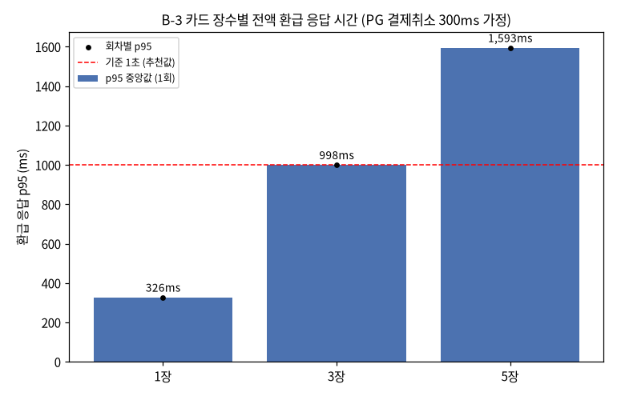
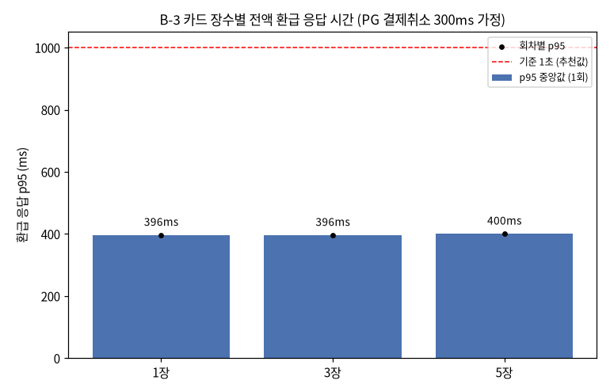
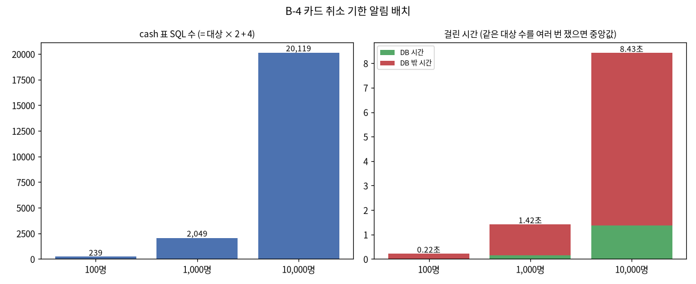
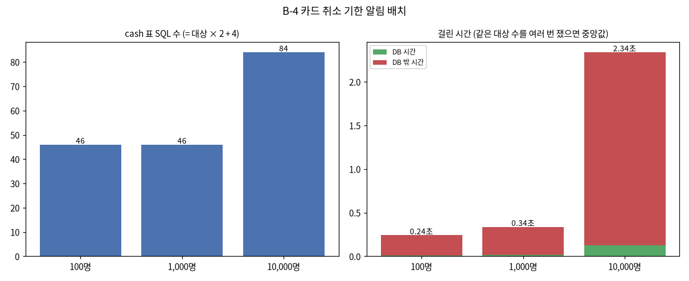
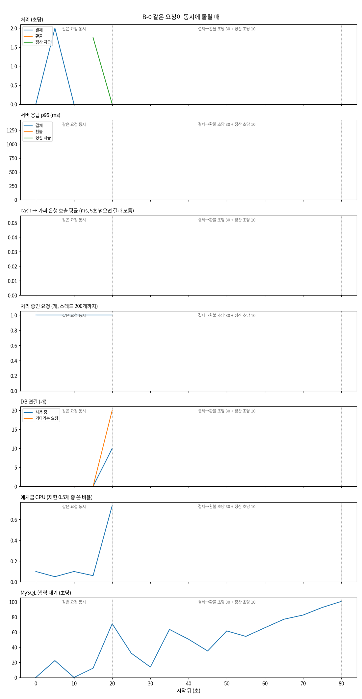
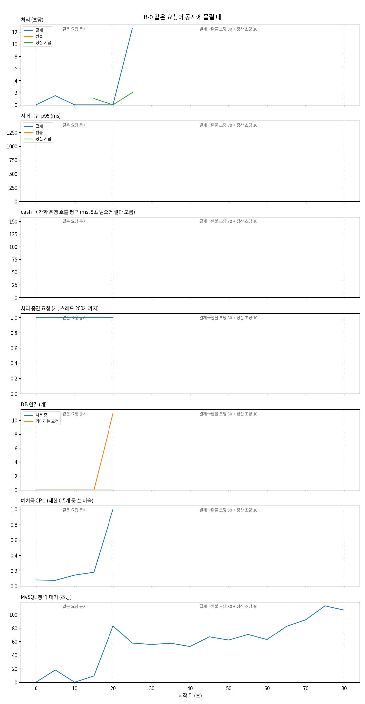
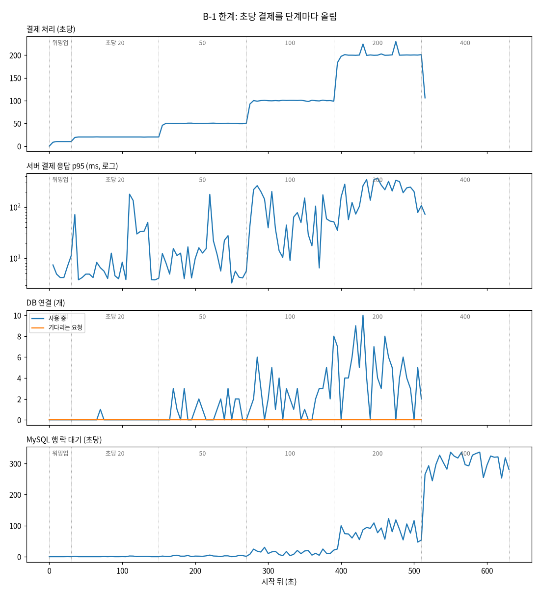

# 예치금(cash) 부하 측정: 고친 뒤 A·B 비교 (2026-11-17)

[기준선 측정](2026-11-17-예치금-부하-기준선.md)에서 「문제 있음」으로 나온 다섯 개 중 원인이 확인된 P4·P5·P6을 고쳤어요.
고치기 전 코드(A)와 고친 코드(B)를 같은 머신에서 번갈아 3번씩 재서 비교했어요.
판정 기준은 측정 전에 커밋한 [판정 기준 문서](2026-11-16-예치금-부하-판정기준.md)를 그대로 썼어요.

- 실행: GitHub Actions [`cash-load-test` 실행 44008697597](https://github.com/prgrms-be-adv-devcourse/beadv8_5_BSB_MONO/actions/runs/44008697597) (PR #566에 `cash-load-test-ab` 라벨)
- 원본: [`docs/loadtest/scenario-b/results/2026-11-17-ab/`](../loadtest/scenario-b/results/2026-11-17-ab/) (`a/`, `b/` 아래 회차마다 k6 요약, 돈 확인 SQL, 락 통계, B-4 출력. 결과 정리 `summary.md`)
  - 예치금 로그와 그래프 원본은 Actions 아티팩트 `cash-load-results`에만 있어요. 2026-12-17에 지워져요.
- 그래프: 2회차 것을 [`img/2026-11-17-예치금-부하-전후/`](img/2026-11-17-예치금-부하-전후/)에 옮겼어요.
- Linear: BUK-11

## 1. 한 줄 결론

- **고친 세 문제는 모두 사라졌어요.**
  - P4 같은 정산 동시 지급 500: 9건 → **0건**
  - P5 카드 5장 환급 p95: 1,596ms → **421ms**
  - P6 기한 알림 1만 명 SQL: 20,119개 → **83개**, 걸린 시간 8.4초 → 2.3초
- **돈은 여섯 번 모두 맞았어요.** 중복 원장·중복 충전·잔액 어긋남·데드락·락 대기 시간 초과가 모두 0이에요.
- **다만 판정 기준대로면 B는 「나아짐」이 아니에요.** 고치지 않은 B-1 동시 4개의 결제 p95가 A보다 23% 높아서 G5(20% 안)를 넘었어요. 바뀐 코드가 결제 경로에 없어 흔들림으로 보지만, 기준을 넘은 건 그대로 적어요(5장).
- P3(정산이 섞이면 결제 처리량 70%)은 고치지 않기로 했고, P8(B-0 결제 p95 4초)은 원인을 반쯤 가렸어요(6장).

## 2. A와 B를 만든 방법

- **B**: PR #566 맨 끝 커밋 `d1637f09`
- **A**: B에서 P4·P5·P6 커밋 세 개(`c0b1097c`, `168e129f`, `c9734e3b`)만 되돌린 코드 ([`container/ab-fixes.txt`](../loadtest/scenario-b/container/ab-fixes.txt))
- 기준선 코드를 그대로 A로 쓰지 않은 이유: 고치는 사이에 dev를 받아 왔어요. 거기에 알림 Kafka 전송 수정(BUK-13)이 들어 있어서, 기준선과 비교하면 B-4 차이에 BUK-13 효과가 섞여요.
  → A와 B의 차이는 고친 커밋 세 개뿐이에요.
- 순서: A 1회 → B 1회 → A 2회 → B 2회 → A 3회 → B 3회. 같은 머신에서 번갈아 재서 머신 상태의 흔들림이 한쪽에 몰리지 않게 했어요.
- 실행 조건(머신, 자원 제한, 가짜 PG 지연, 시드)은 [기준선 2장](2026-11-17-예치금-부하-기준선.md#2-실행-조건)과 같아요. 바뀐 점은 셋이에요.
  - B-4가 끝나면 알림 대상 시드를 지워요. 기준선에서는 남아서 뒤 시나리오와 겹쳤어요(기준선 6장 1번).
  - B-1 한계를 모든 회차에서 재요. 기준선은 1회차만 쟀어요.
  - B-0 그래프를 그려요.
- 걸린 시간: 12:13~16:01 (3시간 48분)

## 3. 판정

### 3-1. 문제 있음 (P1~P8)

| 번호 | 조건 | A 중앙값 | A | B 중앙값 | B |
|---|---|---|---|---|---|
| P1 | B-1 동시 4개: 처리량 < 초당 48건 또는 p99 ≥ 1초 | 초당 265건, p99 90ms | 통과 | 초당 246건, p99 86ms | 통과 |
| P2 | B-1 동시 8개: 같은 조건 | 초당 288건, p99 188ms | 통과 | 초당 279건, p99 118ms | 통과 |
| P3 | B-2 정산 섞인 구간: 결제 p99 ≥ 1초 또는 처리량 < 앞 구간의 80% | p99 98ms, 처리량 70% | **문제 있음** | p99 110ms, 처리량 69% | **문제 있음** |
| P4 | B-0 같은 정산 50번 동시 지급: 200·503이 아닌 응답 ≥ 1건 | 9건 | **문제 있음** | 0건 | 통과 |
| P5 | B-3 카드 5장 환급 p95 ≥ 1초 | 1,596ms | **문제 있음** | 421ms | 통과 |
| P6 | B-4 대상 100 → 10,000명일 때 SQL 수가 10배 넘게 늘어남 | 84배 (239 → 20,119) | **문제 있음** | 1.8배 (46 → 83) | 통과 |
| P7 | B-5 충전 p95 ≥ 2초 또는 실패 ≥ 1% | p95 1,047ms, 실패 0% | 통과 | p95 1,067ms, 실패 0% | 통과 |
| P8 | 어느 시나리오든 결제 p95 ≥ 2초 | B-0에서 3,988ms | **문제 있음** | B-0에서 4,591ms | **문제 있음** |

돈 확인 C1~C7은 A·B 모든 회차, 모든 시나리오에서 0이에요.

### 3-2. 나아짐 (G1~G6)

| 번호 | 조건 | 값 | 맞음 |
|---|---|---|---|
| G1 | 고친 문제의 P 조건이 B에서 더는 맞지 않음 | P4·P5·P6 모두 통과 | 예 |
| G2 | (결제 잠금을 고쳤다면) B-1 동시 8개 처리량이 30% 이상 높음 | 결제 잠금은 고치지 않음 | 해당 없음 |
| G3 | B-3 카드 5장 p95가 1장 p95의 2배 안 | 421ms ≤ 396ms × 2 | 예 |
| G4 | B-4 10,000명 SQL 수가 100명의 2배 안, 걸린 시간이 A보다 늘지 않음 | 83 ≤ 46 × 2, 8.43초 → 2.34초 | 예 |
| G5 | 고치지 않은 시나리오에서 p95가 A보다 20% 넘게 나빠지지 않고, 실패율 차이가 0.5%p 안 | B-1 동시 4개 p95 43 → 53ms (**+23%**) | **아니오** |
| G6 | 정확성 확인(C) 모두 통과 | 6회 모두 0 | 예 |

G5에서 본 값 (고치지 않은 시나리오, 중앙값):

| 시나리오 | A p95 | B p95 | 차이 |
|---|---|---|---|
| B-1 동시 4개 | 43ms | 53ms | **+23%** |
| B-1 동시 8개 | 75ms | 75ms | 0% |
| B-2 앞 구간 | 29ms | 32ms | +10% |
| B-2 정산 섞인 구간 | 58ms | 58ms | 0% |
| B-5 충전 | 1,047ms | 1,067ms | +2% |
| B-0 결제 | 3,988ms | 4,591ms | +15% |

실패율은 B-5가 A·B 모두 0%예요.

**G5를 넘은 것을 흔들림으로 보는 이유** (판정은 바꾸지 않아요)

- 고친 커밋 세 개는 정산 지급, 환급, 기한 알림 배치만 바꿨어요. B-1이 부르는 결제(`CashCompleteOrderPaymentUseCase`)는 A와 B의 코드가 같아요.
- 같은 B-1 동시 4개에서 p99는 오히려 B가 낮아요(90 → 86ms). 동시 8개 p95는 같아요.
- 기준선 측정의 A 3회는 동시 4개 p95가 51, 64, 51ms였어요. 이번 B(53, 58, 47ms)는 그 범위 안이에요.
- 그래도 3회 모두 B가 A보다 높았어요(A 43, 46, 41ms). 흔들림이 아니라면 원인은 아직 몰라요.

## 4. 시나리오별 숫자 (3회)

| 항목 | A 1회 | A 2회 | A 3회 | B 1회 | B 2회 | B 3회 | A 중앙값 | B 중앙값 |
|---|---|---|---|---|---|---|---|---|
| B-1 동시 4개 처리량 (초당) | 259 | 265 | 267 | 246 | 217 | 267 | 265 | 246 |
| B-1 동시 4개 p95 / p99 (ms) | 43 / 90 | 46 / 87 | 41 / 94 | 53 / 85 | 58 / 139 | 47 / 86 | 43 / 90 | 53 / 86 |
| B-1 동시 8개 처리량 (초당) | 288 | 255 | 299 | 279 | 229 | 294 | 288 | 279 |
| B-1 동시 8개 p95 / p99 (ms) | 73 / 145 | 83 / 249 | 75 / 188 | 75 / 110 | 84 / 313 | 75 / 118 | 75 / 188 | 75 / 118 |
| B-2 정산 섞인 구간 처리량 ÷ 앞 구간 | 0.70 | 0.57 | 0.78 | 0.69 | 0.51 | 0.73 | 0.70 | 0.69 |
| B-2 정산 섞인 구간 결제 p99 (ms) | 96 | 150 | 98 | 110 | 217 | 104 | 98 | 110 |
| B-0 같은 정산 동시 지급 500 (건) | 9 | 9 | 9 | 0 | 0 | 0 | 9 | 0 |
| B-0 결제 p95 (ms) | 3,567 | 7,342 | 3,988 | 4,630 | 4,591 | 3,227 | 3,988 | 4,591 |
| B-0 정산 지급 「송금 결과 모름」 (건, 로그) | 23 | 209 | 81 | 68 | 102 | 24 | 81 | 68 |
| B-3 카드 1장 / 3장 / 5장 p95 (ms) | 365 / 998 / 1,596 | 326 / 998 / 1,593 | 340 / 999 / 1,677 | 390 / 570 / 522 | 396 / 396 / 400 | 404 / 421 / 421 | 340 / 998 / 1,596 | 396 / 421 / 421 |
| B-4 100명: SQL 수, 걸린 시간 | 239, 0.19초 | 239, 0.22초 | 239, 0.23초 | 41, 0.17초 | 46, 0.24초 | 46, 0.25초 | 239, 0.22초 | 46, 0.24초 |
| B-4 1,000명: SQL 수, 걸린 시간 | 2,054, 1.47초 | 2,049, 1.42초 | 2,059, 1.62초 | 41, 0.57초 | 46, 0.34초 | 51, 0.46초 | 2,054, 1.47초 | 46, 0.46초 |
| B-4 10,000명: SQL 수, 걸린 시간, DB 시간 | 20,114, 7.87초, 1.36초 | 20,119, 8.43초, 1.38초 | 20,124, 9.02초, 1.39초 | 83, 2.38초, 0.17초 | 84, 2.34초, 0.13초 | 79, 2.16초, 0.12초 | 20,119, 8.43초, 1.38초 | 83, 2.34초, 0.13초 |
| B-5 충전 p95 / p99 (ms) | 1,025 / 1,072 | 1,047 / 1,168 | 1,131 / 1,509 | 1,326 / 2,586 | 1,067 / 1,176 | 1,045 / 1,096 | 1,047 / 1,168 | 1,067 / 1,176 |
| B-5 한계 가장 느린 응답 (ms, 기록만) | 6,924 | 6,621 | 5,825 | 12,525 | 6,381 | 6,776 | 6,621 | 6,776 |
| 회차 전체 행 락 대기 (번) | 182,768 | 179,796 | 185,787 | 181,207 | 165,595 | 181,294 | 182,768 | 181,207 |
| 회차 전체 가장 오래 기다린 행 락 (ms) | 2,304 | 4,369 | 4,350 | 6,362 | 5,347 | 1,640 | 4,350 | 5,347 |

- B-5 한계(1,000명 동시 충전)는 6회 모두 실패 0%, 돈 확인 통과예요.
- 알림이 Kafka로 나가지 못한 로그(「알림을 보내지 못했습니다」)는 6회 모두 0건이에요. BUK-13 수정이 A·B 둘 다에 들어 있어서예요. 기준선에서는 B-4부터 모든 알림이 실패했어요.
- B 1회차는 B-5 p99(2,586ms)와 B-5 한계(12,525ms)가 다른 회차보다 크게 느렸어요. 같은 회차 B-3 카드 1장 p95도 가장 느려요. 그 회차 머신이 느렸던 것으로 보이지만 확인하지 않았어요.

## 5. 고친 문제

### P4. 같은 정산을 동시에 지급하면 500

**측정.** B-0에서 같은 정산 지급을 50번 동시에 보내면 기준선 3회, 이번 A 3회 모두 9건이 500이었어요.
로그에 `Duplicate entry '<정산 번호>-FEE'`가 9번 남았어요. 돈은 맞았어요(한 번만 지급됨).

**원인.**

1. 정산 지급(`CashPayoutUseCase.recordRequestLocked`)이 홀딩 지갑을 잠그기 전에 판매자를 일반 조회해요.
2. MySQL(REPEATABLE READ)은 트랜잭션의 **첫 일반 조회 때** 읽기 시점을 잡아요. 트랜잭션을 시작할 때가 아니에요.
3. 그래서 잠금을 기다렸다 얻은 뒤에도, 그 뒤의 일반 조회는 잠금 전 시점으로 읽어요. 앞 요청이 저장한 수수료 기록이 안 보여요.
4. → 같은 수수료 기록을 다시 넣다가 `(payout_id, transfer_type)` 유니크 키에 걸려 500이 나요.

기존 동시성 테스트(`PayoutConcurrencyTest`)는 통과하고 있었어요. 테스트 DB인 H2는 READ COMMITTED라, 잠금을 얻은 뒤 앞 요청의 기록이 보여요.

**검토한 방법**

| 방법 | 고르지 않은 이유 |
|---|---|
| 유니크 키 예외를 잡아 「이미 지급됨」으로 답하기 | 500은 사라지지만 원인은 남아요. 유니크 키가 없는 판단(옛 기록으로 금액 계산 등)은 옛 값으로 조용히 틀려요. 가상계좌 동시 발급에서는 이 방법을 썼는데, 그쪽은 먼저 저장된 계좌를 다시 읽어 돌려주면 끝나서 옛 값으로 계산할 일이 없어요 |
| 이 메서드만 READ COMMITTED로 바꾸기 | 고쳐지기는 해요. 하지만 「이 메서드만 격리 수준이 다르다」는 규칙이 코드에 숨어서, 같은 모양 코드가 새로 생기면 또 나요 |
| **지갑을 먼저 잠그고 판매자를 조회하기 (고름)** | 원인을 없애요. H2와 MySQL에서 같은 결과예요. 바뀌는 건 두 줄의 순서뿐이에요 |

고른 방법의 비용: 없는 판매자로 온 요청도 홀딩 지갑을 잠깐 잠가요. 홀딩 지갑은 모든 결제가 거치는 한 행이라, 잘못된 요청이 몰리면 결제도 함께 기다려요.

**확인.** `PayoutConcurrencyMySqlTest`(같은 테스트를 MySQL 컨테이너에서)를 더했어요. 고치기 전 10번 중 9번 500, 고친 뒤 통과예요.

**전후.**

| | A | B |
|---|---|---|
| 같은 정산 50번 동시 지급, 500 | 9, 9, 9건 | **0, 0, 0건** |

같은 모양(잠그기 전 일반 조회)이 다른 곳에도 있는지 지갑 잠금 17곳을 봤어요. 결제 취소(`CashCancelOrderPaymentUseCase`)가 잠그기 전에 `hasWallet()`으로 지갑을 일반 조회해요. 결제와 취소가 동시에 오면 같은 500이 날 수 있어 보여요. 아직 재현하지 않았어요(8장).

### P5. 카드 5장 환급이 장수만큼 느림

**측정.** B-3에서 카드 1장 340ms, 3장 998ms, 5장 1,596ms로 장수에 비례했어요. 가짜 PG 결제취소는 한 번에 300ms예요.

**원인.** 환급(`CashWithdrawalUseCase`)이 카드 결제취소를 한 장씩 차례로 불러요. PG를 부르는 동안 지갑 잠금은 잡지 않아요.

**검토한 방법**

| 방법 | 고르지 않은 이유 |
|---|---|
| 그대로 두기 | 카드가 많은 회원일수록 화면에서 오래 기다려요. 3장부터 1초에 닿아요 |
| 동시에 부르되 동시 개수를 제한하기 | 토스가 동시 호출을 얼마나 허용하는지 아직 몰라요. 한도를 근거 없이 정하게 돼요 |
| **카드마다 가상 쓰레드로 한꺼번에 부르고, 모두 끝나면 결과 반영 (고름)** | 걸리는 시간이 가장 느린 카드 한 장으로 줄어요. 가상 쓰레드는 만든 쓰레드의 클래스 로더를 이어받아서 BUK-13 같은 문제가 없어요 |

고른 방법의 비용: 토스가 연속 요청을 제한하면(`FORBIDDEN_CONSECUTIVE_REQUEST`) 동시에 부른 몫이 거절될 수 있어요. 이 거절은 「잠깐 생긴 문제」라 그 몫은 예치금에 되돌리고 다시 신청하게 해요. 코드에 `shortcut:` 주석으로 남겼어요.

**확인.** `CashWithdrawalByChargeTest.cancelsCardsConcurrently`: 카드 5장의 결제취소가 동시에 불리는지 봐요. 고치기 전 1장, 고친 뒤 5장이에요.

**전후.**

| 카드 장수 | A p95 | B p95 |
|---|---|---|
| 1장 | 340ms | 396ms |
| 3장 | 998ms | **421ms** |
| 5장 | 1,596ms | **421ms** |

### P6. 기한 알림 배치의 SQL이 대상 수만큼 늘어남

**측정.** B-4에서 대상이 100명, 1,000명, 1만 명일 때 SQL이 239, 2,054, 20,119개였어요(대상 × 2 + 고정 몇 개).

**원인.** 기한 알림(`CashCardCancelDeadlineNoticeUseCase`)이 회원마다 지갑 한 번, 충전 한 번을 따로 조회해요.

**검토한 방법**

세 방법 모두 1,000명씩 묶어 읽어요. 묶지 않고 한 번에 읽으면 대상 수만큼 메모리를 써서, 묶는 것은 공통이에요.

| 방법 | 판단 |
|---|---|
| 충전을 읽으면서 지갑을 fetch join으로 함께 읽기 (`WalletCharge join fetch wallet`) | 묶음당 SQL이 1개라 고른 방법보다 1개 적어요. 1만 명이면 10개 차이라 걸린 시간으로는 구분되지 않아요. 알림 대상은 모두 완료 충전이 있어 지갑이 빠지지 않아요. JPQL을 따로 써야 해서, 메서드 이름으로 만드는 기존 조회를 쓰는 쪽을 골랐어요 |
| 엔티티 대신 필요한 칸(잔액, 충전 금액·취소 금액·승인 시각)만 읽기 | Hibernate가 엔티티를 만들지 않아 가벼워요. 다만 남은 금액 계산(`refundable()`)이 엔티티를 받아서, 환급 화면과 같은 계산을 쓰려면 함수 모양을 바꿔야 해요 |
| **1,000명씩 IN 조회로 지갑 한 번, 충전 한 번. 묶음마다 영속성 컨텍스트 비우기 (고름)** | SQL이 대상 1,000명당 2개로 줄어요. 기존 메서드 이름 조회와 환급 화면의 계산 함수를 그대로 써요 |

남은 금액 계산은 `CashRefundableChargeQueryUseCase.refundable()`로 떼어 내서, 환급 화면과 기한 알림이 같은 계산을 써요.

**확인.** `CashCardCancelDeadlineNoticeQueryCountTest`: 대상 30명일 때 SQL 수를 Hibernate 통계로 세요. 고치기 전 62개, 고친 뒤 4개 이하예요. 환급 화면의 기존 테스트 14개도 그대로 통과해요.

**전후 (중앙값).**

| 대상 | A SQL | B SQL | A 걸린 시간 | B 걸린 시간 | A DB 시간 | B DB 시간 |
|---|---|---|---|---|---|---|
| 100명 | 239 | 46 | 0.22초 | 0.24초 | | |
| 1,000명 | 2,054 | 46 | 1.47초 | 0.46초 | | |
| 10,000명 | 20,119 | **83** | 8.43초 | **2.34초** | 1.38초 | 0.13초 |

- 1만 명일 때 B의 2.34초 중 DB 시간은 0.13초예요. 나머지 2.2초가 어디에 쓰이는지는 아직 몰라요. 알림 이벤트 1만 개를 만들고 넘기는 시간일 수 있어요(확인 안 함).
- 기준선에서는 알림이 모두 실패해 바로 끝났지만, 이번에는 A·B 모두 알림이 실제로 나갔어요(BUK-13).

## 6. 고치지 않은 문제

### P3. 정산 지급이 섞이면 결제 처리량이 70%로 떨어짐

- **숫자:** 정산 지급(초당 20건)이 섞인 1분 동안 결제 처리량이 앞 1분의 70%(A), 69%(B)예요. 회차마다 51~78%로 흔들려요. 결제 p99는 98~110ms예요.
- **원인 (추정):** 결제와 정산 지급이 같은 홀딩 지갑 행을 잠가요. 정산 지급은 이 잠금을 두 번(기록할 때, 결과를 반영할 때) 잡고, 결제보다 오래 쥐어요.
- **고치지 않는 근거**
  1. 결제 p99가 기준(1초)의 10분의 1이에요. 처리량 조건(80%)으로만 걸렸어요.
  2. 결제 처리량의 천장은 B-1에서 초당 246~288건이에요. 동시 요청을 4개에서 8개로 늘려도 크게 오르지 않아서, 홀딩 지갑 한 행이 천장이라는 걸 확인했어요. 그래도 예상 트래픽(초당 48건)의 5배예요.
  3. 실제 대회 중 가장 빨리 팔린 사례도 천장 아래예요. 팀원 조사로는 2025 춘천마라톤이 약 2만 명을 3분 만에 마감했어요. 성공한 신청만 초당 약 110건이에요. 다만 우리 대기열은 종목당 초당 4명을 들여보내서, 지금 설정으로는 이 속도가 예치금까지 오지 않아요.
  4. 실제 정산 지급은 새벽 4시 배치라(`PayoutPayScheduler`) 접수가 몰리는 시간과 거의 겹치지 않아요.
- **검토한 방법:** 홀딩 지갑을 여러 행으로 나누기. 홀딩 지갑은 정책 6장대로 1차 정산 뒤 환불이 생기면 잠시 음수가 될 수 있고 회수금으로 채워지는 구조라, 나누면 회수 흐름까지 바뀌어요. 위 근거로 지금은 하지 않아요.

### P8. B-0에서 결제 p95가 4초

- **숫자:** A 3,988ms, B 4,591ms예요. 회차마다 3,227~7,342ms예요. B-1·B-2에서는 결제 p95가 29~84ms라, 느려지는 건 B-0의 섞인 구간뿐이에요.
- **B-0의 모양:** 처음 20초는 같은 요청을 동시에 보내요(같은 주문 결제 100번, 같은 정산 지급 50번, 같은 충전 승인 50번). 그 뒤 1분은 결제→환불(초당 30건)과 정산 지급(초당 10건)을 함께 보내요.

**그래프에서 본 것 (A·B 2회차)**

- 처음 20초: 예치금 CPU가 제한(0.5개)의 5~20%예요. → 기준선에서 의심한 「막 띄운 직후라 느림」은 아니에요.
- 20초(섞인 구간 시작): CPU가 제한의 74%(A), 100%(B)까지 올라요. DB 연결을 기다리는 요청이 20개(A), 11개(B) 생겨요.
- **그 뒤로 예치금 앱의 지표가 비어요.** 앱이 너무 바빠서 Prometheus가 지표를 가져가지 못했어요. MySQL 쪽 지표인 행 락 대기만 끝까지 남았어요(초당 14~113번).
- 정산 지급의 「송금 결과를 알 수 없습니다」가 회차마다 23~209건이에요. 가짜 은행이 예치금 앱 안에 있어서, 예치금이 자기 자신을 HTTP로 불러요. 앱이 바쁘면 이 호출도 같은 줄에 서서 5초 제한을 넘어요.

**지금 판단**

| 후보 (기준선 5장) | 판단 |
|---|---|
| ① 막 띄운 직후 첫 큰 부하 | **아님.** 처음 20초는 CPU가 한가해요 |
| ② 결제·환불·정산이 함께 홀딩 지갑을 잠금 | 일부. 행 락 대기가 이어지지만 B-1(초당 250건 이상)보다 요청이 적은데 더 느려요 |
| ③ 요청이 늦어져도 도착 속도는 그대로라 계속 쌓이는 시나리오 모양 | **유력.** CPU가 0.5개 제한에 닿은 뒤 요청이 쌓이고, 가짜 은행 호출이 같은 앱의 쓰레드를 함께 써서 더 밀려요 |

- 측정 도구가 부하를 키운 부분이 있어요. 운영의 은행 호출은 예치금 앱 밖으로 나가요.
- 포화된 구간의 앱 지표가 비어 있어서 확정하지 못했어요. 고칠지는 원인을 가린 뒤 정해요(8장).

## 7. 새로 본 것

### 7-1. 가장 오래 기다린 행 락이 주문의 대기 시간(2초)을 넘음

- 회차 전체에서 가장 오래 기다린 행 락이 A 2.3~4.4초, B 1.6~6.4초예요. **6회 중 5회가 2초를 넘었어요.** 기준선은 0.86~1.59초였어요.
- 주문은 예치금 응답을 2초까지만 기다려요(`order.clients.timeout`). 2초를 넘게 락을 기다린 결제는, 주문 쪽에서는 「결과 모름」이 돼요.
- 락 대기 시간 초과(MySQL 기본 50초)는 0건이에요.
- 이 값은 회차 전체 누적이라 어느 시나리오에서 나왔는지는 몰라요. 기준선과 달리 이번에는 B-1 한계(초당 400건까지)를 모든 회차에서 돌렸어요. 그 단계에서 행 락 대기가 초당 300번 가까이 돼요(아래 그래프).
- → 다른 팀 비교에서 짚은 「락 대기 제한(예: 2초) + 503 응답」이 필요하다는 근거예요. 어느 시나리오에서 나오는지부터 가려야 해요.

### 7-2. B-1 한계: 초당 200건까지 따라가고 400건에서 무너짐

| 단계 (초당 결제) | 20 | 50 | 100 | 200 | 400 |
|---|---|---|---|---|---|
| k6 p95, A 3회 (ms) | 4 / 21 / 5 | 6 / 11 / 6 | 189 / 1,173 / 93 | 374 / 391 / 1,667 | 7,019 / 6,465 / 7,783 |
| k6 p95, B 3회 (ms) | 451 / 7 / 5 | 767 / 14 / 18 | 4,600 / 105 / 395 | 2,689 / 231 / 235 | 7,865 / 5,724 / 6,471 |

- 판정하지 않는 숫자예요. 도착 속도를 단계마다 올려서 어디서 무너지는지 봐요.
- B 2회차 그래프에서 초당 200건 단계까지는 실제 처리량이 도착 속도를 따라가요. 400건 단계에서는 예치금 앱의 지표가 비어요(P8과 같은 현상).
- → 천장은 초당 200~400건 사이예요. B-1 동시 8개의 초당 246~288건과 맞아요.
- B 1회차는 초당 20건 단계부터 느렸어요. 4장의 B 1회차 설명과 같은 회차예요.

## 8. 한계

- 공용 실행 머신에서 예치금 0.5 CPU로 잰 숫자예요. 운영 서버 크기와 다르고, 회차끼리도 흔들려요(B-2 처리량 비율 0.51~0.78).
- PG·회원·은행은 가짜예요. PG 승인 1초, 결제취소 300ms는 가정이에요. 가짜 은행은 예치금 앱 안에 있어서 바쁠 때 부하를 더해요.
- 예치금만 띄우고 k6가 직접 불러요. 게이트웨이·주문·대기열은 거치지 않아요. 그래서 「주문이 2초에 포기하는데 예치금은 계속 기다리는」 상황은 재현하지 않았어요.
- 앱이 포화되면 Prometheus가 앱 지표를 가져가지 못해서, B-0 섞인 구간과 B-1 한계 400건 단계의 앱 지표가 비어요.
- 그래프는 2회차 것만 문서에 옮겼어요. 나머지는 아티팩트에 있어요.

## 9. 다음 할 일

| 할 일 | 이유 |
|---|---|
| P8 원인 가리기 | 측정 도구부터 고쳐요. 가짜 은행을 예치금 앱 밖으로 빼고, 앱이 바빠도 지표가 남게 해요. 그다음 B-0 섞인 구간을 따로 재요 |
| 가장 오래 기다린 락이 어느 시나리오에서 나오는지 가리고, 락 대기 제한 정하기 | 6회 중 5회가 주문 대기 시간(2초)을 넘었어요. 다음 측정에는 「가장 오래 기다린 락 ≥ 2초」를 판정 기준으로 넣어요 |
| 결제 취소의 「잠그기 전 일반 조회」 재현 | P4와 같은 모양이에요. MySQL 테스트로 재현되면 같은 방법(잠금 먼저)으로 고쳐요 |
| G5를 넘은 B-1 동시 4개 p95 다시 재기 | 다음 측정에서도 B가 높으면 흔들림이 아니에요 |
| B-4 걸린 시간 중 DB 밖 2.2초 보기 | 1만 명이 2.34초라 급하지 않아요. 추적으로 어디에 쓰이는지 봐요 |

## 10. 다시 내는 법

PR에 `cash-load-test-ab` 라벨을 붙이면 A·B를 번갈아 3번씩 재요. A는 [`container/ab-fixes.txt`](../loadtest/scenario-b/container/ab-fixes.txt)에 적힌 커밋을 B에서 되돌린 코드예요.
자세한 실행 방법은 [`docs/loadtest/scenario-b/README.md`](../loadtest/scenario-b/README.md)에 있어요.
