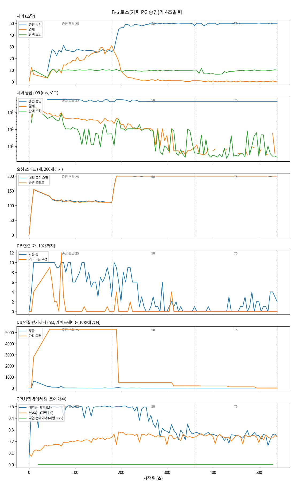
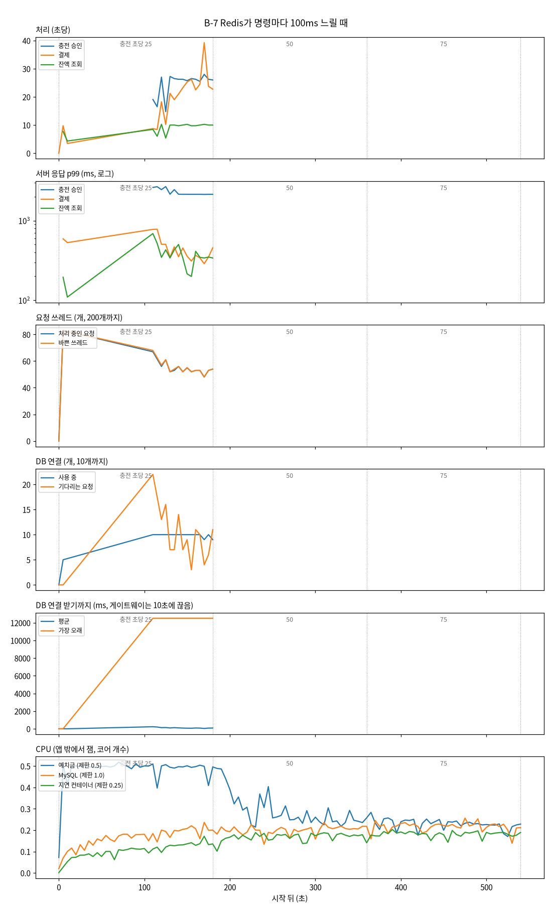
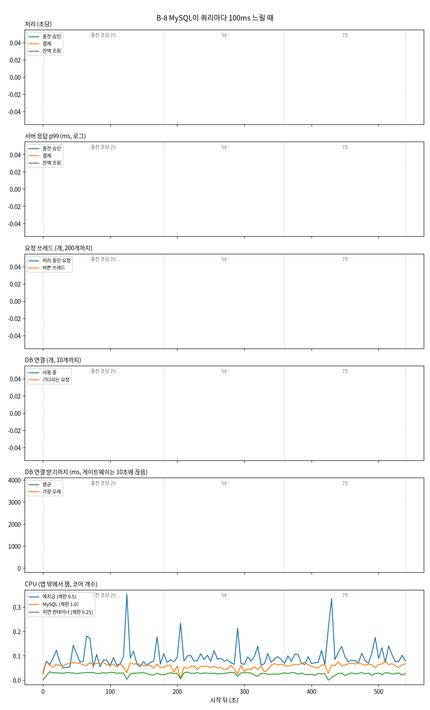
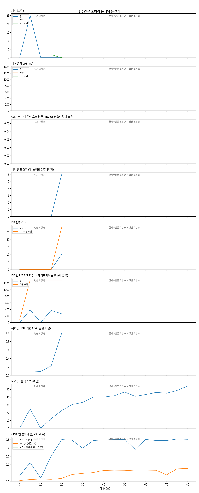
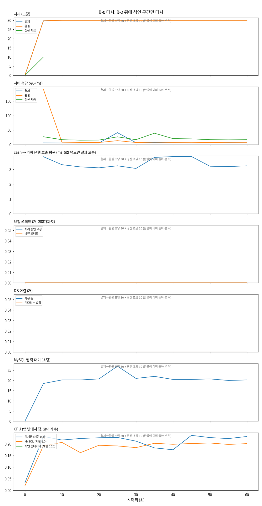
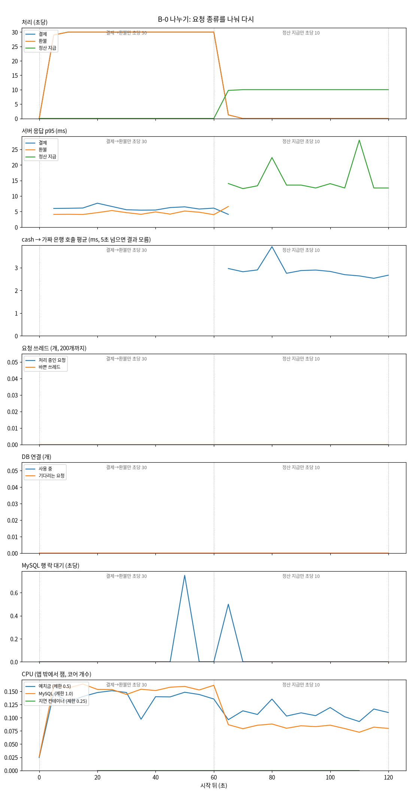
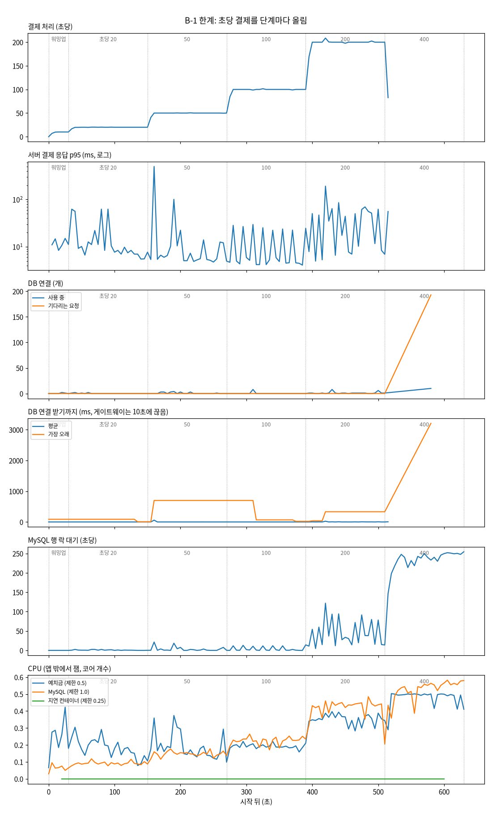

# 예치금(cash) 부하 측정 2차: 바깥이 느릴 때, P8 원인, 2초 넘는 락 (2026-11-19)

1차 측정([기준선](2026-11-17-예치금-부하-기준선.md), [전후](2026-11-17-예치금-부하-전후.md))에서 남은 세 가지를 다시 잰 결과예요.
판정 기준은 측정 전에 커밋한 [2차 판정 기준](2026-11-18-예치금-부하-2차-판정기준.md)을 그대로 썼어요. 숫자를 보고 기준을 바꾸지 않았어요.
이번에는 고친 코드가 없어서 지금 코드(A)만 3번 쟀어요.

- 실행: GitHub Actions [`cash-load-test` 실행 44432991852](https://github.com/prgrms-be-adv-devcourse/beadv8_5_BSB_MONO/actions/runs/44432991852) (PR #566에 `cash-load-test-2` 라벨)
- 원본: [`docs/loadtest/scenario-b/results/2026-11-19-2nd/`](../loadtest/scenario-b/results/2026-11-19-2nd/) (k6 요약, 돈 확인 SQL, 락 통계·잠금 스냅샷·SQL별 잠금 대기, 결과 정리 `summary.md`)
  - B-8의 k6 출력은 요청 실패 경고가 회차마다 7천 줄이라 앞 20줄만 남겼어요.
  - 예치금 로그, JFR·GC 로그, 그래프 원본은 Actions 아티팩트 `cash-load-results`에만 있어요. 2026-12-19에 지워져요.
- 그래프: 1회차 것을 [`img/2026-11-19-예치금-부하-2차/`](img/2026-11-19-예치금-부하-2차/)에 옮겼어요.
- Linear: BUK-11

## 1. 한 줄 결론

- **돈은 세 번 모두 맞았어요.** 바깥을 일부러 느리게 만든 B-6~B-8에서도 중복 원장·중복 충전·잔액 어긋남·데드락·락 대기 시간 초과가 모두 0이에요.
- **바깥 하나가 느려지면 바깥을 부르지 않는 결제까지 같이 느려져요.** 토스가 4초 걸리면 충전이 초당 25건일 때부터 결제 p99가 1.3초가 돼요. 초당 50건부터는 요청 쓰레드 200개가 다 차서 결제가 15초까지 밀려요.
- **MySQL이 쿼리마다 100ms 느려지면 예치금이 사실상 멈춰요.** 모든 요청이 60초 제한에 걸리고, 충전은 72~100% 실패해요.
- **P8(B-0 결제 p95 약 10초)의 원인은 막 띄운 앱의 첫 실행 비용이에요.** 같은 구간을 다시 돌리면 p95가 6~8ms예요. 코드는 고치지 않아요.
- **2초 넘는 락은 B-1 한계가 아니라 막 띄운 직후의 예열에서 나왔어요.** 원인 코드는 아직 확인하지 못했어요(5장).
- 측정하다 지표 수집이 DB 연결을 기다리는 문제를 찾아 고쳤어요(6장).

| 번호 | 무엇 | 중앙값 | 판정 |
|---|---|---|---|
| X1 | B-6·B-7 충전 초당 25건 단계에서 결제 p99 ≥ 1초 또는 충전 실패 ≥ 1% | B-6 p99 **1,300ms**, B-7 p99 **4,396ms**, 충전 실패 0% | **걸림** |
| X2 | B-6·B-7 어느 단계든 결제나 잔액 조회 p99 ≥ 1초 | 첫 단계(초당 25건)부터 넘음 | **걸림**, 문턱 초당 25건 |
| X3 | B-8 어느 단계든 결제 p95 ≥ 2초 | **60,001ms** (k6 제한 60초) | **걸림** |
| X4 | B-6 같은 충전 두 번째 요청의 응답 중앙값 ≥ 3.2초 | **8,657ms** | **걸림** (아래 주의) |
| L1 | B-1 한계가 아닌 시나리오에서 가장 오래 기다린 행 락 ≥ 2초 | 예열 **2,405ms**, B-8 **2,733ms** | **걸림** |
| P8 | B-0 결제 p95 ≥ 2초 | **9,998ms** | **걸림** |
| R1 | B-0 다시의 결제 p95가 첫 B-0의 10분의 1 이하 | 8ms (첫 B-0의 0.1%) | **예열** |
| C1~C7 | 돈 확인 (모든 회차) | 어긋남 0 | 통과 |

X4 주의: 같은 충전의 두 번째 요청도 첫 요청과 같은 쓰레드 부족을 겪어요. 그래서 8.7초 안에는 「첫 요청이 끝나길 잠들며 기다린 시간」과 「쓰레드를 받기까지 줄 선 시간」이 섞여 있어요. 같은 단계 일반 충전의 중앙값(4.3초)보다 두 배 길어서 기다림이 있는 것은 맞지만, 얼마인지는 이 숫자로 나눌 수 없어요.

## 2. 실행 조건

| 항목 | 값 |
|---|---|
| 코드 | `38105c12` (PR #566 머리. 2차 측정 도구 포함) |
| 실행 머신 | GitHub Actions `ubuntu-latest` 한 대. A 3번을 한 머신에서 차례로 |
| 걸린 시간 | 09:56~12:45 (2시간 49분) |
| 자원 제한 | 1차와 같아요(예치금 0.5 CPU·768MB, MySQL 1 CPU). 더한 것: 지연 컨테이너(toxiproxy) 0.25 CPU |
| 순서 | 예열 → B-0 → B-2 → B-0 다시 → B-0 나누기 → (토스 4초로 다시 띄움) B-6 → (지연 컨테이너를 거쳐 다시 띄움) B-7 → B-8 → (바로 붙여 다시 띄움) B-1 한계 |
| 단계 길이 | B-6~B-8 단계마다 3분, B-1 한계 단계마다 2분 |
| 새로 남긴 것 | 시나리오마다 락 앞뒤 통계·5초마다 잠금 스냅샷·SQL별 잠금 대기, JFR·GC 로그, 앱 지표는 관리 포트(8091)로 따로 수집 |

다시 띄울 때마다 예열을 30초 돌렸어요. 그래서 예열이 회차마다 네 번 있어요(처음, 토스 4초, 지연 컨테이너, 바로 붙이기).

## 3. 시나리오별 숫자 (3회)

### B-6·B-7·B-8: 바깥이 느릴 때

충전 승인을 초당 25 → 50 → 75건으로 3분씩 올리고, 그동안 결제(동시 4개)와 잔액 조회(초당 10건)를 함께 보내요. 결제·잔액 조회는 바깥을 부르지 않아요.

| | B-6 토스 4초 | B-7 Redis 명령마다 +100ms | B-8 MySQL 쿼리마다 +100ms |
|---|---|---|---|
| 결제 p99, 초당 25건 | 1,210 / 1,300 / 2,594 | 4,396 / 4,095 / 5,823 | 60,001 (세 번 모두) |
| 결제 p95, 초당 50건 | 4,370 / 4,660 / 6,296 | 10,689 / 10,523 / 10,731 | 60,001 |
| 결제 p95, 초당 75건 | 15,126 / 15,119 / 15,137 | 17,767 / 17,979 / 18,097 | 60,001 |
| 잔액 조회 p99, 초당 25건 | 2,655 / 2,469 / 3,798 | 7,081 / 6,841 / 8,342 | 60,001 |
| 충전 중앙값, 초당 25건 | 4,226 / 4,261 / 4,394 | 3,515 / 2,963 / 6,513 | 60,000 |
| 충전 실패 (단계 1 / 2 / 3) | 0% / 0% / 0% | 0% / 0% / 0% | 약 72% / 100% / 100% |
| 같은 충전 두 번째 요청 중앙값 | 8,469 / 8,657 / 10,337 | 13,634 / 12,956 / 13,567 | 60,000 |
| 먼저 찬 것 | 요청 쓰레드 (초당 50건에서 200개) | DB 연결 (10개, 쓰레드는 50~80개) | 앱 지표가 비어 볼 수 없음 |

(단위 ms, 1·2·3회차 순)

### P8 묶음: B-0 → B-2 → B-0 다시 → B-0 나누기

| 결제 p95 (ms) | 1회차 | 2회차 | 3회차 | 중앙값 |
|---|---|---|---|---|
| B-0 섞인 구간 (처음) | 10,084 | 9,998 | 9,451 | **9,998** |
| B-0 다시 (B-2 뒤 같은 구간) | 6 | 8 | 8 | **8** |
| B-0 나누기: 결제→환불만 | 6 | 5 | 5 | 5 |
| B-0 나누기: 정산 지급만 | 14 | 12 | 12 | 12 |
| B-2 정산 섞인 1분의 결제 p99 | 109 | 108 | 106 | 108 |

B-2의 처리량은 앞 1분의 89% / 79% / 78%(중앙값 79%)예요. 1차의 기준(80%)으로는 아직 문제 있음이에요. 2차에서는 P8 묶음의 순서를 맞추려고 돌렸고, 판정하지 않았어요.

### 시나리오별 가장 오래 기다린 행 락 (L1)

SQL별 잠금 대기(`sql/15`)의 「가장 오래」예요. 시나리오 전에 비우고 끝나면 읽어서, 그 시나리오 안의 값만 들어 있어요.

| 시나리오 | 1회차 | 2회차 | 3회차 |
|---|---|---|---|
| **예열 (처음 띄운 직후)** | **2,406** | **2,600** | **1,909** |
| 예열 (토스 4초로 다시 띄운 직후) | 1,501 | 1,610 | 1,999 |
| 예열 (지연 컨테이너로 다시 띄운 직후) | 1,799 | 1,593 | 493 |
| 예열 (바로 붙여 다시 띄운 직후) | 1,405 | 2,000 | 1,205 |
| B-0 | 997 | 794 | 900 |
| B-2 | 398 | 371 | 204 |
| B-6 | 703 | 702 | 1,010 |
| B-7 | 502 | 412 | 500 |
| **B-8** | **2,743** | **2,733** | **2,658** |
| B-1 한계 (기록만) | 606 | 281 | 295 |
| B-0 다시 / 나누기 | 37 / 6 | 42 / 3 | 104 / 3 |

(단위 ms)

## 4. 시나리오별로 본 것

### B-6. 토스가 4초 걸릴 때



- 초당 25건에서 바쁜 쓰레드가 약 110개예요. 충전 하나가 쓰레드를 4초 남짓 쥐니 25 × 4.3 ≈ 108개로 계산과 맞아요.
- 초당 50건이 되자 쓰레드 200개가 다 찼어요(그래프 셋째 칸). → 새 요청은 쓰레드가 빌 때까지 앱 바깥에서 줄을 서요.
  → 결제는 앱 안에서는 수 ms 만에 끝나는데(둘째 칸의 서버 응답), k6가 잰 응답은 4~15초예요. 늦어진 시간은 거의 다 줄 선 시간이에요.
- 그래서 처리량 칸에서 충전은 초당 50건을 다 받는데 결제는 초당 1~2건으로 떨어져요(앞 단계는 초당 20~30건). 충전이 쓰레드를 다 가져가 결제가 굶어요.
- 충전 실패는 0이에요. 느려질 뿐 돈 처리는 끝까지 맞아요.
- → 쓰레드가 먼저 차므로, 판정 기준 4-4대로 가상 쓰레드·격벽·서킷 브레이커 중에서 골라요.

### B-7. Redis가 명령마다 100ms 느릴 때



- 초당 25건에서 DB 연결 10개가 다 차고, 연결을 기다리는 요청이 최대 22개예요. 쓰레드는 50~80개라 남아 있어요.
- → Redis를 DB 연결을 쥔 동안 부르는 곳이 있어서, Redis가 느린 만큼 DB 연결을 오래 쥐는 것으로 보여요. 어느 호출인지는 코드로 확인하지 않았어요. 판정 기준 4-4대로 「트랜잭션 안의 바깥 호출 빼기」부터 봐요.
- 초당 50건부터 앱 지표가 비어요. 원인은 6장 1번이에요.

### B-8. MySQL이 쿼리마다 100ms 느릴 때



- 처음부터 모든 요청이 60초 제한에 걸리고, 앱 지표는 전 구간 비어요. CPU는 0.1개 안팎으로 일을 거의 하지 않아요.
- 충전 하나가 쿼리를 여러 번 쓰니, 쿼리마다 100ms가 붙으면 연결 하나를 쥐는 시간이 그 배수로 늘어요. 초당 25건을 받을 만큼 연결이 돌지 못해 기다리는 줄이 계속 늘었다고 봐요. 앱 지표가 비어 연결 수를 직접 보지는 못했어요.
- 가장 오래 기다린 행 락이 2.7초로 L1에 걸렸어요. 락을 쥔 쪽의 쿼리 하나하나가 100ms씩 늦으니 예상한 결과예요.
- MySQL이 이만큼 느려지는 상황은 예치금 혼자 막을 수 없어요. 이 시나리오는 「DB가 느려지면 지표까지 함께 사라진다」는 것을 보여 준 게 더 커요(6장 1번).

### P8 묶음. B-0 결제 p95 10초의 원인





- 같은 섞인 구간을 B-2 뒤에 다시 돌리니 결제 p95가 10초에서 8ms로 줄었어요. 결제→환불만, 정산 지급만 따로 돌려도 5ms, 12ms예요.
- → 판정 기준 4-2대로 원인은 「처음 도는 경로의 예열」이에요. B-0이 띄우고 처음 돌리는 무거운 시나리오라서 생긴 값이에요. 코드는 고치지 않고 기록만 해요.
- 운영에서는 배포 직후 첫 요청들이 같은 비용을 낼 수 있어요. 이 비용을 줄일지는 따로 정할 일이에요(8장).

### B-1 한계 (기록만)



- 초당 200건까지는 결제 p99가 103~186ms예요. 초당 400건에서 p95가 7.2~7.8초로 무너지지만 실패는 0이에요. 1차와 같아요.
- 이때 가장 오래 기다린 락은 0.3~0.6초뿐이에요. → 400건 단계가 느린 것은 락이 아니라 처리 한계(CPU 0.5개) 때문이에요.

## 5. 2초 넘는 락: 지금까지 아는 것

1차에서는 「B-1 한계에서 나온다」고 추정했는데 틀렸어요. 시나리오마다 따로 읽으니 아래처럼 나왔어요.

- **확인함:** 2초를 넘은 곳은 처음 띄운 직후의 예열(3회 중 2회)과 B-8뿐이에요. B-1 한계는 0.6초 아래예요.
- **확인함:** 예열은 동시 사용자 2명뿐인데도 1.4~2.6초 기다린 락이 나와요. 다시 띄울 때마다(회차마다 네 번) 0.5~2초가 나와요. → 붐벼서가 아니라 막 띄운 앱이라서 생겨요.
- **확인함:** 기다린 쪽은 보관 지갑(id 2) 행이고, 그때 락을 쥔 트랜잭션의 지금 SQL이 비어 있었어요(`sql/14` 스냅샷). → 락을 쥔 채 쿼리가 아니라 앱 코드가 돌고 있었다는 뜻이에요.
- **정황:** 막 띄운 직후 처음 도는 코드는 클래스 읽기·JIT 컴파일 때문에 느려요. 결제는 보관 지갑을 먼저 잠그고 커밋까지 쥐므로, 그 사이의 첫 실행 비용이 그대로 락을 쥔 시간이 된다고 봐요. JFR로 확인하지는 않았어요.
- **영향:** 주문은 예치금을 2초까지 기다려요. 배포 직후 결제가 몰리면 주문이 2초에 포기하는 결제가 생길 수 있어요.

원인 코드는 회차마다 남긴 JFR로 좁혀요. 예열 구간에서 락을 쥔 쓰레드가 무엇을 하고 있었는지 봐요(8장).

## 6. 측정하면서 찾은 다른 문제

### 1. 예치금: DB 연결이 다 차면 앱 지표가 통째로 빠짐 (고침)

**본 것.** 지표 포트를 따로 열었는데도(7장) B-6 첫 단계, B-7 초당 50건부터, B-8 전 구간에서 앱 지표가 비었어요.

**원인.** 1회차 B-7의 JFR에서 지표 포트(8091)의 쓰레드가 DB 연결을 4,380번 기다렸고, 그중 4,122번이 1초를 넘었어요.
멈춘 돈 건수 지표(`CashStuckMoneyMetrics`)가 Prometheus가 가져갈 때마다 DB에 COUNT 쿼리 5개를 날려요.
→ DB 연결 10개가 다 찬 동안은 지표 수집도 연결을 기다려요. → 수집 제한 시간(1초)을 넘겨요. → 그 순간의 앱 지표가 통째로 빠져요.
포트는 쓰레드만 나누고 DB 연결은 같이 쓰므로 포트를 나눠도 소용이 없었어요.
1차의 「앱이 포화되면 지표를 못 가져간다」(B-0 섞인 구간, B-1 한계 400건)도 같은 원인이었을 수 있어요. 확인하지 않았어요.

**운영 영향.** DB가 꽉 찬 바로 그때 모니터링이 비어요. 또 바쁜 때 지표 수집이 DB 연결을 더 가져가요.

**검토한 방법**

| 방법 | 고르지 않은 이유 |
|---|---|
| 지표용 DB 연결을 따로 두기 | 설정이 복잡해지고 연결 수가 늘어요 |
| 측정에서만 수집 제한 시간을 늘리기 | 운영 문제는 그대로예요 |
| 측정에서만 이 지표를 끄기 | 측정 환경이 운영과 달라져요 |
| **30초마다 따로 세어 두고, 지표는 센 값만 읽기 (고름)** | 지표 수집이 DB에 막히지 않고 DB 부하도 일정해요. 값이 최대 30초 늦지만 사람이 확인할 건수라 괜찮아요 |

세다 실패한 종류는 옛 값을 보여 주지 않게 값 없음으로 둬요.
**확인.** `CashStuckMoneyMetricsTest.readingGaugeDoesNotQueryDb`: 지표를 읽어도 DB를 조회하지 않는지 봐요. 고친 뒤 부하로 다시 재지는 않았어요.

### 2. 측정 도구: 로컬 QUICK이 옛 예치금 이미지로 돎 (고치지 않음)

`run.sh`는 예치금 이미지가 이미 있으면 다시 만들지 않아요. 로컬 이미지가 11/17 0시에 만든 것이라, 그 뒤의 예치금 코드가 로컬 QUICK에 들어가지 않았어요(멈춘 돈 지표도 없었어요).
Actions는 회차마다 이미지를 새로 만들어 이번 결과에는 영향이 없어요. 고치는 방법은 아직 정하지 않았어요.

## 7. 한계

- 고친 코드가 없어서 「나아짐」은 판정하지 않았어요.
- 바깥 지연은 지연 컨테이너로 응답마다 같은 시간을 더한 거예요. 실제 장애는 들쭉날쭉하고, 연결이 끊기기도 해요.
- 게이트웨이·주문을 거치지 않아요. 주문이 2초에 포기한 뒤에도 예치금이 계속 일하는 상황은 재현하지 않아요.
- B-8과 B-7 뒤쪽은 앱 지표가 비어서, 쓰레드와 DB 연결 중 무엇이 먼저 찼는지 그래프로 보지 못했어요(B-8은 계산으로만 봤어요).
- 같은 충전 두 번째 요청(X4)의 시간에는 쓰레드 줄 선 시간이 섞여 있어요(1장).
- 6장 1번의 원인은 1회차 B-7의 JFR 하나로 확인했어요.

## 8. 다음 할 일

| 할 일 | 근거 |
|---|---|
| 바깥이 느릴 때 결제가 굶지 않게 막기 (토스: 쓰레드 쪽 대안, Redis: 트랜잭션 밖으로) | X1·X2, 4장 B-6·B-7 |
| 같은 충전 두 번째 요청이 잠들며 기다리지 않고 바로 「처리 중」을 돌려주기 | X4 |
| 락 대기 제한 + 503, 제한 값은 이번 대기 시간으로 정하기 | L1, 5장 |
| 예열 구간 JFR로 2초 넘는 락을 쥔 쓰레드가 하던 일 찾기 | 5장 |
| 배포 직후 첫 실행 비용을 줄일지 정하기 | P8, R1, 5장 |
| 6장 1번을 고친 코드로 B-7을 다시 재서 지표 구멍이 사라졌는지 보기 | 6장 1번 |

고칠 일은 각각 선택지를 먼저 보고 정해요. 고친 뒤 A·B를 번갈아 재고, 이 문서의 X·L 조건으로 「나아짐」을 새로 정해요.

## 9. 다시 내는 법

```bash
# PR에 cash-load-test-2 라벨을 붙이면 Actions가 3회를 돌린다. 로컬에서 한 바퀴만 (backend/에서)
LABEL=local REP=1 OUT=/tmp/cashload \
  SCENARIOS="warmup b0 b2 b0-again b0-split pg4 b6 proxy b7 b8 direct b1-limit" \
  loadtest/scenario-b/container/run.sh
```

이번 회차부터는 회차마다 Prometheus 데이터가 남아요(`prometheus-data.tar.gz`). 다시 보는 법은 `docs/loadtest/scenario-b/README.md` 「끝난 뒤 지표 다시 보기」에 있어요.
