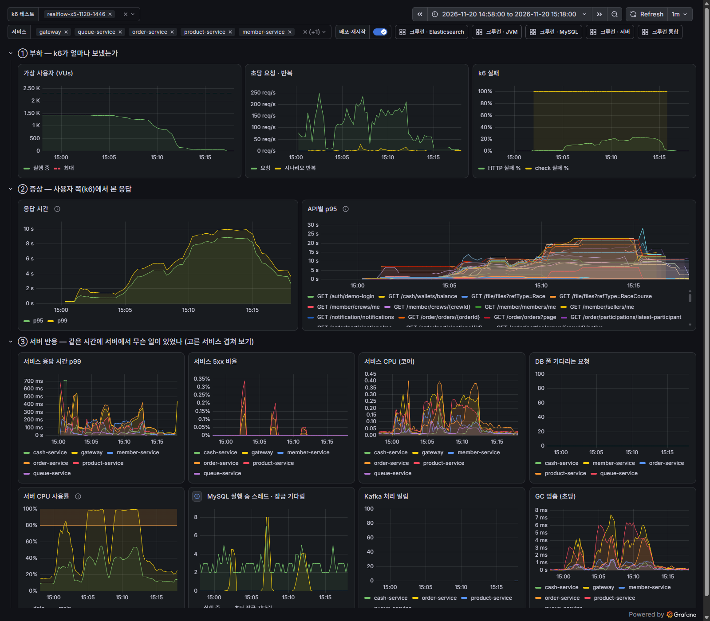
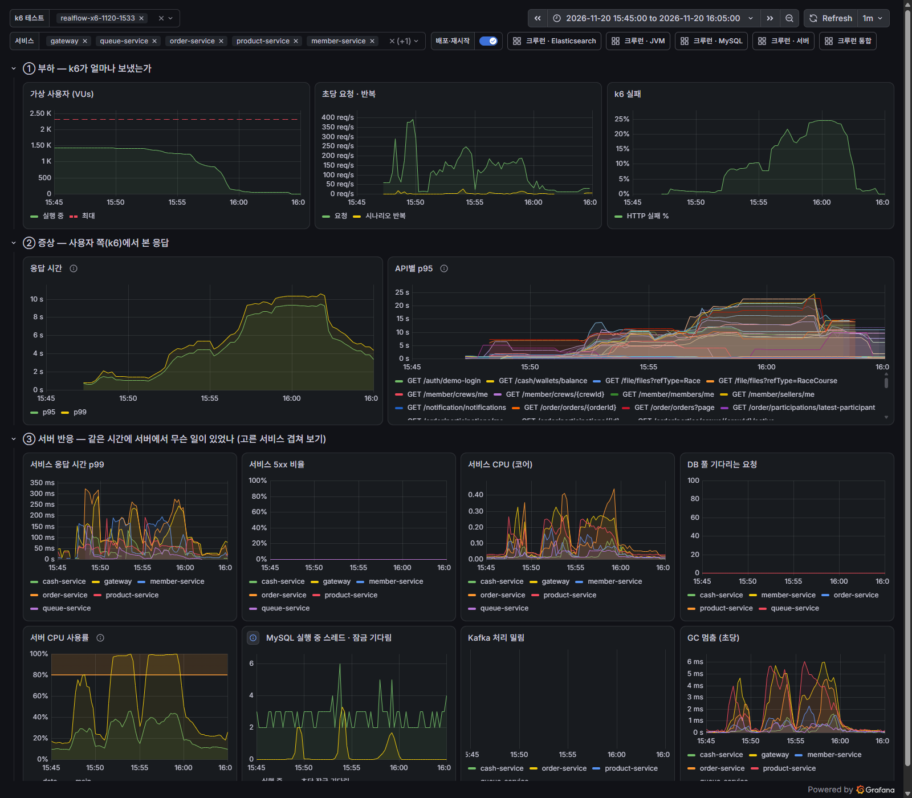

# 예매 오픈 몰림 운영 측정 5·6차: 상품 자리 확보 인덱스 지움 vs 되살림 (2026-11-20)

인기 대회 예매 오픈 몰림(real-flow)을 운영에서 재면 정원이 남았는데도 주문에서 503으로 예매에 실패하는 사람이 나왔어요.
원인인 상품 자리 확보 표의 빠진 인덱스를 CRU-88로 채운 뒤, 효과를 확인하려고 같은 날 운영에서 인덱스를 **지우고(5차) 되살려(6차)** 같은 조건으로 두 번 쟀어요.
다른 것은 인덱스 하나뿐이에요.

- 스크립트: [`docs/loadtest/real-flow/`](../loadtest/real-flow/) (이번 측정부터 화면이 끝내 안 뜨면 그 사람은 다음 단계로 못 가요. 3장)
- 원본: `docs/loadtest/real-flow/results/prod-x5-*` · `prod-x6-*`, 예열 `prod-warm5-*` · `prod-warm6-*` (k6 요약·로그·Prometheus 지표·정합성·부하 PC CPU). `results/`는 커밋하지 않아 측정한 PC에만 있어요.
- 그래프: Grafana 「크루런 · 부하 테스트」 k6 테스트 `realflow-x5-1120-1446` · `realflow-x6-1120-1533`, 캡처는 [`img/2026-11-20-예매-오픈-몰림-인덱스/`](img/2026-11-20-예매-오픈-몰림-인덱스/)
- Linear: CRU-84 (측정), CRU-88 (인덱스)

## 1. 한 줄 결론

- **인덱스가 있으면 교착이 0이에요.** 지운 5차는 상품 로그에 교착이 28줄 찍히고 주문에서 7명이 예매에 실패했어요. 되살린 6차는 교착·주문 실패·5xx가 모두 0이에요.
- **결제 때 자리를 판매로 바꾸는 API가 3~7배 빨라졌어요.** 서버 p95가 237·209·88ms에서 33·31·32ms로, 잠금으로 기다린 시간 합은 30.0초에서 6.8초로 줄었어요.
- **처리 속도(X)는 그대로 초당 약 10건이에요.** 막는 곳이 상품 DB가 아니라 메인 EC2 CPU(2코어)와 web 화면이라서예요.
- **지금 가장 큰 손실은 화면이에요.** 3구간(900명)에서 두 실행 모두 약 270명이 화면 시간 초과로 결제 전에 멈췄어요.
- 돈과 자리는 두 실행 모두 어긋나지 않았어요(정합성 0).

| 지표 | 5차 · 인덱스 없음 | 6차 · 인덱스 있음 | 변화 |
|---|---|---|---|
| 상품 자리 확보 교착 (로그 `Deadlock found`) | 28줄 | **0** | 해결 |
| 주문에서 예매에 실패한 사람 | 7명 | **0** | 해결 |
| 서비스 5xx (order·product·gateway 각각) | 7건 | **0** | 해결 |
| 판매 확정 API 서버 p95 (구간 1·2·3) | 237 · 209 · 88ms | **33 · 31 · 32ms** | −86% · −85% · −64% |
| 잠금으로 기다린 시간 합 (MySQL) | 30.0초 | **6.8초** | −77% |
| X — 결제 완료 예매/초 (30초 창 최대) | 10.66 | 10.87 | 같음 |
| 정합성 어긋남 | 0 (1,213석) | 0 (1,225석) | 같음 |

## 2. 문제와 원인

### 문제 (11/20 새벽 2차 측정)

| 문제 | 어떻게 보였나 | 그래서 |
|---|---|---|
| 정원이 남았는데 예매 실패 | 주문 503 11건, 상품 로그 `Deadlock found`, 서비스 5xx 11건 | 오픈 직후 결제가 몰릴 때마다 몇 명씩 예매에 실패해요 |
| TPS가 실제보다 높게 잡힘 | 3구간 X 10.03. web Pod가 재시작된 직후 30초에 결제가 105·73·63건으로 몰림 | 화면이 502로 실패한 사람도 다음 단계로 넘어가 결제했어요. 개선 전후 TPS를 비교할 수 없어요 |

### 원인: 운영 표에 빠진 유니크 인덱스

운영 `crewrun_product.participation_hold`(신청 하나의 자리 확보 기록)에 코드가 기대하는 `participation_id` 유니크 인덱스가 없었어요. 로컬은 인덱스가 있어서 보이지 않았어요.

- 칼럼 이름을 `application_id` → `participation_id`로 바꿀 때 운영 DB에서 이름 바꾸기 SQL이 돌지 않았어요. JPA(ddl-auto update)는 새 칼럼만 더하고 인덱스는 만들지 않았어요.
- 나중에 들어온 Flyway V1은 `create table if not exists`라 표가 이미 있는 운영에서는 건너뛰었어요.

교착이 나는 순서예요.

1. **자리 확보(주문 때)**: 종목 행을 잠가 남은 자리를 줄이고, 자리 확보 표에 새 행을 넣어요.
2. **판매(결제 때)**: `findForUpdate(participationId)`가 인덱스 없이 표 전체를 훑으며(EXPLAIN `type=ALL`, 13,121행) 지나간 행마다 배타 잠금을 걸어요. 그 상태로 종목 행을 기다려요.
3. ①은 종목 행을 쥔 채 ②가 잠근 범위에 행을 넣으려고 기다리고, ②는 표를 쥔 채 ①이 쥔 종목 행을 기다려요 → 교착.
4. MySQL이 한쪽을 실패시켜요 → 상품 500 → 주문 503 → 그 사람은 예매 실패.

### 원인: 화면 실패를 건너뛴 스크립트

k6 스크립트가 화면 요청 결과를 보지 않고 다음 API로 넘어갔어요. 결제 API는 web을 거치지 않아 화면이 502여도 결제는 성공했어요.
web이 생존 확인(TCP 1초 × 3번)에 답하지 못해 재시작된 순간, 60초씩 기다리던 화면 요청이 한꺼번에 실패로 끝나 묶여 있던 사람들이 동시에 결제했어요.
실제 브라우저라면 오류 화면에서 멈췄을 사람들이에요.

## 3. 해결과 측정 방법

| 해결 | 내용 | 언제 |
|---|---|---|
| CRU-88 Flyway Java 마이그레이션 | 옛 행 35개 채움 → 중복 확인 뒤 `uk_participation_hold_participation` 생성 → 옛 칼럼 삭제. 단계마다 이미 있는지 먼저 확인 | 11/20 11:12 운영 반영 (PR #692·#693) |
| 스크립트 수정 | 화면이 오류(502·504·연결 실패)면 3초 뒤 새로고침 2번, 끝내 안 뜨면 그 사람은 멈추고 `flow_broken{where=화면}`으로 셈. 결제 뒤 완료 화면은 끊지 않음 | 5차부터 |
| 5차 (AS-IS) | 운영에서 인덱스를 지운 뒤 측정 | 14:29 지움 → 15:01 오픈 |
| 6차 (TO-BE) | 중복 0건 확인 뒤 같은 이름으로 되살리고 측정 | 15:17 되살림 → 15:48 오픈 |

```sql
-- 5차 전 (14:29)
alter table participation_hold drop index uk_participation_hold_participation;

-- 6차 전 (15:17): 중복이 없는지 먼저 봐요 (0건)
select count(*) from (select participation_id from participation_hold
  group by participation_id having count(*) > 1) d;
create unique index uk_participation_hold_participation on participation_hold (participation_id);
```

지금 운영은 인덱스가 있는 상태예요(EXPLAIN `const`, 1행만 잠금).

### 실행 조건

| 항목 | 5차 (AS-IS) | 6차 (TO-BE) |
|---|---|---|
| 오픈 3번 (KST) | 15:01 · 15:05 · 15:09 | 15:48 · 15:52 · 15:56 |
| 예열 실행 (300명 1구간, 옛 계정) | 14:30 ~ 14:46 | 15:17 ~ 15:33 |
| 계정 · 크루 | realflow6001~8310 (`ACCOUNT_OFFSET=6000`) · 새 크루 300 | realflow9001~11310 (`ACCOUNT_OFFSET=9000`) · 새 크루 300 |
| 대회 (상품) | 151 ~ 162 | 165 ~ 176 |
| 자리 확보 표 행 수 (시작 때) | 약 13,900 | 약 16,300 |
| 부하 PC CPU (실행 구간 평균 · 최대) | 21% · 66% | 40% · 100% |

- 같은 것: 스크립트, `STAGES=300x1,300x2,300x3`(대회 1·2·3쌍, 300·600·900명), 오픈 간격 240초, `PREP=600`, 판매자 realflow0, 상품 조건(종목 4개·가격·정원 70%). 대회 이름만 오픈 시각으로 달라요.
- 두 실행 모두 주문 기록이 없는 새 사람이라 사람당 요청이 같아요(구간별 게이트웨이 요청 차이 2% 안).
- 6차 1구간 오픈 직후(15:48:27~49:04) 부하 PC CPU가 100% 근처까지 4번 찼어요. 6차 1구간 숫자는 조심해서 읽어요.
- 5차의 자리 확보 표는 2차(8,913행)보다 커서, 인덱스가 없을 때 잠그는 범위가 2차보다 넓어요.

## 4. 결과

### 구간별 부하 판단 지표 (5차 → 6차)

| 구간 | 몰린 사람 | 메인 CPU 최대 | 조회 p95 | 대기열 p95 | 쓰기 p95 | 화면 실패율 | 주문 실패 |
|---|---|---|---|---|---|---|---|
| 1 | 300명 | 85% → 81% | 1,274 → 1,190ms | 1,215 → 1,689ms | 1,771 → 1,450ms | 0% → 0% | 3 → 0 |
| 2 | 600명 | 100% → 100% | 1,623 → 995ms | 1,107 → 883ms | 2,115 → 1,272ms | 1.2% → 1.2% | 3 → 0 |
| 3 | 900명 | 100% → 100% | 976 → 1,079ms | 371 → 910ms | 1,119 → 1,170ms | 11.8% → 11.7% | 1 → 0 |

- 판정 기준(조회 300ms · 대기열 200ms · 쓰기 1초)은 화면 요청까지 함께 보내면 300명부터 넘어요.
- p95는 성공한 요청만으로 계산했어요. 두 실행 모두 요청 한 건이 19.17~19.19초 뒤 끊기는 값(`unexpected EOF`)이 있어, 빼지 않으면 p95가 19초로 튀어요.

### 서버 쪽

| 지표 (구간 1 · 2 · 3) | 5차 | 6차 |
|---|---|---|
| 판매 확정 API 서버 평균 | 77 · 71 · 47ms | 18 · 18 · 19ms |
| MySQL 행 잠금 대기 | 220 · 399 · 346건 | 99 · 164 · 120건 |
| product 서비스 서버 p95 | 61 · 63 · 55ms | 37 · 40 · 43ms |
| order 서비스 서버 p95 | 199 · 174 · 134ms | 148 · 141 · 116ms |
| Pod CPU 1위 web(Next.js) 최대 | 0.51 · 0.75 · 0.73코어 | 0.48 · 0.75 · 0.75코어 |
| DB 커넥션 풀 대기 · 힙 최대 | 0 · 39% | 0 · 40% |

### X — 초당 예매 처리

| 구간 | 5차 (30초 창 최대) | 6차 (30초 창 최대) | 결제까지 끝난 개인 예매 (5차 / 6차) |
|---|---|---|---|
| 1쌍 (300명) | 6.53 | 6.95 | 168 / 168 |
| 2쌍 (600명) | 10.66 | 10.87 | 336 / 336 |
| 3쌍 (900명) | 7.44 | 7.04 | 494 / 488 (정원 504) |

- 3구간 개인 정원이 팔린 시간도 115초 vs 110초로 비슷해요.
- 3구간 정원을 다 못 판 것은 화면이 안 떠 멈춘 사람(269·274명) 때문이에요. 결제 503·결제 못 함은 두 실행 모두 0이에요.
- 2·4차의 X(10.03·8.03)와는 비교하지 않아요. 그때 스크립트는 화면 실패를 건너뛰고 결제해 값이 부풀었어요.





### 정합성 — 두 실행 모두 어긋남 0

| 확인 | 5차 | 6차 |
|---|---|---|
| 결제 완료 금액 (주문 = 예치금) | 52,240,000원 일치 | 52,830,000원 일치 |
| 두 번 결제된 주문 · 결제 확인 중으로 남은 주문 | 0 · 0 | 0 · 0 |
| 종목 48개: 정원 ≥ 판매 = 결제 참가권 | 모두 일치 | 모두 일치 |
| 팔린 자리 = 결제 완료 참가권 | 1,213 = 1,213 | 1,225 = 1,225 |

## 5. 남은 문제와 다음

| 순위 | 문제 | 원인 | 해결 방향 |
|---|---|---|---|
| 1 | 3구간 화면 실패 11.7%, 약 270명 이탈 | 화면 이동마다 Next 서버가 화면을 새로 그리고 백엔드를 다시 불러요. web이 메인 CPU 1위예요 | 대회 목록·상세처럼 사람마다 같은 화면을 캐시(재검증 주기)로 돌려주기 |
| 1 | web이 재시작 직전까지 감 (생존 확인 실패 9·10번) | 생존 확인이 TCP 1초 × 3번이라 CPU가 차면 멀쩡한 web도 제때 답하지 못해요 | 제한 3~5초, 실패 횟수 6. Traefik도 같이 |
| 2 | X가 초당 약 10건에서 멈춤 | 메인 EC2 2코어를 앱 Pod 15개·Traefik·nginx·web이 나눠 써요. 보조 EC2는 50% 아래예요 | web을 메인 밖으로, 또는 메인 4코어 |
| 확인 | 요청 한 건이 19.17~19.19초 뒤 끊김 | 입구(Traefik·nginx) 어딘가의 시간 제한으로 추정, 아직 확인 못 함 | 입구 시간 제한 설정 확인 |

- 늘리지 않아도 되는 것: DB 커넥션 풀(대기 0), 예치금 동시 처리 제한(결제 503 0), MySQL(실행 중 스레드 최대 7).
- 운영에 남은 테스트 데이터(계정 realflow0~11310, 크루, 대회 98~176, 판매자 realflow0)는 정산 전에 정리해야 해요.
