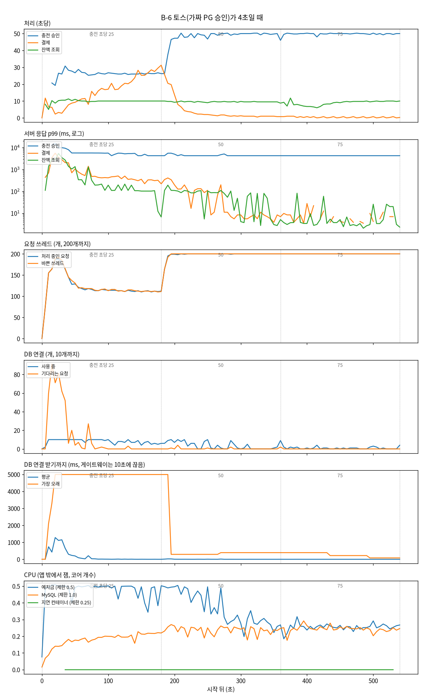
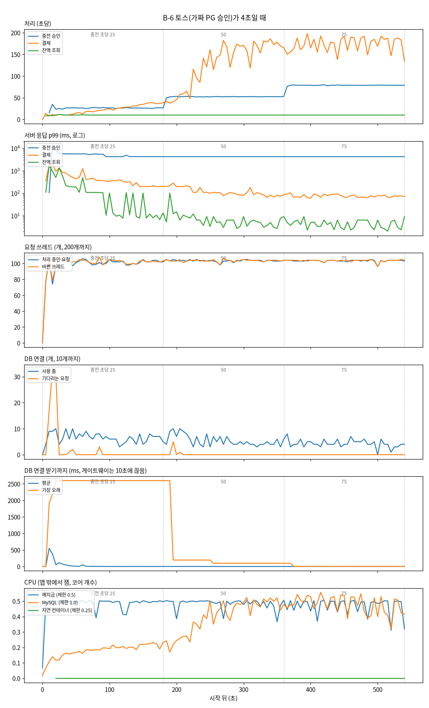
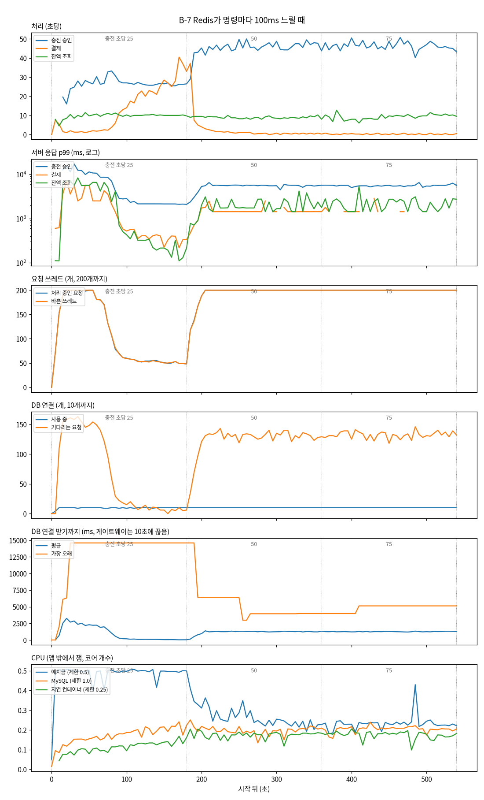
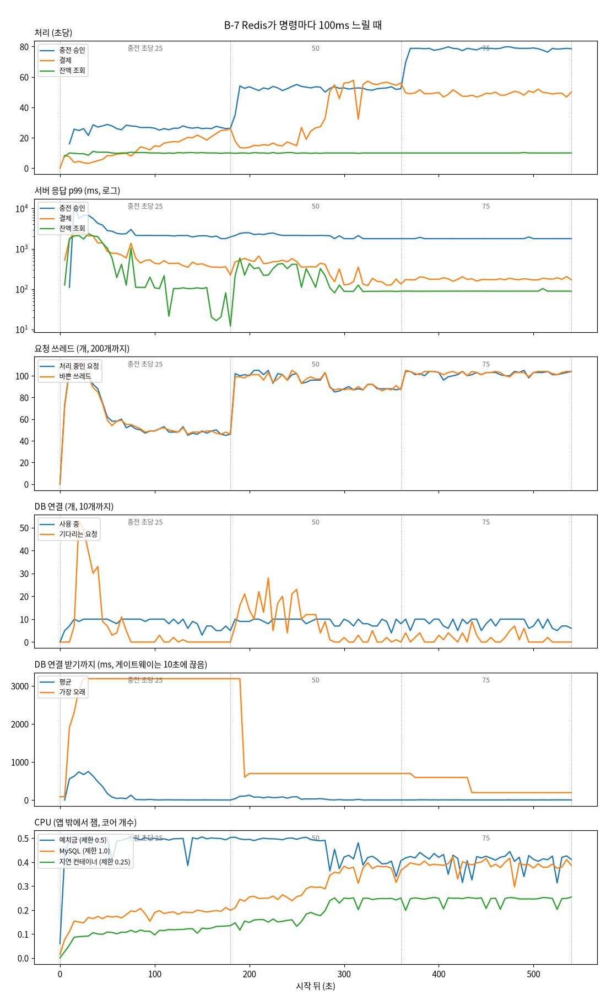

# 예치금(cash) 부하 측정 2차: 고친 뒤 A·B 비교 (2026-11-20)

[2차 측정](2026-11-19-예치금-부하-2차.md)에서 본 「바깥이 느리면 결제까지 멈춤」 중 ①②③을 고쳤어요([고칠 것](2026-11-20-예치금-부하-2차-고칠것.md)).
고치기 전 코드(A)와 고친 코드(B)를 같은 머신에서 번갈아 3번씩 재서 비교했어요.
판정 기준은 측정 전에 커밋한 [고칠 것 문서의 「고친 뒤 측정: 판정 기준」](2026-11-20-예치금-부하-2차-고칠것.md#고친-뒤-측정-판정-기준-측정-전에-정함)을 그대로 썼어요. 숫자를 보고 기준을 바꾸지 않았어요.

- 실행: GitHub Actions [`cash-load-test` 실행 44604531981](https://github.com/prgrms-be-adv-devcourse/beadv8_5_BSB_MONO/actions/runs/44604531981) (PR #688에 `cash-load-test-2ab` 라벨)
- 원본: [`backend/loadtest/scenario-b/results/2026-11-20-2ab/`](../../backend/loadtest/scenario-b/results/2026-11-20-2ab/) (`a/`, `b/` 아래 회차마다 k6 요약, 돈 확인 SQL, 락 통계, 예치금 로그)
  - JFR·GC 로그, Prometheus 데이터, 그래프 원본은 Actions 아티팩트 `cash-load-results`에 있어요. 2026-12-19에 지워져요. 담당자 맥의 `~/develoment/programmers/cash-load-files/2026-11-20-2ab/`에 받아 뒀어요.
  - 아티팩트의 `report/summary.md`는 1차 시나리오(B-0~B-5)만 표로 만들어서 이번 측정에서는 비어 있어요. 레포에 옮기지 않았어요.
- 그래프: 2회차 것을 [`img/2026-11-20-예치금-부하-2차-전후/`](img/2026-11-20-예치금-부하-2차-전후/)에 옮겼어요.
- Linear: BUK-11

## 1. 한 줄 결론

- **토스가 느릴 때 결제가 멈추던 문제는 사라졌어요(①).** B-6 충전 초당 50·75건 단계의 결제 p99가 5.3초·15.2초 → **175ms·85ms**예요.
- **Redis가 느릴 때도 크게 나아졌지만 기준 하나를 못 넘었어요(②).** B-7 충전 초당 25건 단계의 결제 p99가 3.2초 → **1.3초**예요. 기준은 1초 미만이라 G4는 「나아지지 않음」이에요. 그 단계의 첫 1분만 느렸고, 원인은 첫 충전이 Redis 연결을 처음 만드는 비용이었어요(4장, JFR로 확인).
- **돈은 여섯 번 모두 맞았어요.** 중복 원장·중복 충전·잔액 어긋남이 모두 0이에요.
- **대가: 토스가 4초면 충전의 절반 넘게를 429로 거절해요.** 끝난 충전이 22,005건 → 12,419건으로 줄었어요. 고를 때 받아들인 대가예요.
- **새 문제를 찾았어요.** 바쁠 때 같은 충전에 확정이 두 번 오면, 첫 요청이 처리 중인데도 두 번째 요청에 429(「실패」)로 답해요(5장). 우리 웹 화면은 같은 충전에 확정을 한 번만 보내서 실제로는 생기기 어렵지만, 「같은 주문번호로 다시 불러도 같은 결과」라는 약속이 깨져서 고쳐요. 이 PR에서 고칠지 다음 PR로 나눌지는 정하지 않았어요.

## 2. A와 B를 만든 방법

- **B**: PR #688 맨 끝 커밋 `c9e54335`
- **A**: B에서 ①②③ 커밋 `41e7ed51` 하나만 되돌린 코드 ([`container/ab-fixes.txt`](../../backend/loadtest/scenario-b/container/ab-fixes.txt))
- 시나리오: 예열 → (토스 4초로 다시 띄움) 예열 → B-6 → (지연 컨테이너를 거쳐 다시 띄움) 예열 → B-7. 단계·부하는 2차와 같아요.
  - 단계 1·2·3 = 충전 초당 25·50·75건, 단계마다 180초. 결제 동시 4개, 잔액 조회 초당 10건, 같은 충전 두 번 5%
- 순서: A 1회 → B 1회 → A 2회 → B 2회 → A 3회 → B 3회
- 걸린 시간: 05:06~07:29 (2시간 23분)
- 실행 조건(머신, 자원 제한, 가짜 PG)은 [2차 2장](2026-11-19-예치금-부하-2차.md)과 같아요.

## 3. 판정

| 번호 | 무엇 | 기준 (B) | A 중앙값 | B 중앙값 | 판정 |
|---|---|---|---|---|---|
| G1 | ① B-6 충전 초당 50·75건 단계의 결제 p99 | 1초 미만 | 5,282 / 15,195ms | **175 / 85ms** | 나아짐 |
| G2 | ① B-6 모든 단계의 잔액 조회 p99 | 1초 미만 | 2,308 / 5,526 / 15,292ms | **887 / 86 / 7ms** | 나아짐 |
| G3 | ③ B-6 같은 충전 두 번째 요청의 응답 중앙값 | 3.2초 미만 | 8,403ms | **19ms** | 나아짐 (아래 주의) |
| G4 | ② B-7 충전 초당 25건 단계의 결제 p99 | 1초 미만 | 3,219ms | **1,302ms** | **나아지지 않음** |
| G5 | 돈 확인 C1~C7 | A·B 모든 회차 어긋남 0 | 0 | 0 | 나아짐 |

- **A는 2차처럼 기준을 크게 넘었어요.** 2차는 G1 4.4~15초, G3 8.7초, G4 4.4초였어요. 머신 상태가 2차와 비슷했다는 뜻이라, A·B 차이는 ①②③에서 나온 거예요.
- **G3 주의:** B의 19ms는 기다림이 짧아져서가 아니에요. 두 번째 요청 대부분이 동시 개수 제한에 걸려 **바로 429**를 받았어요(5장). 기다림이 짧아진 효과(③)는 제한에 덜 걸린 B-7에서 보여요. B-7 두 번째 요청 중앙값이 12.9초 → 1.6초예요.

## 4. 시나리오별 숫자 (3회)

| 항목 | A 1회 | A 2회 | A 3회 | B 1회 | B 2회 | B 3회 | A 중앙값 | B 중앙값 |
|---|---|---|---|---|---|---|---|---|
| B-6 결제 p99, 초당 25건 (ms) | 1,512 | 1,295 | 1,614 | 603 | 607 | 699 | 1,512 | 607 |
| B-6 결제 p99, 초당 50건 (ms) | 5,282 | 4,918 | 5,353 | 175 | 113 | 191 | 5,282 | 175 |
| B-6 결제 p99, 초당 75건 (ms) | 15,173 | 15,257 | 15,195 | 87 | 85 | 84 | 15,195 | 85 |
| B-6 잔액 조회 p99, 25 / 50 / 75건 (ms) | 2,210 / 5,526 / 15,292 | 2,308 / 5,311 / 15,303 | 2,992 / 5,535 / 15,204 | 887 / 86 / 7 | 811 / 10 / 6 | 1,207 / 92 / 7 | 2,308 / 5,526 / 15,292 | 887 / 86 / 7 |
| B-6 같은 충전 두 번째 요청 중앙값 / p95 (ms) | 8,403 / 19,074 | 8,176 / 19,092 | 8,541 / 18,977 | 14 / 4,127 | 22 / 4,077 | 19 / 4,158 | 8,403 / 19,074 | 19 / 4,127 |
| B-6 충전 거절 비율, 25 / 50 / 75건 | 0 / 0 / 0% | 0 / 0 / 0% | 0 / 0 / 0% | 14 / 53 / 68% | 14 / 52 / 68% | 15 / 53 / 68% | 0% | 14 / 53 / 68% |
| B-6 끝난 충전 (건) | 22,005 | 22,029 | 21,996 | 12,419 | 12,479 | 12,312 | 22,005 | 12,419 |
| B-7 결제 p99, 초당 25건 (ms) | 2,803 | 3,219 | 3,873 | 1,311 | 1,299 | 1,302 | 3,219 | 1,302 |
| B-7 결제 p99, 초당 50건 (ms) | 10,904 | 10,729 | 10,923 | 408 | 405 | 415 | 10,904 | 408 |
| B-7 결제 p99, 초당 75건 (ms) | 18,281 | 18,378 | 18,494 | 176 | 177 | 177 | 18,378 | 177 |
| B-7 잔액 조회 p99, 25 / 50 / 75건 (ms) | 5,256 / 11,035 / 18,785 | 5,765 / 10,878 / 18,828 | 6,591 / 11,112 / 18,908 | 1,726 / 337 / 81 | 1,636 / 327 / 81 | 1,855 / 438 / 64 | 5,765 / 11,035 / 18,828 | 1,726 / 337 / 81 |
| B-7 같은 충전 두 번째 요청 중앙값 / p95 (ms) | 12,861 / 20,777 | 12,087 / 20,851 | 13,361 / 20,935 | 1,554 / 2,091 | 1,573 / 2,104 | 1,574 / 2,124 | 12,861 / 20,851 | 1,573 / 2,104 |
| B-7 충전 거절 비율, 25 / 50 / 75건 | 0 / 0 / 0% | 0 / 0 / 0% | 0 / 0 / 0% | 2.4 / 2.1 / 21% | 2.6 / 1.9 / 23% | 2.5 / 2.5 / 22% | 0% | 2.5 / 2.1 / 22% |
| B-7 끝난 충전 (건) | 20,869 | 20,973 | 20,740 | 23,789 | 23,604 | 23,645 | 20,869 | 23,645 |

- 「충전 거절 비율」은 k6가 충전 확정을 실패로 센 비율이에요. B에서는 대부분 429(동시 개수 제한)예요. B 2회차 Prometheus로 세면 B-6은 429 15,371건, 409 260건, 200 12,666건이고, B-7은 429 3,513건, 200 24,776건이에요.
- 「끝난 충전」은 k6가 성공으로 센 충전 확정 수예요. A는 응답이 느려 보낸 요청 자체가 적었어요.
- 돈 확인 C1~C7은 A·B 모든 회차, 예열·B-6·B-7 모두 0이에요.

### ① 토스가 느릴 때 (B-6)

- B는 처리 중인 요청이 100개 근처에서 멈춰요. 동시 100개를 넘는 충전은 토스를 부르기 전에 429로 돌려보내서, 남은 쓰레드로 결제·잔액 조회를 처리해요.
- 토스가 4초면 동시 100개로 받을 수 있는 충전은 초당 25건이에요(100 ÷ 4초). 그래서 초당 50·75건 단계에서는 절반 넘게 거절해요. → 끝난 충전이 A의 56%예요.
- 초당 25건 단계도 14%를 거절해요. 단계 시작 직후 몰린 요청이 토스 4초를 기다리는 동안 자리가 차서예요.

### ② Redis가 느릴 때 (B-7)

**G4를 못 넘은 이유 (그래프와 B 회차 JFR 3개로 확인, 11/22)**

- 느린 건 B-7 시작 뒤 **처음 약 1분**뿐이에요. 그동안 B 2회차에서
  - 충전 p99가 약 10초예요.
  - DB 연결을 기다리는 요청이 최대 52개까지 쌓이고, 연결을 받기까지 가장 오래 걸린 시간이 약 3.2초예요.
  - 예치금 CPU가 제한(0.5개)에 붙어 있어요.
- 그 뒤 같은 단계의 결제 p99는 약 400ms이고, 초당 50·75건 단계도 408·177ms로 기준 안이에요.
- B-7은 지연 컨테이너를 거치도록 예치금을 다시 띄운 직후예요(예열 30초). 예치금은 Redis 연결을 **처음 쓸 때** 만들고, 예열은 결제만 돌려 Redis를 쓰지 않아요. 그래서 B-7의 첫 충전이 Redis 연결을 처음 만들었어요.
- **충전이 Redis 연결을 기다렸어요.** B 회차 1·2·3에서 충전 90·95·91건이 쿨다운 확인(`ChargeAbuseGuard.assertNotCoolingDown`)에서 Redis 공유 연결이 만들어지기를 최대 4.8·5.0·4.9초 기다렸어요. 트랜잭션 밖이라 이때는 DB 연결을 쥐지 않았어요.
- **풀려난 충전이 한꺼번에 DB 연결로 몰렸어요.** DB 연결을 20ms 넘게 기다린 횟수가 1분째 3,252번 → 2분째 795번 → 3분째 85번이었어요(2회차). 첫 1분에 결제 248번, 잔액 조회 428번도 DB 연결을 기다려서 결제 p99가 올라갔어요. 1·3회차도 같은 모양이에요.

| B-7 시작 뒤 (2회차) | DB 연결을 기다린 횟수 | 평균 | 가장 길게 |
|---|---|---|---|
| 0~10초 | 135번 | 859ms | 1,600ms |
| 10~30초 | 1,302번 | 약 690ms | 1,390ms |
| 30~50초 | 1,444번 | 약 390ms | 801ms |
| 50~80초 | 954번 | 약 120ms | 434ms |
| 80초 뒤 | 10초에 수십 번 | 약 85ms | 100ms |

- **JIT는 주된 원인이 아니었어요.** 새 클래스 읽기는 처음 30초에 몰렸지만(1,081개, 그 뒤 거의 0), CPU 중 JIT 컴파일러 몫은 1분째 26%, 3분째 43%로 오히려 나중이 컸어요. 2차 B-0(락을 쥔 채 JIT 컴파일)과 다른 모양이에요.
- 그래서 G4를 못 넘은 건 ②를 고친 효과가 없어서가 아니라, 첫 충전이 Redis 연결을 처음 만드는 비용이 B-7 첫 1분에 겹쳐서예요. 운영에서도 배포 직후 첫 충전이 같은 비용을 맞지만, 운영 Redis는 명령마다 100ms 지연이 없어 훨씬 짧을 거예요(재지 않음).
- 미리 정한 규칙대로 G4는 「나아지지 않음」으로 남겨요.

**충전 거절이 초당 75건 단계에서 22%로 오르는 이유 (추정):** Redis가 명령마다 100ms 늦어 충전 한 건이 오래 걸려요. 그만큼 동시 100개가 빨리 차요.

## 5. 새로 찾은 문제: 바쁠 때 같은 충전을 다시 부르면 「실패」로 보임

**본 것.** B-6에서 같은 충전 두 번째 요청의 응답 중앙값이 19ms예요. 대부분 바로 429를 받았어요.

**원인.** 동시 개수 제한이 `CashChargeConfirmUseCase.confirmWalletCharge` 맨 앞에 있어요. 이미 처리 중이거나 끝난 충전인지 보기 전에 자리부터 확인해요.

**그래서 생기는 일.** 같은 주문번호로 확정이 두 번 올 때만 생겨요.

1. 첫 요청이 허가표를 받아 「처리 중」으로 선점하고 토스 승인을 진행해요.
2. 그사이 같은 주문번호로 두 번째 요청이 와요. 바쁠 때는 이 요청이 「처리 중」을 보기 전에 429를 받아요.
3. 프론트(`use-confirm-charge-return.ts`)는 409를 뺀 4xx를 「실패, 돈은 빠지지 않음」으로 보여 줘요. 그런데 첫 요청은 계속 처리돼서 예치금에 들어가요.
4. → 이 응답을 믿고 다시 결제하면 토스에서 두 번 결제돼요. 둘 다 예치금에 들어가 돈을 잃지는 않지만, 원하지 않은 결제예요.

**우리 웹 화면에서는 생기기 어려워요.** 프론트는 확정을 보내기 **전에** 기록을 남기고, 새로고침·뒤로 가기에도 같은 충전의 확정을 다시 부르지 않아요. 그래서 웹 화면에서는 같은 충전에 확정이 한 번만 나가요. 그 한 번이 429를 받으면 토스를 부르기 전 거절이라 실제로 돈이 빠지지 않았고, 「실패」 안내가 맞아요. 측정에서 이 문제가 보인 건 k6가 같은 충전을 5% 두 번 보냈기 때문이에요.
(처음 이 장을 쓸 때는 「새로고침하면 같은 주문번호로 확정을 다시 부른다」고 적었는데, 프론트 코드를 확인해 보니 사실이 아니었어요. 11/22 고침)

**그래도 고치는 이유.** 「같은 주문번호로 다시 불러도 같은 결과」라는 서버의 약속이 깨져요. 다른 클라이언트가 생기거나 재요청이 생기면 바로 드러나요. 쿨다운 확인(`assertNotCoolingDown`)도 상태 확인보다 앞에 있어 같은 모양이에요(이 PR 전부터 있던 순서).

**고치는 방법 (정하지 않음).**

| | 방법 | 장점 | 단점 |
|---|---|---|---|
| 가 | 제한 앞에서 충전 행이 있는지 먼저 읽고, 있으면 제한을 건너뛰기 | 고칠 곳이 적어요 | 첫 요청이 아직 행을 만들기 전이면 여전히 429가 나요. 요청마다 DB 읽기가 하나 늘어요 |
| 나 | 바쁠 때 429 대신 503으로 답하기 | 한 줄이에요 | 새 충전도 「결과 모름, 기다리세요」로 보여서, 오지 않을 결과를 기다리게 돼요. 프론트는 결과 모르는 충전이 있으면 10분 동안 새 결제창을 막아, 바빠서 거절된 사용자가 그동안 충전하지 못해요 |
| 다 (추천) | 제한을 선점 뒤 토스 호출 바로 앞으로 옮기기. 자리가 없으면 쿨다운처럼 선점을 실패로 돌리고 429 | 지갑 잠금 안에서 상태를 보므로 틈이 없어요. 같은 충전은 기다리거나 409로 가요. 토스를 부르기 전 거절이라는 점은 그대로예요 | 거절할 요청도 선점과 실패 기록 트랜잭션을 거쳐서, 몰릴 때 DB 일이 늘어요. 고친 뒤 B-6·B-7을 다시 재야 해요 |

## 6. 한계

- 공용 실행 머신에서 예치금 0.5 CPU로 잰 숫자예요. 운영 서버 크기와 달라요.
- 토스·Redis 지연은 일부러 넣은 고정값이에요(토스 4초, Redis 명령마다 +100ms).
- 429·409 건수는 B 2회차 Prometheus로만 셌어요. 다른 회차는 k6 실패 비율이 같아서 비슷하다고 봤어요.
- G4 첫 1분은 B 회차 JFR로 확인했어요(11/22). Redis 연결을 만드는 데 최대 5초가 걸린 이유(연결 설정 명령이 몇 번 오갔는지 등)는 다 나누지 못했어요. 예열에 충전을 넣었을 때 G4를 넘는지는 재지 않았어요.
- 그래프는 2회차 것만 문서에 옮겼어요.

## 7. 다음 할 일

| 할 일 | 이유 |
|---|---|
| 5장 문제를 고칠 방법 고르고 고치기 | 같은 주문번호 재요청에 같은 결과를 준다는 약속이 깨져요. 웹 화면은 확정을 한 번만 보내 급하지는 않아요. 이 PR에서 고칠지, 다음 PR로 나눌지 정해요 |
| 고친 뒤 바뀐 부분만 다시 잴지 정하기 | 5장을 고치면 G3를 다시 봐야 해요 |
| Redis 연결을 앱이 뜰 때 미리 만들지 정하기 | G4 첫 1분의 원인이에요(4장). 배포 직후 첫 충전도 같은 비용을 맞아요. Redis가 없을 때 앱이 뜨지 않게 되는지 먼저 확인해요 |
| ④ 운영 지표 확인 | 배포 직후 몇 분 동안 예치금 결제 응답 시간과 락 대기를 봐요 |

## 8. 다시 내는 법

PR에 `cash-load-test-2ab` 라벨을 붙이면 예열·B-6·B-7만 A·B를 번갈아 3번씩 재요. A는 [`container/ab-fixes.txt`](../../backend/loadtest/scenario-b/container/ab-fixes.txt)에 적힌 커밋을 B에서 되돌린 코드예요.
자세한 실행 방법은 [`backend/loadtest/scenario-b/README.md`](../../backend/loadtest/scenario-b/README.md)에 있어요.
