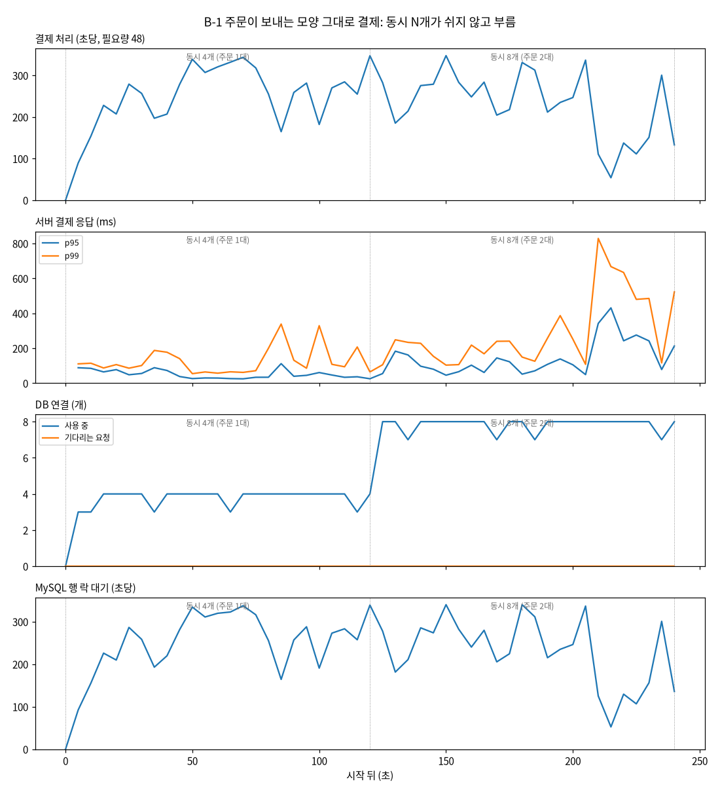
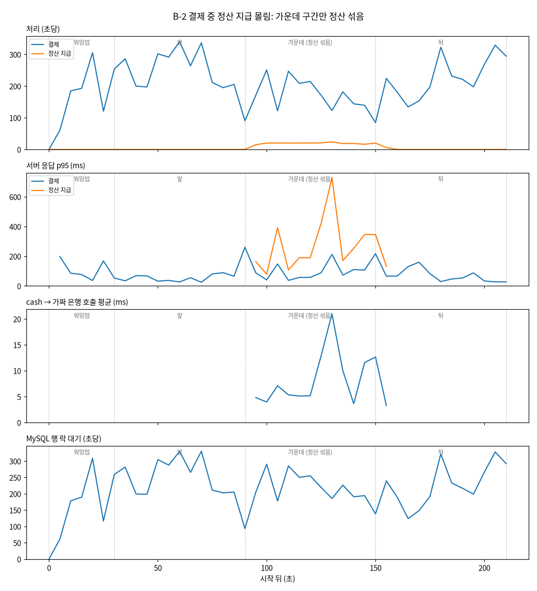
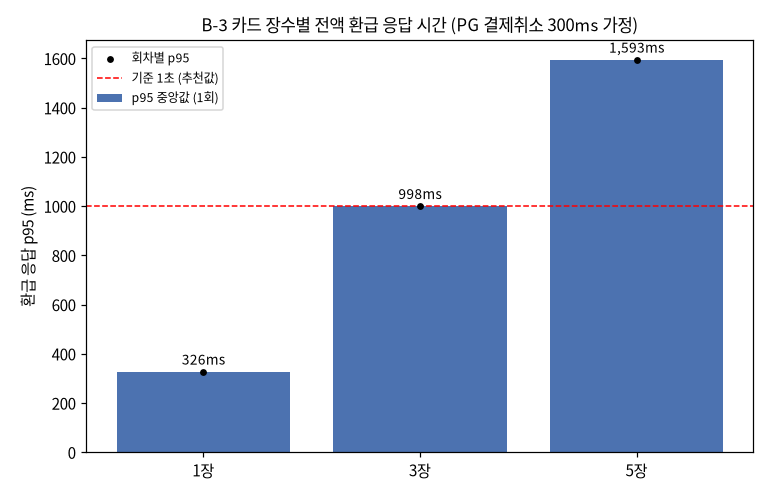
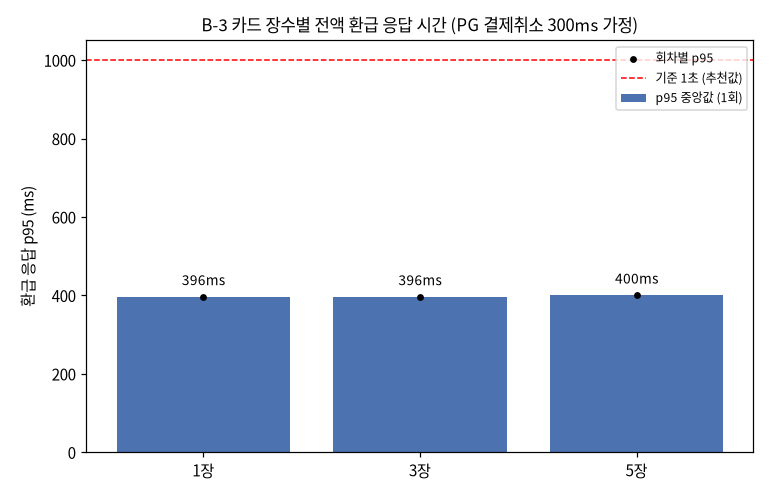
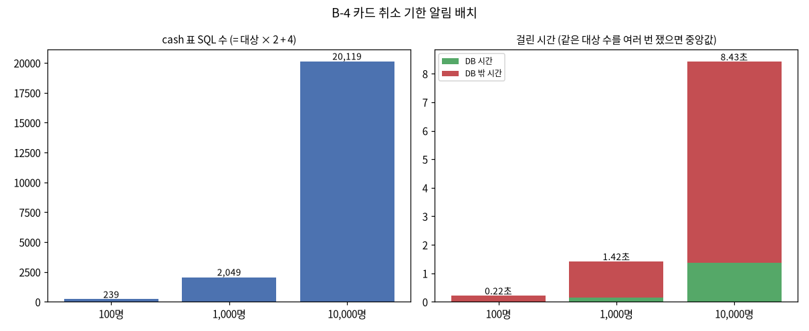
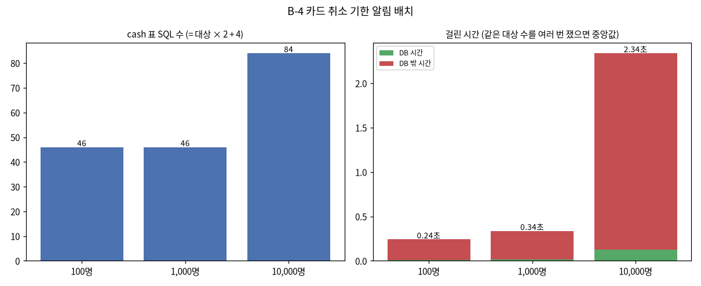
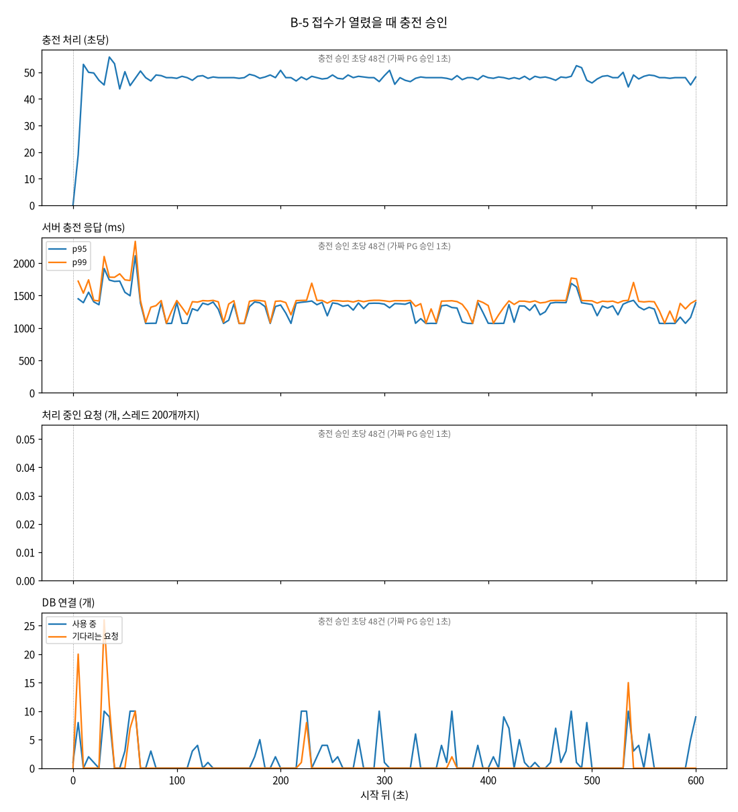
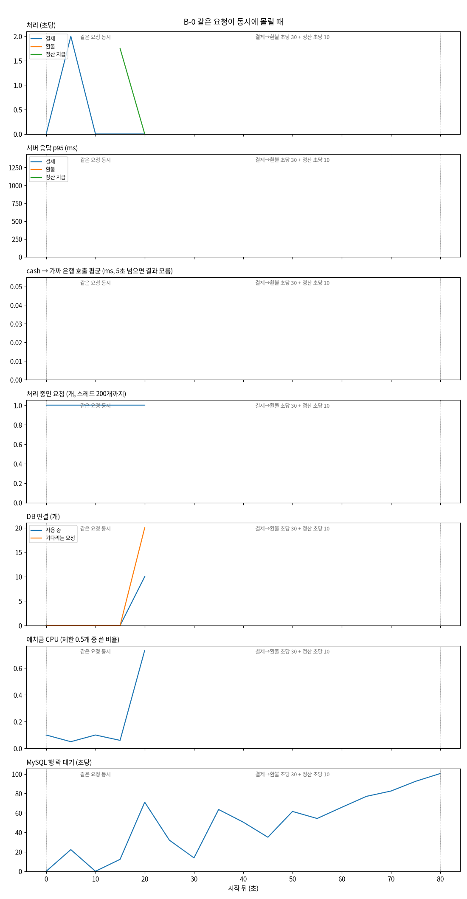
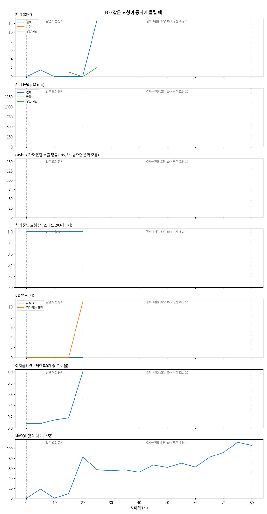
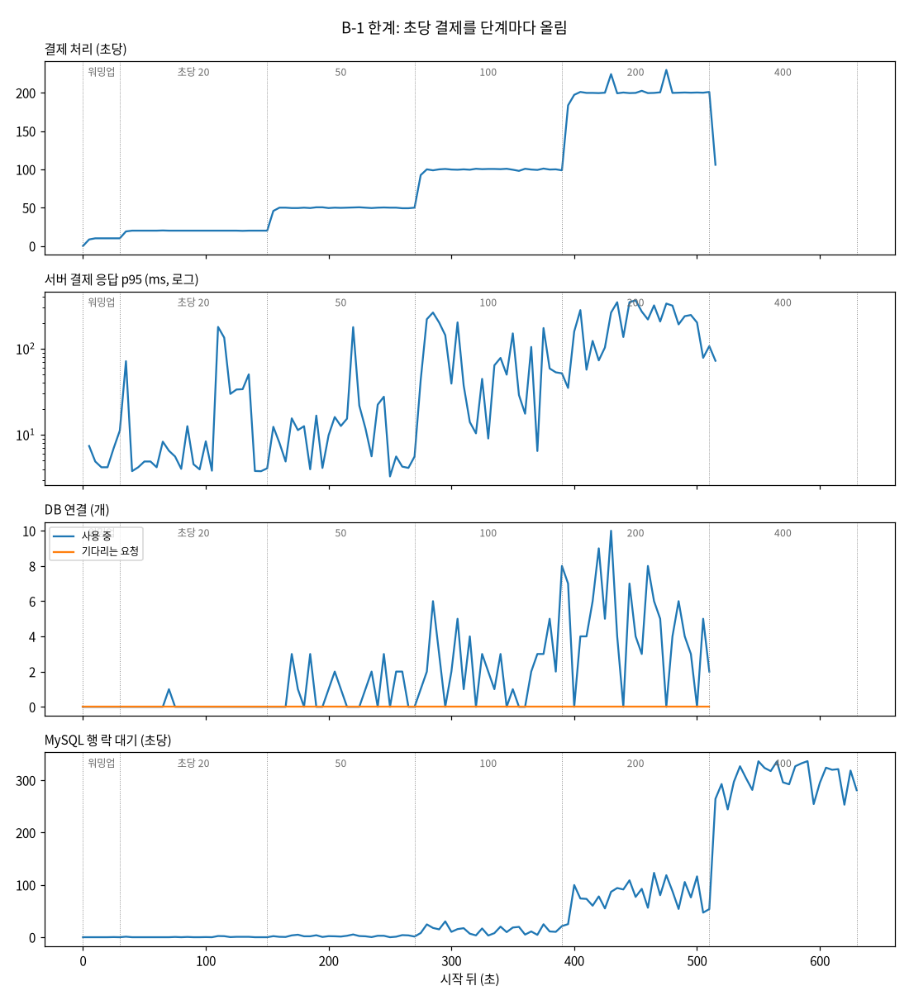

# 예치금 부하 1차: 테스트 계획서와 결과 보고서 (2026-11-17)

예치금 1차 측정(기준선 11/17, 고친 뒤 A·B 11/17)을 실무에서 흔한 양식(계획서 → 보고서)으로 다시 썼어요.
숫자는 아래 「출처」의 측정 문서에서 가져왔고, 원본 문서는 고치지 않았어요.

- 자세히 (시나리오마다 부하·기준·결과·원인을 모두): [1차 상세](2026-11-17-예치금-부하-1차-상세.md)
- Linear: BUK-11

## 1부. 테스트 계획서 (재기 전)

### 1. 목적과 범위

예치금이 예상 트래픽(결제·충전 각 초당 48건)을 버티는지, 코드에서 의심한 곳이 실제로 느리거나 틀리는지 봐요. 고친 뒤에는 그 문제가 사라지고 다른 곳이 나빠지지 않았는지 봐요.

- **묻는 것** (시나리오마다 「의심한 곳」)
  1. 결제를 주문이 보내는 모양(동시 4·8개)으로 받을 때 초당 48건을 p99 1초 안에 처리하나? 모든 결제가 맡아 두는 지갑 한 행을 잠가요. (B-1)
  2. 결제 중에 정산 지급이 섞이면 결제가 얼마나 느려지나? 정산 지급도 같은 행을 잠가요. (B-2)
  3. 같은 요청이 동시에 몰려도 돈이 한 번만 움직이나? (B-0)
  4. 카드가 많은 회원의 전액 환급이 장수만큼 느려지나? 카드 결제취소를 한 장씩 차례로 불러요. (B-3)
  5. 기한 알림 배치의 SQL이 대상 수만큼 늘어나나? 회원마다 지갑·충전을 다시 조회해요. (B-4)
  6. 충전 승인을 초당 48건으로 받을 수 있나? 주문의 동시 호출 제한을 거치지 않아요. (B-5)
  7. (고친 뒤) 고친 문제는 사라지고, 고치지 않은 시나리오는 나빠지지 않나?
- **범위 안**: 예치금 서비스 하나. 결제, 환불, 정산 지급, 환급, 충전 승인, 기한 알림 배치
- **범위 밖**: 게이트웨이·주문·대기열을 거치는 흐름(시나리오 A가 맡아요), 진짜 토스·은행, 운영 서버

### 2. 수용 기준

팀이 합의한 SLO는 아직 없어요. 그래서 주문 설정과 기획 건강 지표에서 통과선을 끌어왔어요. 숫자를 보고 바꾸지 않도록 측정 전에 커밋해요.

| 통과선 | 값 | 시나리오 | 근거 | 종류 |
|---|---|---|---|---|
| 결제 처리량 | 초당 48건 이상 | B-1 | 대기열 속도에서 계산한 예상 트래픽 | 근거 있음 |
| 결제 p99 | 1초 미만 | B-1, B-2 | 주문이 예치금 응답을 2초까지 기다려요(`order.clients.timeout`). 그 절반 | 근거 있음 |
| 결제 p95 | 2초 미만 | 모든 시나리오 | 기획 건강 지표 H7의 경보선 | 근거 있음 |
| 정산이 섞인 1분의 결제 처리량 | 앞 1분의 80% 이상 | B-2 | | 추천값(미확정) |
| 같은 정산 동시 지급의 서버 오류(500) | 0건 | B-0 | 정산 서비스는 500을 받으면 실패로 보고 다시 불러요 | 근거 있음 |
| 카드 5장 환급 p95 | 1초 미만 | B-3 | 화면에서 기다리는 요청 | 추천값(미확정) |
| 대상 100 → 10,000명일 때 SQL 수 | 10배 이하로 늘어남 | B-4 | 대상 수에 비례하는지 | 추천값(미확정) |
| 충전 p95 / 실패율 | 2초 미만 (PG 1초 + 1초) / 1% 미만 | B-5 | | 추천값(미확정) |
| 돈 어긋남 | 0 (C1~C7) | 모든 시나리오 | 건강 지표 H5 중복 결제 0, H6 장부 불일치 0원 | 근거 있음 |

- 고치기 전(A)은 이 선을 넘으면 「문제 있음」(P1~P8)이에요. 값은 3번 중 가운데 값, 돈 확인만은 3번 모두 통과해야 해요.
- 고친 뒤(B)는 「나아짐」(G1~G6)을 모두 맞춰야 해요.
  - G1 고친 문제의 P 조건이 더는 맞지 않음
  - G3 카드 5장 p95가 1장 p95의 2배 안, G4 1만 명 SQL 수가 100명의 2배 안이고 걸린 시간이 늘지 않음 (추천값)
  - G5 고치지 않은 시나리오의 p95가 20% 넘게 나빠지지 않고 실패율 차이가 0.5%p 안 (추천값)
  - G6 돈 확인 통과
- 결제 처리량(P1·P2)을 통과하면 결제 잠금(맡아 두는 지갑)은 고치지 않고, 한계 측정으로 여유만 적어요.

### 3. 워크로드 모델

**부하 크기의 근거.** 운영 피크 자료가 없어 실제 대회 사례와 코드 설정에서 출발해요.

1. **입구**: 정원 × 배수(보통 4.5 · 평균 6 · 최악 7.5배). 천안 이봉주 대회의 동시 접속 31,852명 등이 근거예요. 이 부하는 대기열·게이트웨이가 받아요.
2. **예치금까지 오는 양**: 대기열이 5초마다 종목당 20명(초당 4명)을 들여보내요. 동시에 여는 종목 12개(가정: 대회 3개 × 종목 4개)면 결제가 **초당 48건**이에요. 처음 쓰는 사람은 잔액이 0원이라 충전도 초당 48건으로 봐요(가정: 참가자 100% 충전).
3. **결제의 모양**: 주문 서버 한 대는 예치금 결제를 동시에 4개까지만 보내요(`max-concurrent-pay: 4`). 그래서 결제는 「초당 몇 건」이 아니라 「동시 몇 개」로 걸어요.

**시나리오 (무엇을 어떤 비율로).**

| 이름 | 요청 | 부하 | 판정 |
|---|---|---|---|
| B-0 | 같은 주문 결제 100번, 같은 정산 지급 50번, 같은 충전 승인 50번을 동시에. 이어서 1분 동안 결제 직후 환불과 정산 지급 섞기 | 동시 몰림 20초 + 환불 초당 30건·정산 초당 10건 1분 | P4, P8 |
| B-1 | 결제 (1,000명 중 무작위, 1만 원) | 동시 4개 2분 → 동시 8개 2분 | P1, P2, P8 |
| B-2 | 결제 + 가운데 1분에만 정산 지급 | 결제 동시 4개 3분, 정산 초당 20건 | P3, P8 |
| B-3 | 카드 1·3·5장 회원의 전액 환급 | 장수마다 30명, 동시 10명 | P5 |
| B-4 | 기한 알림 배치 한 번 | 대상 100 · 1,000 · 10,000명 | P6 |
| B-5 | 충전 승인 (6만 원, 가입 24시간 안 된 회원) | 초당 48건 10분 | P7, P8 |
| B-5 한계 | 대기열 없이 1,000명이 같은 순간 충전 | 1,000명 동시 1번 | 돈만 판정 |
| B-1 한계 | 결제 도착 속도 올리기 | 초당 20 → 50 → 100 → 200 → 400건, 2분씩 | 판정 안 함 |

**시험 종류 (얼마나, 어떤 모양으로).**

| 종류 | 이번에 하는 것 |
|---|---|
| smoke | 예열: 결제 동시 2개 30초 (버림) |
| average | B-1 동시 4·8개, B-5 초당 48건 10분 |
| average + 섞기 | B-2 결제 중 정산 지급 1분 |
| spike | B-0 같은 요청 50~100번 동시, B-5 한계 1,000명 동시 |
| breakpoint | B-1 한계 (초당 20 → 400건) |
| 규모 늘리기 | B-4 대상 100 → 10,000명 (SQL 수가 대상에 비례하는지) |
| soak | 하지 않음 |

### 4. 환경과 데이터

GitHub Actions 머신 한 대(CPU 4개, 메모리 16GB)에서 컨테이너마다 자원을 묶어요. 주문 측정과 같은 값을 써서 서로 비교할 수 있게 했어요. 운영에는 부하를 주지 않아요.

| 컨테이너 | CPU | 메모리 |
|---|---|---|
| 예치금 | 0.5개 | 768MB |
| MySQL | 1.0개 | 2GB |
| Redpanda(Kafka), Prometheus | 0.25개씩 | |
| Redis, mysqld-exporter | 0.1개씩 | |
| k6 | 1.0개 | |

**운영과 다른 점**

| | 이번 환경 | 운영 |
|---|---|---|
| 예치금 CPU | 상한 0.5개 | 요청 50m, 상한 없음 |
| PG·은행 | 가짜. 승인 1초, 결제취소 300ms (추천값). 가짜 은행은 예치금 앱 안에 있어요 | 진짜 |
| 기한 알림 배치 | 매분 실행 | 하루 한 번 (오전 9시) |
| 요청 경로 | k6가 예치금을 직접 부름 | 게이트웨이·주문을 거침 |

→ 숫자는 운영 성능이 아니라 「같은 조건에서의 전후 비교」에만 써요.

**데이터** (반복마다 빈 DB에서 시작)

- 결제 회원 1,000명, 지갑마다 1,000만 원(잔액 상한). 판매자 50명
- 카드 충전이 1·3·5장인 회원 30명씩 (한 장에 1만 원)
- 카드 결제취소 마지막 날이 3일 뒤인 회원 100 · 1,000 · 10,000명 (B-4 직전에만 넣음)
- 가입 24시간 안 된 잔액 0원 회원 30,000명 (B-5, 회원 한 명은 한 번만 충전)

### 5. 관측

| 무엇을 | 어디서 | 왜 |
|---|---|---|
| API별 p50·p95·p99, 처리량, 실패율 | k6 | 판정 |
| 처리 중인 요청(쓰레드), DB 연결 사용·대기 | Prometheus | 무엇이 먼저 차는지 |
| 행 락 대기 횟수·가장 오래 기다린 시간 | MySQL 상태값, 회차 끝에 한 번 | 맡아 두는 지갑 한 행의 줄 |
| 배치 SQL 수·DB 시간·걸린 시간 | MySQL 문장 통계, Spring 배치 기록 | B-4 판정 |
| 은행 호출 평균 시간 | Prometheus | B-0·B-2 정산 지급 |
| 돈 | 확인 SQL C1~C7, 시나리오마다 | 수용 기준 |

### 6. 시작·중단 조건, 위험

**시작 조건**

- 판정 기준 문서가 커밋돼 있어요.
- 빈 DB에 시드를 넣고 예열 30초가 끝났어요.
- A·B 측정이면, A(고친 커밋 세 개만 되돌린 코드)가 충돌 없이 만들어져요.

**중단 조건**

- 자동 중단은 두지 않았어요. 실행 머신이 죽거나 A를 만들 수 없으면 멈추고 다시 돌려요.

**위험과 대책**

| 위험 | 대책 |
|---|---|
| 공용 실행 머신이 회차마다 흔들려요 | A만 3번(기준선) → 고친 뒤 A·B를 번갈아 3번. 가운데 값으로 판정해요 |
| 막 띄운 직후라 느려요 (JIT) | 예열 30초. 예열 구간은 판정에서 빼요 |
| 고치는 사이 dev를 받아 와 다른 변경이 섞여요 | 기준선 코드를 A로 쓰지 않고, B에서 고친 커밋만 되돌린 코드를 A로 써요 |
| 행 락 통계를 회차 끝에 한 번만 읽어요 | 어느 시나리오에서 오래 기다렸는지는 구분하지 못해요 (실제로 이 한계가 드러나 2차에서 시나리오마다 읽게 고쳤어요) |
| 가짜 은행이 앱 안에 있어 바쁠 때 부하를 더해요 | 기록만 해요 (2차에서 앱 밖으로 뺐어요) |
| 운영에 영향 | 운영에는 요청을 보내지 않아요 |

## 2부. 결과 보고서 (잰 뒤)

### 요약

- **결제·충전은 예상 트래픽을 버텨요.** 결제는 동시 4개에서 초당 246~265건(필요량의 5배), 충전은 초당 48건에서 p95 약 1초(가짜 PG 1초 포함), 실패 0이에요.
- **고친 세 문제는 모두 사라졌어요.** 같은 정산 동시 지급 500이 9건 → 0건, 카드 5장 환급 p95가 1,596ms → 421ms, 기한 알림 1만 명 SQL이 20,119개 → 83개예요.
- **돈은 모든 회차에서 맞았어요.** 기준선 3번, A·B 6번 모두 어긋남 0이에요.
- **판정 기준대로면 B는 「나아짐」이 아니에요.** 고치지 않은 결제 동시 4개의 p95가 A보다 23% 높아서 G5(20% 안)를 넘었어요.
- **고치지 않은 것 둘:** 정산이 섞이면 결제 처리량이 70%로 떨어지는 문제(P3)와 B-0 결제 p95 4초(P8)예요. P8 원인은 2차에서 예열로 확인했어요.

### 기준 대비 통과·실패

값은 3번 중 가운데 값이에요. 고치기 전·후는 고친 뒤 A·B 측정(같은 머신)의 숫자예요.

| 기준 | 통과선 | 고치기 전 (A) | 고친 뒤 (B) | 결과 |
|---|---|---|---|---|
| P1 결제 동시 4개 | 초당 48건 이상, p99 1초 미만 | 초당 265건, p99 90ms | 초당 246건, p99 86ms | 통과 |
| P2 결제 동시 8개 | 같음 | 초당 288건, p99 188ms | 초당 279건, p99 118ms | 통과 |
| P3 정산이 섞인 1분의 결제 | p99 1초 미만, 처리량 80% 이상 | p99 98ms, 처리량 70% | p99 110ms, 처리량 69% | **실패** (고치지 않음) |
| P4 같은 정산 50번 동시 지급의 500 | 0건 | 9건 | 0건 | 통과 (고침) |
| P5 카드 5장 환급 p95 | 1초 미만 | 1,596ms | 421ms | 통과 (고침) |
| P6 대상 100 → 10,000명 SQL 수 | 10배 이하 | 84배 (239 → 20,119) | 1.8배 (46 → 83) | 통과 (고침) |
| P7 충전 초당 48건 | p95 2초 미만, 실패 1% 미만 | p95 1,047ms, 실패 0% | p95 1,067ms, 실패 0% | 통과 |
| P8 어느 시나리오든 결제 p95 | 2초 미만 | B-0에서 3,988ms | B-0에서 4,591ms | **실패** (원인은 예열, 2차에서 확인) |
| G3 카드 5장 p95 ÷ 1장 p95 | 2배 안 | | 421 ÷ 396ms | 통과 |
| G4 1만 명 SQL ÷ 100명, 걸린 시간 | 2배 안, 늘지 않음 | 8.43초 | 83 ÷ 46, 2.34초 | 통과 |
| G5 고치지 않은 시나리오의 p95 | 20% 넘게 나빠지지 않음 | 결제 동시 4개 43ms | 53ms (+23%) | **실패** |
| 돈 확인 C1~C7 | 어긋남 0 | 0 | 0 | 통과 |

**기록만 하는 숫자**

| | A | B |
|---|---|---|
| B-5 한계(1,000명 동시) 가장 느린 응답 | 6,621ms | 6,776ms |
| 회차 전체 가장 오래 기다린 행 락 | 4,350ms | 5,347ms (6번 중 5번이 2초 넘음) |
| 결제 한계: 따라가는 도착 속도 | 초당 200건까지 | 초당 200건까지 (400건에서 무너짐) |

### 병목과 원인

| 장면 | 원인 | 확인 정도 |
|---|---|---|
| P4 같은 정산 동시 지급 500 | 정산 지급이 지갑을 잠그기 전에 판매자를 일반 조회해요. MySQL(REPEATABLE READ)은 첫 일반 조회 때 읽기 시점을 잡아서, 잠금을 얻은 뒤에도 앞 요청의 수수료 기록이 안 보여요. 같은 기록을 다시 넣다 유니크 키에 걸려요. 돈은 맞았어요 | MySQL 테스트로 재현 (10번 중 9번 500 → 고친 뒤 통과). 테스트 DB인 H2는 READ COMMITTED라 놓쳤어요 |
| P5 카드 5장 환급 1.6초 | 카드 결제취소(300ms)를 한 장씩 차례로 불러요 | 장수에 비례 (340 / 998 / 1,596ms) |
| P6 배치 SQL 2만 개 | 회원마다 지갑 한 번, 충전 한 번을 따로 조회해요 | SQL 수 = 대상 × 2 + 고정 몇 개 |
| P3 정산이 섞이면 처리량 70% | 결제와 정산 지급이 맡아 두는 지갑 한 행을 함께 잠그고, 정산 지급이 더 오래 두 번 쥐어요 | 추정 |
| P8 B-0 결제 p95 4초 | 막 띄운 앱에서 환불·정산이 처음 도는 비용. 섞인 구간에서 CPU가 상한에 닿은 뒤 앱 지표가 비었어요 | 1차에서는 미확정. 2차에서 같은 구간을 다시 돌리면 p95 8ms로 확인 |
| 2초 넘는 행 락 | 회차 끝에 한 번만 읽어 어느 시나리오인지 몰라요 | 미확정. 2차에서 막 띄운 직후 예열로 확인(JFR) |
| G5 결제 동시 4개 p95 +23% | 고친 커밋은 결제 경로를 바꾸지 않았어요. p99는 오히려 B가 낮고(90 → 86ms), 기준선 A(51~64ms) 범위 안이에요 | 흔들림으로 보지만 3번 모두 B가 높아 확정 못 함 |

### 그래프

칸 구성은 그래프마다 달라요. 그래프 위 제목과 칸 이름을 보세요.

**B-1 결제 동시 4·8개 (기준선 3회차).** 동시 수를 두 배로 늘려도 처리량이 크게 오르지 않아요. 맡아 두는 지갑 한 행이 천장이에요.

**B-2 정산이 섞인 1분 (기준선 3회차).** 가운데 1분 동안 결제 처리량이 떨어져요.

**B-3 카드 장수별 환급, 고치기 전 (A 2회차).** 장수에 비례해 느려져요.

**B-3 카드 장수별 환급, 고친 뒤 (B 2회차).** 장수와 상관없이 가장 느린 한 장 정도예요.

**B-4 기한 알림, 고치기 전 (A 2회차).** SQL 수가 대상 수만큼 늘어요.

**B-4 기한 알림, 고친 뒤 (B 2회차).** 대상이 100배가 돼도 SQL 수는 두 배 안이에요.

**B-5 충전 승인 초당 48건 (기준선 3회차).**

**B-0 같은 요청이 동시에 몰릴 때, 고치기 전 (A 2회차).** 20초에 섞인 구간이 시작되자 CPU가 오르고 앱 지표가 비어요.

**B-0, 고친 뒤 (B 2회차).** 같은 모양이에요. 고친 것과 상관없는 문제예요.

**B-1 한계 (B 2회차).** 초당 200건까지 처리량이 도착 속도를 따라가고, 400건에서 앱 지표가 비어요.

### 권고

| 순서 | 할 일 | 이유 |
|---|---|---|
| 1 | P8 원인 가리기: 가짜 은행을 앱 밖으로, 앱이 바빠도 지표가 남게 한 뒤 B-0 섞인 구간을 따로 재기 | 측정 도구가 부하를 키웠고 지표가 비어 확정하지 못했어요 (→ 2차에서 함) |
| 2 | 가장 오래 기다린 락이 어느 시나리오인지 가리고 락 대기 제한 정하기 | 6번 중 5번이 주문 대기 시간(2초)을 넘었어요 (→ 2차에서 예열로 확인, 락 대기 제한은 CRU-87) |
| 3 | 결제 취소의 「잠그기 전 일반 조회」 재현 | P4와 같은 모양이에요 |
| 4 | G5를 넘은 결제 동시 4개 p95 다시 재기 | 다음에도 B가 높으면 흔들림이 아니에요 |
| 5 | 배치 1만 명의 DB 밖 2.2초 보기 | 급하지 않아요. 추적으로 어디에 쓰이는지 봐요 |
| 6 | P3(정산이 섞이면 처리량 70%)는 고치지 않기 | 결제 p99가 기준의 10분의 1이고, 실제 정산은 새벽 4시 배치라 접수와 거의 겹치지 않아요 |

### 용량 결론

예상 부하(결제·충전 각 초당 48건)에는 예치금 1대로 여유가 있어요. 아래는 측정값에서 계산한 추정이에요.

| 대상 | 1대가 받는 양 | 예상 대비 | 대수를 늘리면 |
|---|---|---|---|
| 결제 | 동시 4·8개에서 초당 246~288건, 도착 속도로는 초당 200건까지 따라가고 400건에서 무너짐 | 약 5배 여유 | **거의 안 올라요.** 모든 결제가 맡아 두는 지갑 한 행을 잠가서 그 한 행이 천장이에요. 동시 4개 → 8개로 늘려도 처리량이 크게 오르지 않았어요 |
| 충전 | 초당 48건에서 p95 약 1초 (가짜 PG 승인 1초 포함). 1,000명 동시 몰림도 실패 0, 가장 느린 응답 약 6.7초 | 버팀 | 올라요. 충전은 회원 지갑만 잠가 회원끼리 겹치지 않아요 |
| 환급 | 카드 5장 p95 421ms (고친 뒤) | 화면 기준(1초) 안 | 해당 없음 |
| 기한 알림 배치 | 1만 명 2.34초, SQL 83개 (DB 시간 0.13초) | 하루 한 번이라 충분 | 해당 없음. 대상 1,000명당 SQL이 2개씩 늘어요 |

- 결제 천장을 더 올리려면 대수가 아니라 맡아 두는 지갑을 여러 행으로 나누는 구조 변경이 필요해요. 이 지갑은 1차 정산 뒤 환불로 잠시 음수가 될 수 있어(정책 6장) 나누면 회수 흐름까지 바뀌어요. 지금 예상 부하에서는 필요 없어요.
- 충전 수치는 가짜 PG 승인 1초를 가정한 값이에요. 토스가 느려질 때는 2차 측정에서 봤어요.

## 출처

| 내용 | 경로 |
|---|---|
| 1차 판정 기준 (예상 부하, 시나리오, P1~P8, G1~G6, C1~C7, 환경) | [2026-11-16-예치금-부하-판정기준.md](../2026-11-16-예치금-부하-판정기준.md) |
| 기준선 (A 3번) | [2026-11-17-예치금-부하-기준선.md](../2026-11-17-예치금-부하-기준선.md) |
| 고친 뒤 A·B | [2026-11-17-예치금-부하-전후.md](../2026-11-17-예치금-부하-전후.md) |
| P8·2초 락 원인 (2차) | [2026-11-19-예치금-부하-2차.md](../2026-11-19-예치금-부하-2차.md) |
| 건강 지표 H5·H6·H7 | [07-north-star-metrics.md](../../ideation/07-north-star-metrics.md) |
| 대회 사례 (천안 31,852명) | [2026-11-15-10pct.md](../../loadtest/scenario-a/results/2026-11-15-10pct.md) |
