# 예치금 부하 1차 상세 (2026-11-16 ~ 11-17)

1차 측정의 모든 내용을 이 문서 하나에 모았어요. 판정 기준, 지금 코드를 3번 잰 기준선, 고친 뒤 A·B를 번갈아 잰 결과가 다 들어 있어요.
시나리오마다 같은 순서(① 왜 재나 → ② 부하 → ③ 보는 것 → ④ 판정 기준 → ⑤ 결과 숫자 → ⑥ 통과 여부 → ⑦ 그래프 → ⑧ 원인 → ⑨ 어떻게 했나)로 적었어요.

- 짧게 보려면: [1차 계획서·보고서](2026-11-17-예치금-부하-1차-계획서-보고서.md)
- 이 문서를 만든 원래 문서 4개는 그대로 두었어요. 숫자는 모두 거기서 가져왔어요.
  - [판정 기준 (11/16, 재기 전에 커밋)](../2026-11-16-예치금-부하-판정기준.md)
  - [맥 연습 측정 (11/16)](../2026-11-16-예치금-부하.md)
  - [기준선, 지금 코드 3번 (11/17 새벽)](../2026-11-17-예치금-부하-기준선.md)
  - [고친 뒤 A·B (11/17 낮)](../2026-11-17-예치금-부하-전후.md)
- Linear: BUK-11

## 목차

- [0. 이 문서를 읽는 법](#0-이-문서를-읽는-법)
- [1. 한눈에 보기](#1-한눈에-보기)
- [2. 왜 쟀나](#2-왜-쟀나)
- [3. 공통 조건](#3-공통-조건)
  - [3-1. 예상 트래픽 계산](#3-1-예상-트래픽-계산)
  - [3-2. 측정 환경](#3-2-측정-환경)
  - [3-3. 데이터](#3-3-데이터)
  - [3-4. 세 번의 측정과 도는 순서](#3-4-세-번의-측정과-도는-순서)
- [4. 판정 기준 전체 목록](#4-판정-기준-전체-목록)
- [5. 시나리오별 상세](#5-시나리오별-상세)
  - [5-1. 예열](#5-1-예열)
  - [5-2. B-0 같은 요청이 동시에 몰릴 때](#5-2-b-0-같은-요청이-동시에-몰릴-때)
  - [5-3. B-1 결제를 주문이 보내는 모양으로 받을 때](#5-3-b-1-결제를-주문이-보내는-모양으로-받을-때)
  - [5-4. B-2 결제 중에 정산 지급이 섞일 때](#5-4-b-2-결제-중에-정산-지급이-섞일-때)
  - [5-5. B-3 카드가 많은 회원의 전액 환급](#5-5-b-3-카드가-많은-회원의-전액-환급)
  - [5-6. B-4 카드 취소 기한 알림 배치](#5-6-b-4-카드-취소-기한-알림-배치)
  - [5-7. B-5 충전 승인 초당 48건](#5-7-b-5-충전-승인-초당-48건)
  - [5-8. B-5 한계 1000명이 같은 순간에 충전](#5-8-b-5-한계-1000명이-같은-순간에-충전)
  - [5-9. B-1 한계 결제 도착 속도를 계속 올리기](#5-9-b-1-한계-결제-도착-속도를-계속-올리기)
- [6. 측정하면서 찾은 다른 문제](#6-측정하면서-찾은-다른-문제)
- [7. 한계](#7-한계)
- [8. 다음 할 일과 지금 상태](#8-다음-할-일과-지금-상태)
- [9. 판정 기준을 바꾼 기록](#9-판정-기준을-바꾼-기록)
- [10. 부록 맥 연습 측정](#10-부록-맥-연습-측정)
- [11. 원본 위치와 다시 내는 법](#11-원본-위치와-다시-내는-법)

## 0. 이 문서를 읽는 법

### 말

| 말 | 뜻 |
|---|---|
| A | 고치기 전 코드예요. 기준선에서는 그때의 코드, A·B 측정에서는 고친 코드에서 고친 커밋만 되돌린 코드예요 |
| B | 고친 코드예요 |
| 회차 | 한 바퀴예요. 빈 DB로 띄우고, 시나리오를 처음부터 끝까지 돌리고, 내려요. 한 측정에서 3번(A·B 측정은 A 3번, B 3번) 돌려요 |
| 중앙값 | 3회차 값 중 가운데 값이에요. 판정은 이 값으로 해요. 돈 확인만은 3회 모두 통과해야 해요 |
| p50·p95·p99 | 응답 시간을 빠른 순으로 줄 세웠을 때 50%·95%·99% 자리의 값이에요. p99 1초는 「100번 중 99번은 1초 안」이라는 뜻이에요 |
| 처리량 | 1초에 끝낸 요청 수예요 |
| 동시 N개 | 요청을 N개씩 보내고, 하나가 끝나면 바로 다음을 보내요. 서버가 느려지면 보내는 양도 줄어요. 주문 서버가 예치금 결제를 보내는 모양이에요 |
| 초당 N건 | 서버가 느려도 1초에 N건씩 계속 보내요. 서버가 못 따라가면 줄이 쌓여요 |
| 버려진 반복 | 「초당 N건」으로 보내야 하는데 k6의 가상 사용자가 모자라 보내지 못한 요청이에요. 서버가 못 따라간다는 신호예요 |
| 보관 지갑 | 주문 대금을 정산 전까지 맡아 두는 지갑이에요. 한 개(한 행)뿐이라 모든 결제·환불·정산 지급이 이 행을 잠가요. 옛 문서에는 「홀딩 지갑」, 「맡아 두는 지갑」으로도 적혀 있어요 |
| 행 락 대기 | 다른 요청이 잠근 DB 행을 풀어 주길 기다린 일이에요 |
| 예열 | 막 띄운 앱은 처음 도는 코드마다 클래스를 읽고 컴파일해서 느려요. 그래서 측정 전에 짧게 돌리고 숫자는 버려요 |

### 판정 기호

| 기호 | 뜻 | 누구에게 쓰나 |
|---|---|---|
| P1~P8 | 「문제 있음」 조건이에요. 하나라도 맞으면 고칠 대상이에요 | A |
| G1~G6 | 「나아짐」 조건이에요. 모두 맞아야 나아졌다고 해요 | 고친 뒤 B |
| C1~C7 | 돈 확인이에요. 모든 회차에서 0이어야 해요 | A·B 모두 |

기호 옆에는 늘 뜻을 함께 적었어요. 예: 「P4 (같은 정산 동시 지급에서 500이 나나)」

## 1. 한눈에 보기

| 시나리오 | 무엇을 의심했나 | 부하 | 기준 | 기준선 A (11/17 새벽) | A·B (11/17 낮) A → B | 결과 |
|---|---|---|---|---|---|---|
| B-0 | 같은 요청이 겹치면 돈이 두 번 움직이나 | 같은 결제 100·같은 정산 50·같은 충전 50번 동시 → 1분 섞기 | P4 같은 정산 동시 지급 500 0건 | 9건 ✗ | 9 → **0건** | **고쳐서 통과** |
| B-0 | 섞인 1분 결제가 느린가 | 위와 같음 | P8 결제 p95 2초 미만 | 4,579ms ✗ | 3,988 → 4,591ms ✗ | **실패** (원인은 2차에서 예열로 확인) |
| B-1 | 보관 지갑 한 행이 결제를 막나 | 결제 동시 4개 2분 | P1 초당 48건 이상, p99 1초 미만 | 초당 259건, 128ms ✓ | 265건·90ms → 246건·86ms ✓ | 통과 |
| B-1 | 주문 서버 2대면 | 결제 동시 8개 2분 | P2 같은 선 | 초당 225건, 243ms ✓ | 288건·188ms → 279건·118ms ✓ | 통과 |
| B-2 | 정산 지급도 같은 행을 잠가 결제를 늦추나 | 결제 동시 4개 3분, 가운데 1분 정산 초당 20건 | P3 p99 1초 미만, 처리량 80% 이상 | 227ms, **72%** ✗ | 70% → 69% ✗ | **실패** (고치지 않기로 함) |
| B-3 | 카드 결제취소를 한 장씩 불러 느린가 | 카드 1·3·5장 회원 30명씩, 동시 10명 | P5 5장 p95 1초 미만 | 1,797ms ✗ | 1,596 → **421ms** | **고쳐서 통과** |
| B-4 | 배치 SQL이 대상 수만큼 느나 | 대상 100·1,000·10,000명 | P6 100배일 때 SQL 10배 이하 | 98배 ✗ | 84배 → **1.8배** | **고쳐서 통과** |
| B-5 | 충전이 주문 제한 없이 몰리면 | 충전 승인 초당 48건 10분 | P7 p95 2초 미만, 실패 1% 미만 | 1,309ms, 0% ✓ | 1,047 → 1,067ms ✓ | 통과 |
| B-5 한계 | 대기열 없이 몰려도 돈이 맞나 | 1,000명이 같은 순간 충전 1번 | 돈만 판정 | 돈 맞음, 가장 느린 7.4초 ✓ | 돈 맞음 ✓ | 통과 |
| B-1 한계 | 결제가 어디서 무너지나 | 초당 20 → 400건, 2분씩 | 판정 안 함 | 초당 약 170건에서 멈춤 (배치와 겹침) | 200건까지 따라가고 400건에서 무너짐 | 기록만 |
| 전체 | 돈이 맞나 | 모든 시나리오 끝마다 | C1~C7 어긋남 0 | 0 ✓ | 0 → 0 ✓ | 통과 (9회 모두) |

고친 뒤 「나아짐」 판정은 G5 하나 때문에 「나아짐 아님」이에요. 고치지 않은 B-1 동시 4개의 결제 p95가 43 → 53ms(+23%)로, 20% 선을 넘었어요([5-3 ⑥](#5-3-b-1-결제를-주문이-보내는-모양으로-받을-때)).

## 2. 왜 쟀나

예치금은 플랫폼의 모든 결제가 지나가는 곳이에요. 접수가 열리는 순간 결제·충전이 몰리는데, 그때 버티는지와 돈이 맞는지를 숫자로 확인하려고 쟀어요.
코드를 읽으며 의심한 곳을 하나씩 시나리오로 만들었어요.

| 번호 | 질문 | 시나리오 |
|---|---|---|
| 1 | 결제를 주문이 보내는 모양(동시 4·8개)으로 받을 때 초당 48건을 p99 1초 안에 처리하나? 모든 결제가 보관 지갑 한 행을 잠가요 | B-1 |
| 2 | 결제 중에 정산 지급이 섞이면 결제가 얼마나 느려지나? 정산 지급도 같은 행을 잠가요 | B-2 |
| 3 | 같은 요청이 동시에 몰려도 돈이 한 번만 움직이나? | B-0 |
| 4 | 카드가 많은 회원의 전액 환급이 장수만큼 느려지나? 카드 결제취소를 한 장씩 차례로 불러요 | B-3 |
| 5 | 기한 알림 배치의 SQL이 대상 수만큼 늘어나나? 회원마다 지갑·충전을 다시 조회해요 | B-4 |
| 6 | 충전 승인을 초당 48건으로 받을 수 있나? 결제와 달리 주문의 동시 호출 제한을 거치지 않아요 | B-5, B-5 한계 |
| 7 | (고친 뒤) 고친 문제는 사라지고, 고치지 않은 곳은 나빠지지 않나? | A·B 측정 |

범위 밖: 게이트웨이·주문·대기열을 거치는 흐름(시나리오 A가 맡아요), 진짜 토스·은행, 운영 서버예요.

## 3. 공통 조건

### 3-1. 예상 트래픽 계산

운영 피크 자료가 없어서 실제 대회 사례와 코드 설정에서 계산했어요.

| 값 | 정한 값 | 근거 | 종류 |
|---|---|---|---|
| 동시에 접수를 여는 종목 | 12개 (대회 3개 × 종목 4개) | 국내 대회는 연 약 450개, 대회당 평균 3,560명이에요(`docs/ideation/11-market-sizing.md`). 일주일에 9개꼴이라 성수기에 접수 시작이 겹치는 대회를 3개로 봤어요. 종목은 5K·10K·하프·풀 4개예요 | 가정 |
| 대기열이 들여보내는 속도 | 종목당 초당 4명 | 5초마다 종목당 20명을 들여보내요(`queue.schedule`) | 코드 |
| 결제 | **초당 48건** | 4명 × 12종목. 들어온 사람이 모두 결제한다고 봐요 | 계산 |
| 충전 | **초당 48건** | 처음 쓰는 사람은 예치금이 0원이라 결제 전에 반드시 충전해요. 충전 화면은 결제 화면 안에만 있어서 들어오는 속도를 넘지 못해요 | 가정 (참가자 100% 충전) |
| 결제의 모양 | 주문 서버 한 대가 동시 4개 | 주문은 예치금 결제를 서버 한 대당 동시 4개까지만 보내고, 1초 안에 자리가 안 나면 「잠시 후 다시」로 돌려보내요(`max-concurrent-pay: 4`, `pay-acquire-timeout: 1s`) | 코드 |
| 운영 서버 수 | 예치금 1대, 주문 1대 (주문 2대도 한 번 더) | k8s 설정이 `replicas: 1`이에요 | 코드 |

- → 예치금에는 결제가 한꺼번에 몰려오지 않아요. 동시 4개(주문 2대면 8개)가 쉬지 않고 들어오는 모양이에요.
- → 이 모양에서 초당 48건을 넘게 처리하려면 결제 한 건이 약 83ms(4 ÷ 48) 안에 끝나야 해요.
- 입구 쪽 크기(실제 대회 동시 접속, 예: 천안 이봉주 대회 31,852명)는 대기열·게이트웨이가 받아요. 예치금까지는 위 속도로만 들어와요.
- 충전 승인은 게이트웨이와 예치금이 대기열을 확인하지 않아요. 기다리는 동안 다른 탭에서 충전하는 길이 있어서, 그 몰림은 B-5 한계로 따로 봐요.

### 3-2. 측정 환경

GitHub Actions 머신 한 대(`ubuntu-latest`, CPU 4개, 메모리 16GB)에서 컨테이너마다 자원을 묶어요. 주문 결제 잠금 측정과 같은 값이에요. 운영에는 요청을 보내지 않아요.

| 컨테이너 | CPU | 메모리 |
|---|---|---|
| 예치금 | 0.5개 | 768MB |
| MySQL | 1.0개 | 2GB |
| Redpanda(Kafka), Prometheus | 0.25개씩 | |
| Redis, mysqld-exporter | 0.1개씩 | |
| k6 | 1.0개 | |

| | 이번 환경 | 운영 |
|---|---|---|
| 예치금 CPU | 상한 0.5개 | 요청 50m, 상한 없음 |
| PG | 가짜. 승인 1초, 결제취소 300ms (추천값(미확정), 실제 토스 시간은 재지 않았어요) | 진짜 토스 |
| 은행 | 가짜. 예치금 앱 안에 있고, 예치금이 자기 자신을 HTTP로 불러요 | 진짜 |
| 회원 서비스 | 가짜 | 진짜 |
| 기한 알림 배치 | 매분 0초 | 하루 한 번 (오전 9시) |
| 요청 경로 | k6가 예치금을 직접 불러요 | 게이트웨이·주문을 거쳐요 |

→ 숫자는 운영 성능이 아니라 「같은 조건에서의 전후 비교」에만 써요.

### 3-3. 데이터

회차마다 빈 DB로 띄우고 시드를 넣어요.

| 데이터 | 양 | 쓰는 시나리오 |
|---|---|---|
| 결제 회원 | 1,000명, 지갑마다 1,000만 원(잔액 상한). 잔액 부족이 나지 않게 해요 | B-0, B-1, B-2, B-1 한계 |
| 판매자 | 50명 | B-0, B-2 |
| 카드 충전 회원 | 카드 1·3·5장 회원 30명씩, 한 장에 1만 원 | B-3 |
| 기한 알림 대상 | 카드 결제취소 마지막 날이 3일 뒤인 회원 100·1,000·10,000명 (B-4 직전에만 넣어요) | B-4 |
| 신규 회원 | 가입 24시간 안 된 잔액 0원 회원 30,000명. 한 명은 한 번만 충전해요(같은 회원은 5분에 3번까지만 시도할 수 있어서) | B-5, B-5 한계 |

- 결제 한 건은 1,000명 중 무작위 회원이 1만 원을 내요(`POST /internal/v1/cash/payments/{주문 번호}`).
- 주문·정산 번호는 실행마다 겹치지 않게 매겨요.

### 3-4. 세 번의 측정과 도는 순서

| 측정 | 날짜·시간 | 코드 | 회차 | 판정에 쓰나 |
|---|---|---|---|---|
| 맥 연습 | 11/16 15:27~17:33 | `cd397860` 등 | 시나리오마다 1~3번 | 아니요. 다른 컨테이너와 자원을 나눠 썼어요([10장](#10-부록-맥-연습-측정)) |
| 기준선 | 11/17 00:46~02:17 | `825e563e` | A 3번 | P 판정 (무엇을 고칠지) |
| 고친 뒤 A·B | 11/17 12:13~16:01 | B `d1637f09`, A = B에서 고친 커밋 세 개만 되돌림 | A·B 번갈아 3번씩 | P와 G 판정 |

**도는 순서 (한 회차)**

```
예열(결제 동시 2개 30초, 버림) → B-0 → B-1(동시 4개 2분 → 동시 8개 2분) → B-2 → B-3 → B-4 → B-5(10분) → B-5 한계 → B-1 한계
```

- 기준선은 B-1 한계를 1회차에만 돌렸어요. A·B 측정은 모든 회차에서 돌렸어요([5-9 ①](#5-9-b-1-한계-결제-도착-속도를-계속-올리기)).
- 시나리오가 끝날 때마다 돈 확인(C1~C6)을 돌리고, 회차 끝에 락 통계(C7)를 읽어요.
- A·B는 A 1회 → B 1회 → A 2회 → B 2회 → A 3회 → B 3회 순서예요. 같은 머신에서 번갈아 재야 머신의 흔들림이 A와 B에 고르게 나뉘어요.
- A를 기준선 코드로 두지 않은 이유: 고치는 사이 dev를 받아 와서 알림 Kafka 전송 수정(BUK-13)이 들어왔어요. 기준선 코드를 A로 쓰면 그 변경이 A·B 차이에 섞여요. 그래서 B에서 고친 커밋 세 개(`c0b1097c`, `168e129f`, `c9734e3b`)만 되돌려 A를 만들었어요(`container/ab-fixes.txt`).

## 4. 판정 기준 전체 목록

재기 전에 커밋했어요(11/16). 숫자를 보고 기준을 바꾸지 않았어요. 근거 없이 고른 값은 「추천값(미확정)」, 자료가 없어 우리가 정한 값은 「가정」이에요.

### 문제 있음 (A가 하나라도 맞으면 고칠 대상)

| 번호 | 뜻 | 시나리오 | 조건 | 근거 | 종류 |
|---|---|---|---|---|---|
| P1 | 주문 1대 모양 결제를 버티나 | B-1 동시 4개 | 처리량 초당 48건 밑, 또는 결제 p99 1초 이상 | 48건은 3-1 예상 트래픽. 1초는 주문이 예치금 응답을 2초까지 기다리니(`order.clients.timeout`) 그 절반 | 근거 있음 |
| P2 | 주문 2대 모양 결제를 버티나 | B-1 동시 8개 | P1과 같은 조건 | 주문 2대일 때 | 근거 있음 |
| P3 | 정산이 섞여도 결제가 버티나 | B-2 | 정산이 섞인 1분의 결제 p99 1초 이상, 또는 처리량이 앞 1분의 80% 밑 | 1초는 P1과 같음 | 80%는 추천값(미확정) |
| P4 | 같은 정산 동시 지급에서 500이 나나 | B-0 | 서버 오류(500)가 1건 이상 | 정산 서비스는 「이미 지급됨」(200)이나 「결과 모름」(503)을 받아야 해요. 500을 받으면 실패로 보고 다시 불러요 | 근거 있음 |
| P5 | 카드 5장 환급이 느린가 | B-3 | 카드 5장 환급 p95 1초 이상 | 화면에서 기다리는 요청 | 추천값(미확정) |
| P6 | 배치 SQL이 대상 수만큼 느나 | B-4 | 대상 100 → 10,000명일 때 SQL 수가 10배 넘게 늘어남 | 대상 수에 비례하는지 봐요 | 추천값(미확정) |
| P7 | 충전 승인을 버티나 | B-5 | 충전 p95 2초 이상(PG 1초 + 1초), 또는 실패 1% 이상 | | 추천값(미확정) |
| P8 | 어느 시나리오든 결제가 2초 넘게 걸리나 | 모든 시나리오 | 결제 p95 2초 이상 | 기획 건강 지표 H7의 경보선(`docs/ideation/07-north-star-metrics.md`) | 근거 있음 |

P1·P2가 통과하면 「결제는 예상 트래픽에서 버틴다」고 적고 결제 잠금(보관 지갑)은 고치지 않아요. 대신 B-1 한계에서 막힌 속도가 초당 48건의 몇 배인지를 여유로 적어요.

### 나아짐 (고친 B가 모두 맞아야)

| 번호 | 뜻 | 조건 | 종류 |
|---|---|---|---|
| G1 | 고친 문제가 사라졌나 | 고친 문제의 P 조건이 B에서 더는 맞지 않음 | |
| G2 | (결제 잠금을 고쳤다면) 처리량이 올랐나 | B-1 동시 8개 처리량이 A보다 30% 이상 높음 | 추천값(미확정) |
| G3 | (환급을 고쳤다면) 장수에 비례하지 않나 | B-3 카드 5장 p95가 1장 p95의 2배 안 | 추천값(미확정) |
| G4 | (배치를 고쳤다면) SQL이 대상에 비례하지 않나 | B-4 10,000명 SQL 수가 100명의 2배 안, 걸린 시간이 A보다 늘지 않음 | 추천값(미확정) |
| G5 | 고치지 않은 곳이 나빠지지 않았나 | 고치지 않은 시나리오의 p95가 A보다 20% 넘게 나빠지지 않고, 실패율 차이가 0.5%p 안 | 추천값(미확정). 공용 머신이라 이 정도는 흔들릴 수 있다고 봤어요 |
| G6 | 돈이 맞나 | C1~C7 모두 통과 | |

### 돈 확인 (A·B 모두, 시나리오마다 끝에 SQL로)

| 번호 | 확인 | 통과 조건 |
|---|---|---|
| C1 | 돈 보존: 이번 실행의 원장 합 + 은행으로 나간 정산 대금 | 0 |
| C2 | 결제와 회원 원장: 결제됨이면 회원 원장 합이 −결제액, 환불됨이면 0 | 어긋난 건 0 |
| C3 | 중복 원장: 같은 주문에 같은 방향 원장이 두 줄 이상 | 0건 |
| C4 | 정산 원장: 보관 지갑에서 빠진 금액 = 송금 기록 금액 | 어긋난 건 0 |
| C5 | 잔액: 지갑 잔액 = 마지막 원장의 거래 후 잔액 | 어긋난 건 0 |
| C6 | 중복 충전: 충전 하나에 충전 원장이 두 줄 이상 | 0건 |
| C7 | MySQL 데드락, 락 대기 시간 초과 (실행 전후 누적값 차이) | 0 |

C가 하나라도 실패하면 응답 시간과 상관없이 가장 먼저 고칠 문제예요(건강 지표 H5 중복 결제 0, H6 예치금 장부 불일치 0원).

**결과: C1~C7은 기준선 3회, A·B 6회, 모든 시나리오에서 0이었어요.**

## 5. 시나리오별 상세

### 5-1. 예열

- **① 왜 재나:** 막 띄운 앱은 처음 도는 코드마다 클래스를 읽고 컴파일해서 느려요. 첫 시나리오(B-0)가 그 비용을 떠안지 않게 하려고 돌려요.
- **② 부하:** 결제 동시 2개, 30초
- **③~⑥:** 숫자는 버려요. 판정하지 않아요.
- **⑧ 나중에 안 것:** 예열은 **결제만** 불러요. 그래서 B-0에서 처음 도는 환불·정산 지급 코드는 데워지지 않아요. 이게 P8(B-0 결제 4초)의 원인이었어요(2차에서 확인, [5-2 ⑧](#5-2-b-0-같은-요청이-동시에-몰릴-때)).

### 5-2. B-0 같은 요청이 동시에 몰릴 때

**① 왜 재나**

같은 요청이 겹치면 결제·정산 지급·충전이 두 번 처리될 수 있어요. 응답이 모두 200이어도 돈은 두 번 빠졌을 수 있어서, 판정은 응답이 아니라 DB(C1~C7)로 해요.

**② 부하**

| 순서 | 요청 | 기대 |
|---|---|---|
| 0~20초 | 같은 주문 결제 100번을 한꺼번에 (회원 1명) | 100번 모두 「결제됨」, 돈은 한 번만 빠짐 |
| 0~20초 | 같은 정산 지급 50번을 한꺼번에 (판매자 1명) | 송금은 한 번. 나머지는 「이미 지급됨」(200) 또는 「처리 중」(503). 500은 안 됨 |
| 0~20초 | 같은 충전 승인 50번을 한꺼번에 (같은 충전 번호) | 충전은 한 번만 |
| 20초~1분 20초 (섞인 1분) | 결제 직후 바로 환불 초당 30건 + 새 정산 지급 초당 10건 | 모두 성공, 원장 합 0 |

**③ 보는 것:** 응답 코드별 건수, 섞인 1분의 결제 p95, 정산 지급 실패 건수, C1~C7. A·B 측정부터는 시간대별 그래프(처리·응답·은행 호출·처리 중인 요청·DB 연결·CPU·행 락)도 그려요.

**④ 판정 기준:** P4 (같은 정산 동시 지급 500 0건), P8 (결제 p95 2초 미만), C1~C7

**⑤ 결과**

| 항목 | 기준선 1 | 기준선 2 | 기준선 3 | A 1 | A 2 | A 3 | B 1 | B 2 | B 3 | 기준선 중앙값 | A 중앙값 | B 중앙값 |
|---|---|---|---|---|---|---|---|---|---|---|---|---|
| 같은 정산 50번 동시 지급의 500 (건) | 9 | 9 | 9 | 9 | 9 | 9 | 0 | 0 | 0 | 9 | 9 | **0** |
| 섞인 1분의 결제 p95 (ms) | 4,319 | 4,579 | 5,177 | 3,567 | 7,342 | 3,988 | 4,630 | 4,591 | 3,227 | 4,579 | 3,988 | 4,591 |
| 정산 지급 실패 / 「송금 결과 모름」 (건, 판정 안 함) | 91 | 84 | 129 | 23 | 209 | 81 | 68 | 102 | 24 | 91 | 81 | 68 |

- 같은 주문 결제 100번, 같은 충전 50번은 9회 모두 한 번만 처리됐어요.
- 섞인 1분 동안 k6의 가상 사용자가 상한(200명)에 닿아 회차마다 276~358번은 보내지 못했어요(기준선).
- 정산 지급 실패 건수가 회차마다 로그의 「송금 결과를 알 수 없습니다」 건수와 정확히 같아요. 가짜 은행 호출이 5초 제한을 넘어 결과를 모름으로 두고 503을 답한 거예요. 돈은 맞았어요.

**⑥ 통과 여부**

| 기준 | 기준선 | A | B |
|---|---|---|---|
| P4 같은 정산 동시 지급 500 | ✗ 문제 있음 | ✗ 문제 있음 | ✓ 통과 → **고쳐서 통과** |
| P8 결제 p95 2초 미만 | ✗ | ✗ | ✗ → **실패** (고친 것과 상관없는 문제) |
| C1~C7 | ✓ | ✓ | ✓ |

**⑦ 그래프**

고치기 전 (A 2회차). 20초에 섞인 구간이 시작되자 CPU가 오르고, 그 뒤로 앱 지표가 비어요.

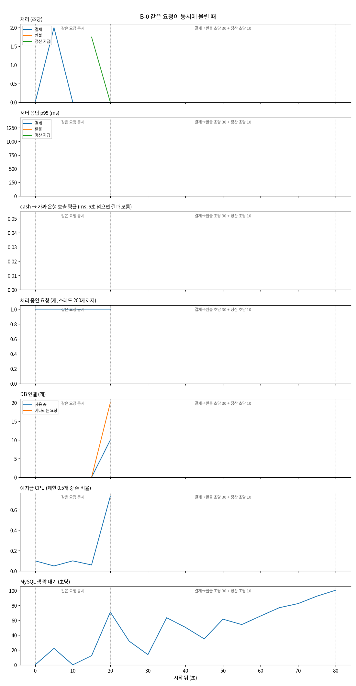

고친 뒤 (B 2회차). 같은 모양이에요. 고친 것과 상관없는 문제라는 뜻이에요.

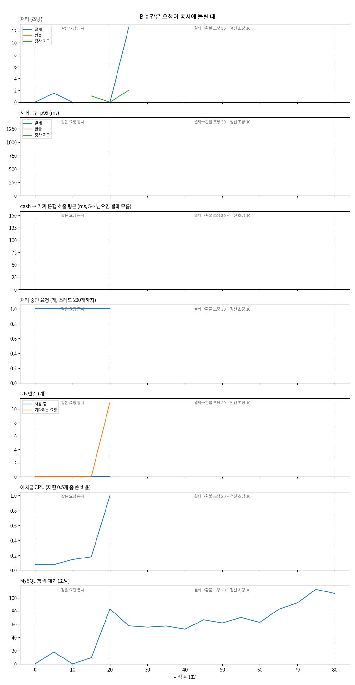

**⑧ 원인**

*P4 같은 정산 동시 지급 500 (코드·로그·MySQL 테스트로 확인)*

1. 정산 지급(`CashPayoutUseCase.recordRequestLocked`)이 보관 지갑을 잠그기 **전에** 판매자를 일반 조회(`resolveSellerMemberId`)해요.
2. MySQL(REPEATABLE READ)은 트랜잭션의 **첫 일반 조회 때** 읽기 시점을 잡아요. 트랜잭션을 시작할 때가 아니에요.
3. 그래서 잠금을 기다렸다 얻은 뒤에도, 그 뒤의 일반 조회는 잠금 전 시점으로 읽어요. 앞 요청이 저장한 수수료 기록이 안 보여요.
4. → 같은 수수료 기록을 다시 넣다가 `(payout_id, transfer_type)` 유니크 키에 걸려 500이 나요. 로그에 `Duplicate entry '<정산 번호>-FEE'`가 9번 남았어요.
5. 유니크 키가 막아서 돈이 두 번 나가지는 않았어요.

기존 동시성 테스트(`PayoutConcurrencyTest`)는 통과하고 있었어요. 테스트 DB인 H2는 READ COMMITTED라 잠금을 얻은 뒤 앞 요청의 기록이 보여서, 이 문제를 놓쳤어요.

*P8 섞인 1분의 결제 p95 4초 (1차에서는 확정 못 함 → 2차에서 확인)*

1차에서 본 것:
- 처음 20초는 예치금 CPU가 상한(0.5개)의 5~20%라 한가해요.
- 20초(섞인 구간 시작)부터 CPU가 상한의 74%(A)·100%(B)까지 오르고, DB 연결을 기다리는 요청이 20개(A)·11개(B) 생겨요.
- 그 뒤로 예치금 앱 지표가 비어요. 앱이 너무 바빠 Prometheus가 지표를 가져가지 못했어요. MySQL 쪽 행 락 대기만 끝까지 남았어요(초당 14~113번).
- B-1·B-2에서는 결제 p95가 29~167ms인데, 요청이 더 적은 B-0의 섞인 1분만 느려요.

1차에서 세운 후보와 판단:

| 후보 | 1차 판단 | 2차에서 확인한 것 |
|---|---|---|
| ① 막 띄운 직후 첫 큰 부하 | 처음 20초는 CPU가 한가해서 「아님」으로 봤어요 | **이게 맞았어요.** 처음 20초에 도는 건 이미 예열된 결제뿐이고, 환불·정산 지급은 20초부터 처음 돌아요. 같은 구간을 B-2 뒤에 다시 돌리니 p95가 10초 → 8ms예요 |
| ② 결제·환불·정산이 함께 보관 지갑을 잠금 | 일부 | 다시 돌리면 같은 잠금인데도 8ms라 주원인이 아니에요 |
| ③ 늦어져도 도착 속도는 그대로라 계속 쌓이는 시나리오 모양 | 유력 | 쌓인 건 맞지만, 처음 느려진 이유는 ①이에요 |

*정산 지급 실패 (판정 안 함)*

가짜 은행이 예치금 앱 안에 있어서 예치금이 자기 자신을 HTTP로 불러요. 앱이 바쁘면 이 호출도 같은 줄에 서서 5초 제한을 넘어요. 측정 도구가 부하를 키운 부분이에요.

**⑨ 어떻게 했나**

*P4: 고쳤어요 (커밋 `c0b1097c`)*

| 방법 | 판단 |
|---|---|
| 유니크 키 예외를 잡아 「이미 지급됨」으로 답하기 | 고르지 않음. 500은 사라지지만 원인이 남아요. 유니크 키가 없는 판단(옛 기록으로 금액 계산 등)은 옛 값으로 조용히 틀려요 |
| 이 메서드만 READ COMMITTED로 바꾸기 | 고르지 않음. 「이 메서드만 격리 수준이 다르다」는 규칙이 코드에 숨어서, 같은 모양 코드가 새로 생기면 또 나요 |
| **지갑을 먼저 잠그고 판매자를 조회하기** | **고름.** 원인을 없애요. H2와 MySQL에서 같은 결과예요. 바뀌는 건 두 줄의 순서뿐이에요 |

- 비용: 없는 판매자로 온 요청도 보관 지갑을 잠깐 잠가요. 잘못된 요청이 몰리면 결제도 함께 기다려요.
- 확인: `PayoutConcurrencyMySqlTest`(같은 테스트를 MySQL 컨테이너에서)를 더했어요. 고치기 전 10번 중 9번 500, 고친 뒤 통과예요.
- 같은 모양이 다른 곳에도 있는지 지갑 잠금 17곳을 봤어요. 결제 취소(`CashCancelOrderPaymentUseCase`)가 잠그기 전에 `hasWallet()`으로 지갑을 일반 조회해요. 아직 재현하지 않았어요([8장](#8-다음-할-일과-지금-상태)).

*P8: 1차에서는 고치지 않았어요.* 원인을 가리지 못했어요. 2차에서 예열로 확인했고, 코드는 고치지 않고 측정 순서 탓으로 기록했어요. 다만 운영에서는 배포 직후 같은 비용이 생겨요(2차 상세 문서).

### 5-3. B-1 결제를 주문이 보내는 모양으로 받을 때

**① 왜 재나**

결제마다 회원 지갑 행과 보관 지갑 행을 잠가요(`CashSupport.lockCustomerAndHoldingWallets`). 보관 지갑은 하나뿐이라 모든 결제가 이 한 행에서 줄을 서요. 맥 연습에서는 초당 약 190건에서 막혔어요.

**② 부하**

- 결제를 동시 4개(주문 1대)로 2분, 이어서 동시 8개(주문 2대)로 2분이에요. 응답을 받자마자 다음 결제를 보내요.
- 「초당 몇 건」이 아니라 「동시 몇 개」인 이유: 주문 서버 한 대는 예치금 결제를 동시 4개까지만 보내요(3-1). 그래서 예치금이 받는 결제는 동시 수로 정해져요.

**③ 보는 것:** 처리량(필요량 초당 48건), 결제 p50·p95·p99, DB 연결 사용·대기, MySQL 행 락 대기

**④ 판정 기준:** P1 (동시 4개에서 초당 48건 이상·p99 1초 미만), P2 (동시 8개에서 같은 선), P8, G5 (고치지 않은 시나리오라 B가 20% 넘게 나빠지면 안 됨)

**⑤ 결과**

| 항목 | 기준선 1 | 기준선 2 | 기준선 3 | A 1 | A 2 | A 3 | B 1 | B 2 | B 3 | 기준선 중앙값 | A 중앙값 | B 중앙값 |
|---|---|---|---|---|---|---|---|---|---|---|---|---|
| 동시 4개 처리량 (초당) | 259 | 224 | 266 | 259 | 265 | 267 | 246 | 217 | 267 | 259 | 265 | 246 |
| 동시 4개 p95 (ms) | 51 | 64 | 51 | 43 | 46 | 41 | 53 | 58 | 47 | 51 | 43 | 53 |
| 동시 4개 p99 (ms) | 128 | 174 | 99 | 90 | 87 | 94 | 85 | 139 | 86 | 128 | 90 | 86 |
| 동시 8개 처리량 (초당) | 214 | 246 | 225 | 288 | 255 | 299 | 279 | 229 | 294 | 225 | 288 | 279 |
| 동시 8개 p95 (ms) | 116 | 101 | 127 | 73 | 83 | 75 | 75 | 84 | 75 | 116 | 75 | 75 |
| 동시 8개 p99 (ms) | 279 | 238 | 243 | 145 | 249 | 188 | 110 | 313 | 118 | 243 | 188 | 118 |

**⑥ 통과 여부**

| 기준 | 기준선 | A | B |
|---|---|---|---|
| P1 동시 4개 | ✓ 초당 259건, p99 128ms | ✓ | ✓ |
| P2 동시 8개 | ✓ 초당 225건, p99 243ms | ✓ | ✓ |
| G5 동시 4개 p95가 20% 넘게 나빠지지 않음 | | 43ms | **53ms (+23%) ✗** |

G5에서 본 값 전부 (고치지 않은 시나리오, 중앙값):

| 시나리오 | A p95 | B p95 | 차이 |
|---|---|---|---|
| B-1 동시 4개 | 43ms | 53ms | **+23%** |
| B-1 동시 8개 | 75ms | 75ms | 0% |
| B-2 앞 1분 | 29ms | 32ms | +10% |
| B-2 정산 섞인 1분 | 58ms | 58ms | 0% |
| B-5 충전 | 1,047ms | 1,067ms | +2% |
| B-0 결제 | 3,988ms | 4,591ms | +15% |

G5를 넘은 것을 흔들림으로 보는 이유 (판정은 바꾸지 않아요):
- 고친 커밋 세 개는 정산 지급, 환급, 기한 알림 배치만 바꿨어요. B-1이 부르는 결제(`CashCompleteOrderPaymentUseCase`)는 A와 B의 코드가 같아요.
- 같은 동시 4개에서 p99는 오히려 B가 낮아요(90 → 86ms). 동시 8개 p95는 같아요.
- 기준선 A 3회의 동시 4개 p95는 51, 64, 51ms였어요. 이번 B(53, 58, 47ms)는 그 범위 안이에요.
- 그래도 3회 모두 B가 A보다 높았어요(A 43, 46, 41ms / B 53, 58, 47ms). 흔들림이 아니라면 원인은 몰라요. → [8장](#8-다음-할-일과-지금-상태)의 「다시 재기」로 남겼어요.

**⑦ 그래프 (기준선 3회차)**

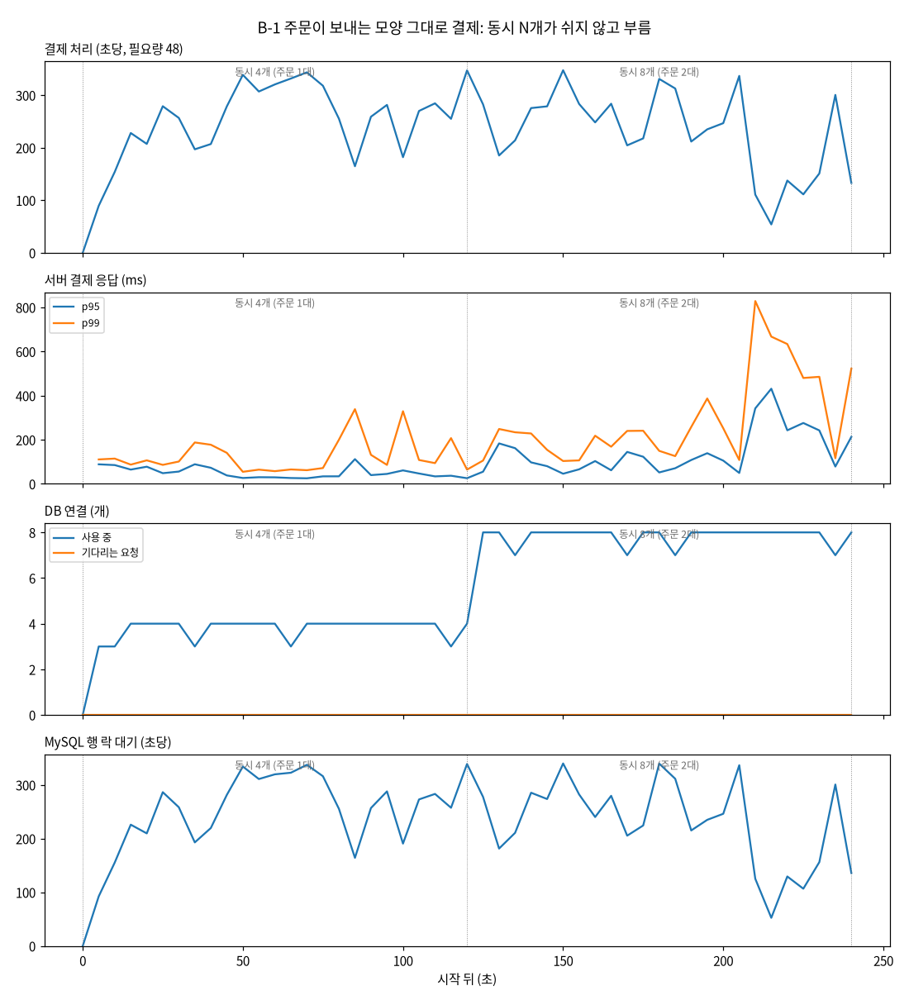

**⑧ 원인 (그래프로 본 것)**

- 동시 4개일 때 DB 연결 4개, 8개일 때 8개를 쓰고, 연결을 기다리는 요청은 0이에요. → 줄은 DB 연결이 아니라 행 락에서 서요.
- 초당 행 락 대기가 결제 처리량과 거의 같아요. 거의 모든 결제가 보관 지갑을 한 번씩 기다려요.
- 동시 8개로 늘려도 처리량이 크게 오르지 않고 p99만 두 배쯤 돼요. → 보관 지갑 한 행이 천장이에요.

**⑨ 어떻게 했나:** 고치지 않았어요. P1·P2가 통과했고, 천장(초당 225~288건)이 필요량(초당 48건)의 약 5배예요. 판정 기준에 미리 적은 규칙대로 결제 잠금은 고치지 않고 여유만 적었어요.

### 5-4. B-2 결제 중에 정산 지급이 섞일 때

**① 왜 재나**

정산 지급도 결제와 같은 보관 지갑 행을 잠가요. 정산 배치는 운영에서 새벽 4시에 몰려 와요. 그 시각에 접수가 열려 있으면 결제가 정산 뒤에 줄을 설 수 있어요.

**② 부하**

- 결제 동시 4개를 3분 동안 쉬지 않고 보내요. 앞 1분 · 가운데 1분 · 뒤 1분으로 나눠 봐요.
- 가운데 1분에만 정산 지급을 초당 20건 섞어요. 판매자 50명 중 무작위, 최종 정산, 대금 1만 원·수수료 1천 원이에요. 정산 지급은 가짜 은행 송금을 불러요.
- 초당 20건은 추천값(미확정)이에요. 정산 배치가 실제로 초당 몇 건을 보내는지 재지 않았어요.

**③ 보는 것:** 구간별 결제 처리량과 p95·p99, 정산 지급 p95, 은행 호출 평균 시간, 행 락 대기

**④ 판정 기준:** P3 (정산이 섞인 1분의 결제 p99 1초 미만, 처리량이 앞 1분의 80% 이상), P8

**⑤ 결과**

| 항목 | 기준선 1 | 기준선 2 | 기준선 3 | A 1 | A 2 | A 3 | B 1 | B 2 | B 3 | 기준선 중앙값 | A 중앙값 | B 중앙값 |
|---|---|---|---|---|---|---|---|---|---|---|---|---|
| 앞 1분 결제 p95 (ms) | 75 | 64 | 57 | | | | | | | 64 | 29 | 32 |
| 섞인 1분 결제 p95 (ms) | 167 | 84 | 84 | | | | | | | 84 | 58 | 58 |
| 섞인 1분 결제 p99 (ms) | 333 | 227 | 215 | 96 | 150 | 98 | 110 | 217 | 104 | 227 | 98 | 110 |
| 섞인 1분 처리량 ÷ 앞 1분 | 0.58 | 0.79 | 0.72 | 0.70 | 0.57 | 0.78 | 0.69 | 0.51 | 0.73 | **0.72** | **0.70** | **0.69** |

(A·B 회차별 p95는 원래 문서에 중앙값만 있어요.)

- 기준선 3회차 그래프에서 섞인 1분 동안 결제 처리량이 초당 120~250건 → 65~175건으로 떨어져요.
- 같은 동안 정산 지급 p95는 1.3초까지 올라요. 가짜 은행 호출은 평균 40ms 아래라, 느려진 곳은 은행이 아니에요.
- 참고로 2차(11/19)에서도 같은 B-2를 돌렸어요. 처리량 비율 89% / 79% / 78%, 결제 p99 109 / 108 / 106ms예요.

**⑥ 통과 여부:** P3 ✗ (기준선·A·B 모두). 결제 p99는 98~227ms라 1초 선에는 한참 못 미치고, **처리량 조건(80%)으로만** 걸렸어요. → **실패, 고치지 않기로 함**

**⑦ 그래프 (기준선 3회차)**

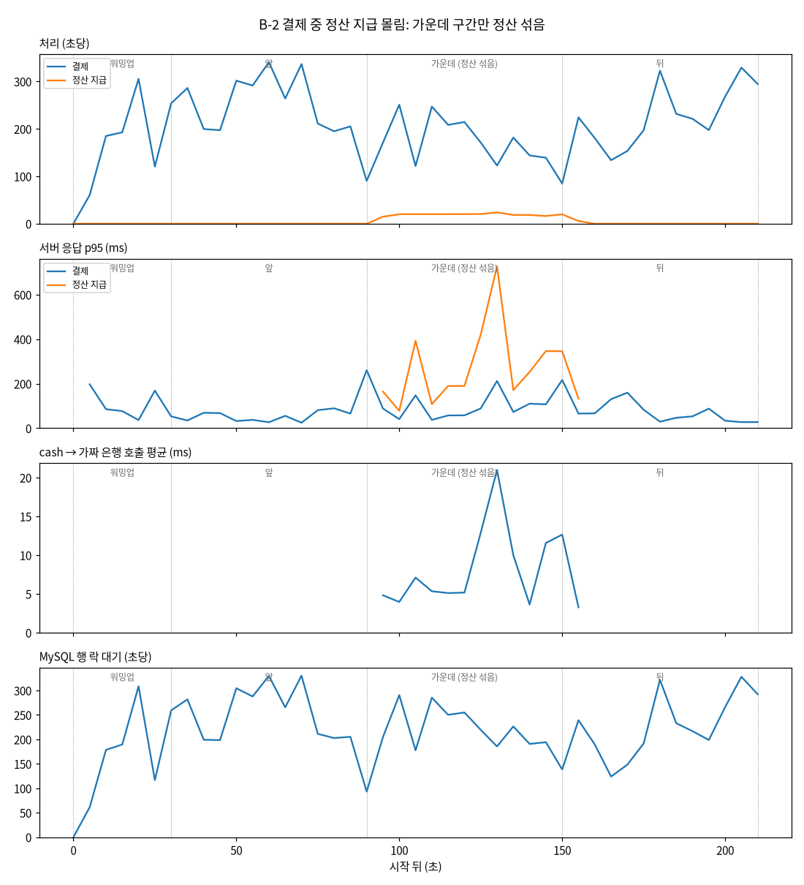

**⑧ 원인 (추정)**

결제와 정산 지급이 같은 보관 지갑 행을 잠가요. 정산 지급 한 번은 이 잠금을 두 번(기록할 때, 결과를 반영할 때) 잡고, 잡은 동안 수수료 이동·원장 세 줄·송금 기록까지 해서 결제보다 오래 쥐어요. 정산이 잠금을 얼마나 오래 쥐는지는 재지 않았어요.

**⑨ 어떻게 했나: 고치지 않기로 했어요.** 이유는 네 가지예요.

1. **결제 응답은 멀쩡해요.** 결제 p99가 98~110ms로 기준(1초)의 10분의 1이에요. 처리량 조건으로만 걸렸어요.
2. **떨어져도 필요량보다 훨씬 많아요.** 결제 처리량 천장은 B-1에서 초당 246~288건이에요. 70%로 떨어져도 예상 트래픽(초당 48건)의 3배가 넘어요.
3. **실제 대회 사례도 천장 아래예요.** 2025 춘천마라톤이 약 2만 명을 3분 만에 마감했어요(성공 신청 초당 약 110건). 게다가 우리 대기열은 종목당 초당 4명만 들여보내서, 이 속도가 예치금까지 오지 않아요.
4. **실제로는 거의 겹치지 않아요.** 정산 지급은 새벽 4시 배치(`PayoutPayScheduler`)라 접수가 몰리는 시간과 거의 안 겹쳐요.

검토한 방법: 보관 지갑을 여러 행으로 나누기. 보관 지갑은 정책 6장대로 1차 정산 뒤 환불이 생기면 잠시 음수가 될 수 있고 회수금으로 채워지는 구조예요. 나누면 회수 흐름까지 바뀌어서, 위 근거로 지금은 하지 않아요.

### 5-5. B-3 카드가 많은 회원의 전액 환급

**① 왜 재나**

환급(`CashWithdrawalUseCase`)은 카드 결제취소를 한 장씩 차례로 불러요. 응답 시간이 「장수 × PG 결제취소 시간」이 돼요.

**② 부하**

- 카드 충전이 1장·3장·5장인 회원을 30명씩 만들어요. 한 장에 1만 원이고, 잔액은 충전한 만큼이에요.
- 장수마다 회원 30명이 `POST /api/v1/cash/withdrawals`로 전액 환급해요. 동시에 10명씩이에요. 카드로 다 돌려줄 수 있어서 계좌 정보는 보내지 않아요.
- 가짜 PG 결제취소는 한 번에 300ms예요(추천값(미확정)).
- 측정 전에 카드 1장 회원 10명이 먼저 환급하고 숫자는 버려요(환급 예열). 짧은 확인 실행에서 막 띄운 뒤 첫 환급 몇 건이 느렸고, 그게 처음 도는 1장 묶음에 몰려 1장 p95가 2.4초로 부풀었어요.

**③ 보는 것:** 장수별 p95, 실패율

**④ 판정 기준:** P5 (카드 5장 환급 p95 1초 미만), G3 (고친 뒤 5장 p95가 1장 p95의 2배 안)

**⑤ 결과 (p95, ms)**

| 카드 장수 | 기준선 1 | 기준선 2 | 기준선 3 | A 1 | A 2 | A 3 | B 1 | B 2 | B 3 | 기준선 중앙값 | A 중앙값 | B 중앙값 |
|---|---|---|---|---|---|---|---|---|---|---|---|---|
| 1장 | 480 | 519 | 628 | 365 | 326 | 340 | 390 | 396 | 404 | 519 | 340 | 396 |
| 3장 | 1,094 | 1,027 | 1,012 | 998 | 998 | 999 | 570 | 396 | 421 | 1,027 | 998 | **421** |
| 5장 | 1,596 | 1,815 | 1,797 | 1,596 | 1,593 | 1,677 | 522 | 400 | 421 | 1,797 | 1,596 | **421** |

실패는 모든 회차 0건이에요.

**⑥ 통과 여부**

| 기준 | 기준선 | A | B |
|---|---|---|---|
| P5 5장 p95 1초 미만 | ✗ 1,797ms | ✗ 1,596ms | ✓ 421ms |
| G3 5장 ÷ 1장 2배 안 | | | ✓ 421 ≤ 396 × 2 |

→ **고쳐서 통과**

**⑦ 그래프**

고치기 전 (A 2회차). 장수에 비례해 느려져요.

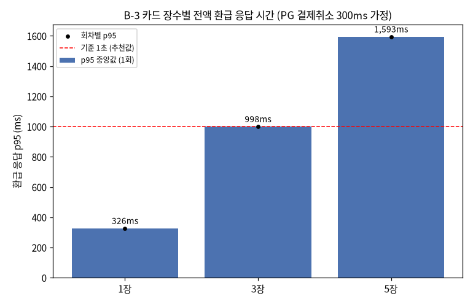

고친 뒤 (B 2회차). 장수와 상관없이 한 장 정도예요.

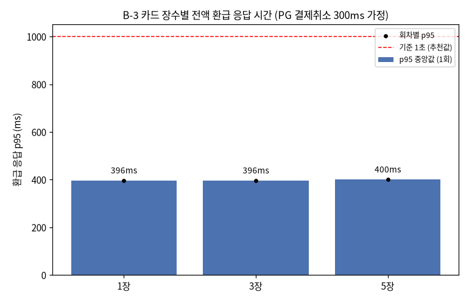

**⑧ 원인 (코드로 확인):** 카드 결제취소를 한 장씩 차례로 불러요. 응답 시간 ≈ 장수 × 300ms + 약 35ms예요. PG를 부르는 동안 지갑 잠금은 잡지 않아요.

**⑨ 어떻게 했나: 고쳤어요 (커밋 `168e129f`)**

| 방법 | 판단 |
|---|---|
| 그대로 두기 | 고르지 않음. 카드가 많은 회원일수록 화면에서 오래 기다려요. 3장부터 1초에 닿아요 |
| 동시에 부르되 동시 개수를 제한하기 | 고르지 않음. 토스가 동시 호출을 얼마나 허용하는지 몰라요. 한도를 근거 없이 정하게 돼요 |
| **카드마다 가상 쓰레드로 한꺼번에 부르고, 모두 끝나면 결과 반영** | **고름.** 걸리는 시간이 가장 느린 카드 한 장으로 줄어요 |

어떻게 바뀌었나:
- 환급 코드에 가상 쓰레드 실행기(`Executors.newVirtualThreadPerTaskExecutor()`)를 두고, 카드마다 결제취소를 `CompletableFuture.supplyAsync`로 동시에 불러요.
- `CompletableFuture.allOf(...).join()`으로 모두 끝나길 기다린 뒤, 카드마다 성공·실패를 모아 한 번에 반영해요.
- 가상 쓰레드는 만든 쓰레드의 클래스 로더를 이어받아서, 공용 ForkJoin 풀에서 생긴 알림 Kafka 문제(BUK-13, [6장](#6-측정하면서-찾은-다른-문제))가 생기지 않아요.
- → 5장이어도 300ms짜리 다섯 번을 동시에 기다려서 약 0.4초예요.

비용: 토스가 연속 요청을 제한하면(`FORBIDDEN_CONSECUTIVE_REQUEST`) 동시에 부른 몫이 거절될 수 있어요. 이 거절은 「잠깐 생긴 문제」라 그 몫은 예치금에 되돌리고 다시 신청하게 해요. 코드에 `shortcut:` 주석으로 남겼어요.

확인: `CashWithdrawalByChargeTest.cancelsCardsConcurrently`가 카드 5장의 결제취소가 동시에 불리는지 봐요. 고치기 전 1장, 고친 뒤 5장이에요.

### 5-6. B-4 카드 취소 기한 알림 배치

**① 왜 재나**

배치가 대상 회원마다 지갑과 충전 내역을 다시 조회해요. 맥 연습에서 SQL 수가 「대상 × 2 + 4」였어요.

**② 부하**

- 카드 결제취소 마지막 날이 정확히 3일 뒤인 충전 1건(1만 원)을 가진 회원을 100명 · 1,000명 · 10,000명 만들어요.
- 원래 매일 오전 9시인 배치를 매분 0초로 바꿔, 한 번 돌 때를 재요. 회원마다 알림이 Kafka로 나가요.
- 끝나면 알림 대상을 지워요(A·B 측정부터. 기준선은 지우지 않아 뒤 시나리오와 겹쳤어요, [6장](#6-측정하면서-찾은-다른-문제)).

**③ 보는 것**
- 걸린 시간: Spring이 배치 실행마다 남기는 시간(`tasks_scheduled_execution_seconds`). 알림 전송까지 들어 있어요.
- SQL 수와 DB 시간: 배치 직전에 MySQL 문장 통계(`performance_schema`)를 비우고, 한 번 실행한 몫의 예치금 표 문장만 세요.

**④ 판정 기준:** P6 (대상 100배일 때 SQL 10배 이하), G4 (고친 뒤 10,000명 SQL이 100명의 2배 안, 걸린 시간이 A보다 늘지 않음)

**⑤ 결과**

| 항목 | 기준선 1 | 기준선 2 | 기준선 3 | A 1 | A 2 | A 3 | B 1 | B 2 | B 3 | 기준선 중앙값 | A 중앙값 | B 중앙값 |
|---|---|---|---|---|---|---|---|---|---|---|---|---|
| 100명 SQL 수 | 204 | 204 | 204 | 239 | 239 | 239 | 41 | 46 | 46 | 204 | 239 | 46 |
| 100명 걸린 시간 (초) | 0.18 | 0.16 | 0.25 | 0.19 | 0.22 | 0.23 | 0.17 | 0.24 | 0.25 | 0.18 | 0.22 | 0.24 |
| 1,000명 SQL 수 | 2,004 | 2,004 | 2,004 | 2,054 | 2,049 | 2,059 | 41 | 46 | 51 | 2,004 | 2,054 | 46 |
| 1,000명 걸린 시간 (초) | 1.16 | 1.57 | 1.55 | 1.47 | 1.42 | 1.62 | 0.57 | 0.34 | 0.46 | 1.55 | 1.47 | 0.46 |
| 10,000명 SQL 수 | 20,004 | 20,004 | 20,010 | 20,114 | 20,119 | 20,124 | 83 | 84 | 79 | 20,004 | 20,119 | **83** |
| 10,000명 걸린 시간 (초) | 7.67 | 7.87 | 7.55 | 7.87 | 8.43 | 9.02 | 2.38 | 2.34 | 2.16 | 7.67 | 8.43 | **2.34** |
| 10,000명 DB 시간 (초) | 1.30 | 1.28 | 1.29 | 1.36 | 1.38 | 1.39 | 0.17 | 0.13 | 0.12 | 1.29 | 1.38 | 0.13 |

- 기준선과 A의 SQL 수가 조금 다른 건 A에 BUK-13(알림 실제 전송)이 들어가서예요. 기준선에서는 알림이 모두 실패해 바로 끝났어요.

**⑥ 통과 여부**

| 기준 | 기준선 | A | B |
|---|---|---|---|
| P6 100배일 때 SQL 10배 이하 | ✗ 98배 | ✗ 84배 (239 → 20,119) | ✓ 1.8배 (46 → 83) |
| G4 SQL 2배 안, 시간 늘지 않음 | | | ✓ 83 ≤ 92, 8.43 → 2.34초 |

→ **고쳐서 통과**

**⑦ 그래프**

고치기 전 (A 2회차). SQL 수가 대상 수만큼 늘어요.

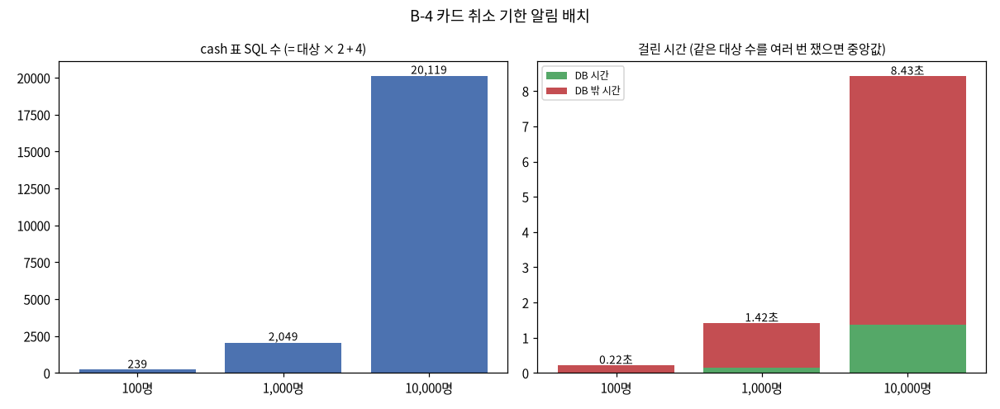

고친 뒤 (B 2회차). 대상이 100배가 돼도 SQL 수는 두 배 안이에요.

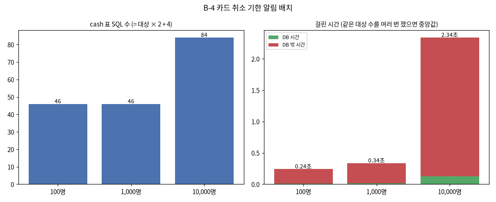

**⑧ 원인 (코드로 확인):** 기한 알림(`CashCardCancelDeadlineNoticeUseCase` → `CashRefundableChargeQueryUseCase`)이 회원마다 지갑 한 번(`SELECT ... cash_wallet`), 충전 한 번(`SELECT ... cash_wallet_charge`)을 따로 조회해요.

**⑨ 어떻게 했나: 고쳤어요 (커밋 `c9734e3b`)**

세 방법 모두 1,000명씩 묶어 읽어요. 한 번에 다 읽으면 대상 수만큼 메모리를 써서, 묶는 건 공통이에요. 1,000은 이 메모리 한도를 위한 묶음 크기예요(`CHUNK_SIZE = 1_000`).

| 방법 | 판단 |
|---|---|
| 충전을 읽으면서 지갑을 fetch join으로 함께 읽기 | 고르지 않음. 묶음당 SQL이 1개라 고른 방법보다 1개 적어요. 1만 명이면 10개 차이라 시간으로는 구분되지 않아요. JPQL을 따로 써야 해서 기존 조회를 쓰는 쪽을 골랐어요 |
| 엔티티 대신 필요한 칸만 읽기 | 고르지 않음. 가볍지만 남은 금액 계산(`refundable()`)이 엔티티를 받아서, 환급 화면과 같은 계산을 쓰려면 함수 모양을 바꿔야 해요 |
| **1,000명씩 IN 조회로 지갑 한 번, 충전 한 번. 묶음마다 영속성 컨텍스트 비우기** | **고름.** SQL이 대상 1,000명당 2개로 줄어요. 기존 조회와 환급 화면의 계산 함수를 그대로 써요 |

- 남은 금액 계산은 `CashRefundableChargeQueryUseCase.refundable()`로 떼어 내서, 환급 화면과 기한 알림이 같은 계산을 써요.
- 확인: `CashCardCancelDeadlineNoticeQueryCountTest`가 대상 30명일 때 SQL 수를 Hibernate 통계로 세요. 고치기 전 62개, 고친 뒤 4개 이하예요. 환급 화면의 기존 테스트 14개도 그대로 통과해요.
- 남은 것: 1만 명일 때 B의 2.34초 중 DB 시간은 0.13초예요. 나머지 약 2.2초가 어디에 쓰이는지는 아직 몰라요([8장](#8-다음-할-일과-지금-상태)).

### 5-7. B-5 충전 승인 초당 48건

**① 왜 재나**

충전 승인은 게이트웨이에서 예치금으로 바로 가요. 결제와 달리 주문의 동시 호출 제한을 거치지 않아요. 승인 하나는 세 단계예요.
1. 회원 지갑을 잠그고 충전을 「처리 중」으로 선점해요(트랜잭션 ①).
2. PG 승인을 기다려요(트랜잭션 밖).
3. 지갑에 반영해요(트랜잭션 ②).

PG를 기다리는 동안 트랜잭션은 닫혀 있어서, 막힌다면 DB 연결보다 요청 쓰레드(200개)가 먼저 찰 거라고 봤어요.

**② 부하**

- 초당 48건으로 10분 동안 `POST /api/v1/cash/charges/confirm`을 불러요. 한 건에 6만 원(기획의 평균 참가비), 충전 번호는 모두 달라요.
- 가입한 지 24시간이 안 된 회원(잔액 0원)이 한 번씩 충전해요. 가입 직후 회원은 「신규 회원 고액 충전 표시」 확인 조회가 한 번 더 나가요.
- 가짜 PG 승인 1초(추천값(미확정))예요.

**③ 보는 것:** 충전 p50·p95·p99와 실패율, 처리 중인 요청 수, DB 연결 사용·대기, C6

**④ 판정 기준:** P7 (충전 p95 2초 미만, 실패 1% 미만), P8, C6

**⑤ 결과**

| 항목 | 기준선 1 | 기준선 2 | 기준선 3 | A 1 | A 2 | A 3 | B 1 | B 2 | B 3 | 기준선 중앙값 | A 중앙값 | B 중앙값 |
|---|---|---|---|---|---|---|---|---|---|---|---|---|
| 충전 p95 (ms) | 1,309 | 1,329 | 1,279 | 1,025 | 1,047 | 1,131 | 1,326 | 1,067 | 1,045 | 1,309 | 1,047 | 1,067 |
| 충전 p99 (ms) | 1,598 | 1,515 | 1,560 | 1,072 | 1,168 | 1,509 | 2,586 | 1,176 | 1,096 | 1,560 | 1,168 | 1,176 |
| 실패율 | 0% | 0% | 0% | 0% | 0% | 0% | 0% | 0% | 0% | 0% | 0% | 0% |

- 10분 내내 초당 48건을 따라가요. 가짜 PG 1초를 빼면 예치금이 쓰는 시간은 0.1~0.4초예요.
- 기준선에서 DB 연결 10개가 몇 번 다 차고 기다리는 요청이 최대 26개 생겼어요. 매분 도는 기한 알림 배치(1만 명)와 겹친 때로 보여요(확인 안 함, [6장](#6-측정하면서-찾은-다른-문제)).
- B 1회차는 p99(2,586ms)가 다른 회차보다 크게 느렸어요. 같은 회차 B-3 1장 p95, B-5 한계도 가장 느려서 그 회차 머신이 느렸던 것으로 보여요(확인 안 함).

**⑥ 통과 여부:** P7 ✓ (기준선·A·B 모두) → **통과**

**⑦ 그래프 (기준선 3회차)**

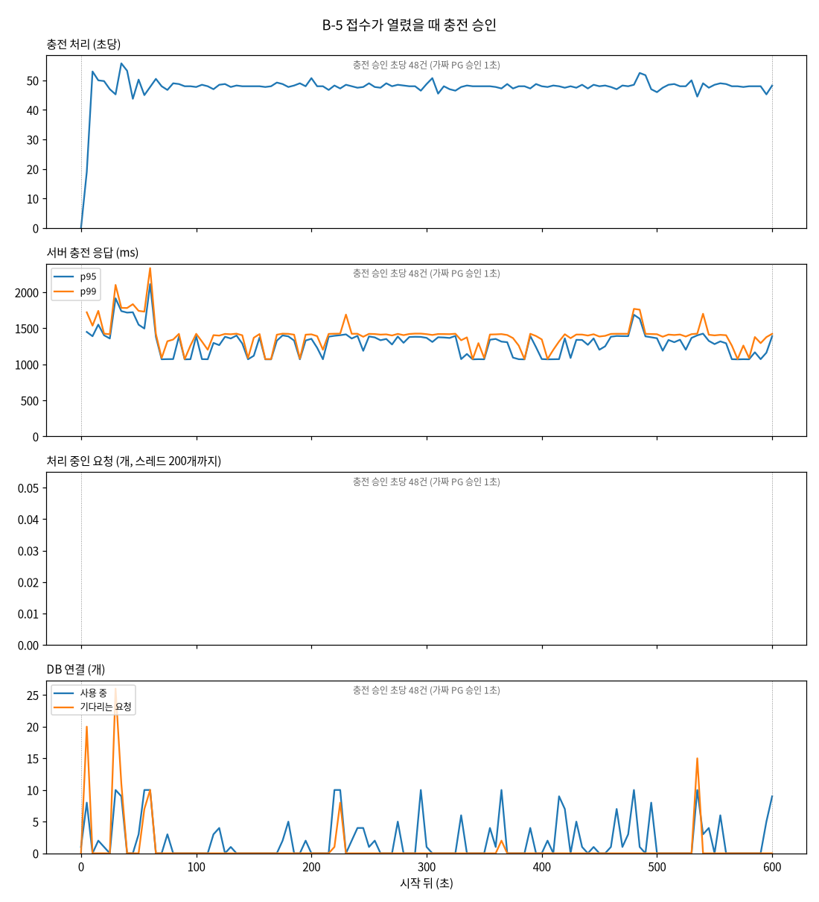

**⑧ 원인:** 해당 없음

**⑨ 어떻게 했나:** 고칠 것 없음. 토스가 느려질 때는 2차 B-6에서 따로 봤어요.

### 5-8. B-5 한계 1000명이 같은 순간에 충전

**① 왜 재나**

앱이 안내하는 길은 아니지만, 대기열에서 기다리는 동안 다른 탭에서 충전할 수 있어요. 대기열이 막아 주지 않는 몰림에서도 **돈이 두 번 들어오지 않는지**를 봐요.

**② 부하:** B-5에서 쓰지 않은 회원 1,000명이 같은 순간에 한 번씩 충전 승인을 불러요(k6 가상 사용자 1,000명이 1번씩).

**③ 보는 것:** 마지막 응답까지 걸린 시간, p95·p99, 실패 건수, 처리 중인 요청 수 최대, DB 연결 대기 최대

**④ 판정 기준: C1~C7(돈)만 판정해요. 응답 시간은 기록만 해요.**

**⑤ 결과**

| 항목 | 기준선 1 | 기준선 2 | 기준선 3 | A 1 | A 2 | A 3 | B 1 | B 2 | B 3 |
|---|---|---|---|---|---|---|---|---|---|
| p95 (ms) | 6,650 | 20,630 | 5,600 | | | | | | |
| 가장 느린 응답 (ms) | 7,362 | 21,076 | 5,906 | 6,924 | 6,621 | 5,825 | 12,525 | 6,381 | 6,776 |
| 실패율 | 0% | 0% | 0% | 0% | 0% | 0% | 0% | 0% | 0% |
| 돈 확인 | 통과 | 통과 | 통과 | 통과 | 통과 | 통과 | 통과 | 통과 | 통과 |

**⑥ 통과 여부: 통과.** 가장 느린 응답이 6~7초인데도 통과인 이유:
- 이 시나리오의 기준은 처음부터 「돈이 맞나」 하나예요. 재기 전에 「응답 시간은 기록만」이라고 정해 두었어요.
- 1,000명이 한 순간에 오면 요청 쓰레드(200개)를 넘어요. 충전 하나가 PG를 1초 기다리니, 1,000명을 다 받으려면 최소 5초(1,000 ÷ 200 × 1초)가 걸려요. 6~7초는 이 계산과 맞는 「예상한 느림」이에요.
- 게이트웨이는 충전 확정 요청을 30초까지 기다려요(`gateway`의 `cash-charge-confirm` 경로, `response-timeout: 30000`). 그래서 사용자 화면에서는 6~7초 뒤 성공으로 끝나요.
- 기준선 2회차 21초와 B 1회차 12.5초는 다른 회차보다 크게 느렸어요. 원인은 확인하지 못했어요. 기준선 2회차 그 시각(01:51:21~01:51:43)은 매분 도는 배치와도 겹치지 않았어요. 30초 안이라 사용자 실패는 아니에요.

**⑦ 그래프:** 없음 (기준선 B-5 그래프 끝부분에 함께 보여요)

**⑧·⑨:** 해당 없음. 대기열 밖 충전 몰림이 실제로 얼마나 되는지는 운영 자료가 없어요.

### 5-9. B-1 한계 결제 도착 속도를 계속 올리기

**① 왜 재나**

결제가 어느 속도에서 무너지는지, 그래서 필요량(초당 48건)의 몇 배 여유가 있는지 적으려고 재요. **판정하지 않는 숫자예요.**

- 왜 판정하지 않나: 「초당 N건으로 계속 밀어 넣는」 모양은 실제로 예치금에 오지 않아요. 주문 서버가 동시 4개로 묶어서 보내기 때문이에요(3-1). 실제 모양은 B-1이 재요.
- 왜 기준선은 1회차만 돌렸나: 판정하지 않는 숫자라 처음에는 「첫 A에서만」 돌려 시간을 아끼기로 했어요. 그런데 기준선 1회차의 한계 측정이 매분 도는 기한 알림 배치(1만 명)와 겹쳐 믿기 어려웠어요. 그래서 A·B 측정부터는 **모든 회차(6회)에서** 돌렸어요(판정 기준 고친 기록 11/17, [9장](#9-판정-기준을-바꾼-기록)).

**② 부하:** 결제 도착 속도를 초당 20 → 50 → 100 → 200 → 400건으로 2분씩 올려요. 응답이 느려도 정해진 속도로 계속 보내요.

**③ 보는 것:** 단계별 p95, 실제 처리량, 행 락 대기

**④ 판정 기준:** 없음 (기록만)

**⑤ 결과**

| 단계 (초당 결제) | 20 | 50 | 100 | 200 | 400 |
|---|---|---|---|---|---|
| 기준선 1회차: 실제 처리량 (초당) | | | | 171 | 175 |
| 기준선 1회차: p95 | | | 1.69초 | | |
| A 3회 k6 p95 (ms) | 4 / 21 / 5 | 6 / 11 / 6 | 189 / 1,173 / 93 | 374 / 391 / 1,667 | 7,019 / 6,465 / 7,783 |
| B 3회 k6 p95 (ms) | 451 / 7 / 5 | 767 / 14 / 18 | 4,600 / 105 / 395 | 2,689 / 231 / 235 | 7,865 / 5,724 / 6,471 |

- 기준선 1회차는 배치와 겹쳐 100건 단계부터 느렸어요(p95 1.69초).
- A·B에서는 초당 200건까지 실제 처리량이 도착 속도를 따라가고, 400건 단계에서 p95가 6~8초로 무너져요. 실패는 0이에요(결국 다 처리해요).
- B 1회차는 20건 단계부터 느렸어요. B-5에서 느렸던 그 회차예요.

**⑥ 통과 여부:** 판정 안 함. **여유: 초당 200건까지 따라감 = 필요량(48건)의 약 4배.** 동시 8개 B-1의 초당 246~288건과도 맞아요.

**⑦ 그래프 (A·B 측정 B 2회차)**

초당 200건까지는 처리량이 도착 속도를 따라가고, 400건 단계에서는 예치금 앱 지표가 비어요.

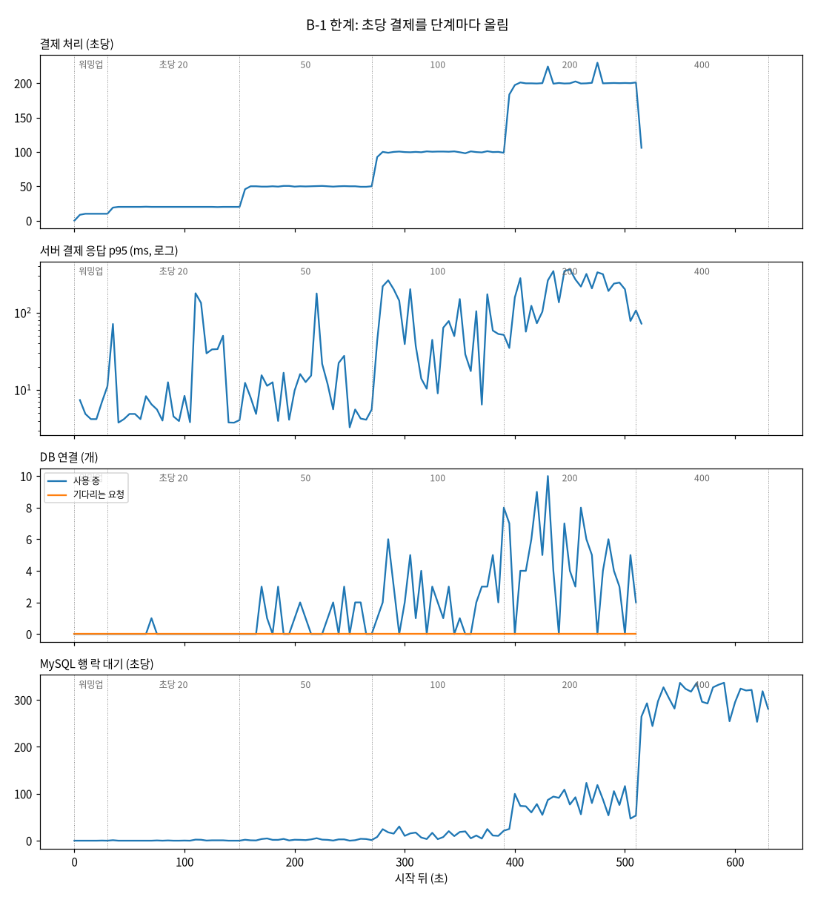

**⑧ 원인**
- 1차 맥 연습: 초당 200건부터 DB 연결 10개가 모두 차고, 연결을 기다리는 요청이 190개까지 쌓였어요. 결제의 57%가 행 락을 기다렸어요. CPU는 8% 아래였어요. → 보관 지갑 한 행이 천장으로 보였어요.
- 2차(11/19)에서 다시 보니: 400건 단계의 가장 오래 기다린 락은 0.3~0.6초뿐이고, 예치금 CPU가 상한(0.5개)에 닿았어요. → 측정 환경에서는 CPU 0.5개 상한도 함께 막아요.

**⑨ 어떻게 했나: 고치지 않았어요.** 400건에서 무너지는데도 고치지 않은 이유예요.
1. **실제로 오지 않는 모양이에요.** 예치금에 오는 결제는 주문이 동시 4개로 묶어요. 실제 모양(B-1)에서는 P1·P2 모두 통과했어요.
2. **400건은 필요량의 8배예요.** 200건까지 따라가니 4배 여유예요.
3. **재기 전에 정한 규칙이에요.** 「P1·P2가 통과하면 결제 잠금은 고치지 않고 여유만 적는다」(판정 기준 3-1).
4. **고치려면 구조를 바꿔야 해요.** 보관 지갑 한 행이 천장이라 서버 대수를 늘려도 오르지 않아요. 여러 행으로 나눠야 하는데, 보관 지갑은 1차 정산 뒤 환불로 잠시 음수가 될 수 있어(정책 6장) 나누면 회수 흐름까지 바뀌어요.
5. **측정 환경의 CPU 상한도 원인이에요.** 운영 예치금은 CPU 상한이 없어서 이 숫자보다 높을 수 있어요(운영에서 재지는 않았어요).

## 6. 측정하면서 찾은 다른 문제

### 6-1. 가장 오래 기다린 행 락이 2초를 넘음 (1차에서는 어디서인지 모름)

**어디서 봤나.** MySQL의 「가장 오래 기다린 행 락」(`lock_row_lock_time_max`)을 **회차 끝에 한 번만** 읽었어요.

| 측정 | 회차 | B-1 한계를 돌렸나 | 가장 오래 기다린 락 |
|---|---|---|---|
| 기준선 | 1회차 | 돌렸어요 | 1,588ms |
| | 2회차 | 안 돌렸어요 | 858ms |
| | 3회차 | 안 돌렸어요 | 860ms |
| A·B | A 1·2·3회차 | 돌렸어요 | 2,304 · 4,369 · 4,350ms |
| | B 1·2·3회차 | 돌렸어요 | 6,362 · 5,347 · 1,640ms |

- A·B 6회 중 5회가 2초를 넘었어요. 주문은 예치금 응답을 2초까지만 기다려요(`order.clients.timeout`). → 2초 넘게 락을 기다린 결제는 주문 쪽에서 「결과 모름」이 돼요.
- 락 대기 시간 초과(MySQL 기본 50초)는 0건이에요.

**왜 어디서인지 모르나.** 이 값은 MySQL이 켜진 뒤의 최댓값이라 줄지 않아요. 회차 끝에 한 번만 읽으면, 그 회차의 예열·B-0~B-5·B-1 한계 중 어느 시나리오에서 나왔는지 알 수 없어요. 그래서 1차에서는 「정확히 어디서 나왔는지 모른다」가 맞아요.

**1차의 추정.** B-1 한계를 돌린 회차만 1.5초를 넘어서 「B-1 한계(초당 400건)에서 나온다」고 추정했어요.

**2차에서 확인한 것 (추정은 틀렸어요).** 2차에서 시나리오 앞뒤로 따로 읽었어요. 2초를 넘은 곳은 **막 띄운 직후의 예열**(3회 중 2회)과 **B-8(MySQL 지연)**뿐이었어요. B-1 한계는 0.6초 아래였어요. 락을 쥔 결제가 그동안 클래스를 처음 읽고 JIT 컴파일을 하고 있었어요(JFR). 자세한 내용은 2차 상세 문서에 있어요.

### 6-2. 예치금: 알림이 Kafka로 한 건도 나가지 않음 (BUK-13으로 고침)

- 기준선 세 회차 모두, 첫 알림을 보내는 순간(B-4)부터 모든 알림이 실패했어요.
  - 로그: `알림을 보내지 못했습니다 (버림) … ExceptionInInitializerError`, 그 뒤로 `NoClassDefFoundError: Could not initialize class org.apache.kafka.clients.producer.ProducerConfig`
- 원인: common의 `NotificationKafkaSender`가 알림을 공용 ForkJoin 풀에서 보내요. jar로 띄운 앱(운영과 같은 방식)에서는 이 풀의 쓰레드가 앱 안의 라이브러리 클래스를 찾지 못해요. bootRun(dev)에서는 생기지 않아요.
  한 번 실패한 클래스는 앱을 다시 띄울 때까지 다시 불러오지 않아서, 그 앱의 Kafka 전송이 모두 막혀요(회수 입금 메시지도). 같은 코드를 주문·회원·문의 서비스도 써요.
- 지금 상태: BUK-13으로 고쳤어요. A·B 6회에서는 알림 실패 로그가 0건이에요.

### 6-3. 측정 도구: B-4가 끝난 뒤에도 기한 알림 배치가 매분 1만 명씩 돎 (고침)

- 측정 도구가 배치를 매분 돌게 해 두고 B-4 대상을 지우지 않았어요. 그래서 기준선의 B-5, B-5 한계, B-1 한계는 매분 1만 명 배치(약 7.6초, SQL 2만 개)와 함께 재졌어요.
- B-5는 그래도 통과해서 판정은 그대로예요. 한계 두 개는 판정하지 않는 숫자예요.
- A·B 측정 전에 고쳤어요. B-4가 끝나면 대상을 지워요(`sql/13-cleanup-notice.sql`).

### 6-4. 측정 도구: 그래프 두 개가 비어 있음 (고침)

- 기준선은 B-0 그래프를 그리지 않아 P8 원인을 시간대별로 볼 수 없었어요. → A·B 측정부터 그려요.
- B-5 그래프의 「처리 중인 요청」 칸이 비어 있었어요. 지표 이름을 고쳤어요(`http_server_requests_active_seconds_gcount`).

## 7. 한계

- 공용 실행 머신에서 예치금 CPU 0.5개로 잰 숫자예요. 운영 서버 크기와 다르고, 회차끼리도 흔들려요(B-2 처리량 비율 0.51~0.79).
- PG·회원·은행은 가짜예요. PG 승인 1초, 결제취소 300ms는 가정이에요. 가짜 은행은 예치금 앱 안에 있어서 바쁠 때 부하를 더해요.
- 예치금만 띄우고 k6가 직접 불러요. 게이트웨이·주문·대기열은 거치지 않아요. 「주문이 2초에 포기하는데 예치금은 계속 일하는」 상황은 재현하지 않았어요.
- 앱이 포화되면 Prometheus가 앱 지표를 가져가지 못해서, B-0 섞인 구간과 B-1 한계 400건 단계의 앱 지표가 비어요(원인은 2차에서 찾았어요: 지표 수집이 DB 연결을 기다림).
- 행 락 통계를 회차 끝에 한 번만 읽어서, 2초 넘는 락이 어느 시나리오인지 몰랐어요(6-1).
- 그래프는 회차 하나 것만 문서에 옮겼어요(기준선은 3회차, A·B는 2회차). 나머지는 Actions 아티팩트에 있었고 2026-12-17에 지워져요.

## 8. 다음 할 일과 지금 상태

1차 문서 끝의 「다음 할 일」을 뜻과 지금 상태까지 풀어 적었어요. (2026-11-20 기준)

| 할 일 | 무슨 뜻인가 | 왜 | 지금 상태 |
|---|---|---|---|
| P8 원인 가리기 | B-0 섞인 1분의 결제 4초가 왜 생기는지 가려요 | 측정 도구가 부하를 키웠고 지표가 비어 확정하지 못했어요 | **2차에서 함.** 같은 구간을 다시 돌리면 8ms → 원인은 예열. 코드는 안 고침 |
| 2초 넘는 락이 어느 시나리오인지 가리고, 락 대기 제한 정하기 | 6-1의 2초 넘는 락 | 주문이 기다리는 2초를 넘었어요 | **반만 함.** 2차에서 「막 띄운 직후 예열」과 B-8로 확인. 락 대기 제한 + 503은 CRU-87로 남아 있어요 |
| 결제 취소의 「잠그기 전 일반 조회」 재현 | P4와 같은 모양이 결제 취소(`CashCancelOrderPaymentUseCase`)에도 있어요. 지갑을 잠그기 전에 `hasWallet()`으로 지갑을 일반 조회해서, 그 순간 MySQL 읽기 시점이 잡혀요. 결제와 취소가 동시에 오면 취소가 잠금을 얻은 뒤에도 결제가 막 저장한 기록을 못 보고, 같은 기록을 다시 넣다 500이 날 수 있어요. 돈은 유니크 키가 막을 거라고 보지만 재현하지 않았어요 | P4를 고칠 때 지갑 잠금 17곳을 훑다가 찾았어요 | **안 함.** 11/20 코드에도 `hasWallet()`이 잠금 앞에 그대로 있어요. MySQL 테스트로 재현되면 P4처럼 「잠금 먼저」로 고쳐요 |
| G5를 넘은 B-1 동시 4개 p95 다시 재기 | 고친 뒤 B-1 동시 4개 p95가 43 → 53ms(+23%)로 G5(20%)를 넘었어요. 고친 코드는 결제를 건드리지 않아 흔들림으로 보지만, 3회 모두 B가 높아 확정하지 못했어요. 같은 A·B로 한 번 더 재서 또 B가 높으면 흔들림이 아니에요 | 미리 정한 규칙상 「나아짐」이 아니라서, 흔들림인지 확인해야 해요 | **안 함.** 2차는 B-1 동시 4개를 돌리지 않았고(2차 판정 기준 4-3), 2차 A·B는 B-6·B-7만 돌렸어요 |
| B-4 걸린 시간 중 DB 밖 2.2초 보기 | 고친 뒤 1만 명 배치가 2.34초인데 DB 시간은 0.13초예요. 나머지 2.2초가 어디에 쓰이는지 몰라요. 알림 1만 개를 만들고 Kafka로 넘기는 시간일 수 있어요 | 시간이 어디에 쓰이는지 알아야 더 줄일지 정해요 | **안 함.** 하루 한 번 도는 배치이고 1만 명에 2.34초라 급하지 않아요. 보려면 추적(Tempo)이나 JFR로 배치 한 번을 나눠 봐요 |
| 알림 Kafka 실패 재현·수정 | 6-2 | 운영에서도 알림·회수 입금 메시지가 막힐 수 있었어요 | **함** (BUK-13) |
| 측정 도구 고치기 | 6-3, 6-4 | 고친 뒤 A·B가 같은 조건이어야 해요 | **함** (A·B 측정 전에) |
| P3(정산이 섞이면 처리량 70%) | 5-4 | | **고치지 않기로 함** |

## 9. 판정 기준을 바꾼 기록

판정 기준 값은 한 번도 바꾸지 않았어요. 확인 방법과 측정 도구만 바꿨어요.

| 날짜 | 무엇을 | 왜 |
|---|---|---|
| 11/17 (도구를 만들면서, 재기 전) | C6의 「PG 승인이 두 번」을 직접 세지 않고, 충전 하나에 충전 원장이 한 줄인지·지갑 잔액이 완료된 충전 합과 같은지로 봐요 | 가짜 PG는 앱 안에서 바로 답해서 호출 수를 남기지 않아요. 같은 충전 번호로 기록이 두 개 생기는 일은 유니크 키가 막아요 |
| 11/17 (재기 전) | B-3 앞에 환급 예열(카드 1장 회원 10명, 버림)을 넣었어요 | 막 띄운 뒤 첫 환급 몇 건이 느렸고 1장 묶음에 몰려, 1장 p95가 2.4초로 부풀었어요. 5장 ÷ 1장을 보는 G3가 틀어질 수 있어요 |
| 11/17 (기준선 뒤, A·B 전) | B-4가 끝나면 알림 대상을 지워요 | 6-3 |
| 11/17 (기준선 뒤, A·B 전) | B-1 한계를 모든 회차에서 돌려요 | 기준선의 한 번은 배치와 겹쳐 믿기 어렵고, 밤에 돌려 시간 여유가 있어요(한 바퀴 약 40분) |
| 11/17 (기준선 뒤, A·B 전) | B-0 그래프를 더하고 B-5 그래프 지표 이름을 고쳤어요 | 6-4 |
| 11/17 (A·B 전) | A를 기준선 코드가 아니라 「B에서 고친 커밋만 되돌린 코드」로 만들어요 | 고치는 사이 dev를 받아 와 BUK-13 등이 섞였어요. 기준선 숫자와 A·B의 A 숫자는 코드가 달라 직접 비교하지 않아요 |

## 10. 부록 맥 연습 측정

11/16 맥 한 대(10코어, 16GB, Docker 6GB)에서 예치금만 bootRun으로 띄워 잰 연습이에요. 다른 프로젝트 컨테이너가 함께 떠 있었고 자원도 묶지 않았고, 시나리오마다 조건(시각, PG 지연, 배치 시각)이 달라서 **판정에 쓰지 않아요.** 여기서 본 것으로 판정 기준과 시나리오를 정했어요.

| 시나리오 | 무엇을 봤나 | 결과 |
|---|---|---|
| B-0 | 같은 주문·같은 정산 동시 요청, 결제→환불·정산 섞기 | 같은 정산 50번 동시에 9건이 500. 돈은 맞음 (이게 P4가 됐어요) |
| B-1 | 결제 도착 속도를 20 → 400건으로 | 초당 100건까지 p95 9ms. 초당 약 190건에서 막히고 p95 4.4초(200건)·10.3초(400건). DB 연결 10개가 다 차고 요청 약 190개가 연결을 기다림. 결제의 57%가 행 락을 기다림. CPU 8% 아래 |
| B-2 | 결제 초당 50건에 정산 지급 초당 20건 섞기 | 정산이 섞인 동안 결제 p95 13ms (앞 16ms, 뒤 12ms). 문제 없음 |
| B-3 | 카드 1·3·5장 환급 | p95 367 / 994 / 1,610ms. 장수에 비례 |
| B-4 | 기한 알림 배치 | 1만 명에 SQL 20,004개, 7.75초. 그중 DB 시간 0.7초 |

연습 그래프:

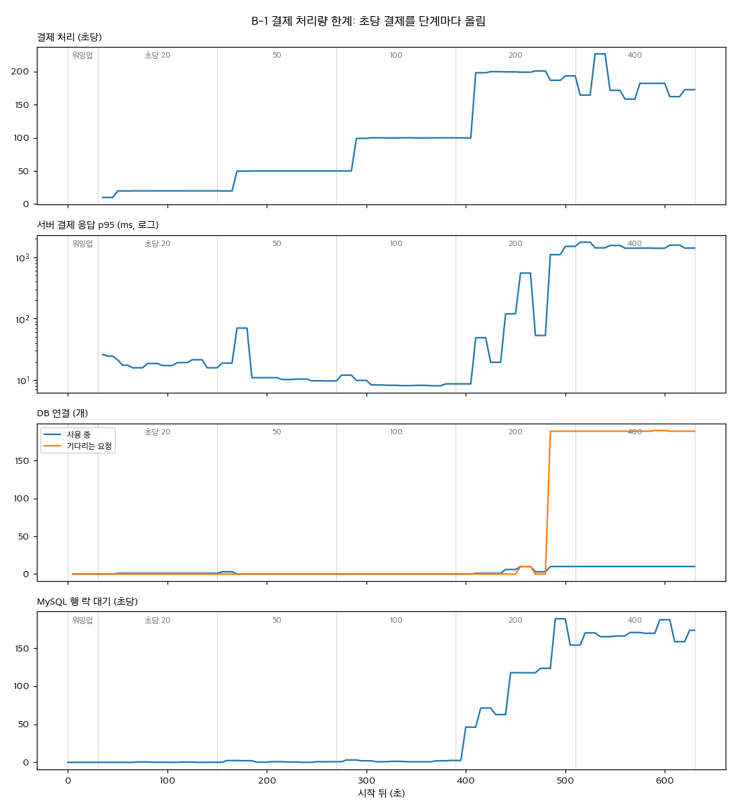
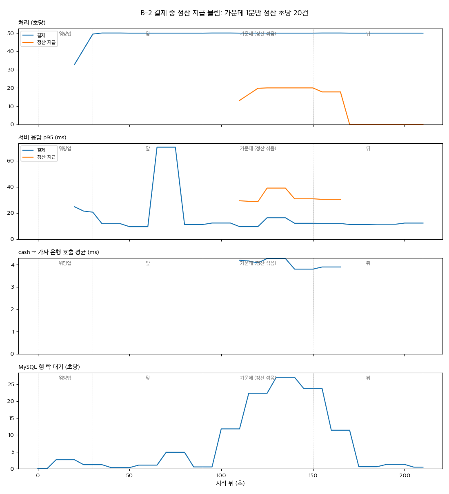
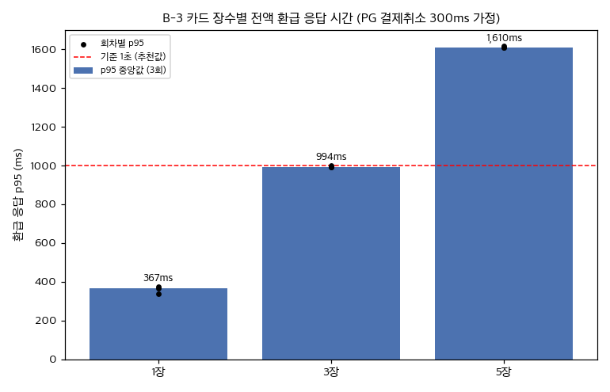
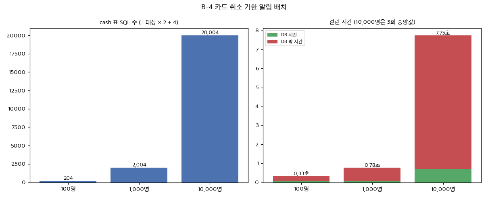

연습의 B-2는 「도착 속도 초당 50건」이라 본 측정의 B-2(동시 4개, 처리량 초당 200건 이상)보다 훨씬 가벼워서 문제가 보이지 않았어요.

## 11. 원본 위치와 다시 내는 법

| 측정 | Actions 실행 | 레포 안 원본 |
|---|---|---|
| 기준선 | [43900024578](https://github.com/prgrms-be-adv-devcourse/beadv8_5_BSB_MONO/actions/runs/43900024578) (PR #566, `cash-load-test` 라벨) | [`results/2026-11-17-a/`](../../loadtest/scenario-b/results/2026-11-17-a/) |
| 고친 뒤 A·B | [44008697597](https://github.com/prgrms-be-adv-devcourse/beadv8_5_BSB_MONO/actions/runs/44008697597) (PR #566, `cash-load-test-ab` 라벨) | [`results/2026-11-17-ab/`](../../loadtest/scenario-b/results/2026-11-17-ab/) |
| 맥 연습 | 없음 | [`results/`](../../loadtest/scenario-b/results/)의 `2026-11-16-*` |

- 레포 안 원본: 회차마다 k6 요약, 돈 확인 SQL, 락 통계, B-4 출력, 결과 정리 `summary.md`
- 예치금 로그와 그래프 원본은 Actions 아티팩트 `cash-load-results`에만 있었어요. 2026-12-17에 지워져요.

**다시 내는 법**

- 기준선처럼 지금 코드만 3번: PR에 `cash-load-test` 라벨
- A·B 번갈아 3번씩: 고친 커밋을 [`container/ab-fixes.txt`](../../loadtest/scenario-b/container/ab-fixes.txt)에 적고 PR에 `cash-load-test-ab` 라벨
- 로컬에서 한 바퀴만 짧게 (`backend/`에서, 도는지만 확인하고 판정에는 쓰지 않아요):

```bash
QUICK=1 loadtest/scenario-b/container/run.sh
```

자세한 실행 방법은 [`docs/loadtest/scenario-b/README.md`](../../loadtest/scenario-b/README.md)와 [A·B 부하 측정 따라 하기](../../loadtest/ab-measurement-guide.md)에 있어요.
