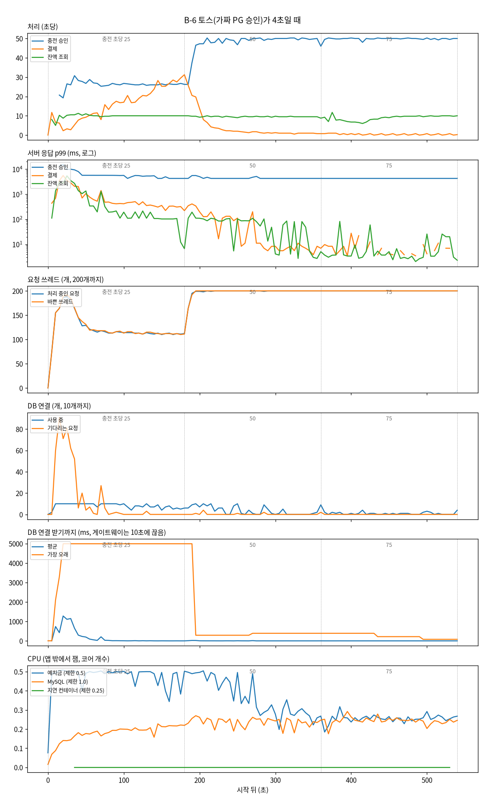
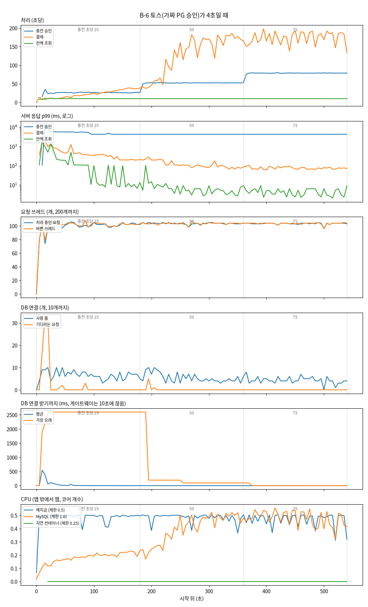
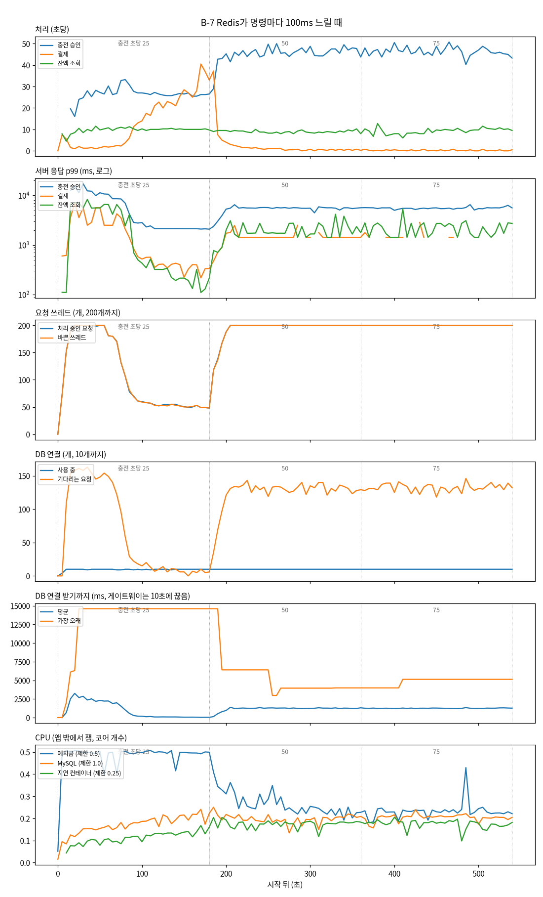
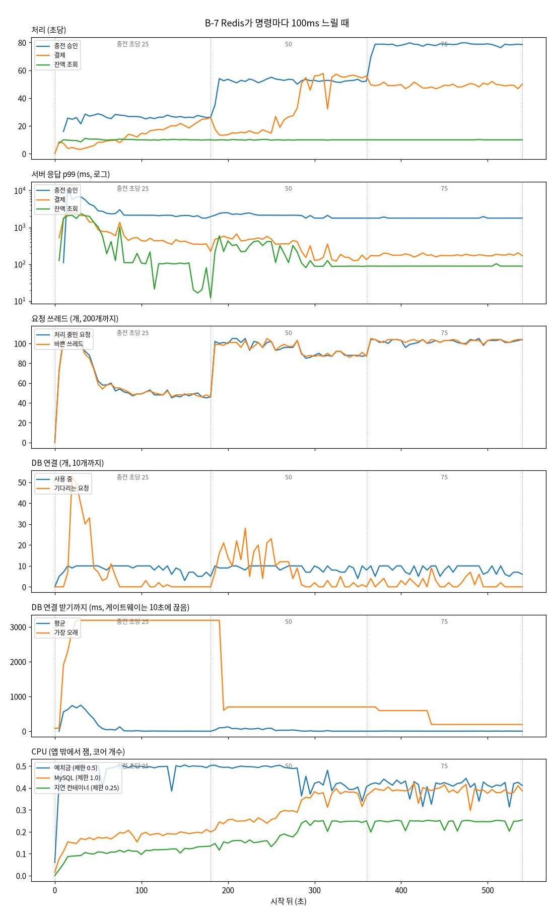
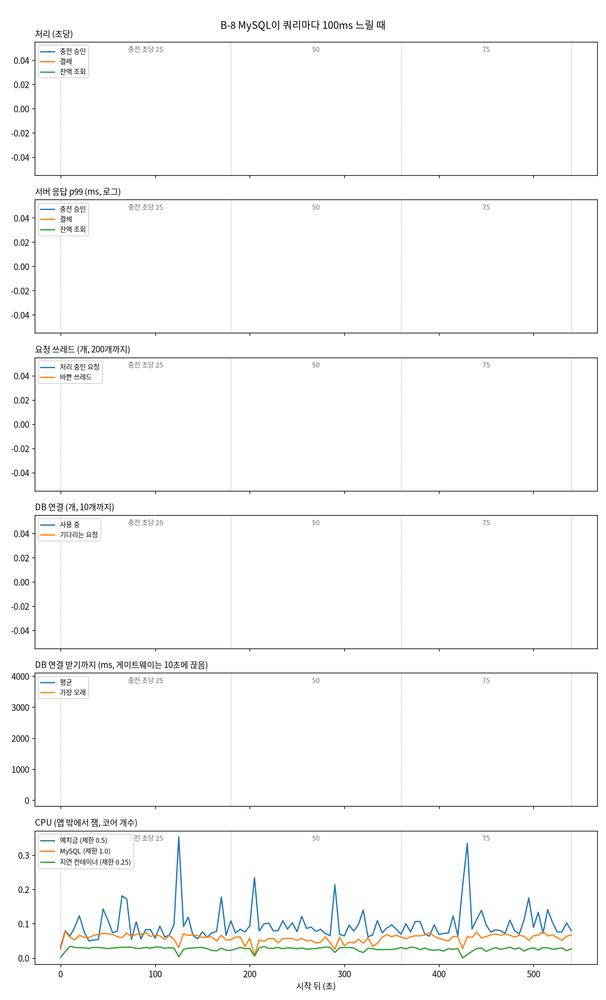
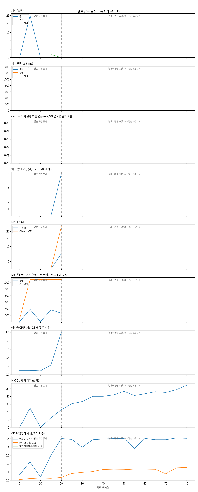
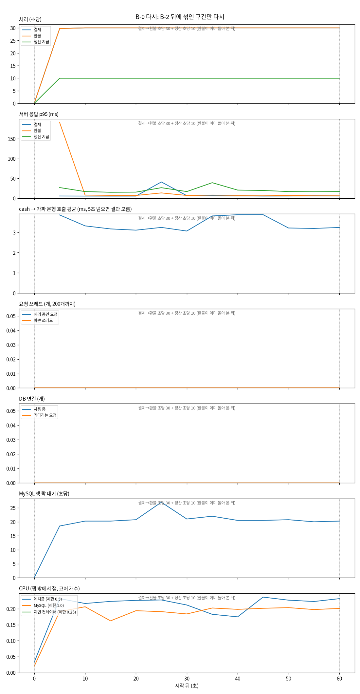

# 예치금 부하 2차: 테스트 계획서와 결과 보고서 (2026-11-20)

예치금 2차 측정(11/19)과 고친 뒤 A·B 측정(11/20)을 실무에서 흔한 양식(계획서 → 보고서)으로 다시 썼어요.
숫자는 아래 「출처」의 측정 문서에서 가져왔고, 원본 문서는 고치지 않았어요.

- 자세히 (시나리오마다 부하·기준·결과·원인을 모두): [2차 상세](2026-11-20-예치금-부하-2차-상세.md)
- Linear: BUK-11

## 1부. 테스트 계획서 (재기 전)

### 1. 목적과 범위

바깥(토스·Redis·MySQL)이 느려질 때, 바깥을 부르지 않는 결제·잔액 조회까지 같이 멈추는지 봐요. 고친 뒤에는 그 번짐이 사라졌는지 봐요.

- **묻는 것**
  1. 바깥(토스·Redis·MySQL)이 느려지면 요청 쓰레드 200개나 DB 연결이 다 차서 결제·잔액 조회까지 느려지나? 무엇이 먼저 차나?
  2. P8: 1차 B-0에서 결제 p95가 4초였던 원인은 막 띄운 직후의 예열(JIT)인가?
  3. 2초 넘게 기다린 행 락은 어느 시나리오의 어느 행에서 나오나?
  4. (고친 뒤) ①②③을 고치면 1번의 번짐이 사라지나?
- **범위 안**: 예치금 서비스 하나. 충전 확정, 결제, 잔액 조회 API
- **범위 밖**: 게이트웨이·주문·대기열을 거치는 흐름(시나리오 A와 운영 측정이 맡아요), 진짜 토스·은행, 운영 서버

앞의 세 질문은 [2차 판정 기준](../2026-11-18-예치금-부하-2차-판정기준.md) 1장 「왜 다시 재나」의 질문이에요. 돈 확인(C1~C7)은 질문이 아니라 모든 시나리오의 수용 기준이에요(2장).

### 2. 수용 기준

팀이 합의한 SLO는 아직 없어요. 그래서 주문 설정과 기획 건강 지표에서 통과선을 끌어왔어요. 숫자를 보고 바꾸지 않도록 측정 전에 커밋해요.

| 통과선 | 값 | 근거 | 종류 |
|---|---|---|---|
| 결제·잔액 조회 p99 | 1초 미만 | 주문이 예치금 응답을 2초까지 기다려요(`order.clients.timeout`). 그 절반 | 근거 있음 |
| 결제 p95 | 2초 미만 | 기획 건강 지표 H7의 경보선 | 근거 있음 |
| 돈 어긋남 | 0 (C1~C7) | 건강 지표 H5 중복 결제 0, H6 장부 불일치 0원 | 근거 있음 |
| 같은 충전 두 번째 요청 중앙값 | 3.2초 미만 | 토스 지연 4초의 80% | 추천값(미확정) |
| 가장 오래 기다린 행 락 | 2초 미만 | 주문이 기다리는 2초 | 근거 있음 |

- 고치기 전(A)은 이 선을 넘으면 「문제 있음」(X1~X4, L1, P8), 고친 뒤(B)는 이 선 안에 들어오면 「나아짐」(G1~G5)이에요. 값은 3번 중 가운데 값으로 판정해요.
- 충전 거절(429) 비율과 끝난 충전 수는 판정하지 않고 고친 것의 대가로 적어요. 고친 방법이 일부러 충전을 거절하기 때문이에요.

### 3. 워크로드 모델

**부하 크기의 근거.** 운영 피크 자료가 없어 실제 대회 사례에서 출발해요.

1. **입구**: 정원 × 배수(보통 4.5 · 평균 6 · 최악 7.5배). 천안 이봉주 대회의 동시 접속 31,852명(정원의 약 4.5배), 춘천 2025의 3분 마감(성공 신청 초당 약 110건) 등이 근거예요. 이 부하는 대기열·게이트웨이가 받아요.
2. **예치금까지 오는 양**: 대기열이 종목당 초당 4명만 들여보내요. 동시에 여는 종목 12개(가정)면 결제·충전이 각각 **초당 48건**이에요. 충전 한 건은 기획의 평균 참가비 6만 원이에요.
3. **이번 단계**: 충전 초당 25 → 50 → 75건. 토스가 4초면 쓰레드가 100 → 200 → 300개 필요해서, 두 번째 단계에서 쓰레드 한도(200개)를 넘어요. 예상 48건을 가운데에 두고 무너질 지점을 노린 단계예요.

**시나리오 (무엇을 어떤 비율로).** 바깥이 느릴 때의 시나리오 하나를 세 가지 장애로 돌려요.

| 요청 | 부하 | 바깥 호출 |
|---|---|---|
| 충전 확정 | 초당 25 → 50 → 75건, 단계마다 3분 | 토스 승인, Redis(시도 횟수) |
| 같은 충전 두 번 | 충전의 5% | 없음 (처리 중이면 기다림) |
| 결제 | 동시 4개 (주문 서버 한 대가 보내는 모양) | 없음 |
| 잔액 조회 | 초당 10건 | 없음 |

**시험 종류 (얼마나, 어떤 모양으로).**

| 종류 | 이번에 하는 것 | 이름 |
|---|---|---|
| smoke | 띄울 때마다 사용자 2명으로 30초 | 예열 |
| stress + 장애 주입 | 위 시나리오를 토스 승인 4초로 | B-6 |
| stress + 장애 주입 | Redis 명령마다 +100ms | B-7 |
| stress + 장애 주입 | MySQL 쿼리마다 +100ms | B-8 |
| spike | 같은 요청 50~100번 동시, 결제→환불·정산 섞기 | B-0 (다시·나누기) |
| breakpoint | 결제 초당 20 → 400건 | B-1 한계 (기록만) |
| soak | 하지 않음 | 한 번에 3시간이라 더 길게 돌릴 수 없었어요 |

고친 뒤 A·B 측정은 예열·B-6·B-7만 돌려요. B-8(MySQL)은 고치지 않기로 해서 뺐어요.

### 4. 환경과 데이터

GitHub Actions 머신 한 대(CPU 4개, 메모리 16GB)에서 컨테이너마다 자원을 묶어요. 운영에는 부하를 주지 않아요.

| 컨테이너 | CPU | 메모리 |
|---|---|---|
| 예치금 | 0.5개 | 768MB |
| MySQL | 1.0개 | 2GB |
| Toxiproxy (지연 주입 중계기) | 0.25개 | |
| cAdvisor (앱 밖 CPU 측정) | 0.25개 | |
| k6 | 1.0개 | |

**운영과 다른 점**

| | 이번 환경 | 운영 |
|---|---|---|
| 예치금 CPU | 상한 0.5개 | 요청 50m, 상한 없음 |
| 토스·은행 | 가짜 (승인 지연을 설정으로 주입) | 진짜 |
| 함께 도는 것 | 예치금과 인프라만 | 서비스 13개가 같은 노드 |
| 요청 경로 | k6가 예치금을 직접 부름 | 게이트웨이·주문을 거침 |

→ 숫자는 운영 성능이 아니라 「같은 조건에서의 전후 비교」에만 써요.

**데이터**

- 가입한 지 24시간이 안 된 회원 27,000명(초당 25+50+75건 × 180초), 잔액 0원, 한 건에 6만 원
- 실행마다 DB를 비우고 컨테이너를 새로 띄워요
- 설정: 요청 쓰레드 200개, DB 연결 10개 (운영과 같음)

### 5. 관측

| 무엇을 | 어디서 | 왜 |
|---|---|---|
| API별·단계별 p95·p99, 실패율 | k6 태그 (`api`, `stage`) | 판정 |
| 바쁜 요청 쓰레드, DB 연결 사용·대기 | Prometheus (관리 포트로 따로 수집) | 쓰레드와 DB 연결 중 무엇이 먼저 차는지 |
| 컨테이너 CPU | cAdvisor | 앱이 바빠 자기 지표를 못 남길 때도 보려고 |
| 행 락 대기 | 5초마다 잠금 스냅샷, SQL별 잠금 대기 합, 시나리오 앞뒤 통계 | 어느 시나리오·SQL에서 오래 기다렸는지 |
| JVM 안쪽 | JFR, GC 로그 | 락을 쥔 채 무엇을 하고 있었는지 |
| 돈 | 확인 SQL C1~C7, 시나리오마다 | 수용 기준 |
| 상태 코드별 건수 | Prometheus `http_server_requests_seconds_count` | 429·409 비율 (대가) |

끝난 뒤에는 회차마다 남긴 Prometheus 데이터를 로컬에서 다시 띄워, 그래프에 없는 지표도 다시 볼 수 있어요.

### 6. 시작·중단 조건, 위험

**시작 조건**

- 판정 기준 문서가 커밋돼 있어요.
- 빈 DB에 시드를 넣고 예열 30초가 끝났어요.
- A·B 측정이면, A(고친 커밋만 되돌린 코드)가 충돌 없이 만들어져요.

**중단 조건**

- 자동 중단은 두지 않았어요. 요청마다 k6 제한(60초)만 있어요. → B-8처럼 모두 60초에 걸려도 끝까지 돌아요.
- 실행 머신이 죽거나 A를 만들 수 없으면 멈추고 다시 돌려요.

**위험과 대책**

| 위험 | 대책 |
|---|---|
| 공용 실행 머신이 회차마다 흔들려요 | A·B를 번갈아 3번 재고 가운데 값으로 판정해요. A가 이전 측정처럼 기준을 넘는지도 봐요 |
| 막 띄운 직후라 느려요 (JIT) | 띄울 때마다 예열 30초. 예열 구간은 판정에서 빼요 |
| 측정 도구가 부하를 키워요 | 가짜 은행·지표 수집을 앱 밖이나 관리 포트로 빼요 |
| 앱이 바빠 지표가 비어요 | 앱 밖에서 재는 cAdvisor를 더해요 |
| 운영에 영향 | 운영에는 요청을 보내지 않아요 |

## 2부. 결과 보고서 (잰 뒤)

### 요약

- **바깥이 느려지면 결제까지 멈췄어요 (고치기 전).** 토스가 4초면 쓰레드가, Redis가 느리면 DB 연결이 먼저 차서 결제 p99가 최대 15~18초가 됐어요.
- **고친 뒤 토스 지연은 통과, Redis 지연은 한 항목 미달이에요.** 토스 4초에서 결제 p99 15,195ms → 85ms예요. Redis 지연 때 초당 25건 단계 결제 p99는 3,219ms → 1,302ms로 기준(1초)을 못 넘었어요.
- **돈은 모든 회차에서 맞았어요.** 어긋남 0이에요.
- **대가: 토스가 4초면 충전 절반 넘게를 거절해요.** 끝난 충전이 22,005건 → 12,419건이에요.
- **새 문제:** 바쁠 때 같은 충전에 확정이 두 번 오면, 첫 요청이 처리 중인데도 두 번째 요청이 429(「실패」)를 받아요. 우리 웹 화면은 확정을 보내기 전에 기록을 남기고 새로고침·뒤로 가기에도 같은 충전의 확정을 다시 부르지 않아서, 같은 충전에 확정이 한 번만 나가요. 그래서 웹 화면에서는 생기기 어렵고, 측정에서 보인 건 k6가 같은 충전을 5% 두 번 보냈기 때문이에요. 그래도 「같은 주문번호로 다시 불러도 같은 결과」라는 약속이 깨져서 고쳐요.

### 기준 대비 통과·실패

값은 3번 중 가운데 값이에요. 고치기 전·후는 11/20 A·B 측정(같은 머신)의 숫자예요. B-8, 행 락, P8은 11/19 측정에서만 쟀어요.

| 기준 | 통과선 | 고치기 전 | 고친 뒤 | 결과 |
|---|---|---|---|---|
| 토스 4초: 충전 초당 50·75건의 결제 p99 | 1초 미만 | 5,282 / 15,195ms | 175 / 85ms | 통과 |
| 토스 4초: 잔액 조회 p99 (25 / 50 / 75건) | 1초 미만 | 2,308 / 5,526 / 15,292ms | 887 / 86 / 7ms | 통과 |
| 토스 4초: 같은 충전 두 번째 요청 중앙값 | 3.2초 미만 | 8,403ms | 19ms | 통과 (대부분 429로 끝남, 아래 병목 참고) |
| Redis +100ms: 충전 초당 25건의 결제 p99 | 1초 미만 | 3,219ms | **1,302ms** | **실패** |
| Redis +100ms: 충전 초당 50·75건의 결제 p99 | (기록만) | 10,904 / 18,378ms | 408 / 177ms | |
| MySQL +100ms: 결제 p95 | 2초 미만 | 60,001ms (k6 제한) | 재지 않음 (고치지 않음) | 실패 |
| 가장 오래 기다린 행 락 (막 띄운 직후 예열) | 2초 미만 | 2,405ms | 재지 않음 | 실패 |
| P8: B-0 섞인 구간의 결제 p95 | 2초 미만 | 9,998ms (처음) → 8ms (같은 구간 다시) | 재지 않음 | 실패 (원인은 예열) |
| 돈 확인 C1~C7 | 어긋남 0 | 0 | 0 | 통과 |

**대가 (판정 아님)**

| | 토스 4초 | Redis +100ms |
|---|---|---|
| 충전 거절 비율 (초당 25 / 50 / 75건) | 14 / 53 / 68% | 2.5 / 2.1 / 22% |
| 끝난 충전 (고치기 전 → 후) | 22,005 → 12,419건 | 20,869 → 23,645건 |

### 병목과 원인

| 장면 | 먼저 찬 것 | 원인 | 확인 정도 |
|---|---|---|---|
| 토스 4초 (고치기 전) | 요청 쓰레드 200개 (초당 50건에서) | 충전이 토스를 기다리는 4초 동안 쓰레드를 쥐어요. 결제는 앱 안에서 수 ms인데 쓰레드를 받으려고 줄을 서요 | 그래프·계산 일치 (25 × 4.3초 ≈ 108개) |
| Redis +100ms (고치기 전) | DB 연결 10개 (초당 25건에서) | 지갑 잠금 트랜잭션 안에서 Redis(시도 횟수)를 불러, Redis가 느린 만큼 DB 연결을 쥐어요 | 코드 확인, 고친 뒤 초당 50·75건 통과 |
| Redis +100ms (고친 뒤) 첫 1분 | DB 연결 대기 최대 52개, 예치금 CPU 상한 | 지연 컨테이너를 거치도록 다시 띄운 직후의 첫 실행 비용으로 봐요 | 추정 (JFR 미확인) |
| MySQL +100ms | 알 수 없음 | 앱 지표가 비어 보지 못했어요 | 미확인 |
| 막 띄운 직후 행 락 2초 넘음 | 보관 지갑 한 행 | 락을 쥔 결제가 클래스를 처음 읽고 JIT 컴파일 중이었어요. CPU 0.5개 상한에 닿아 있었어요 | JFR 확인 |
| B-0 섞인 구간 결제 10초 (P8) | 예치금 CPU 상한 | 막 띄운 앱에서 결제→환불·정산이 처음 도는 비용이에요. 같은 구간을 다시 돌리면 p95 8ms예요 | 다시 돌려 확인 (코드는 안 고침) |
| 고친 뒤 같은 충전 재요청 429 | 동시 개수 제한 100개 | 제한이 충전 확정 맨 앞에 있어, 이미 처리 중인 충전인지 보기 전에 자리부터 확인해요 | 코드·상태 코드 건수 확인 |

### 그래프

위 병목을 본 그래프예요. 칸은 위에서부터 처리량, 서버 응답 p99, 요청 쓰레드, DB 연결, DB 연결 받기까지 걸린 시간, CPU예요. 점선은 단계(충전 초당 25 → 50 → 75건)가 바뀐 시각이에요.

**토스 4초, 고치기 전 (A 2회차).** 초당 50건부터 요청 쓰레드 200개가 다 차고 결제 처리량이 바닥으로 떨어져요.

**토스 4초, 고친 뒤 (B 2회차).** 처리 중인 요청이 100개 근처에서 멈추고, 결제는 초당 150~200건을 계속 처리해요.

**Redis +100ms, 고치기 전 (A 2회차).** 초당 25건에서 DB 연결 10개가 다 차요.

**Redis +100ms, 고친 뒤 (B 2회차).** 첫 1분만 DB 연결 대기가 최대 52개까지 쌓이고, 그 뒤로는 거의 없어요. G4를 못 넘은 이유예요. B 회차 JFR 3개로 보니, 첫 충전이 Redis 연결을 처음 만드는 동안 충전 약 90건이 쿨다운 확인에서 최대 5초 기다렸다가 한꺼번에 DB 연결로 몰렸어요(DB 연결 대기 1분째 3,252번 → 2분째 795번 → 3분째 85번, 2회차). 예열은 결제만 돌려 Redis 연결을 만들지 않아요. JIT는 주된 원인이 아니었어요(2차 전후 문서 4장).

**MySQL +100ms (11/19, 1회차).** 모든 요청이 60초 제한에 걸려요. 앱이 바빠 지표가 비어 있어요.

**B-0 처음 (11/19, 1회차).** 섞인 구간이 시작되자(20초) 예치금 CPU가 상한에 닿고, 그 뒤로 앱 지표가 비어요.

**B-0 다시 (11/19, 1회차).** 같은 구간을 다시 돌리면 예치금 CPU가 0.2개 안팎으로 여유가 있고, 결제·환불·정산이 수십 ms 안에 끝나요.

### 권고

| 순서 | 할 일 | 이유 |
|---|---|---|
| 1 | 동시 개수 제한을 「처리 중」 선점 뒤, 토스 호출 바로 앞으로 옮기기 | 같은 충전 재요청이 429를 받아, 그 응답을 믿고 다시 결제하면 두 번 결제돼요. 웹 화면은 확정을 한 번만 보내 급하지는 않지만, 같은 주문번호 재요청에 같은 결과를 준다는 약속을 지키려고 고쳐요 |
| 2 | 운영 지표로 배포 직후 결제 응답·행 락 대기 확인 | 측정에서는 막 띄운 직후 락이 2초를 넘었어요. 운영은 CPU 상한이 없어 덜할 수 있어요 |
| 3 | Redis 연결을 앱이 뜰 때 미리 만들지 정하기 | JFR로 확인한 G4 첫 1분의 원인이에요(11/22). 첫 충전이 Redis 연결을 처음 만드는 동안 다른 충전이 최대 5초 기다렸어요 |
| 4 | 팀 SLO 합의 | 지금 통과선은 주문 설정·기획 지표에서 끌어온 값이에요. 측정 기간·목표 비율이 없어요 |
| 5 | k6에 자동 중단 더하기 | 모두 60초에 걸리는 시나리오(B-8)를 일찍 끊어 실행 시간을 아껴요 |
| 6 | 짧은 성능 테스트를 CI에 넣기, soak 테스트 따로 두기 | 지금은 사람이 라벨을 붙여야 돌고, 오래 돌릴 때 생기는 문제는 못 봐요 |
| 7 | MySQL 지연은 기록만 | DB가 요청마다 100ms 느려지는 상황은 앱에서 막기 어려워요. DB 모니터링·경보로 다뤄요 |

### 용량 결론

예상 부하(결제·충전 각 초당 48건)에는 예치금 1대로 여유가 있어요. 단, 토스 승인이 약 2초보다 느려지면 충전 거절이 생겨요. 아래는 측정값에서 계산한 추정이에요.

| 대상 | 1대가 받는 양 | 예상 48건 대비 | 대수를 늘리면 |
|---|---|---|---|
| 충전 | 동시 100개 ÷ 토스 승인 시간. 1초면 초당 100건, 4초면 초당 25건 | 토스가 2.08초(100 ÷ 48)보다 느리면 모자라요 | 올라요. 제한이 서버마다 따로라 2대면 두 배예요 |
| 결제 | 초당 약 200~400건에서 무너져요 (1차 한계 측정) | 4~8배 여유 | **거의 안 올라요.** 모든 결제가 보관 지갑 한 행을 잠가서, 그 한 행이 천장이에요. 동시 4개→8개로 늘려도 처리량이 크게 오르지 않았어요 |

- 충전은 대수나 동시 제한으로 늘릴 수 있어요. 다만 요청 쓰레드 200개 안에서 결제 몫을 남겨야 해서, 한 대의 제한을 100개보다 크게 올리기는 어려워요.
- 결제 천장을 더 올리려면 대수가 아니라 보관 지갑을 여러 행으로 나누는 구조 변경이 필요해요. 지금 예상 부하에서는 필요 없어요.
- 운영 토스 승인 시간은 아직 재지 않았어요. 운영 예치금에는 외부 호출 지표가 없어, 지표를 더해야 위 2.08초 선과 비교할 수 있어요.

## 출처

| 내용 | 경로 |
|---|---|
| 1차 판정 기준 (예상 부하 48건, 환경) | [2026-11-16-예치금-부하-판정기준.md](../2026-11-16-예치금-부하-판정기준.md) |
| 2차 판정 기준 (X1~X4, L1, 시나리오) | [2026-11-18-예치금-부하-2차-판정기준.md](../2026-11-18-예치금-부하-2차-판정기준.md) |
| 2차 결과 (고치기 전, B-8, 행 락, P8, JFR) | [2026-11-19-예치금-부하-2차.md](../2026-11-19-예치금-부하-2차.md) |
| 고칠 것과 G1~G5 | [2026-11-20-예치금-부하-2차-고칠것.md](../2026-11-20-예치금-부하-2차-고칠것.md) |
| 고친 뒤 A·B 결과 | [2026-11-20-예치금-부하-2차-전후.md](../2026-11-20-예치금-부하-2차-전후.md) |
| 결제 한계 (초당 200~400건) | [2026-11-17-예치금-부하-전후.md](../2026-11-17-예치금-부하-전후.md) 7-2장 |
| 건강 지표 H5·H6·H7 | [07-north-star-metrics.md](../../ideation/07-north-star-metrics.md) |
| 대회 사례 (천안 31,852명) | [2026-11-15-10pct.md](../../loadtest/scenario-a/results/2026-11-15-10pct.md) |
