# 예치금 부하 2차 상세 (2026-11-18 ~ 11-20)

2차 측정의 모든 내용을 이 문서 하나에 모았어요. 판정 기준, 지금 코드를 3번 잰 결과(11/19), 고칠 방법 고르기, 고친 뒤 A·B를 번갈아 잰 결과(11/20), 운영 지표 확인이 다 들어 있어요.
시나리오마다 같은 순서(① 왜 재나 → ② 부하 → ③ 보는 것 → ④ 판정 기준 → ⑤ 결과 숫자 → ⑥ 통과 여부 → ⑦ 그래프 → ⑧ 원인 → ⑨ 어떻게 했나)로 적었어요.

- 짧게 보려면: [2차 계획서·보고서](2026-11-20-예치금-부하-2차-계획서-보고서.md)
- 1차는: [1차 상세](2026-11-17-예치금-부하-1차-상세.md)
- 이 문서를 만든 원래 문서 4개는 그대로 두었어요. 숫자는 모두 거기서 가져왔어요.
  - [2차 판정 기준 (11/18, 재기 전에 커밋)](../2026-11-18-예치금-부하-2차-판정기준.md)
  - [2차 결과, 지금 코드 3번 (11/19)](../2026-11-19-예치금-부하-2차.md)
  - [고칠 것과 고친 뒤 판정 기준 (11/20, 재기 전에 커밋)](../2026-11-20-예치금-부하-2차-고칠것.md)
  - [고친 뒤 A·B (11/20)](../2026-11-20-예치금-부하-2차-전후.md)
- Linear: BUK-11, PR #688

## 목차

- [0. 이 문서를 읽는 법](#0-이-문서를-읽는-법)
- [1. 한눈에 보기](#1-한눈에-보기)
- [2. 왜 쟀나](#2-왜-쟀나)
- [3. 공통 조건](#3-공통-조건)
  - [3-1. 1차와 같은 점과 다른 점](#3-1-1차와-같은-점과-다른-점)
  - [3-2. 측정 환경](#3-2-측정-환경)
  - [3-3. 두 번의 측정과 도는 순서](#3-3-두-번의-측정과-도는-순서)
  - [3-4. 새로 더한 관측 도구](#3-4-새로-더한-관측-도구)
- [4. 판정 기준 전체 목록](#4-판정-기준-전체-목록)
- [5. 시나리오별 상세](#5-시나리오별-상세)
  - [5-1. 예열 (네 번)](#5-1-예열-네-번)
  - [5-2. P8 묶음 B-0 B-2 B-0 다시 B-0 나누기](#5-2-p8-묶음-b-0-b-2-b-0-다시-b-0-나누기)
  - [5-3. B-6 토스가 4초 걸릴 때](#5-3-b-6-토스가-4초-걸릴-때)
  - [5-4. B-7 Redis가 명령마다 100ms 느릴 때](#5-4-b-7-redis가-명령마다-100ms-느릴-때)
  - [5-5. B-8 MySQL이 쿼리마다 100ms 느릴 때](#5-5-b-8-mysql이-쿼리마다-100ms-느릴-때)
  - [5-6. B-1 한계 결제 도착 속도를 계속 올리기](#5-6-b-1-한계-결제-도착-속도를-계속-올리기)
- [6. 2초 넘는 락은 어디서 나오나](#6-2초-넘는-락은-어디서-나오나)
- [7. 예열을 충분히 하면 되지 않나](#7-예열을-충분히-하면-되지-않나)
- [8. 운영 지표 확인](#8-운영-지표-확인)
- [9. 측정하면서 찾은 다른 문제](#9-측정하면서-찾은-다른-문제)
- [10. 한계](#10-한계)
- [11. 다음 할 일과 지금 상태](#11-다음-할-일과-지금-상태)
- [12. 판정 기준을 바꾼 기록](#12-판정-기준을-바꾼-기록)
- [13. 원본 위치와 다시 내는 법](#13-원본-위치와-다시-내는-법)

## 0. 이 문서를 읽는 법

### 말

1차 상세 문서 0장의 말(A, B, 회차, 중앙값, p95·p99, 동시 N개, 초당 N건, 보관 지갑, 예열)을 그대로 써요. 2차에서 새로 쓰는 말이에요.

| 말 | 뜻 |
|---|---|
| 바깥 | 예치금이 요청을 처리하는 도중 밖으로 부르는 것이에요. 토스(PG), Redis, MySQL |
| 요청 쓰레드 | 예치금이 요청 하나를 처리하는 일꾼이에요. 최대 200개(Tomcat 기본값)이고, 모든 API가 같이 써요. 다 차면 새 요청은 빌 때까지 앱 바깥에서 줄을 서요 |
| DB 연결 | 예치금이 MySQL과 쓰는 연결이에요. 10개뿐이에요. 다 차면 요청은 연결이 빌 때까지 기다려요(최대 30초) |
| 지연 컨테이너 (Toxiproxy) | 예치금과 MySQL·Redis 사이에 끼워, 응답마다 일부러 시간을 더하는 중계기예요 |
| 다시 띄우기 | 토스 지연값이나 지연 컨테이너를 바꾸려면 예치금을 다시 띄워야 해요. DB는 그대로 두고 예치금만 다시 띄워요 |
| 단계 1·2·3 | B-6·B-7·B-8에서 충전을 초당 25 → 50 → 75건으로 올리는 세 단계예요. 단계마다 3분이에요 |
| 동시 개수 제한 | 고친 코드(B)에서 충전 확정을 동시에 100개까지만 받고, 넘으면 토스를 부르기 전에 바로 거절(429)하는 장치예요 |
| JFR | JVM이 스스로 남기는 기록이에요. 어느 쓰레드가 무엇을 하며 멈췄는지 볼 수 있어요 |

### 판정 기호

2차에서는 기호가 두 벌이에요. **고치기 전(A)에 쓰는 X·L과, 고친 뒤(B)에 쓰는 G가 같은 선을 다른 쪽에서 봐요.**

| 기호 | 뜻 | 누구에게 쓰나 | 언제 정했나 |
|---|---|---|---|
| X1~X4 | 바깥이 느릴 때 「문제 있음」 조건 | A (11/19) | 11/18, 재기 전 |
| L1 | 2초 넘게 기다린 락이 있나 | A (11/19) | 11/18, 재기 전 |
| P8 | B-0 결제 p95가 2초를 넘나 (1차와 같아요) | A (11/19) | 1차 |
| R1 | P8의 원인이 예열인가 (판정이 아니라 원인 고르기) | A (11/19) | 11/18, 재기 전 |
| G1~G5 | 고친 뒤 「나아짐」 조건. 1차의 G1~G6과 다른 목록이에요 | A·B (11/20) | 11/20, 고친 뒤 재기 전 |
| C1~C7 | 돈 확인 (1차와 같아요) | 모두 | 1차 |

왜 X에서 G로 바뀌나: X는 「A가 이 선을 넘으면 문제」, G는 「B가 이 선 안에 들어오면 나아짐」이에요. 2차 판정 기준에 「고친 뒤 이 문서의 X·L 조건으로 G를 새로 정한다」고 미리 적어 두었어요. 그래서 G1·G2는 X2와, G3는 X4와, G4는 X1과 같은 선이에요(4장).

## 1. 한눈에 보기

### 11/19 지금 코드(A) 3번

| 시나리오 | 무엇을 의심했나 | 부하 | 기준 | 결과 (3회 중앙값) | 판정 |
|---|---|---|---|---|---|
| 예열 (처음 띄운 직후) | 막 띄운 앱에서 락이 오래 걸리나 | 결제 동시 2개 30초 | L1 가장 오래 기다린 락 2초 미만 | 2,406ms | **실패** |
| B-0 | P8 원인 | 1차 B-0과 같음 | P8 결제 p95 2초 미만 | 9,998ms | **실패** |
| B-0 다시 | 예열 탓인가 | B-0 섞인 1분만 다시 | R1 처음의 10분의 1 이하 | 8ms | **예열이 원인** |
| B-0 나누기 | 요청 종류 탓인가 | 환불만 1분, 정산만 1분 | (원인 고르기) | 5ms, 12ms | 요청 종류 탓 아님 |
| B-2 | (P8 순서 맞추기용) | 1차와 같음 | 판정 안 함 | 처리량 79%, p99 108ms | 기록만 |
| B-6 | 토스가 느리면 결제까지 멈추나 | 충전 25 → 50 → 75건 + 결제 동시 4개 + 잔액 조회 초당 10건 + 같은 충전 두 번 5%, 토스 4초 | X1, X2, X4 | 결제 p99 1,300ms (25건), p95 15초 (75건), 두 번째 요청 8,657ms | **실패** |
| B-7 | Redis가 느리면 결제까지 멈추나 | B-6과 같음, Redis +100ms | X1, X2 | 결제 p99 4,396ms (25건) | **실패** |
| B-8 | MySQL이 느리면 | B-6과 같음, MySQL +100ms | X3 결제 p95 2초 미만 | 60,001ms (모두 제한 시간) | **실패** |
| B-8 | 락 | | L1 | 2,733ms | **실패** |
| B-1 한계 | 2초 락이 여기서 나오나 | 결제 초당 20 → 400건 | 판정 안 함 (락만 L1로 봄) | 락 0.3~0.6초, 400건 p95 7.2~7.8초 | 기록만. 2초 락은 여기서 안 나옴 |
| 전체 | 돈 | | C1~C7 | 0 | 통과 |

### 11/20 고친 뒤 A·B (예열·B-6·B-7만)

| 기준 | 뜻 | A 중앙값 | B 중앙값 | 판정 |
|---|---|---|---|---|
| G1 | B-6 충전 50·75건 단계의 결제 p99 1초 미만 | 5,282 / 15,195ms | **175 / 85ms** | 통과 |
| G2 | B-6 모든 단계의 잔액 조회 p99 1초 미만 | 2,308 / 5,526 / 15,292ms | **887 / 86 / 7ms** | 통과 |
| G3 | B-6 같은 충전 두 번째 요청 중앙값 3.2초 미만 | 8,403ms | 19ms | 통과 (대부분 429로 바로 거절된 결과) |
| G4 | B-7 충전 25건 단계의 결제 p99 1초 미만 | 3,219ms | **1,302ms** | **실패** (첫 1분만 느림) |
| G5 | 돈 확인 | 0 | 0 | 통과 |

대가(판정 아님): 토스가 4초면 충전의 절반 넘게를 429로 거절해요. 끝난 충전이 22,005 → 12,419건이에요.
새 문제: 바쁠 때 같은 충전을 다시 부르면 첫 요청이 처리 중인데도 429(「실패」)로 답해요([5-3 ⑨](#5-3-b-6-토스가-4초-걸릴-때)). 고칠 방법은 아직 정하지 않았어요.

## 2. 왜 쟀나

1차에서 답하지 못한 세 질문이에요.

| 질문 | 1차에서 본 것 | 이번에 가릴 것 | 시나리오 |
|---|---|---|---|
| ① 바깥이 느려지면 요청 쓰레드 200개나 DB 연결이 다 차나 | 재지 않았어요. 가짜 PG 승인은 1초였어요 | 토스·Redis·MySQL이 느릴 때, 바깥을 부르지 않는 결제와 잔액 조회까지 느려지는지. 쓰레드와 DB 연결 중 무엇이 먼저 차는지 | B-6, B-7, B-8 |
| ② P8: B-0 섞인 1분 결제 p95가 4초인 원인 | B-1·B-2는 수십 ms인데 요청이 더 적은 B-0만 느려요. CPU가 상한에 닿은 뒤 앱 지표가 비어 원인을 몰라요 | 처음 도는 환불의 예열 때문인지, 요청 종류 중 무엇이 CPU를 쓰는지 | P8 묶음 |
| ③ 2초 넘게 기다린 행 락 | 회차 끝에 한 번만 읽어서 6회 중 5회 2초를 넘었지만 어느 시나리오인지 몰라요 | 어느 시나리오의 어느 행인지 | 모든 시나리오 (락을 시나리오마다 따로 읽음), B-1 한계 |

그리고 고친 뒤(11/20): ④ ①②③을 고치면 ①의 번짐이 사라지나?

**왜 토스·Redis·MySQL만 늦추나 (11/18 코드로 확인)**

| 바깥 | 부르는 요청 | 한 번에 최대로 기다리는 시간 | 늦추나 |
|---|---|---|---|
| MySQL | 모든 요청 | DB 연결을 얻을 때까지 30초(연결 10개) | B-8 |
| Redis | 충전 승인 (이상 충전 감지에서 명령 4번, 그중 2번은 지갑을 잠근 트랜잭션 안) | 명령마다 2초 | B-7 |
| 토스 승인 | 충전 승인 | 연결·응답에 5초씩, 결과를 모르면 조회까지 최악 약 19초 | B-6 |
| 은행 송금 | 정산 지급 | 연결·응답에 5초씩 | 아니요 (P8 묶음에서 관찰) |
| 토스 결제취소, 가상계좌 발급, 회원 서비스 | 환급, 회수 청구, 관리자 화면 | | 아니요. 접수 때 드물어요 |

접수가 열릴 때 같이 느려질 법한 셋을 골랐어요. 운영에서 MySQL·Redis는 모든 서비스가 보조 EC2 한 대를 같이 써요.

## 3. 공통 조건

### 3-1. 1차와 같은 점과 다른 점

**같은 점**
- k6가 예치금 API를 직접 불러요. 게이트웨이·주문은 거치지 않아요.
- 회차마다 빈 DB에서 시작해요. 결제 회원 1,000명(지갑마다 1,000만 원), 판매자 50명이에요.
- 가짜 PG 결제취소 300ms, 기한 알림 배치 매분이에요.
- 시나리오가 끝날 때마다 돈 확인(C1~C7)을 돌리고 지표를 받아 둬요.
- 예상 트래픽은 결제·충전 각 초당 48건이에요(1차 상세 3-1).

**다른 점**
- **지연 컨테이너(Toxiproxy):** B-7·B-8 동안만 예치금이 이 컨테이너를 거쳐 Redis·MySQL에 가요. 처음에는 모든 시나리오에서 거치게 했는데, 짧은 확인 실행에서 B-1 한계 400건 근처에 이 컨테이너가 병목이 돼서 바꿨어요([12장](#12-판정-기준을-바꾼-기록)).
- **예치금 다시 띄우기:** 토스 지연값과 지연 컨테이너는 띄울 때 정해요. 그래서 B-6 앞(토스 4초), B-7 앞(토스 1초 + 지연 컨테이너 거침), B-1 한계 앞(토스 1초 + 바로)에서 다시 띄우고, 띄울 때마다 예열을 다시 돌려요. → 한 회차에 예열이 네 번 있어요.
- **새 데이터:** 가입 24시간 안 된 잔액 0원 회원 27,000명(초당 25+50+75건 × 180초). B-6·B-7·B-8이 같은 회원을 돌려 써요. 같은 회원은 5분에 3번까지 충전할 수 있는데 시나리오 사이가 5분보다 길고, 하루 한도 100만 원도 넘지 않아요(3번 × 6만 원).
- **더 보는 것:** 3-4의 관측 도구를 더해서, 같은 머신의 자원을 조금 더 써요. → 1차 숫자와 직접 비교하지 않고, 같은 실행 안에서만 비교해요.

### 3-2. 측정 환경

| 컨테이너 | CPU | 메모리 |
|---|---|---|
| 예치금 | 0.5개 | 768MB |
| MySQL | 1.0개 | 2GB |
| 지연 컨테이너 (Toxiproxy) | 0.25개 (처음 0.1개에서 올림) | |
| cAdvisor (앱 밖에서 CPU 재기) | 0.25개 | |
| k6 | 1.0개 | |
| 그 밖 (Redpanda, Prometheus, Redis 등) | 1차와 같음 | |

컨테이너 상한 합은 약 3.7개예요(머신 4개).

| | 이번 환경 | 운영 |
|---|---|---|
| 예치금 CPU | 상한 0.5개 | 요청 50m, 상한 없음 |
| 토스·은행 | 가짜 (승인 지연을 설정으로 넣음) | 진짜 |
| 함께 도는 것 | 예치금과 인프라만 | 서비스 13개가 같은 노드 |
| 요청 경로 | k6가 예치금을 직접 부름 | 게이트웨이·주문을 거침 |
| 요청 쓰레드, DB 연결 | 200개, 10개 | 같음 |

**운영 서버에서는 재지 않아요.** 운영은 메인 EC2 한 대에 앱 12개가 CPU 상한 없이 함께 떠 있고, MySQL·Redis를 모든 서비스가 같이 써요. 부하를 주면 다른 서비스가 함께 느려지고, 매번 조건이 달라 개선 판정에도 쓸 수 없어요. 대신 운영 지표를 읽어 확인만 해요([8장](#8-운영-지표-확인)).

### 3-3. 두 번의 측정과 도는 순서

| 측정 | 날짜·시간 | 코드 | 회차 | 시나리오 |
|---|---|---|---|---|
| 2차 | 11/19 09:56~12:45 (2시간 49분) | `38105c12` (PR #566) | A 3번 | 전부 |
| 2차 A·B | 11/20 05:06~07:29 (2시간 23분) | B `c9e54335` (PR #688), A = B에서 ①②③ 커밋 `41e7ed51`만 되돌림 | A·B 번갈아 3번씩 | 예열·B-6·B-7만 |

**11/19 도는 순서 (한 회차)**

```
예열 → B-0 → B-2 → B-0 다시 → B-0 나누기
→ (토스 4초로 다시 띄움) 예열 → B-6
→ (토스 1초 + 지연 컨테이너를 거치게 다시 띄움) 예열 → B-7 → B-8
→ (토스 1초 + 바로 가게 다시 띄움) 예열 → B-1 한계
```

**11/20 도는 순서 (한 회차)**

```
예열 → (토스 4초로 다시 띄움) 예열 → B-6 → (지연 컨테이너를 거치게 다시 띄움) 예열 → B-7
```

B-8은 고치지 않기로 해서, P8 묶음·B-1 한계는 원인을 이미 가려서 뺐어요.
A 1회 → B 1회 → A 2회 → B 2회 → A 3회 → B 3회 순서예요.

### 3-4. 새로 더한 관측 도구

새 문제를 찾으려는 게 아니라, 1차에서 답을 막은 빈칸을 채우려고 더했어요.

| 무엇 | 1차에서 막힌 빈칸 | 어떻게 | 알 수 있는 것 |
|---|---|---|---|
| 앱 밖에서 잰 CPU (cAdvisor) | 앱이 바쁘면 CPU 지표도 함께 비었어요 | 컨테이너 CPU를 1초마다 재요 | 앱이 바빠도 CPU가 상한에 닿았는지 |
| SQL별 잠금 대기 합 (`sql/15`) | 어느 행에서 기다렸는지 몰라요 | 시나리오 전에 MySQL 문장 요약을 비우고, 끝나면 SQL마다 잠금 대기 합·가장 오래 걸린 시간을 읽어요 | 그 시나리오 안에서 어느 SQL이 얼마나 기다렸는지. **L1은 이 값의 「가장 오래」로 판정해요** |
| 잠금 스냅샷 (`sql/14`) | 누가 막았는지 몰라요 | 5초마다 「지금 기다리는 표·SQL, 막은 SQL, 기다린 초」를 찍어요 | 막은 SQL이 비어 있으면, 막은 쪽이 쿼리가 아니라 앱 코드를 돌며 락을 쥐고 있다는 뜻 |
| 시나리오 앞뒤 락 통계 | 회차 끝에 한 번만 읽었어요 | 시나리오 앞뒤로 읽어요 | 어느 시나리오에서 최댓값이 올랐는지 (MySQL 최댓값은 0으로 되돌릴 수 없어요) |
| DB 연결 받기까지 걸린 시간 | 기다리는 요청 수만 있었어요 | 평균과 가장 오래를 그래프에 더해요 | B-7·B-8에서 DB 연결이 먼저 찼는지 |
| JFR, GC 로그 | 앱 지표가 빈 구간에 CPU를 누가 썼는지 몰라요 | 예치금 JVM에 바퀴 내내 켜요 | 어느 메서드·JIT·GC가 CPU를 썼는지, 락을 쥔 채 무엇을 했는지 |
| 바쁜 요청 쓰레드 수 | 쓰레드가 다 차는 상황을 재지 않았어요 | Tomcat 쓰레드 지표(`tomcat_threads_busy_threads`) | 쓰레드가 200에 닿았는지 |
| 앱 지표를 따로 받는 포트 (8091) | 앱이 바쁘면 지표 요청도 요청 쓰레드 줄에 서서 늦었어요 | 측정에서만 관리 포트를 따로 열어요 | 쓰레드가 다 차도 지표는 자기 쓰레드로 답해요 |
| 회차마다 Prometheus 데이터 저장 | 끝나면 그래프에 없는 지표는 볼 수 없었어요 | `prometheus-data.tar.gz` | 나중에 로컬에서 다시 띄워 볼 수 있어요 |

## 4. 판정 기준 전체 목록

### 11/18에 정한 것 (재기 전에 커밋, 고치기 전 A에 써요)

| 번호 | 뜻 | 시나리오 | 조건 (하나라도 맞으면 문제) | 근거 | 종류 |
|---|---|---|---|---|---|
| X1 | 바깥이 조금만 느려도 결제가 흔들리나 | B-6·B-7 | 충전 초당 25건 단계에서 결제 p99 1초 이상, 또는 충전 실패 1% 이상 | 25건이면 B-6에서 쓰레드 100개만 필요해 남는데도 느리면 다른 원인이 있어요. 1초는 주문이 기다리는 2초의 절반 | 근거 있음 |
| X2 | 바깥 지연이 바깥을 부르지 않는 API까지 번지나 | B-6·B-7 | 어느 단계든 결제나 잔액 조회 p99 1초 이상 | 몇 번째 단계에서 넘었는지를 문턱으로 적어요 | 근거 있음 |
| X3 | MySQL이 느리면 결제가 경보선을 넘나 | B-8 | 어느 단계든 결제 p95 2초 이상 | 1차 P8과 같은 선(건강 지표 H7) | 근거 있음 |
| X4 | 같은 충전 두 번째 요청이 쓰레드를 오래 쥐나 | B-6 | 두 번째 요청 응답 중앙값 3.2초 이상 | 토스 지연 4초의 80% | 추천값(미확정) |
| L1 | 2초 넘게 기다린 락이 있나 | B-1 한계가 아닌 모든 시나리오 | 가장 오래 기다린 행 락 2초 이상 | 주문이 예치금을 2초까지 기다려요. B-1 한계(예상의 8배)에서만 넘으면 기록만 | 근거 있음 |
| P8 | B-0 결제가 경보선을 넘나 | B-0 | 결제 p95 2초 이상 | 1차와 같아요 | 근거 있음 |
| R1 | P8 원인이 예열인가 | B-0 다시 | B-0 다시의 결제 p95가 첫 B-0의 10분의 1 이하면 예열 | 1차 B-1·B-2 p95가 B-0의 약 50분의 1이라 그 사이로 잡았어요 | 추천값(미확정) |

X2·X3에 걸리면 「처리 중인 요청이 200에 닿은 시각」과 「DB 연결 대기가 처음 생긴 시각」 중 먼저인 쪽을 적어요. 고칠 방법을 고를 때 써요(쓰레드가 먼저면 가상 쓰레드·격벽, DB 연결이 먼저면 트랜잭션 안의 바깥 호출 빼기).

### 11/20에 정한 것 (고친 뒤 재기 전에 커밋, A·B에 써요)

| 번호 | 뜻 | 무엇 | B가 이러면 「나아짐」 | 같은 선 |
|---|---|---|---|---|
| G1 | ① 토스가 느려도 결제가 멈추지 않나 | B-6 충전 50·75건 단계의 결제 p99 | 1초 미만 | X2 |
| G2 | ① 토스가 느려도 잔액 조회가 멈추지 않나 | B-6 모든 단계의 잔액 조회 p99 | 1초 미만 | X2 |
| G3 | ③ 같은 충전 두 번째 요청이 짧아졌나 | B-6 두 번째 요청 응답 중앙값 | 3.2초 미만 | X4 |
| G4 | ② Redis가 느려도 결제가 흔들리지 않나 | B-7 충전 25건 단계의 결제 p99 | 1초 미만 | X1 |
| G5 | 돈 | C1~C7 | A·B 모든 회차 0 | |

- 3회 중앙값으로 판정해요. 하나라도 못 미치면 그 항목만 「나아지지 않음」으로 적어요.
- A가 2차처럼 기준을 넘는지도 봐요. A가 넘지 않으면 머신이 2차와 달랐다는 뜻이라 B만으로 나아졌다고 말하지 않아요.
- 판정하지 않고 적는 것: 충전 거절(429) 비율과 끝난 충전 수(①의 대가), 두 번째 요청 중 409로 끝난 비율(③의 대가)

**돈 확인 C1~C7은 1차와 같아요(1차 상세 4장). 11/19 3회, 11/20 6회, 모든 시나리오에서 0이었어요.** 바깥을 일부러 느리게 만든 B-6~B-8에서도 0이에요.

## 5. 시나리오별 상세

### 5-1. 예열 (네 번)

- **① 왜 재나:** 막 띄운 앱의 첫 실행 비용을 시나리오가 떠안지 않게 하려고 돌려요. 2차에서는 **예열 자체의 락도 L1로 봐요.** 1차에서 2초 넘는 락이 어디서 나왔는지 몰랐기 때문이에요.
- **② 부하:** 결제 동시 2개, 30초. **결제 API만 불러요.** 충전·잔액 조회·환불·정산은 부르지 않아요.
- **③ 보는 것:** 가장 오래 기다린 행 락(`sql/15`), 잠금 스냅샷(`sql/14`), JFR
- **④ 판정 기준:** L1 (2초 미만)

**⑤ 결과: 가장 오래 기다린 행 락 (ms)**

| 예열 | 1회차 | 2회차 | 3회차 |
|---|---|---|---|
| 처음 띄운 직후 | **2,406** | **2,600** | 1,909 |
| 토스 4초로 다시 띄운 직후 | 1,501 | 1,610 | 1,999 |
| 지연 컨테이너로 다시 띄운 직후 | 1,799 | 1,593 | 493 |
| 바로 붙여 다시 띄운 직후 | 1,405 | 2,000 | 1,205 |

**⑥ 통과 여부:** 처음 띄운 직후 중앙값 2,406ms → L1 **실패**. 사용자가 2명뿐인데도 다시 띄울 때마다 0.5~2.6초가 나와요.

**⑦ 그래프:** 없음 (원인은 JFR로 봤어요)

**⑧ 원인:** [6장](#6-2초-넘는-락은-어디서-나오나)에 자세히 적었어요. 요약하면, 막 띄운 앱의 첫 결제가 보관 지갑을 잠근 채 클래스를 처음 읽고 컴파일하느라 2초쯤 걸리고, 그동안 뒤 결제가 기다려요.

**⑨ 어떻게 했나:** 코드는 아직 안 고쳤어요(고칠 것 ④). 운영에서도 생기는지 먼저 봤고, **운영에서도 보였어요**([8장](#8-운영-지표-확인)). 고칠 방법은 아직 고르지 않았어요([11장](#11-다음-할-일과-지금-상태)).

### 5-2. P8 묶음 B-0 B-2 B-0 다시 B-0 나누기

**① 왜 재나**

1차 B-0의 섞인 1분(결제 직후 환불 초당 30건 + 정산 지급 초당 10건)에서 결제 p95가 4초였어요. 같은 결제가 B-1·B-2에서는 수십 ms예요. 원인 후보는 셋이었어요. ① 처음 도는 환불·정산 코드의 예열 ② 요청 종류 중 하나가 CPU를 많이 씀 ③ 시나리오 모양. 순서와 요청 종류를 바꿔 가려요.

**② 부하**

| 순서 | 이름 | 부하 | 무엇을 가리나 |
|---|---|---|---|
| 1 | B-0 | 1차와 같아요. 같은 결제 100·같은 정산 50·같은 충전 50번 동시(20초) → 섞인 1분(결제 직후 환불 초당 30건 + 새 정산 지급 초당 10건). 환불과 정산 지급은 **여기 섞인 1분에서 처음 돌아요** | P8 재현 |
| 2 | B-2 | 1차와 같아요. 결제 동시 4개 3분, 가운데 1분 정산 초당 20건 | 첫 B-0에서 밀린 요청과 GC가 가라앉는 사이 |
| 3 | B-0 다시 | B-0의 **섞인 1분만** 한 번 더 (환불 초당 30건 + 정산 초당 10건, 1분). 이번에는 환불·정산 코드가 이미 한 번 돌아 본 상태예요 | 이게 빠르면 원인은 예열 |
| 4 | B-0 나누기 | 섞인 1분을 **요청 종류별로 쪼개서** 차례로: 「결제 직후 환불만 초당 30건」 1분 → 「정산 지급만 초당 10건」 1분 | 섞여서 느린지, 어느 한 종류가 느린지 |

**③ 보는 것:** 구간마다 결제 p95, 예치금 CPU(앱 밖), JFR, 가짜 은행 호출 시간과 「송금 결과를 알 수 없습니다」 로그 건수

**④ 판정 기준:** P8 (B-0 결제 p95 2초 미만), R1 (B-0 다시가 첫 B-0의 10분의 1 이하면 예열)

**⑤ 결과: 결제 p95 (ms)**

| 구간 | 1회차 | 2회차 | 3회차 | 중앙값 |
|---|---|---|---|---|
| B-0 섞인 1분 (처음) | 10,084 | 9,998 | 9,451 | **9,998** |
| B-0 다시 (B-2 뒤 같은 구간) | 6 | 8 | 8 | **8** |
| B-0 나누기: 결제→환불만 | 6 | 5 | 5 | 5 |
| B-0 나누기: 정산 지급만 | 14 | 12 | 12 | 12 |
| B-2 정산 섞인 1분의 결제 p99 | 109 | 108 | 106 | 108 |

- B-2 처리량은 앞 1분의 89% / 79% / 78%(중앙값 79%)예요. 1차 P3 기준(80%)으로는 아직 문제 있음이지만 2차에서는 판정하지 않았어요.
- 이번 B-0이 1차(4초)보다 느린 건 관측 도구가 같은 머신 자원을 더 써서로 보여요. 그래서 1차 숫자와 직접 비교하지 않아요.

**⑥ 통과 여부**

| 기준 | 결과 |
|---|---|
| P8 결제 p95 2초 미만 | ✗ 9,998ms → **실패** |
| R1 B-0 다시 ≤ 첫 B-0의 10분의 1 | 8ms (0.1%) → **원인은 예열** |
| B-0 나누기 | 환불만 5ms, 정산만 12ms → 어느 한 종류가 느린 게 아니에요 |

**⑦ 그래프 (1회차)**

B-0 처음. 섞인 구간이 시작되자(20초) 예치금 CPU가 상한에 닿고, 그 뒤로 앱 지표가 비어요.

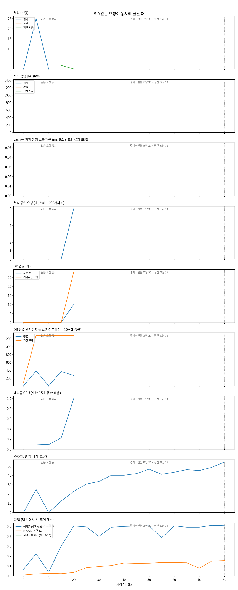

B-0 다시. 예치금 CPU가 0.2개 안팎으로 여유가 있고, 결제·환불·정산이 수십 ms 안에 끝나요.

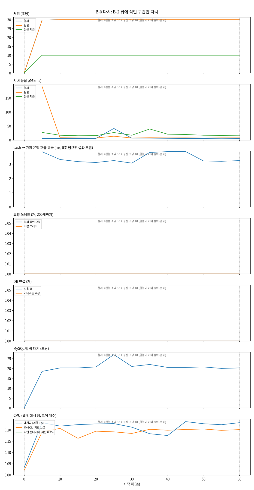

B-0 나누기.

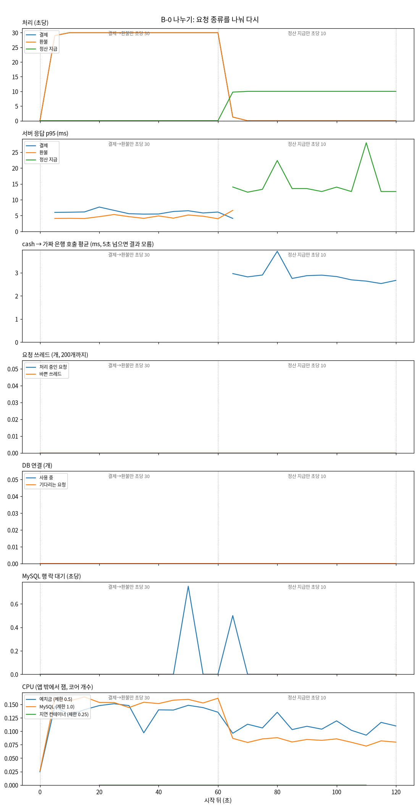

**⑧ 원인: 처음 도는 경로의 예열(JIT)이에요.**

- 예열은 결제만 불러요. 환불·정산 지급 코드는 B-0 섞인 1분에서 처음 돌아요.
- 처음 도는 코드는 클래스를 읽고 컴파일해요. CPU 0.5개 상한에서 이 일이 느려 CPU가 꽉 차고, 그동안 「초당 몇 건」으로 계속 들어오는 요청이 쌓여 결제까지 10초로 밀려요.
- 같은 구간을 한 번 데운 뒤 다시 돌리면 8ms예요.
- 1차에서 「처음 20초는 CPU가 한가하니 예열이 아니다」라고 본 것은 틀렸어요. 처음 20초에 도는 건 이미 데워진 결제뿐이었어요.

**⑨ 어떻게 했나:** 코드는 고치지 않고 「측정 순서 탓」으로 기록했어요. 다만 운영에서는 배포 직후 첫 요청들이 같은 비용을 내요. 이건 예열 락(5-1)과 같은 문제로 묶어 [11장](#11-다음-할-일과-지금-상태)에 남겼어요.

### 5-3. B-6 토스가 4초 걸릴 때

**① 왜 재나**

충전 확정은 토스 승인을 기다리는 동안 **요청 쓰레드를 쥐고** 있어요(DB 연결은 놓아요). 쓰레드는 200개를 결제·잔액 조회와 같이 써요. 토스가 느려 충전이 쓰레드를 다 가져가면, 토스를 부르지 않는 결제와 잔액 조회도 쓰레드를 받으려고 줄을 설 거라고 의심했어요.

**② 부하**

네 가지 요청을 9분 동안 **동시에** 보내요.

| 요청 | 양 | 보내는 방식 | 왜 넣었나 |
|---|---|---|---|
| 충전 확정 | 초당 **25 → 50 → 75건**, 단계마다 3분 | 「초당 N건」. 느려져도 계속 보내요 | 바깥(토스)을 부르는 요청. 쓰레드를 오래 쥐는 쪽이에요 |
| 결제 | **동시 4개**, 9분 내내 | 하나가 끝나면 바로 다음을 보내요 | 주문 서버 한 대가 보내는 모양이에요. 바깥을 부르지 않아요. 이게 느려지면 「번졌다」는 뜻이에요 |
| 잔액 조회 | **초당 10건**, 9분 내내 | 「초당 N건」 | 바깥을 부르지 않는 읽기 요청이에요. 결제와 함께 번짐을 봐요 |
| 같은 충전 두 번 | 충전 20건 중 1건(**5%**) | 첫 요청을 보내고 **0.1초 뒤** 같은 충전 번호로 한 번 더 | 사용자가 충전 결과 화면을 새로고침하거나 두 번 누르는 경우예요. 두 번째 요청은 토스를 다시 부르지 않고 첫 요청이 끝나길 기다려요. 그 기다림이 쓰레드를 얼마나 쥐는지 봐요 |

- **토스 승인 4초:** 가짜 PG가 승인 응답을 4초 늦게 줘요(예치금을 `fake-confirm-delay=4s`로 다시 띄워요). 가짜 PG는 앱 안에서 잠들어서, 실제 호출처럼 쓰레드를 4초 쥐어요.
  - 왜 4초: 실제 토스 승인은 응답을 5초까지 기다려요(연결·응답 각 5초). 그 안쪽에서 가장 느린 「성공」 값이에요. 추천값(미확정)이에요.
- **왜 25·50·75건:** 토스가 4초면 충전 하나가 쓰레드를 4초 쥐어요. 그래서 필요한 쓰레드는 초당 건수 × 4예요.

  | 단계 | 충전 | 필요한 쓰레드 | 200개 대비 |
  |---|---|---|---|
  | 1 | 초당 25건 | 100개 | 남아요 |
  | 2 | 초당 50건 | 200개 | 딱 다 차요 |
  | 3 | 초당 75건 | 300개 | 넘어요 |

  예상 트래픽(초당 48건)을 가운데에 두고, 두 번째 단계에서 쓰레드 한도를 넘도록 잡았어요.
- 충전 한 건은 6만 원(기획의 평균 참가비), 가입 24시간 안 된 잔액 0원 회원이에요.

**③ 보는 것:** 단계별 결제·잔액 조회·충전 p95·p99, 충전 실패율, 바쁜 요청 쓰레드 수, DB 연결 사용·대기, 두 번째 요청 응답 시간. B에서는 충전 거절(429) 비율, 끝난 충전 수

**④ 판정 기준:** A는 X1·X2·X4, 고친 뒤는 G1·G2·G3

**⑤ 결과**

*11/19 지금 코드 (ms, 1·2·3회차)*

| 항목 | 1회차 | 2회차 | 3회차 |
|---|---|---|---|
| 결제 p99, 초당 25건 | 1,210 | 1,300 | 2,594 |
| 결제 p95, 초당 50건 | 4,370 | 4,660 | 6,296 |
| 결제 p95, 초당 75건 | 15,126 | 15,119 | 15,137 |
| 잔액 조회 p99, 초당 25건 | 2,655 | 2,469 | 3,798 |
| 충전 중앙값, 초당 25건 | 4,226 | 4,261 | 4,394 |
| 충전 실패 (단계 1 / 2 / 3) | 0 / 0 / 0% | 0 / 0 / 0% | 0 / 0 / 0% |
| 같은 충전 두 번째 요청 중앙값 | 8,469 | 8,657 | 10,337 |
| 먼저 찬 것 | 요청 쓰레드 (초당 50건에서 200개) | 같음 | 같음 |

*11/20 고친 뒤 A·B*

| 항목 | A 1 | A 2 | A 3 | B 1 | B 2 | B 3 | A 중앙값 | B 중앙값 |
|---|---|---|---|---|---|---|---|---|
| 결제 p99, 초당 25건 (ms) | 1,512 | 1,295 | 1,614 | 603 | 607 | 699 | 1,512 | 607 |
| 결제 p99, 초당 50건 (ms) | 5,282 | 4,918 | 5,353 | 175 | 113 | 191 | 5,282 | **175** |
| 결제 p99, 초당 75건 (ms) | 15,173 | 15,257 | 15,195 | 87 | 85 | 84 | 15,195 | **85** |
| 잔액 조회 p99, 25 / 50 / 75건 (ms) | 2,210 / 5,526 / 15,292 | 2,308 / 5,311 / 15,303 | 2,992 / 5,535 / 15,204 | 887 / 86 / 7 | 811 / 10 / 6 | 1,207 / 92 / 7 | 2,308 / 5,526 / 15,292 | **887 / 86 / 7** |
| 두 번째 요청 중앙값 / p95 (ms) | 8,403 / 19,074 | 8,176 / 19,092 | 8,541 / 18,977 | 14 / 4,127 | 22 / 4,077 | 19 / 4,158 | 8,403 / 19,074 | **19** / 4,127 |
| 충전 거절 비율, 25 / 50 / 75건 | 0 / 0 / 0% | 0 / 0 / 0% | 0 / 0 / 0% | 14 / 53 / 68% | 14 / 52 / 68% | 15 / 53 / 68% | 0% | 14 / 53 / 68% |
| 끝난 충전 (건) | 22,005 | 22,029 | 21,996 | 12,419 | 12,479 | 12,312 | 22,005 | 12,419 |

- B 2회차를 Prometheus로 세면 충전 확정 응답이 429 15,371건, 409 260건, 200 12,666건이에요.
- A는 2차(11/19)처럼 기준을 크게 넘었어요. → 머신 상태가 2차와 비슷했다는 뜻이라, A·B 차이는 고친 것에서 나왔어요.

**⑥ 통과 여부**

| 기준 | 11/19 (A) | 11/20 A | 11/20 B |
|---|---|---|---|
| X1 / (G4는 B-7) 25건 단계 결제 p99 1초 미만 | ✗ 1,300ms | ✗ 1,512ms | (판정 항목 아님, 607ms) |
| X2 → G1 50·75건 단계 결제 p99 1초 미만 | ✗ 첫 단계부터 넘음 | ✗ 5,282 / 15,195ms | ✓ **175 / 85ms** |
| X2 → G2 잔액 조회 p99 1초 미만 | ✗ | ✗ | ✓ **887 / 86 / 7ms** |
| X4 → G3 두 번째 요청 중앙값 3.2초 미만 | ✗ 8,657ms | ✗ 8,403ms | ✓ 19ms (주의: 대부분 바로 429) |

→ **고쳐서 통과.** 단, G3의 19ms는 기다림이 짧아져서가 아니라 두 번째 요청 대부분이 동시 개수 제한에 걸려 바로 429를 받아서예요. 그래서 새 문제가 생겼어요(⑨).

**⑦ 그래프**

그래프 칸은 위에서부터 처리량, 서버 응답 p99, 요청 쓰레드, DB 연결, DB 연결 받기까지 걸린 시간, CPU예요. 점선은 단계가 바뀐 시각이에요.

11/19 (1회차).

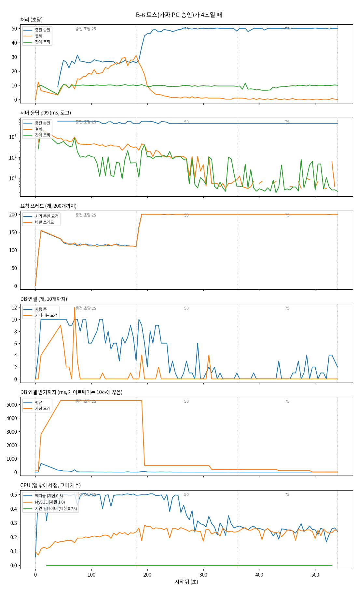

고치기 전 (11/20 A 2회차). 초당 50건부터 요청 쓰레드 200개가 다 차고 결제 처리량이 바닥으로 떨어져요.

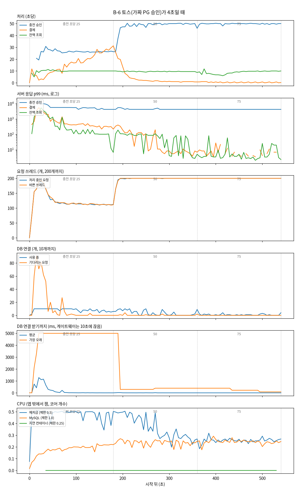

고친 뒤 (11/20 B 2회차). 처리 중인 요청이 100개 근처에서 멈추고, 결제는 초당 150~200건을 계속 처리해요.

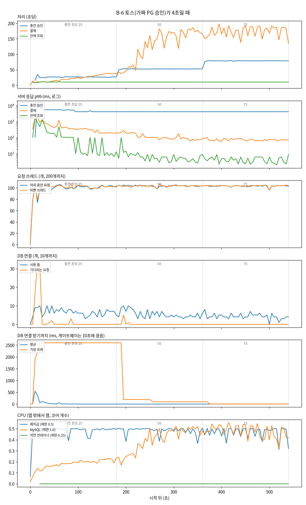

**⑧ 원인 (그래프·계산으로 확인)**

- 초당 25건에서 바쁜 쓰레드가 약 110개예요. 충전 하나가 쓰레드를 4초 남짓 쥐니 25 × 4.3 ≈ 108개로 계산과 맞아요.
- 초당 50건이 되자 쓰레드 200개가 다 찼어요. 새 요청은 쓰레드가 빌 때까지 앱 바깥에서 줄을 서요.
- 결제는 앱 안에서는 수 ms 만에 끝나는데(서버 응답), k6가 잰 응답은 4~15초예요. 늦어진 시간은 거의 다 줄 선 시간이에요.
- 처리량 칸에서 충전은 초당 50건을 다 받는데 결제는 초당 1~2건으로 떨어져요(앞 단계는 초당 20~30건). 충전이 쓰레드를 다 가져가 결제가 굶어요.
- 두 번째 요청 8.7초: 「첫 요청이 끝나길 잠들며 기다린 시간」과 「쓰레드를 받기까지 줄 선 시간」이 섞여 있어요. 같은 단계 일반 충전(4.3초)의 두 배라 기다림이 있는 것은 맞지만, 얼마인지는 나눌 수 없어요.
- 충전 실패는 0이에요. 느려질 뿐 돈 처리는 끝까지 맞아요.

**⑨ 어떻게 했나: ①과 ③을 고쳤어요 (커밋 `41e7ed51`, ②와 한 커밋)**

*① 토스가 느리면 결제까지 멈춤 → 충전 확정의 동시 개수 제한*

| | 방법 | 장점 | 단점 |
|---|---|---|---|
| **가 (고름)** | 충전 확정을 동시에 정해진 수까지만 받고, 넘으면 바로 거절 | 결제 몫 쓰레드가 늘 남아요. 토스를 부르기 전에 거절하니 돈이 빠지지 않아요. 주문이 예치금 결제를 부를 때 쓰는 동시 개수 제한과 같은 방식이에요 | 몰릴 때 충전 거절이 생겨요. 제한 값에 근거가 필요해요 |
| 나 | 가상 쓰레드 켜기 | 쓰레드 200개 상한이 사라져요 | 기다리는 충전이 끝없이 쌓여 병목이 DB 연결 10개로 옮겨 가요. 모든 API의 실행 방식이 바뀌어 다시 재야 해요 |
| 다 | 서킷 브레이커 | 토스 장애 동안 쓰레드를 아예 쓰지 않아요 | 라이브러리가 늘고, 「느린 성공(4초)」을 어디서부터 장애로 볼지 정해야 해요 |
| 라 | 토스 시간 제한 줄이기 (지금 연결·응답 각 5초) | 설정만 바꿔요 | 4초 지연에는 효과가 없어요. 「승인됐는지 모름」이 늘어 재확인 배치 부담이 커져요 |

- 정한 값: 동시 100개(`cash.charge.confirm.max-concurrent`, 추천값(미확정))
  - 쓰레드 200개의 절반이에요. 나머지 절반은 결제·잔액 조회 몫이에요.
  - 평소(충전 초당 48건 × 승인 약 1초 ≈ 48개)의 두 배라 평소에는 거절이 없어요.
  - 토스가 4초면 초당 25건(100 ÷ 4)까지 받고 그 위는 거절해요.
- 503이 아니라 **429**로 답해요. 프론트(`use-confirm-charge-return.ts`)는 409나 5xx를 「서버가 처리했는지 모름, 기다리세요」로 보여 주고, 그 밖의 4xx는 「돈이 빠지지 않은 실패, 다시 결제하세요」로 보여 줘요. 이 거절은 토스를 부르기 전이라 돈이 빠지지 않은 게 확실해서, 쿨다운과 같은 429로 답해요.
- 대가: 토스가 4초면 초당 50·75건 단계에서 절반 넘게 거절해요. 끝난 충전이 A의 56%예요. 초당 25건 단계도 14%를 거절해요. 단계 시작 직후 몰린 요청이 토스 4초를 기다리는 동안 자리가 차서예요.

*③ 같은 충전 두 번째 요청이 오래 기다림 → 기다리는 시간 줄이기*

지금 코드는 두 번째 요청이 0.1초마다 결과를 다시 조회하며 최대 220번(22초) 기다리고, 그래도 안 끝나면 409(「이미 처리 중인 충전 요청입니다」)로 답해요.

| | 방법 | 장점 | 단점 |
|---|---|---|---|
| 가 | 기다리지 않고 바로 409 | 쓰레드를 바로 돌려줘요 | 첫 요청이 몇십 ms면 끝나는 평소에도 두 번째 요청이 결과 대신 409를 받아요 |
| **나 (고름)** | 22초 → 3초 (0.1초 × 30번) | 평소(승인 1초 안팎)에는 그대로 결과를 받아요. 토스가 느릴 때만 3초 뒤 409로 끝나요 | 토스가 느릴 때 두 번째 요청이 쓰레드를 3초는 쥐어요 |
| 다 | 그대로 두고 ①의 제한에 맡기기 | 바꿀 게 없어요 | 두 번째 요청이 제한 몫을 22초씩 차지해요 |

프론트는 409를 「결과를 모름, 기다리세요」로 보여 주고 같은 확정을 다시 부르지 않아요. 첫 요청이 끝나면 잔액에 들어가요. → 3초 뒤 409여도 돈은 맞아요. ③의 효과는 제한에 덜 걸린 B-7에서 보여요(두 번째 요청 중앙값 12.9 → 1.6초).

*고친 뒤 새로 찾은 문제: 바쁠 때 같은 충전을 다시 부르면 「실패」로 보임 (고칠 방법 정하지 않음)*

- **본 것:** B에서 두 번째 요청 중앙값이 19ms예요. 대부분 바로 429를 받았어요.
- **원인:** 동시 개수 제한이 `CashChargeConfirmUseCase.confirmWalletCharge` 맨 앞에 있어요. 이미 처리 중이거나 끝난 충전인지 보기 **전에** 자리부터 확인해요.
- **그래서 생기는 일**
  1. 같은 주문번호로 확정이 두 번 올 때만 생겨요. 첫 요청이 「처리 중」으로 선점하고 토스 승인을 진행하는 사이 두 번째 요청이 와요.
  2. 바쁠 때는 두 번째 요청이 「처리 중」을 보기 전에 429를 받아요. 프론트는 409를 뺀 4xx를 「실패, 돈은 빠지지 않음」으로 보여 줘요.
  3. 그런데 첫 요청은 계속 처리돼서 예치금에 들어가요.
  4. → 이 응답을 믿고 다시 결제하면 토스에서 두 번 결제돼요. 둘 다 예치금에 들어가 돈을 잃지는 않지만, 원하지 않은 결제예요.
- **우리 웹 화면에서는:** 우리 웹 화면은 확정을 보내기 전에 기록을 남기고 새로고침·뒤로 가기에도 같은 충전의 확정을 다시 부르지 않아서, 같은 충전에 확정이 한 번만 나가요. 그래서 웹 화면에서는 생기기 어렵고, 측정에서 보인 건 k6가 같은 충전을 5% 두 번 보냈기 때문이에요. 그래도 「같은 주문번호로 다시 불러도 같은 결과」라는 약속이 깨져서 고쳐요. (처음에는 「새로고침하면 다시 부른다」고 적었는데 프론트 코드를 확인해 보니 사실이 아니었어요. 11/22 고침)
- **지금 충전 흐름:** 「① 지갑 잠금 + 처리 중으로 선점(커밋) → ② 잠금 없이 토스 승인 → ③ 지갑 잠금 + 완료 반영」이에요. 지금 제한은 ① 앞에 있어요.

| | 방법 | 장점 | 단점 |
|---|---|---|---|
| 가 | 제한 앞에서 충전 행이 있는지 먼저 읽고, 있으면 제한을 건너뛰기 | 고칠 곳이 적어요 | 첫 요청이 아직 행을 만들기 전이면 여전히 429가 나요. 요청마다 DB 읽기가 하나 늘어요 |
| 나 | 바쁠 때 429 대신 503 | 한 줄이에요 | 새 충전도 「결과 모름, 기다리세요」로 보여서, 오지 않을 결과를 기다리게 돼요. 프론트는 결과 모르는 충전이 있으면 10분 동안 새 결제창을 막아요 |
| 다 (추천) | 제한을 ①(선점) 뒤, ②(토스 호출) 바로 앞으로 옮기기. 자리가 없으면 쿨다운처럼 선점을 실패로 돌리고 429 | 지갑 잠금 안에서 상태를 보므로 틈이 없어요. 같은 충전은 ①에서 「처리 중」을 보고 기다리거나 409로 가요. 토스를 부르기 전 거절이라는 점은 그대로예요 | 거절할 요청도 선점과 실패 기록 트랜잭션을 거쳐서, 몰릴 때 DB 일이 늘어요. 고친 뒤 B-6·B-7을 다시 재야 해요 |

웹 화면은 확정을 한 번만 보내 급하지는 않아요. PR #688에서 고칠지, 다음 PR로 나눌지는 정하지 않았어요.

### 5-4. B-7 Redis가 명령마다 100ms 느릴 때

**① 왜 재나**

충전 확정의 이상 충전 감지가 Redis 명령을 4번 불러요. 그중 2번(`ChargeAbuseGuard.registerNewAttempt`)은 **회원 지갑을 잠근 트랜잭션 안**에서 불러요. Redis가 느리면 그동안 DB 연결과 지갑 잠금을 함께 쥐어요. 연결은 10개뿐이라 쓰레드보다 DB 연결이 먼저 찰 거라고 봤어요.

**② 부하**

- B-6과 같은 네 가지 요청이에요(충전 25 → 50 → 75건 + 결제 동시 4개 + 잔액 조회 초당 10건 + 같은 충전 두 번 5%).
- 토스 승인은 1초(1차와 같아요)예요.
- 지연 컨테이너가 Redis 명령마다 **100ms**를 더해요. 예치금을 지연 컨테이너를 거치게 다시 띄우고 예열한 뒤 시작해요.
- 왜 100ms: 트랜잭션 안의 2번 때문에 충전 하나가 DB 연결을 200ms 넘게 쥐어요. 연결 10개면 초당 약 45건이 한계라, 두 번째 단계(초당 50건)에서 무너지는지 보려고 잡았어요. 추천값(미확정)이에요.

**③ 보는 것:** B-6과 같아요. 특히 DB 연결 사용·대기와 받기까지 걸린 시간

**④ 판정 기준:** A는 X1·X2, 고친 뒤는 G4

**⑤ 결과**

*11/19 지금 코드 (ms, 1·2·3회차)*

| 항목 | 1회차 | 2회차 | 3회차 |
|---|---|---|---|
| 결제 p99, 초당 25건 | 4,396 | 4,095 | 5,823 |
| 결제 p95, 초당 50건 | 10,689 | 10,523 | 10,731 |
| 결제 p95, 초당 75건 | 17,767 | 17,979 | 18,097 |
| 잔액 조회 p99, 초당 25건 | 7,081 | 6,841 | 8,342 |
| 충전 중앙값, 초당 25건 | 3,515 | 2,963 | 6,513 |
| 충전 실패 (단계 1 / 2 / 3) | 0 / 0 / 0% | 0 / 0 / 0% | 0 / 0 / 0% |
| 같은 충전 두 번째 요청 중앙값 | 13,634 | 12,956 | 13,567 |
| 먼저 찬 것 | DB 연결 (10개, 쓰레드는 50~80개) | 같음 | 같음 |

*11/20 고친 뒤 A·B*

| 항목 | A 1 | A 2 | A 3 | B 1 | B 2 | B 3 | A 중앙값 | B 중앙값 |
|---|---|---|---|---|---|---|---|---|
| 결제 p99, 초당 25건 (ms) | 2,803 | 3,219 | 3,873 | 1,311 | 1,299 | 1,302 | 3,219 | **1,302** |
| 결제 p99, 초당 50건 (ms) | 10,904 | 10,729 | 10,923 | 408 | 405 | 415 | 10,904 | 408 |
| 결제 p99, 초당 75건 (ms) | 18,281 | 18,378 | 18,494 | 176 | 177 | 177 | 18,378 | 177 |
| 잔액 조회 p99, 25 / 50 / 75건 (ms) | 5,256 / 11,035 / 18,785 | 5,765 / 10,878 / 18,828 | 6,591 / 11,112 / 18,908 | 1,726 / 337 / 81 | 1,636 / 327 / 81 | 1,855 / 438 / 64 | 5,765 / 11,035 / 18,828 | 1,726 / 337 / 81 |
| 두 번째 요청 중앙값 / p95 (ms) | 12,861 / 20,777 | 12,087 / 20,851 | 13,361 / 20,935 | 1,554 / 2,091 | 1,573 / 2,104 | 1,574 / 2,124 | 12,861 / 20,851 | 1,573 / 2,104 |
| 충전 거절 비율, 25 / 50 / 75건 | 0 / 0 / 0% | 0 / 0 / 0% | 0 / 0 / 0% | 2.4 / 2.1 / 21% | 2.6 / 1.9 / 23% | 2.5 / 2.5 / 22% | 0% | 2.5 / 2.1 / 22% |
| 끝난 충전 (건) | 20,869 | 20,973 | 20,740 | 23,789 | 23,604 | 23,645 | 20,869 | 23,645 |

- B 2회차를 Prometheus로 세면 충전 확정 응답이 429 3,513건, 200 24,776건이에요.
- B-7은 고친 뒤 끝난 충전이 오히려 늘었어요. A는 응답이 느려 보낸 요청 자체가 적었어요.

**⑥ 통과 여부**

| 기준 | 11/19 (A) | 11/20 A | 11/20 B |
|---|---|---|---|
| X1 → G4 25건 단계 결제 p99 1초 미만 | ✗ 4,396ms | ✗ 3,219ms | **✗ 1,302ms** |
| X2 50·75건 단계 (B는 기록만) | ✗ | ✗ 10,904 / 18,378ms | 408 / 177ms |

→ **크게 나아졌지만 G4는 「나아지지 않음」.** 미리 정한 규칙대로 남겨요.

**⑦ 그래프**

11/19 (1회차). 초당 50건부터 앱 지표가 비어요(원인은 [9장](#9-측정하면서-찾은-다른-문제) 1번).

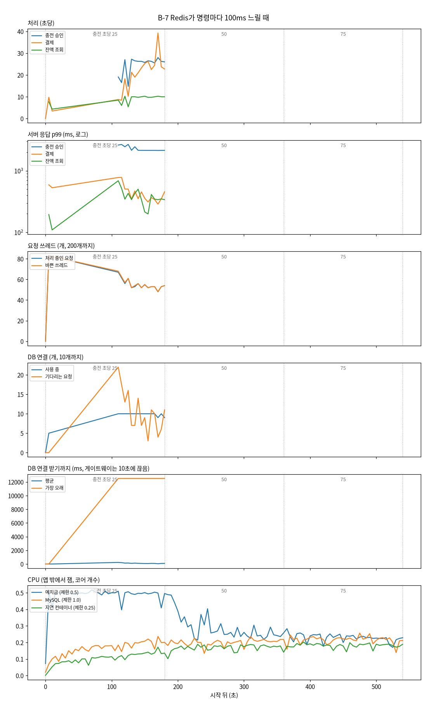

고치기 전 (11/20 A 2회차). 초당 25건에서 DB 연결 10개가 다 차요.

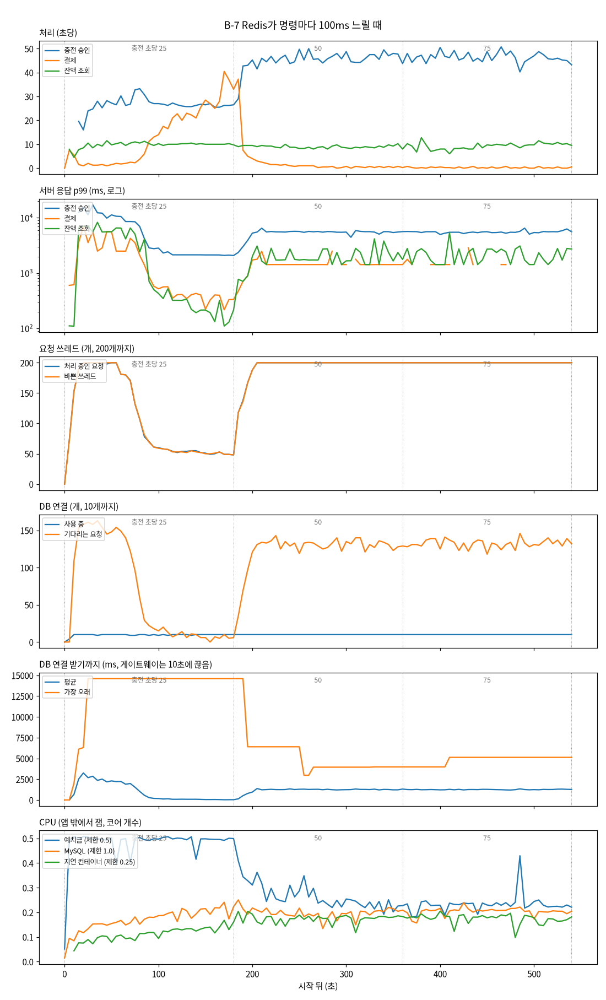

고친 뒤 (11/20 B 2회차). 첫 1분만 DB 연결 대기가 최대 52개까지 쌓이고, 그 뒤로는 거의 없어요.

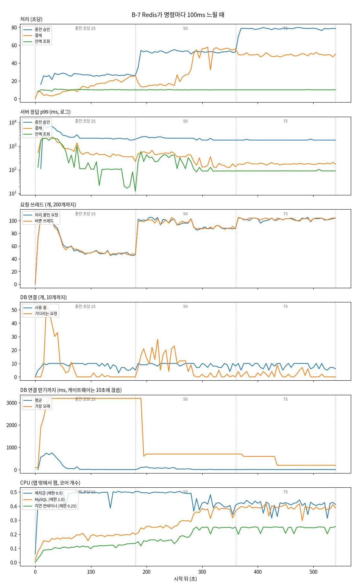

**⑧ 원인**

*고치기 전:* 초당 25건에서 DB 연결 10개가 다 차고 기다리는 요청이 최대 22개예요. 쓰레드는 50~80개라 남아 있어요. → Redis를 DB 연결을 쥔 동안 불러서, Redis가 느린 만큼 연결을 오래 쥐어요.

*고친 뒤 G4를 못 넘은 이유 (그래프와 B 회차 JFR로 확인, 11/22):*
- 느린 건 B-7 시작 뒤 **처음 약 1분**뿐이에요. 그동안 B 2회차에서 충전 p99가 약 10초, DB 연결을 기다리는 요청이 최대 52개, 연결을 받기까지 가장 오래 걸린 시간이 약 3.2초예요. 예치금 CPU는 상한(0.5개)에 붙어 있어요.
- 그 뒤 같은 단계의 결제 p99는 약 400ms이고, 50·75건 단계도 408·177ms로 기준 안이에요.
- B-7은 지연 컨테이너를 거치도록 예치금을 **다시 띄운 직후**예요. 예열 30초는 결제만 불러서, 충전 경로(지갑 잠금·Redis·토스)는 B-7이 시작될 때 처음 돌아요. → 막 띄운 직후의 첫 실행 비용이 맞았어요. 다만 5-1·5-2(락을 쥔 채 JIT)와 달리, B 회차 JFR 3개로 보니, 첫 충전이 Redis 연결을 처음 만드는 동안 충전 약 90건이 쿨다운 확인에서 최대 5초 기다렸다가 한꺼번에 DB 연결로 몰렸어요(DB 연결 대기 1분째 3,252번 → 2분째 795번 → 3분째 85번, 2회차). 예열은 결제만 돌려 Redis 연결을 만들지 않아요. JIT는 주된 원인이 아니었어요(2차 전후 문서 4장).
- 충전 거절이 75건 단계에서 22%로 오르는 이유(추정): Redis가 명령마다 100ms 늦어 충전 한 건이 오래 걸려, 동시 100개가 빨리 차요.

**⑨ 어떻게 했나: ②를 고쳤어요 (커밋 `41e7ed51`)**

| | 방법 | 장점 | 단점 |
|---|---|---|---|
| **가 (고름)** | 이상 충전 횟수 세기를 등록 트랜잭션이 끝난 뒤로 옮기기 | DB 연결·지갑 잠금을 쥔 시간이 Redis 속도와 상관없어져요 | 쿨다운에 걸렸을 때 이미 저장된 등록을 되돌리는 단계가 하나 더 필요해요 |
| 나 | Redis 시간 제한을 짧게 하고, 넘으면 감지를 건너뛰기 | 설정만 바꿔요 | 그동안 이상 충전 감지가 꺼져요. 보안 정책으로 정할 일이에요. 100ms 지연에는 효과가 없어요 |

쿨다운에 걸리면 등록을 실패로 돌려요:
- 지금은 횟수 세기가 쿨다운 예외를 던지면 등록 트랜잭션이 통째로 롤백돼요. 트랜잭션 밖으로 옮기면 그 롤백이 없어서, 같은 충전을 「실패」로 바꾸는 트랜잭션을 한 번 더 돌리고 쿨다운 예외(429)를 그대로 던져요.
- 토스는 부르지 않았으니 돈은 빠지지 않아요.
- 달라지는 점 1: 쿨다운에 걸린 새 충전이 「실패」 행으로 남아요(지금은 행이 없어요). 같은 주문번호로 다시 확정하면 실패 건 재시도로 처리돼요.
- 달라지는 점 2: 일일 한도·보유 한도에 걸려 거절된 시도는 더는 횟수에 들어가지 않아요. 토스를 부르지 않고 거절되므로 쿨다운으로 막을 이유가 작아요.
- 「실패」로 바꾸는 트랜잭션마저 실패하면 행이 「처리 중」으로 남고, 재확인 배치가 2분 뒤 토스에 다시 물어 정리해요.

### 5-5. B-8 MySQL이 쿼리마다 100ms 느릴 때

**① 왜 재나:** 다른 서비스가 같은 MySQL을 바쁘게 쓰는 상황이에요. 운영 MySQL은 서비스 12개가 같이 써요. DB가 느리면 어디까지 버티는지 봐요.

**② 부하:** B-6과 같은 네 가지 요청이에요. 토스 1초. 지연 컨테이너가 MySQL 쿼리마다 **100ms**를 더해요(추천값(미확정)). B-7 바로 뒤에 돌아요(같은 띄움).

**③ 보는 것:** B-6과 같아요.

**④ 판정 기준:** X3 (어느 단계든 결제 p95 2초 미만), L1

**⑤ 결과 (ms, 1·2·3회차)**

| 항목 | 1회차 | 2회차 | 3회차 |
|---|---|---|---|
| 결제 p99·p95, 모든 단계 | 60,001 | 60,001 | 60,001 |
| 잔액 조회 p99, 초당 25건 | 60,001 | 60,001 | 60,001 |
| 충전 중앙값, 초당 25건 | 60,000 | 60,000 | 60,000 |
| 충전 실패 (단계 1 / 2 / 3) | 약 72 / 100 / 100% | 같음 | 같음 |
| 같은 충전 두 번째 요청 중앙값 | 60,000 | 60,000 | 60,000 |
| 가장 오래 기다린 행 락 | 2,743 | 2,733 | 2,658 |

60,001ms는 k6의 요청 제한(60초)에 걸렸다는 뜻이에요.

**⑥ 통과 여부:** X3 ✗, L1 ✗ (2,733ms) → **실패, 고치지 않기로 함**

**⑦ 그래프 (1회차).** 처음부터 모든 요청이 60초 제한에 걸리고, 앱 지표가 전 구간 비어요.

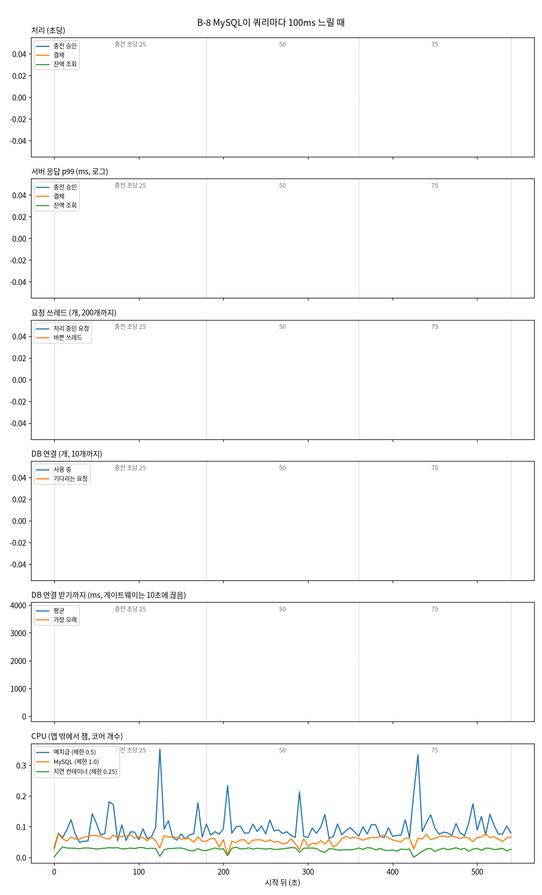

**⑧ 원인**
- CPU는 0.1개 안팎으로 일을 거의 하지 않아요.
- 충전 하나가 쿼리를 여러 번 쓰니, 쿼리마다 100ms가 붙으면 연결 하나를 쥐는 시간이 그 배수로 늘어요. 초당 25건을 받을 만큼 연결이 돌지 못해 줄이 계속 늘었다고 봐요. 앱 지표가 비어 연결 수를 직접 보지는 못했어요.
- 락 2.7초: 락을 쥔 쪽의 쿼리 하나하나가 100ms씩 늦으니 예상한 결과예요.
- 앱 지표가 빈 이유는 [9장](#9-측정하면서-찾은-다른-문제) 1번이에요.

**⑨ 어떻게 했나: 기록만 해요 (고칠 것 ⑤)**

| | 방법 | 장점 | 단점 |
|---|---|---|---|
| **가 (고름)** | 그대로 두고 기록만 | MySQL 장애는 예치금 혼자 막을 수 없어요 | 장애 때 요청이 오래 매달려요 |
| 나 | 연결 대기 시간 줄이기 (30초 → 예: 2초) | 빨리 실패하고 쓰레드가 빨리 돌아와요 | 잠깐 몰릴 때도 실패가 생길 수 있어요 |
| 다 | 연결 수 늘리기 (10 → 20) | 연결이 모자라는 시간이 줄어요 | MySQL이 느린 게 원인이라 오히려 더 느려질 수 있어요 |

DB가 쿼리마다 100ms 느려지는 상황은 DB 모니터링·경보로 다뤄요. 11/20 A·B에서는 B-8을 뺐어요.

### 5-6. B-1 한계 결제 도착 속도를 계속 올리기

**① 왜 재나:** 처리량을 판정하려는 게 아니에요. 1차에서 「2초 넘는 락은 B-1 한계에서 나온다」고 추정했는데, 이번에는 시나리오마다 락을 따로 읽어서 그 추정이 맞는지 봐요.

**② 부하:** 1차와 같아요. 결제 도착 속도를 초당 20 → 50 → 100 → 200 → 400건으로 2분씩 올려요. 예치금을 다시 띄우고(토스 1초, 지연 컨테이너 없이) 예열 30초 뒤에 돌아요.

**③ 보는 것:** 단계별 결제 p95·p99, 가장 오래 기다린 락, CPU

**④ 판정 기준:** 처리량은 판정 안 함. 락은 L1로 보되, B-1 한계에서만 넘으면 기록만 해요.

**⑤ 결과**

| 항목 | 세 회차 |
|---|---|
| 초당 200건까지 결제 p99 | 103~186ms (세 회차 범위) |
| 초당 400건 결제 p95 | 7.2~7.8초 (세 회차 범위) |
| 실패 | 0 / 0 / 0 |
| 가장 오래 기다린 행 락 (ms) | 606 / 281 / 295 |

**⑥ 통과 여부:** 판정 안 함. 락은 0.6초 아래라 **2초 넘는 락은 여기서 나오지 않아요.** 1차 추정은 틀렸어요.

**⑦ 그래프 (1회차)**

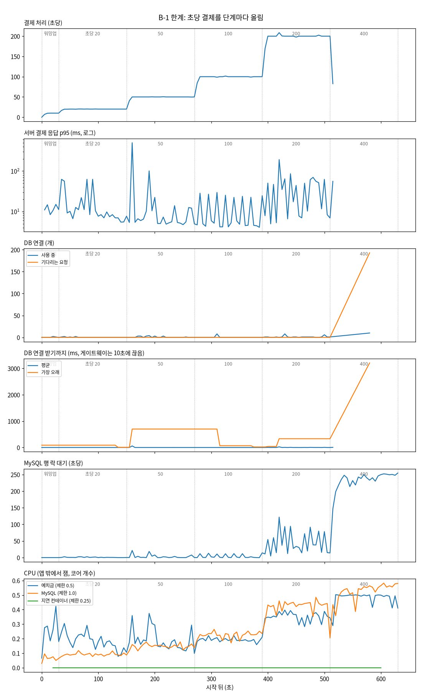

**⑧ 원인:** 400건 단계가 느린 것은 락이 아니라 처리 한계(예치금 CPU 상한 0.5개)예요. 락은 0.3~0.6초뿐이에요.

**⑨ 어떻게 했나:** 기록만 해요. 결제 한계를 고치지 않은 이유는 1차 상세 5-9 ⑨와 같아요(실제로 오지 않는 모양, 필요량의 8배, 미리 정한 규칙, 고치려면 보관 지갑 구조 변경).

## 6. 2초 넘는 락은 어디서 나오나

1차에서는 회차 끝에 한 번만 읽어서 어디서인지 몰랐어요(1차 상세 6-1). 2차에서 시나리오마다 따로 읽은 결과예요.

**시나리오별 가장 오래 기다린 행 락 (ms)**

`sql/15`의 「가장 오래」예요. 시나리오 전에 비우고 끝나면 읽어서, 그 시나리오 안의 값만 들어 있어요.

| 시나리오 | 1회차 | 2회차 | 3회차 |
|---|---|---|---|
| **예열 (처음 띄운 직후)** | **2,406** | **2,600** | 1,909 |
| 예열 (토스 4초로 다시 띄운 직후) | 1,501 | 1,610 | 1,999 |
| 예열 (지연 컨테이너로 다시 띄운 직후) | 1,799 | 1,593 | 493 |
| 예열 (바로 붙여 다시 띄운 직후) | 1,405 | 2,000 | 1,205 |
| B-0 | 997 | 794 | 900 |
| B-2 | 398 | 371 | 204 |
| B-6 | 703 | 702 | 1,010 |
| B-7 | 502 | 412 | 500 |
| **B-8** | **2,743** | **2,733** | **2,658** |
| B-1 한계 (기록만) | 606 | 281 | 295 |
| B-0 다시 / 나누기 | 37 / 6 | 42 / 3 | 104 / 3 |

**확인한 것**

1. 2초를 넘은 곳은 **처음 띄운 직후의 예열**(3회 중 2회)과 **B-8**뿐이에요. B-1 한계는 0.6초 아래예요.
2. 예열은 사용자 2명뿐인데도 1.4~2.6초 기다린 락이 나와요. 다시 띄울 때마다(회차마다 네 번) 0.5~2초가 나와요. → 붐벼서가 아니라 **막 띄운 앱이라서** 생겨요.
3. 기다린 쪽은 보관 지갑(id 2) 행이고, 그때 락을 쥔 트랜잭션의 지금 SQL이 비어 있었어요(`sql/14` 스냅샷). → 락을 쥔 채 쿼리가 아니라 앱 코드가 돌고 있었어요.
4. JFR (1회차 첫 예열, 09:59:36~38):
   - 기다린 쪽은 요청 쓰레드 `exec-3`이에요. 보관 지갑을 잠그는 쿼리(`findByIdForUpdate`)에서 2.41초 멈췄어요.
   - 락을 쥔 쪽은 `exec-2`예요. 결제(`CashCompleteOrderPaymentUseCase`) 안에서 지갑을 잠근 뒤였고, 그 2초 동안 한 일은 이래요.
     - 클래스를 처음 읽을 때 생기는 내부 예외 69번(대부분 `ClassNotFoundException`). Spring Data의 엔티티 매핑 클래스, 메서드 핸들 클래스를 처음 읽고 있었어요.
     - jar 파일 읽기, 1~1.6초 걸린 JIT 컴파일 두 번
   - 그때 예치금 JVM은 CPU를 0.5개 가까이(상한) 쓰고 있었어요. GC 멈춤은 12~13ms로 원인이 아니에요.

**그래서**

- 막 띄운 앱은 결제 코드를 처음 돌 때 클래스 읽기와 컴파일을 해요. CPU 상한(0.5개) 때문에 이 일이 느려져요.
- 결제는 지갑을 ID 순서대로 잠가서, 보관 지갑(2번)을 가장 먼저 잠그고 커밋까지 쥐어요.
- → 그 느린 시간이 그대로 락을 쥔 시간이 돼요. → 뒤 결제가 2초 넘게 기다려요.
- 특정 코드가 잘못된 게 아니라 「첫 실행 비용」과 「락을 일찍 잡는 순서」가 겹친 거예요.
- 영향: 주문은 예치금을 2초까지 기다려요. 배포 직후 결제가 몰리면 주문이 2초에 포기하는 결제가 생길 수 있어요. → 운영에서 실제로 보였어요([8장](#8-운영-지표-확인)).

## 7. 예열을 충분히 하면 되지 않나

「예열로 추정되는 실패가 자꾸 보이는데, 예열을 미리 충분히 하고 들어가면 안 생기지 않나?」에 대한 답이에요.

**측정에서는 맞아요. 지금 예열이 모자라요.**

- 지금 예열은 **결제만, 사용자 2명, 30초**예요(`run.sh`의 `warmup`이 `b1-payment-concurrency.js`를 동시 2개로 돌려요).
- 그래서 데워지는 건 결제 경로뿐이에요. 뒤 시나리오가 처음 부르는 코드는 차가운 채 시작해요.

  | 시나리오 | 처음 도는 코드 | 결과 |
  |---|---|---|
  | B-0 섞인 1분 | 환불, 정산 지급, 가짜 은행 호출 | 결제 p95 10초 → 데운 뒤 8ms (5-2) |
  | B-7 (11/20 B) | 지연 컨테이너를 거치는 충전 확정, 잔액 조회 | 첫 1분만 결제 p99가 1.3초 → 그 뒤 약 400ms (5-4) |
  | 예열 자체 | 결제 | 락 2초 넘음 (6장) |

- JVM은 코드를 처음 돌 때 클래스를 읽고, 여러 번 돈 뒤에야 빠른 기계어로 컴파일해요. 그래서 시나리오가 쓰는 **모든 API를 충분한 횟수** 돌려야 데워져요. 30초에 결제만으로는 모자라요.
- 측정에서 고칠 방법(아직 안 함): 예열이 시나리오가 쓰는 API(결제·환불·정산 지급·충전 확정·잔액 조회)를 모두 부르게 하고, 데워진 뒤(응답 시간이 안정된 뒤) 시작해요. 그러면 「정상 상태 성능」을 공정하게 비교할 수 있어요.

**그런데 운영에서는 예열이 없어요. 그래서 이 실패는 지우면 안 되는 신호예요.**

- 운영은 배포하거나 다시 띄울 때마다 차가운 JVM이에요. 그 순간 들어온 실제 사용자가 첫 실행 비용을 내요.
- 운영 지표에서 실제로 보였어요. 지난 4일 동안 주문 결제 503 28건이 **모두 예치금을 다시 띄운 뒤 첫 1분**에 났어요([8장](#8-운영-지표-확인)).
- 측정에서 예열을 충분히 해서 이 느림을 숨기면, 운영에서 생기는 문제를 측정이 못 보게 돼요.

**그래서 두 가지를 나눠요.**

| | 무엇을 재나 | 예열 |
|---|---|---|
| 정상 상태 측정 (B-1~B-8 등) | 데워진 앱이 버티는지, 고친 코드가 나아졌는지 | 충분히 해요 (모든 API) |
| 막 띄운 직후 측정 (새로 만들 시나리오) | 배포 직후 첫 몇 초~1분에 무슨 일이 생기나 | 일부러 하지 않아요 |

운영 쪽 해결은 고칠 것 ④의 선택지예요([11장](#11-다음-할-일과-지금-상태)). 그중 「다: 요청을 받기 전에 결제 경로를 미리 돌리고 나서 준비됨」이 바로 「운영에서도 예열을 충분히 하고 들어가기」예요.

## 8. 운영 지표 확인

### 출처를 먼저 분명히

| | 이 장의 숫자 | 2차 측정 (3~7장) |
|---|---|---|
| 어디서 | **운영 k3s** 예치금·주문 | GitHub Actions 머신 안의 컨테이너 |
| 지표 경로 | 운영 Prometheus → 원격 저장(`prom.bukang-devops.duckdns.org`) → Grafana (라벨 `env="prod"`) | Actions 안의 Prometheus. 밖으로 보내지 않고 `prometheus-data.tar.gz`에만 남아요 |
| 부하를 넣은 사람 | **팀원이 운영에 넣은 부하 테스트** (11/18 밤, 11/20 새벽·오전). 누가 넣었는지는 확인하지 않았어요 | 담당자가 돌린 측정 (11/19 09:56~12:45, 11/20 05:06~07:29) |
| 무엇을 봤나 | 예치금을 다시 띄운 뒤 첫 결제가 몰릴 때의 응답 시간·주문 쪽 응답 | 정해진 시나리오의 응답 시간과 판정 |

이 장은 「측정에서 본 막 띄운 직후의 느림이 운영에서도 생기나」만 확인해요. 운영에 부하를 주지 않고 지표만 읽었어요.

### 결과 (15초 단위)

| 예치금 재시작 뒤 첫 결제 | 주문 결제 응답 | 예치금 결제 첫 15~30초 |
|---|---|---|
| 11/18 23:14 | 503 1건 | 평균 0.22초 |
| 11/20 01:12 | 503 27건 + 202 4건 | p99 3.49초, 평균 0.87초 |
| 11/20 11:33 | 202 2건 | p99 3.39초, 평균 1.05초, 행 락 평균 796ms |

- 503: 주문이 「결제 요청이 몰려 있습니다. 잠시 후 다시 시도해주세요」 등으로 거절한 응답이에요.
- 202: 주문이 예치금 결과를 2초 안에 받지 못해 「결제를 확인하고 있습니다. 잠시 뒤 주문 상세에서 결과를 확인해주세요」로 답한 응답이에요.
- **지난 4일 동안 주문 결제 503 28건은 모두 예치금 재시작 뒤 첫 1분에 났어요.**
- 그 뒤 몰림에서는 응답이 0.3초 아래예요. 운영 예치금 CPU는 16% 아래로 남아 있었어요.
- → 측정의 「막 띄운 직후 첫 결제가 느림」(5-1, 6장)이 운영에서도 같은 모양으로 보여요. CPU가 남는데도 느려서, 원인은 처음 도는 비용(클래스 읽기·JIT)으로 추정해요. 운영 JFR은 없어서 확정하지는 못했어요.
- 처음에 PromQL `increase()`로 세서 「11/18 모두 200, 11/19 503 1건, 11/20 202 1건」이라고 했던 것은 틀렸어요. `increase()`는 새로 생긴 시리즈의 첫 값을 세지 못해요. 카운터 원래 값의 차이로 다시 센 위 표가 맞아요.

### 그래프

운영 15초 단위예요. 세 칸은 세 번의 첫 결제(11/18 23:14, 11/20 01:12, 11/20 11:33)예요. 위에서부터 결제 건수, 결제 응답 시간(주문 쪽 503·202 건수와 주문이 기다리는 2초 선 표시), 행 락 한 번 기다린 평균(MySQL 전체), 예치금 CPU예요. 가로축은 결제 지표가 처음 생긴 시각을 0분으로 둔 시간이에요.

예치금 재시작과 첫 결제 사이는 5시간, 3시간, 38분이었어요(재시작 11/18 17:48, 11/19 22:06, 11/20 10:55). 그동안 결제가 없어서, 첫 결제가 막 띄운 앱과 같은 상태(결제 코드를 한 번도 돌지 않음)에서 시작했어요.

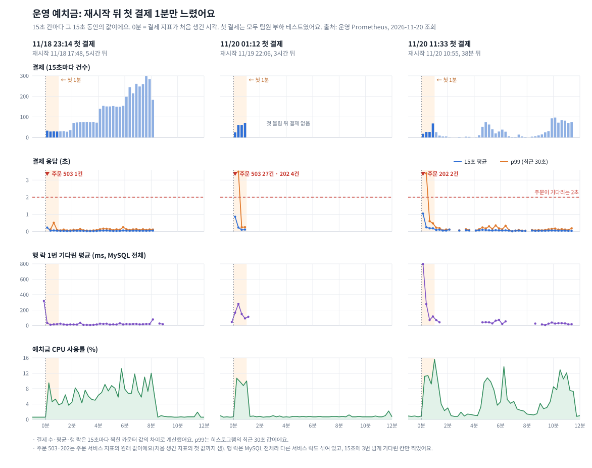

## 9. 측정하면서 찾은 다른 문제

### 1. 예치금: DB 연결이 다 차면 앱 지표가 통째로 빠짐 (고침)

- **본 것:** 지표 포트를 따로 열었는데도 B-6 첫 단계, B-7 초당 50건부터, B-8 전 구간에서 앱 지표가 비었어요.
- **원인:** 1회차 B-7의 JFR에서 지표 포트(8091)의 쓰레드가 DB 연결을 4,380번 기다렸고, 그중 4,122번이 1초를 넘었어요.
  - 멈춘 돈 건수 지표(`CashStuckMoneyMetrics`)가 Prometheus가 가져갈 때마다 DB에 COUNT 쿼리 5개를 날려요.
  - DB 연결 10개가 다 찬 동안은 지표 수집도 연결을 기다려요. → 수집 제한(1초)을 넘겨요. → 그 순간의 앱 지표가 통째로 빠져요.
  - 포트는 쓰레드만 나누고 DB 연결은 같이 써서, 포트를 나눠도 소용이 없었어요.
  - 1차의 「앱이 포화되면 지표를 못 가져간다」도 같은 원인이었을 수 있어요(확인 안 함).
- **운영 영향:** DB가 꽉 찬 바로 그때 모니터링이 비어요. 바쁜 때 지표 수집이 DB 연결을 더 가져가요.

| 방법 | 판단 |
|---|---|
| 지표용 DB 연결을 따로 두기 | 고르지 않음. 설정이 복잡해지고 연결 수가 늘어요 |
| 측정에서만 수집 제한 시간을 늘리기 | 고르지 않음. 운영 문제는 그대로예요 |
| 측정에서만 이 지표를 끄기 | 고르지 않음. 측정 환경이 운영과 달라져요 |
| **30초마다 따로 세어 두고, 지표는 센 값만 읽기** | **고름.** 지표 수집이 DB에 막히지 않고 DB 부하도 일정해요. 값이 최대 30초 늦지만 사람이 확인할 건수라 괜찮아요 |

- 세다 실패한 종류는 옛 값을 보여 주지 않게 값 없음으로 둬요.
- 확인: `CashStuckMoneyMetricsTest.readingGaugeDoesNotQueryDb`. 고친 뒤 부하로 다시 재서 지표 구멍이 사라졌는지는 아직 안 봤어요.

### 2. 측정 도구: 로컬 짧은 실행이 옛 예치금 이미지로 돎 (고침)

`run.sh`는 예치금 이미지가 이미 있으면 다시 만들지 않았어요. 로컬 이미지가 11/17 것이라 그 뒤 코드가 로컬 확인 실행에 들어가지 않았어요. Actions는 회차마다 새로 만들어서 결과에는 영향이 없어요. 로컬(`LABEL=local`)일 때만 띄우기 전에 지금 코드로 다시 만들게 고쳤어요.

### 3. 11/20 A·B 결과 정리표가 비어 있음 (기록만)

아티팩트의 `report/summary.md`는 1차 시나리오(B-0~B-5)만 표로 만들어서 이번 측정에서는 비어 있어요. 숫자는 회차별 k6 요약에서 직접 모았어요.

## 10. 한계

- 공용 실행 머신에서 예치금 CPU 0.5개로 잰 숫자예요. 운영 서버 크기와 달라요.
- 바깥 지연은 지연 컨테이너로 응답마다 같은 시간을 더한 거예요. 실제 장애는 들쭉날쭉하고 연결이 끊기기도 해요. 토스 4초, Redis·MySQL +100ms, 같은 충전 두 번 5%는 모두 가정이에요.
- 실제로는 바깥이 느리면 회원이 기다리다 다시 누르는 일이 늘어요. 이번에는 비율을 5%로 고정했어요.
- 게이트웨이·주문을 거치지 않아요. 주문이 2초에 포기한 뒤에도 예치금이 계속 일하는 상황은 재현하지 않았어요.
- B-8과 B-7 뒤쪽(11/19)은 앱 지표가 비어서, 쓰레드와 DB 연결 중 무엇이 먼저 찼는지 그래프로 보지 못했어요.
- 같은 충전 두 번째 요청(X4) 시간에는 쓰레드 줄 선 시간이 섞여 있어요.
- 9장 1번의 원인은 1회차 B-7의 JFR 하나로, 6장의 락을 쥔 쪽은 1회차 첫 예열의 JFR 하나로 확인했어요.
- 11/20 G4 첫 1분은 B 회차 JFR로 확인했어요(11/22). Redis 연결을 만드는 데 최대 5초가 걸린 이유는 다 나누지 못했고, 예열에 충전을 넣었을 때 G4를 넘는지는 재지 않았어요.
- 429·409 건수는 11/20 B 2회차 Prometheus로만 셌어요.
- 그래프는 회차 하나 것만 문서에 옮겼어요(11/19는 1회차, 11/20은 2회차).
- 운영 지표(8장)는 팀원이 넣은 부하 시간대 세 번뿐이고, 운영 JFR은 없어요.

## 11. 다음 할 일과 지금 상태

(2026-11-20 기준)

| 할 일 | 무슨 뜻인가 | 지금 상태 |
|---|---|---|
| 같은 충전 재요청 429 고치기 | 5-3 ⑨의 새 문제. 가·나·다 중 고르기 (다 추천). 웹 화면은 확정을 한 번만 보내 급하지 않아요 | **정하지 않음.** 이 PR에서 고칠지 다음 PR로 나눌지도 정해요 |
| 고친 뒤 바뀐 부분만 다시 잴지 정하기 | 429를 고치면 G3를 다시 봐야 해요. 가장 작게는 B-6만 A·B로 약 1시간이에요 | **정하지 않음** |
| G4 첫 1분을 JFR로 확인하기 | 11/20 B 회차의 JFR에서 B-7 시작 뒤 1분의 클래스 읽기·컴파일·쓰레드 멈춤을 봐요 | **함 (11/22).** 첫 충전의 Redis 연결 생성이 원인이었어요. 다음: Redis 연결을 앱이 뜰 때 미리 만들지, 측정 예열에 충전을 넣을지 정하기 |
| ④ 배포 직후 결제가 2초 넘게 멈춤: 고칠 방법 고르기 | 나: 보관 지갑을 마지막(커밋 직전)에 잠그기 / 다: 요청을 받기 전에 결제 경로를 미리 돌리고 「준비됨」(추천) / 라: 락 대기 시간 제한 + 503 (CRU-87). 「가: 운영 지표로 먼저 확인」은 8장에서 했어요 | **운영 확인 끝, 방법은 정하지 않음** |
| 측정 예열을 모든 API로 늘리고, 막 띄운 직후 시나리오를 따로 두기 | 7장 | **안 함** (선택지를 먼저 봐요) |
| 9장 1번을 고친 코드로 B-7을 다시 재서 지표 구멍이 사라졌는지 보기 | | **안 함** |
| 운영 토스 승인 시간 재기 | 충전 용량은 「동시 100개 ÷ 토스 승인 시간」이라 토스가 2.08초(100 ÷ 48)보다 느리면 예상 트래픽을 못 받아요. 운영 예치금에는 외부 호출 지표가 없어 지표를 더해야 해요 | **안 함** |
| 11/20 새벽·오전 운영 부하를 누가 넣었는지 팀에 묻기 | 8장의 출처를 분명히 하려고 | **안 함** |

## 12. 판정 기준을 바꾼 기록

판정 기준 값은 한 번도 바꾸지 않았어요. 확인 방법과 측정 도구만 바꿨어요.

| 날짜 | 무엇을 | 왜 |
|---|---|---|
| 11/19 (도구를 만들면서, 재기 전) | L1을 「시나리오 앞뒤 최댓값 비교 + `sql/15`의 가장 오래」로 판정해요 | MySQL 8.4에서 `lock_row_lock_time_max`를 0으로 되돌려 봤지만 값이 그대로였어요 |
| 11/19 (재기 전) | 지연 컨테이너 CPU 0.1개 → 0.25개 | 예치금의 모든 MySQL·Redis 요청이 지나가서, 0.1개면 B-1 한계에서 병목이 될 수 있어요 |
| 11/19 (짧은 확인 실행 뒤, 재기 전) | 예치금이 지연 컨테이너를 B-7·B-8 동안만 거치게 바꿨어요 | 짧은 확인 실행의 B-1 한계 400건 근처에서 지연 컨테이너 CPU가 상한에 닿았어요. 측정 도구가 결제를 막을 수 있어요. 다시 띄우기가 한 번 늘었어요 |
| 11/19 (재기 전) | 앱 지표를 따로 받는 포트(8091)를 열었어요 | 짧은 확인 실행에서 B-6~B-8의 앱 지표가 시작 10초 만에 끊겼어요. 지표 요청도 요청 쓰레드 줄에 섰어요 |
| 11/19 (재기 전) | B-1 한계 그래프가 단계 길이를 읽게 고쳤어요 | 짧은 확인 실행(15초 단계)에서 축이 어긋났어요. 본 측정에는 영향 없어요 |
| 11/20 (고친 뒤, 재기 전) | G1~G5를 새로 정했어요 | 2차 판정 기준에 「고친 뒤 X·L 조건으로 G를 새로 정한다」고 미리 적어 두었어요 |

## 13. 원본 위치와 다시 내는 법

| 측정 | Actions 실행 | 레포 안 원본 | 레포 밖 (담당자 맥) |
|---|---|---|---|
| 2차 (11/19) | [44432991852](https://github.com/prgrms-be-adv-devcourse/beadv8_5_BSB_MONO/actions/runs/44432991852) (PR #566, `cash-load-test-2` 라벨) | [`results/2026-11-19-2nd/`](../../loadtest/scenario-b/results/2026-11-19-2nd/) | `~/develoment/programmers/cash-load-files/2026-11-19-2nd/` |
| 2차 A·B (11/20) | [44604531981](https://github.com/prgrms-be-adv-devcourse/beadv8_5_BSB_MONO/actions/runs/44604531981) (PR #688, `cash-load-test-2ab` 라벨) | [`results/2026-11-20-2ab/`](../../loadtest/scenario-b/results/2026-11-20-2ab/) | `~/develoment/programmers/cash-load-files/2026-11-20-2ab/` |

- 레포 안: 회차마다 k6 요약, 돈 확인 SQL, 락 통계·잠금 스냅샷·SQL별 잠금 대기, 예치금 로그
- 레포 밖: JFR·GC 로그, Prometheus 데이터, 그래프 원본. Actions 아티팩트는 2026-12-19에 지워져요.
- 운영 지표(8장)는 운영 Grafana에서 읽었어요. 그래프를 그린 데이터는 레포에 넣지 않았어요.

**다시 내는 법**

- 2차처럼 지금 코드만 3번: PR에 `cash-load-test-2` 라벨
- 고친 뒤 예열·B-6·B-7만 A·B 번갈아 3번씩: 고친 커밋을 [`container/ab-fixes.txt`](../../loadtest/scenario-b/container/ab-fixes.txt)에 적고 PR에 `cash-load-test-2ab` 라벨
- 로컬에서 한 바퀴만 (`backend/`에서, 도는지만 확인하고 판정에는 쓰지 않아요):

```bash
LABEL=local REP=1 OUT=/tmp/cashload SCENARIOS="warmup b0 b2 b0-again b0-split pg4 b6 proxy b7 b8 direct b1-limit" loadtest/scenario-b/container/run.sh
```

- 끝난 뒤 지표 다시 보기: [`docs/loadtest/scenario-b/README.md`](../../loadtest/scenario-b/README.md) 「끝난 뒤 지표 다시 보기」
- 내 서비스에 같은 방식 쓰기: [A·B 부하 측정 따라 하기](../../loadtest/ab-measurement-guide.md)
