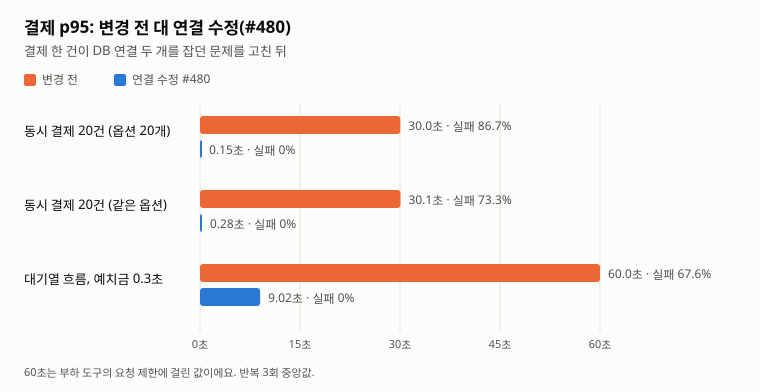
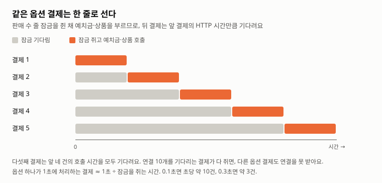
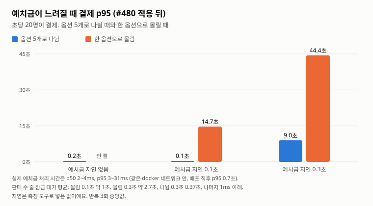
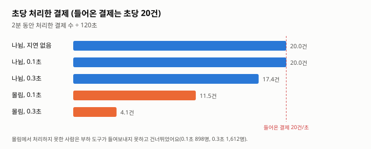

# 결제가 몰리면 30초 멈추고 실패하던 문제 (2026-11-14)

주문 서비스 결제 API(`POST /api/v1/orders/{id}/pay`)의 트러블슈팅 기록이에요.
움직이는 그림으로 본 설명은 [결제가 줄을 서는 이유](https://claude.ai/artifact/3p4LFstN9GNQ2SyM2Nr8Gm)에 있어요(비공개 링크).

## 한 줄 요약

| | 내용 | 상태 |
|---|---|---|
| 증상 | 결제 20건이 한꺼번에 오면 30초 동안 멈췄다가 87%가 실패해요 | |
| 원인 1 | 결제 한 건이 DB 연결을 두 개 쥐어서, 연결 10개가 서로를 기다리며 멈췄어요 | 고침 (#480) |
| 원인 2 | 결제가 키트 옵션 판매 수 줄을 잠근 채 예치금·상품을 불러요. 같은 옵션 결제는 한 줄로 서요 | 남음, 측정 중 |

## 1. 배경: 결제가 하는 일

참가 신청이 열리면 대기열이 종목마다 5초에 20명씩 결제 화면으로 들여보내요(종목당 초당 4명). 결제 한 건은 아래 순서로 움직여요.

1. **준비 (트랜잭션 밖)**: 결제 대상 조회 → 상품 서비스에 종목·키트 옵션 조회(HTTP) → 고른 옵션 확인
2. **확정 (트랜잭션 하나)**: 주문 잠금 → 참가 신청 잠금 → 키트 옵션 판매 수 줄 잠금(`FOR UPDATE`) → 예치금 결제(HTTP) → 상품 자리 판매(HTTP) → 저장·커밋

키트 옵션은 키트 상품의 옵션 값 하나예요(예: 티셔츠 M). 주문 서비스가 `order_kit_option_sale`에 옵션마다 한 줄을 두고 팔린 수를 세요. 결제 때 이 줄을 잠그고 「팔린 수 < 판매 상한」이면 1을 올려요. 잠그지 않으면 동시 결제가 서로의 숫자를 덮어 상한을 넘겨 팔 수 있어요.

## 2. 처음 이렇게 만든 이유

결제 메서드 `OrderFacade.pay`에는 `@Transactional(propagation = NOT_SUPPORTED)`가 붙어 있어요. 클래스 전체는 `readOnly` 트랜잭션인데, 결제만 일부러 「트랜잭션 없이」 시작하게 한 거예요.

- **10/13 (`7b13646e`)**: 취소가 정산 서비스에 묻는 동안 주문 잠금과 DB 연결을 쥐고 있으면, 정산이 느릴 때 같은 주문의 결제·만료 처리가 기다리고 연결이 바닥날 수 있었어요. 그래서 다른 서비스에 묻는 일은 트랜잭션 밖에서 먼저 하고, 잠금은 그 뒤에 짧게 잡는 구조로 바꿨어요.
- **11/09 (`4e8c1164`)**: 결제에 키트 옵션을 더하면서 같은 생각으로, 상품 HTTP(옵션 조회)를 주문을 잠그기 전에 끝내도록 결제도 `NOT_SUPPORTED`로 열고 트랜잭션은 `OrderPayUseCase`가 `TransactionTemplate`으로 직접 열게 했어요.

의도는 「HTTP는 잠금·연결 밖에서」였어요. 그런데 실제로는 두 가지가 의도와 달랐어요.

## 3. 원인 1: 결제 한 건이 DB 연결 두 개를 쥐었다

### 무엇이 일어났나

`NOT_SUPPORTED` 구간에서도 Spring의 트랜잭션 동기화는 켜져 있어요. 그래서 준비 단계의 첫 조회(`findPayTargets`)가 만든 EntityManager가 메서드 끝까지 남고, Hibernate가 그 DB 연결을 놓지 않았어요. 그 상태에서 확정 단계의 `TransactionTemplate`이 연결을 하나 더 빌렸어요.

→ 결제 한 건이 연결 두 개를 동시에 쥐는 구간이 생겨요.
→ 결제 10건이 동시에 첫 연결을 하나씩 가져가면 연결 풀(10개)이 다 차요.
→ 10건 모두 두 번째 연결을 기다리는데 돌려줄 결제가 없어요.
→ Hikari 대기 제한 30초가 지나 모두 실패해요. 남은 결제도 같은 일을 겪어요.

`open-in-view`와는 상관없어요. 연결 풀을 20개로 늘려도 같은 모양으로 멈췄어요.

### 어떻게 찾았나

- 부하 테스트(#478)에서 결제 20건을 동시에 보냈더니, 예치금 지연이 없어도 대부분 30초 뒤 실패했어요.
- 스레드 덤프에서 결제 스레드가 연결 하나를 쥔 채 두 번째 연결을 기다리는 것을 봤어요.
- 연결 풀을 1개로 줄인 테스트(`OrderSingleConnectionTest`)로 네 곳을 확인했어요. 결제·파티 재신청이 같은 모양으로 막혔고, 장바구니 결제와 취소는 아니었어요.

### 어떻게 고쳤나 (#480, BUK-213)

트랜잭션 없이 돌던 앞 조회 두 개(`OrderItemRepository.findPayTargets`, `PartyRepository.findApplyTarget`)에 `@Transactional(readOnly = true)`를 붙였어요. 조회가 끝나면 연결을 바로 돌려줘서, 결제 한 건은 연결을 한 번에 하나만 쥐어요.

트랜잭션 동기화를 실제 트랜잭션에서만 켜는 근본 해법도 있지만, 트랜잭션 밖 지연 로딩이 깨질 수 있어 이번에는 하지 않았어요.

### 숫자 (GitHub Actions run 43461470590, 3회 중앙값)

| 시나리오 | 변경 전 p95 | 변경 전 결제 실패 | #480 p95 | #480 결제 실패 |
|---|---|---|---|---|
| 동시 결제 20건 (옵션 20개) | 30,045ms | 86.7% | 154ms | 0% |
| 동시 결제 20건 (같은 옵션) | 30,069ms | 73.3% | 285ms | 0% |
| 대기열 흐름 + 예치금 지연 0.3초 | 60,001ms | 67.6% | 9,019ms | 0% |

- 60,001ms는 k6 요청 제한(60초)에 걸린 값이에요.
- 변경 전에는 한 회에 예치금 결제 약 200건이 결제 기한이 지나 만료 취소됐어요. #480 뒤에는 0건이에요.
- 돈 합계, 이중 차감, 판매 수, 「결제 완료 = 예치금 결제 = 판매된 자리」 확인은 두 쪽 모두 맞았어요.

## 4. 원인 2: 옵션 잠금을 쥔 채 다른 서비스를 부른다

### 무엇이 남았나

#480 뒤에도 확정 단계는 키트 옵션 판매 수 줄을 잠근 채 예치금과 상품을 HTTP로 불러요. 잠금은 커밋할 때 풀려요.

→ 같은 옵션을 고른 다음 결제는 앞 결제의 HTTP가 끝날 때까지 기다려요.
→ 기다리는 동안에도 DB 연결을 쥐고 있어요.
→ 기다리는 결제가 연결 10개를 다 쥐면, 다른 옵션을 고른 결제도 연결을 못 받아요.

옵션 하나가 1초에 처리할 수 있는 결제는 대략 「1초 ÷ 잠금을 쥔 시간」이에요. 티셔츠 M과 L은 다른 줄이라, 문제는 결제가 한 옵션으로 몰릴 때 커져요.

### 숫자 (#480 상태, run 43564604077, 3회 중앙값, 초당 20건)

| 시나리오 | 결제 p95 | 2분 동안 결제 | 잠금 대기 평균 / 최대 | 못 들어온 사람 |
|---|---|---|---|---|
| 옵션 5개, 지연 없음 | 214ms | 2,400 | 0.8 / 175ms | 0 |
| 옵션 5개, 예치금 0.1초 | 117ms | 2,401 | 0.0 / 0.5ms | 0 |
| 옵션 5개, 예치금 0.3초 | 8,983ms | 2,089 | 373 / 1,853ms | 312 |
| 한 옵션, 예치금 0.1초 | 14,717ms | 1,381 | 961 / 1,048ms | 898 |
| 한 옵션, 예치금 0.3초 | 44,416ms | 488 | 2,737 / 2,802ms | 1,612 |

- 예치금 지연은 측정 도구로 넣은 값이에요.
- 잠금 대기는 MySQL `performance_schema`에서 `order_kit_option_sale ... FOR UPDATE` 문장의 실행 시간으로 쟀어요. 기본 키로 줄 하나를 읽는 문장이라 실행 시간 대부분이 잠금 대기예요.
- 한 옵션에 몰릴 때 잠금 대기가 「연결 수 10 − 1 = 9건 × 잠금을 쥐는 시간」과 거의 같아요. 위 설명대로 움직인다는 뜻이에요.
- 「못 들어온 사람」은 k6가 결제가 끝나지 않아 다음 사람을 들여보내지 못한 수예요.

### 그런데 지금은 드러나지 않는다

지연을 넣지 않은 실제 예치금 처리 시간은 p50 2~4ms, p95 3~31ms였어요(동시 결제 20건일 때 31ms). 잠금을 쥐는 시간이 짧아서 지연 없는 시나리오에서는 잠금 대기가 거의 0이에요.

다만 예치금이 막 뜬 직후에는 p95가 0.7초까지 올랐어요. 그 순간 인기 옵션 결제가 얼마나 밀리는지는 아직 재지 않았어요. 예치금을 재시작하면서 결제를 흘리는 측정(run 43601125957)을 돌리고 있어요.

## 5. 남은 문제를 고치는 방법들

11/12에 팀에서 견준 안들이에요.

| 안 | 내용 | 잠금을 쥐는 시간 | 드는 것 |
|---|---|---|---|
| A | 지금 그대로 | 예치금 + 상품 HTTP | 없음 |
| A+ | 회원 확인 같은 조회를 잠금 앞으로 옮김 | 조금 줄어듦 | 작음 |
| B | 설정만 바꿈 (연결 수, HTTP 시간 제한) | 그대로 | 작음. 연결 20개도 p95 9초 → 7초에 그침 |
| C | 취소처럼 나눔: 「결제 중」 저장·커밋 → 잠금 밖 HTTP → 확정, 재시도 배치 | DB 저장 몇 ms | 3~4일, 「결제 중」 상태와 복구 배치가 생김 |
| D | 작업 표에 넣고 따로 처리 | 짧음 | 구조 변경 큼 |
| E | 이벤트와 보상 처리 | 짧음 | 구조 변경 가장 큼 |

팀은 C안 쪽으로 의견이 모였어요. 하지 않을 이유는 「지금 예치금이 빨라서 문제가 드러나지 않는다」는 것 하나예요.

## 6. 결론과 다음 일

- 원인 1은 고쳤어요. 동시 결제 20건의 p95가 30초에서 0.15초로, 실패가 86.7%에서 0%로 바뀌었어요.
- 원인 2는 「예치금이 0.1초 이상 느려지고 결제가 한 옵션에 몰릴 때」만 드러나요. 그 조건이 실제로 생기는지가 C안을 할지 정하는 기준이에요.
- 다음 일
  1. 예치금 재시작 직후 측정 결과를 이 문서에 더하기 (진행 중)
  2. 운영 지표에 예치금 결제 API p95를 띄워 달라고 예치금 담당에게 부탁하기 (보내기 전 다윗님 확인)
  3. 상품 서비스가 막 뜬 뒤 1분 동안 느렸던 것(p95 1.5~1.9초) 예열·준비 확인 부탁하기 (보내기 전 다윗님 확인)

## 측정 환경과 한계

- GitHub Actions에서 주문(CPU 1, 1GB), 예치금(0.5, 768MB), 상품(0.5, 1GB), MySQL(1, 2GB)을 compose로 띄우고 k6로 쟀어요. 주문 DB 연결은 10개예요.
- 운영의 네트워크·배포 방식·GC는 들어 있지 않아요. dev 서버 지표는 보지 않았어요.
- 부하가 클 때 Prometheus가 주문 지표를 1초 안에 받지 못해 표본이 빠졌어요. 연결 대기 지표는 남은 표본만 봤어요.
- 지연 없이 한 옵션으로 몰리는 경우는 재지 않았어요.
- 원본 숫자와 측정 방법: [2026-11-14-결제-잠금-A-B.md](../measurements/2026-11-14-결제-잠금-A-B.md) (#478)
