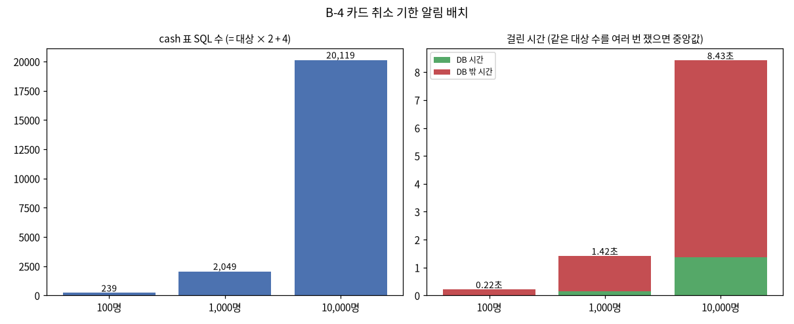
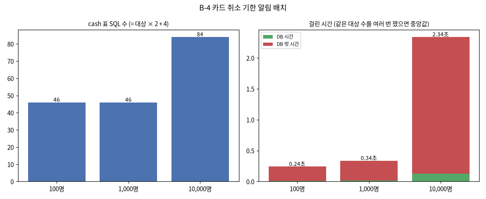

# 기한 알림 배치의 회원마다 하던 조회를 묶어 1만 명 SQL 20,119개 → 83개, 8.43초 → 2.34초 (2026-11-17)

- Linear: BUK-11
- 찾은 곳: 예치금 부하 측정 [연습](../measurements/2026-11-16-예치금-부하.md) 9장 문제 4, [기준선](../measurements/2026-11-17-예치금-부하-기준선.md) P6
- 고친 코드: cash-service `CashCardCancelDeadlineNoticeUseCase`, `CashRefundableChargeQueryUseCase`, `WalletChargeRepository` (커밋 `c0b1097c`)
- 비교 측정: `CashCardCancelDeadlineNoticeReadMeasureTest`로 읽는 방법(IN 두 번·fetch join)과 묶음 크기를 MySQL에서 함께 재고, 기준선(IN 두 번, 묶음 1,000)을 유지하기로 정함 (11/21)

## 1. 한 줄 요약

카드 결제취소 기한 알림 배치가 대상 회원마다 지갑과 충전을 따로 조회해서, SQL이 대상 수의 2배씩 늘었어요(1만 명에 2만 개).
1,000명씩 묶어 지갑과 충전을 한 번에 읽고, 남은 금액 계산은 환급 화면과 같은 함수로 떼어 내 **누구에게 얼마를 알리는지는 그대로** 두었어요.
같은 조건 A·B 3회 중앙값으로 1만 명 SQL이 20,119개에서 83개로, 걸린 시간이 8.43초에서 2.34초로 줄었어요.

## 2. 증상

| | 기대 | 실제 (기준선 3회 중앙값) |
|---|---|---|
| 대상 100명 → 10,000명일 때 SQL 수 | 10배 안으로 늘어남 (판정 기준 P6) | 204 → 20,004개 (**98배**) |
| 10,000명 걸린 시간 | | 7.67초 |
| 그중 DB 시간 | | 1.29초 (**걸린 시간의 17%**) |

| 대상 | 100명 | 1,000명 | 10,000명 |
|---|---|---|---|
| SQL 수 | 204 | 2,004 | 20,004 |
| 걸린 시간 | 0.18초 | 1.55초 | 7.67초 |

- SQL 수가 정확히 「대상 × 2 + 4」였어요. 맥에서 한 연습 측정(bootRun)도 같은 식이었어요.
- 걸린 시간은 대상 수에 비례해 늘었는데, **DB가 쓴 시간은 그중 일부**였어요. 연습 측정에서도 1만 명 7.75초 중 DB 시간이 0.7초였어요.
- 운영에서 느리다는 신고가 있던 건 아니에요. 대상 수에 비례해 늘어나는 구조를 측정으로 찾은 거예요.

## 3. 가설

| 번호 | 가설 | 맞으면 보여야 할 것 | 판정 |
|---|---|---|---|
| H1 | 대상 회원마다 지갑 1번, 충전 1번을 따로 조회해서 SQL이 대상 수에 비례해요 | SQL 수 = 대상 × 2 + 고정 몇 개 | **맞음** (204 · 2,004 · 20,004, 코드에서 회원마다 부르는 조회 확인) |
| H2 | 걸린 시간이 늘어나는 것도 DB가 SQL을 처리하는 시간 때문이에요 | 걸린 시간 대부분이 DB 시간 | **틀림** (DB 시간은 17%, 나머지 6.4초는 DB 밖) |
| H3 | DB 밖 시간의 상당 부분은 알림 1만 건이 바로 실패하며 경고 로그를 찍은 시간이에요 (기준선은 BUK-13 전이라 알림이 모두 실패했어요) | 알림이 실제로 나가는 코드에서는 DB 밖 시간이 크게 줄어요 | **틀림 (정황)** BUK-13이 들어간 A에서도 DB 밖이 7.05초로 줄지 않았어요 |

H2가 틀리면서 「SQL을 줄여도 걸린 시간은 그대로일 수 있다」는 걱정이 생겼어요.
그래서 판정 기준(G4)을 「SQL 수는 100명의 2배 안, **걸린 시간은 늘지 않으면 됨**」으로 고치기 전에 정했어요. 시간이 줄어드는 것까지 약속하지 않았어요.

## 4. 어떻게 확인했나

| 실행 | 바꾼 것 | 본 것 | 결과 | 판정한 가설 |
|---|---|---|---|---|
| 연습 측정 (11/16, 맥 bootRun) | 지금 코드 | SQL 수, 걸린 시간, DB 시간 | 1만 명 SQL 20,004개, 7.75초, DB 0.7초 | H1 맞음, H2 틀림 |
| 기준선 3회 (11/17, 컨테이너) | 지금 코드, 예치금 0.5 CPU | 같음 | 1만 명 SQL 20,004개, 7.67초, DB 1.29초 | H1 맞음, H2 틀림 |
| A 3회 (11/17, BUK-13 포함) | 기준선 코드 + dev(알림이 실제로 나감) | 같음 | 1만 명 SQL 20,119개, 8.43초, DB 1.38초 | H3 틀림 |
| SQL 수 테스트 | 고치기 전 코드 | Hibernate 통계로 SQL 수 | 회원 30명에 62개 (30 × 2 + 2) | H1 맞음 |

### 원인

1. 기한 알림(`CashCardCancelDeadlineNoticeUseCase`, 정책 5장 2차 1)은 카드 결제취소 마지막 날이 3일 뒤·1일 뒤인 충전을 가진 회원을 먼저 찾아요. 알림에는 「그날까지 환급하면 카드로 돌려받는 금액」이 들어가요.
2. 그 뒤 회원마다 남은 금액 계산(`CashRefundableChargeQueryUseCase`)을 불렀어요. 이 계산이 회원 한 명의 지갑과 충전을 각각 조회해요.
3. → 대상이 N명이면 SQL이 2N개 나가요. 전형적인 N+1 조회예요.
4. 1만 명을 읽기 전용 트랜잭션 하나에서 처리해서, 읽은 지갑·충전 엔티티가 트랜잭션이 끝날 때까지 메모리에 쌓였어요.

### 영향 범위

- 매일 09:00 도는 배치 하나예요. 회원이 기다리는 요청이 아니라서 화면이 느려지지는 않아요.
- 대상 수가 늘수록 배치 시간, DB 왕복 수, 메모리가 같이 늘어요. 지금 실제 대상이 하루 몇 명인지는 보지 않았어요.

## 5. 고친 내용

1,000명씩 묶어 지갑 한 번, 충전 한 번을 IN 조회로 읽어요. 묶음이 끝날 때마다 영속성 컨텍스트를 비워요.
남은 금액 계산은 「조회 결과를 받아 계산만 하는 함수」 `CashRefundableChargeQueryUseCase.refundable(...)`로 떼어 냈어요.

```text
고치기 전: 대상 찾기 → 회원마다 [지갑 조회 → 충전 조회 → 남은 금액 계산] → 알림 요청
고친 뒤:   대상 찾기 → 1,000명씩 [지갑 IN 조회 → 충전 IN 조회 → 회원마다 남은 금액 계산 → 비우기] → 알림 요청
```

**동작이 같다는 근거**
- 환급 화면과 알림 배치가 **같은 계산 함수**를 써요. 두 곳의 금액이 따로 놀 수 없어요.
- 기존 알림 테스트 7개(`CashCardCancelDeadlineNoticeTest`)와 환급 화면 테스트 7개가 고치지 않은 채 그대로 통과해요. 예치금 전체 테스트 431개도 통과했어요.
- 알림을 보내는 쪽(배치는 요청만 남기고, 작업 실행기가 Kafka로 보냄)은 바꾸지 않았어요.

**다시 늘지 않게 막은 것**
- `CashCardCancelDeadlineNoticeQueryCountTest`가 회원 30명일 때 SQL 수를 Hibernate 통계로 세요. 고치기 전 62개로 실패했고, 고친 뒤 4개 이하로 통과해요.

### 검토한 방법

세 방법 모두 1,000명씩 묶어 읽어요. 한 번에 다 읽으면 대상 수만큼 메모리를 쓰고, `IN (1만 개)` 같은 큰 쿼리는 MySQL이 인덱스 대신 표 전체를 읽는 쪽을 고를 수도 있어서 묶는 것은 공통이에요.

| 방법 | 장점 | 단점 | 고름 |
|---|---|---|---|
| 충전을 읽으면서 지갑을 fetch join으로 함께 읽기 (`WalletCharge join fetch wallet`) | 묶음당 SQL이 1개라 고른 방법보다 1개 적어요 | JPQL을 따로 써야 해요. 충전이 여러 건인 회원은 지갑 칸이 충전마다 반복돼 받는 데이터가 늘어요 (아래 11/21 비교) | |
| 엔티티 대신 필요한 칸(잔액, 충전 금액·취소 금액·승인 시각)만 읽기 | Hibernate가 엔티티를 만들지 않아 가벼워요 | 남은 금액 계산이 엔티티를 받아서, 환급 화면과 같은 계산을 쓰려면 함수 모양을 바꿔야 해요 | |
| 1,000명씩 IN 조회로 지갑 한 번, 충전 한 번. 묶음마다 비우기 | 기존 메서드 이름 조회와 환급 화면의 계산 함수를 그대로 써요 | SQL이 묶음마다 2개라 셋 중 가장 많아요(1만 명에 약 20개) | ✓ |

### 고른 이유

이 수정에서 가장 지키고 싶었던 건 **「알림에 적히는 금액이 환급 화면과 같다」**였어요. 기한 알림은 「지금 환급하면 카드로 얼마가 돌아간다」를 알려 주는 것이라, 두 곳의 금액이 다르면 회원이 헷갈려요.
필요한 칸만 읽기는 계산 함수의 모양을 바꿔야 해서 두 곳이 어긋날 틈이 생겨요.
fetch join은 충전을 지갑별로 묶으면 같은 계산 함수를 그대로 쓸 수 있어서, 이 이유로는 뺄 수 없어요. 처음 기록에는 fetch join도 함수를 바꿔야 한다고 잘못 적었어요.
고칠 때(11/17)는 fetch join을 재 보지 않고 「1만 명에 SQL 10개 차이라 시간으로는 구분되지 않는다」고 추정해, 조회와 계산을 기존 것 그대로 쓰는 쪽을 골랐어요. 기존 테스트로 동작이 같다는 것을 바로 보일 수 있었어요.
11/21에 두 방법을 MySQL에서 직접 쟀어요(아래). 추정과 달리 회원당 충전이 1건이면 차이가 났어요.

### fetch join과 지금 방법 비교 (11/21 1차 측정)

**조건**
- 맥에서 MySQL 8.4 컨테이너(Testcontainers), 회원 1만 명. 회원당 완료 충전 1건(부하 측정 B-4와 같은 모양)과 5건 두 가지.
- 배치 전체가 아니라 **묶음마다 지갑·충전을 읽고 남은 금액을 계산하는 부분만** 쟀어요. 대상 찾기와 알림 이벤트는 두 방법이 같아서 뺐어요.
- 예열 3회 뒤 7회, 두 방법을 회차마다 순서를 바꿔 번갈아 돌리고 중앙값을 썼어요. 재기 전에 두 방법이 1만 명 모두에게 같은 금액을 내는지 먼저 확인했어요.
- 「만든 객체」는 그 쓰레드가 읽는 동안 만든 객체의 총량이에요. 한 번에 들고 있는 최대 메모리는 아니에요.
- 다시 내는 법: `CASH_MEASURE=true ./gradlew :cash-service:test --tests "*CashCardCancelDeadlineNoticeReadMeasureTest"` (결과는 `cash-service/build/measure/`)

**묶음 1,000명일 때**

| 회원당 충전 | 방법 | SQL 수 | MySQL이 보낸 데이터 | 걸린 시간 (최소~최대) | 만든 객체 |
|---|---|---|---|---|---|
| 1건 | 지갑 IN + 충전 IN (지금) | 20 | 2,263KB | 102ms (98~103) | 123MB |
| 1건 | fetch join | **10** | 2,224KB | **74ms** (66~80) | **99MB** |
| 5건 | 지갑 IN + 충전 IN (지금) | 20 | **8,408KB** | 211ms (201~232) | 324MB |
| 5건 | fetch join | **10** | 11,173KB | 205ms (200~212) | 316MB |

- **회원당 충전 1건:** fetch join이 읽기 시간 27%, 만든 객체 20%를 줄였어요. 받은 데이터는 거의 같아요. SQL 10개 차이가 28ms라 SQL 하나에 2.8ms쯤이에요. 쿼리마다 드는 Hibernate 준비·결과 처리 비용으로 보이지만 추적으로 나눠 보지는 않았어요.
- **회원당 충전 5건:** 시간 차이(211 → 205ms)는 범위가 겹쳐 흔들림 안이에요. 대신 fetch join이 받는 데이터가 33% 많아요. 충전 행마다 지갑 칸이 반복되기 때문이에요.
- **배치 전체로 보면:** 이 숫자는 맥 전체 CPU에서 읽기만 잰 값이에요. 부하 측정(0.5 CPU)의 1만 명 배치 2.34초 중 DB 시간이 0.13초였으니, 읽기 방법의 차이는 배치 전체의 몇 % 수준으로 보여요(추정).

**고를 방법** (아래 「함께 정하기」에서 기준선 유지로 정함)

| 방법 | 장점 | 단점 |
|---|---|---|
| 지금 방법 그대로 | 기존 메서드 이름 조회를 그대로 써요. 지갑이 없으면 예외로 바로 드러나요. 충전이 많은 회원에서 받는 데이터가 적어요 | 회원당 충전이 1건인 경우가 많으면 읽기가 fetch join보다 27% 느리고 객체를 20% 더 만들어요 |
| fetch join으로 바꾸기 | SQL이 절반이에요. 충전 1건 모양에서 읽기 27%, 만든 객체 20%가 줄어요 | JPQL을 하나 더해요. 지갑이 없는 회원은 inner join이라 조용히 빠져요(충전의 지갑 칸이 필수라 지금은 생기지 않아요). 충전이 많은 회원은 받는 데이터가 늘어요 |

어느 쪽이 나은지는 **실제 회원당 완료 충전 수**에 달려 있어요. 운영에서 그 분포를 보기 전에는 둘 다 근거가 있어요.

### 묶음 크기를 1,000명으로 둔 이유 (11/21 1차 측정)

1,000은 재서 고른 값이 아니에요. 코드 주석의 이유는 「IN 목록이 너무 길어지지 않게, 묶음마다 읽은 엔티티를 비워 메모리가 대상 수만큼 늘지 않게」예요.
흔히 쓰는 1,000은 Oracle의 IN 목록 1,000개 제한에서 온 관례예요. MySQL에는 IN 목록 개수 제한이 없고, 한 쿼리의 자리표시자 65,535개와 패킷 크기(`max_allowed_packet`)가 한계예요. 그래서 2,000·3,000도 쓸 수 있어요.

11/21 측정에서 묶음 크기만 바꾼 결과예요(걸린 시간 중앙값, 지금 방법 / fetch join).

| 묶음 | 충전 1건 | 충전 5건 |
|---|---|---|
| 500 | 111 / 86ms | 235 / 220ms |
| 1,000 | 102 / 74ms | 211 / 205ms |
| 2,000 | 94 / 68ms | 203 / 197ms |
| 5,000 | 85 / 65ms | 198 / 194ms |
| 10,000 (한 번에) | 83 / 63ms | 208 / 216ms |

- 묶음을 키우면 SQL이 줄고 조금 빨라지지만, 2,000부터는 거의 그대로예요. 1,000을 2,000으로 올려도 1만 명에 SQL 10개, 읽기 10ms 안팎이 줄어요.
- 만든 객체 총량은 묶음 크기와 상관없이 같았어요. 대신 한 번에 들고 있는 엔티티가 묶음 크기만큼 늘어요. 이 최대 메모리는 재지 않았어요.
- **IN 목록이 표의 큰 비율을 덮으면 MySQL이 인덱스 대신 표 전체를 읽었어요.** 측정용 표(1만 명)에서 충전 1건 모양은 충전 IN이 2,000부터, 충전 5건 모양은 지갑 IN이 5,000부터 전체 읽기(`ALL`)로 바뀌었어요. 1,000까지는 모두 인덱스(지갑 PRIMARY, 충전 `wallet_id` 외래 키 인덱스)를 썼어요.
  표가 작아서 2,000명이 표의 20%라 전체 읽기가 더 싼 선택이었어요. 운영 표 크기에서는 다를 수 있어요.

그래서 1,000을 그대로 둬요. 키워서 얻는 몫이 작고, 운영 표 크기에서 큰 IN 목록이 어떤 실행 계획을 타는지 아직 보지 않았어요.

### 읽는 방법과 묶음 크기를 함께 정하기: 판정 기준 (11/21, 재기 전에 정함)

위 두 비교는 따로 쟀고, 표가 1만 명뿐이었고, 회원당 충전이 1·5건뿐이었어요. 읽는 방법과 묶음 크기를 한 번에 정하려고 아래 기준으로 다시 재요. 숫자를 본 뒤에 기준을 바꾸지 않아요.

| | 묶음 1,000 | 묶음 2,000 | 묶음 3,000 |
| --- | --- | --- | --- |
| IN 두 번 (지갑 IN + 충전 IN) | **기준선 (지금 코드)** | 후보 | 후보 |
| fetch join | 후보 | 후보 | 후보 |

**판정 기준.** 후보 조합은 넷을 모두 만족해야 통과해요. 통과한 후보가 없으면 기준선을 유지해요.

1. **어느 조건에서도 느려지지 않는다.** 모든 측정 조건에서 후보의 시간 중앙값이 기준선보다 느리지 않다. 기준선의 최소~최대 범위 안이면 같은 것으로 본다.
2. **몰리는 날에 10% 넘게 빠르다.** 10만 명 표, 하루 대상 1만 명일 때, 회원당 충전 1·10·30건 중 하나 이상에서 기준선보다 읽기 시간을 10% 넘게 줄인다.
3. **기준선보다 실행 계획이 나빠지지 않는다.** 두 표의 모든 조건에서, 기준선이 인덱스를 쓰면 후보도 인덱스를 써야 한다(`EXPLAIN`의 `type`이 `ALL`이 아니다). fetch join은 충전 표와 지갑 표 둘 다 본다. 표 전체를 읽으면 배치 시간이 알림 대상 수가 아니라 표 크기에 따라 늘어나기 때문이다.
4. **메모리가 기준선보다 늘지 않는다.** 묶음 하나가 늘리는 힙(GC 뒤)을 기준선과 비교한다. 기준선의 최소~최대 범위 안이면 같은 것으로 본다. 기준선보다 늘어나는 조합은 운영 힙 사용량을 확인할 때까지 고르지 않고 「보류」로 남긴다.

여러 후보가 통과하면 **10만 명 표, 대상 1만 명, 회원당 충전 10건**에서 가장 빠른 조합을 골라요. 실제 회원당 충전 수 분포를 몰라 1건과 30건 사이의 가운데 값을 대표로 써요.

**측정 조건.**

| 전체 회원 수 (표 크기) | 하루 알림 대상 수 | 회원당 완료 충전 기록 |
| --- | --- | --- |
| 1만 | 1,000 · 3,000 | 1 · 10 · 30건 |
| 10만 | 1,000 · 3,000 · 1만 | 1 · 10 · 30건 |

- 1만 명 표에서 대상 1만 명은 재지 않아요. IN 목록이 표 전체라 어느 조합이든 표를 다 읽어 비교할 것이 없어요.
- 대상 1,000명은 대조군이에요. 묶음이 하나뿐이라 같은 방법이면 묶음 크기 세 개가 같게 나와야 해요.
- 대상 회원은 고정된 시드로 표 전체에서 무작위로 뽑아요. 대상마다 충전 1건은 결제취소 마지막 날이 정확히 3일 뒤이고, 나머지는 며칠씩 떨어뜨려 넣어요. 대상이 아닌 회원도 같은 수의 충전을 가져요.
- 재기 전에 여섯 조합이 모든 대상에게 같은 금액을 내는지 확인해요.
- 시간: 예열 3회 뒤 7회, 조합 순서를 돌려 가며 번갈아 재요. 메모리: 시간과 따로 3회, 묶음을 비우기 직전마다 GC를 부르고 힙과 엔티티 수를 적어요. 실행 계획: 조건마다 `EXPLAIN`과 `EXPLAIN ANALYZE`.
- 참고하는 운영 값: 예치금 컨테이너 상한 512MiB, 힙 최대 약 307MiB(상한의 60%), 배치는 매일 09:00. 09:00 전후 평소 힙 사용량은 모름(지금 운영은 회원과 요청이 적어 재도 의미가 작음). 그래서 4번은 이 값 대신 기준선과 비교해요.

### 읽는 방법과 묶음 크기를 함께 정하기: 결과와 결정 (11/21)

**결정: 통과한 후보가 없어 기준선(IN 두 번, 묶음 1,000)을 유지해요.** 운영 코드는 바꾸지 않아요.

- 실행: 맥, MySQL 8.4 컨테이너, 11/21 16:32~16:38 (5분 52초). 15가지 조건 × 여섯 조합, 재기 전에 여섯 조합이 모든 대상에게 같은 금액을 내는 것을 확인했어요.
- 원본: `cash-service/build/measure/notice-read-combos.md`·`.csv`·`notice-read-explain-analyze.txt` (다시 내는 법은 위 1차 측정과 같아요)

| 후보 | 1. 느려지지 않음 | 2. 몰리는 날 10% 넘게 빠름 (충전 1·10·30건) | 3. 실행 계획 | 4. 메모리 | 결과 |
|---|---|---|---|---|---|
| IN 두 번 2,000 | 통과 | ✗ 4.3 · 1.0 · −5.8% | ✗ 1만 명·대상 3,000·충전 1건에서 충전 IN이 표 전체를 읽음 | ✗ 기준선의 2배 | 탈락 |
| IN 두 번 3,000 | 통과 | ✗ 2.6 · −1.0 · −7.0% | ✗ 1만 명·대상 3,000명 세 조건 모두 표 전체를 읽음 | ✗ 기준선의 3배 | 탈락 |
| fetch join 1,000 | ✗ 10만 명·대상 3,000·충전 30건: 322.0ms (기준선 최대 313.0ms) | 통과 22.5 · 1.7 · −2.1% | 통과 | 통과 | 탈락 |
| fetch join 2,000 | ✗ 같은 조건 319.5ms | 통과 25.2 · 0.7 · −7.2% | ✗ 1만 명·대상 3,000·충전 1건 | ✗ 기준선의 2배 | 탈락 |
| fetch join 3,000 | ✗ 같은 조건 321.1ms | 통과 25.7 · −0.6 · −12.3% | ✗ 1만 명·대상 3,000명 세 조건 | ✗ 기준선의 3배 | 탈락 |

**몰리는 날(10만 명 표, 대상 1만 명)의 숫자**

| 회원당 충전 | IN 두 번 1,000 (기준선) | IN 두 번 2,000 | IN 두 번 3,000 | fetch join 1,000 | fetch join 2,000 | fetch join 3,000 |
|---|---|---|---|---|---|---|
| 1건, 걸린 시간 | 94.1ms | 90.1ms | 91.7ms | **72.9ms** | 70.4ms | 69.9ms |
| 10건, 걸린 시간 | 343.9ms | 340.3ms | 347.4ms | 338.2ms | 341.6ms | 346.1ms |
| 30건, 걸린 시간 | **1,236.6ms** | 1,308.3ms | 1,322.9ms | 1,262.2ms | 1,325.2ms | 1,389.3ms |
| 30건, MySQL이 보낸 데이터 | 47,969KB | 47,962KB | 47,961KB | 69,105KB | 69,098KB | 69,097KB |
| 30건, 묶음 하나가 늘린 힙 | 18.9MiB | 38.6MiB | 57.4MiB | 18.9MiB | 38.4MiB | 57.2MiB |

**알게 된 것**
- **묶음을 키워도 빨라지지 않았어요.** 충전 1건에서 4% 남짓 빨라졌을 뿐이고, 충전 30건에서는 오히려 6~7% 느려졌어요. 느려진 이유는 확인하지 않았어요.
- **묶음 하나가 늘리는 힙은 묶음 크기에 비례했어요.** 엔티티 하나에 약 0.6~0.8KiB예요. 충전 30건이면 묶음 1,000에서 19MiB, 3,000에서 57MiB예요. 기준선이 가장 많이 늘린 19MiB는 힙 최대 307MiB의 6%예요.
- **10만 명 표에서는 모든 조합이 인덱스를 썼어요.** 1만 명 표에서는 대상 3,000명일 때 묶음 3,000(표의 30%)이 표 전체를 읽었어요. 1차 측정에서 본 「2,000부터 표 전체」는 표가 작아서 생긴 일이었어요.
- **fetch join은 회원당 충전이 1건일 때만 빨랐어요(20~25%).** 10건이면 같고, 30건이면 기준선보다 느렸어요. 지갑 칸이 충전 행마다 반복돼 받는 데이터가 44% 많기 때문이에요. fetch join 1,000은 네 기준 중 1번 한 곳(10만 명·대상 3,000·충전 30건, 9ms 차이)만 못 넘었어요.
- **대조군(대상 1,000명)은 같은 방법이면 묶음 크기 셋의 범위가 겹쳤어요.** 묶음이 하나뿐인 조건에서 차이가 없었으니 측정이 흔들리지 않았다고 봐요.

**fetch join을 다시 볼 조건:** 운영에서 회원당 완료 충전이 대부분 1건으로 확인되면 fetch join 1,000을 다시 볼 만해요. 떨어진 조건이 충전 30건뿐이라서예요.

## 6. 결과

| 지표 (10,000명, 3회 중앙값) | 고치기 전 (A) | 고친 뒤 (B) | 변화 |
|---|---|---|---|
| SQL 수 | 20,119개 | **83개** | 242분의 1 |
| 걸린 시간 | 8.43초 | **2.34초** | 72% 줄어듦 |
| DB 시간 | 1.38초 | 0.13초 | 91% 줄어듦 |
| DB 밖 시간 (걸린 시간 − DB 시간) | 7.05초 | 2.21초 | 69% 줄어듦 |
| SQL 수, 10,000명 ÷ 100명 | 84배 (239 → 20,119) | **1.8배** (46 → 83) | 판정 기준 P6(10배 안) 통과 |

| 대상 | A SQL | B SQL | A 걸린 시간 | B 걸린 시간 |
|---|---|---|---|---|
| 100명 | 239 | 46 | 0.22초 | 0.24초 |
| 1,000명 | 2,054 | 46 | 1.47초 | 0.46초 |
| 10,000명 | 20,119 | 83 | 8.43초 | 2.34초 |




- **기준선:** A예요. B에서 P4·P5·P6 커밋 세 개만 되돌린 코드라, A와 B의 차이는 고친 커밋뿐이에요. 기준선 측정(11/17 오전)은 BUK-13 전이라 알림이 모두 실패해서 비교에 쓰지 않았어요.
- **조건:** GitHub Actions 머신, 예치금 컨테이너 0.5 CPU, 운영 프로필, 가짜 PG·회원. 대상마다 결제취소 마지막 날이 정확히 3일 뒤인 충전 1건(1만 원)을 만들었어요.
- **횟수:** A·B를 번갈아 3번씩 재서 중앙값을 썼어요. 1만 명 걸린 시간은 A 7.87 · 8.43 · 9.02초, B 2.38 · 2.34 · 2.16초예요.
- **테스트:** 예치금 전체 431개, 기존 알림·환급 화면 테스트 14개, 새 SQL 수 테스트가 통과했어요.
- 100명에서는 차이가 없어요(0.22초 → 0.24초). 묶음이 하나라 SQL 수만 줄고 시간은 고정 비용이 대부분이에요.
- SQL 수만 줄였는데 **DB 밖 시간도 7.05초 → 2.21초로 줄었어요.** SQL마다 드는 앱 쪽 비용(DB 왕복, JDBC·Hibernate 처리, 엔티티 생성)이 DB 밖 시간의 큰 부분이었던 것으로 보여요. 추적으로 나눠 보지는 않았어요.

## 7. 남은 문제

| 무엇 | 지금 상태 | 다음에 할 일 |
|---|---|---|
| 고친 뒤 DB 밖 2.21초가 어디에 쓰이는지 | 확인 안 함. 알림 이벤트 1만 개를 만들고 넘기는 시간일 수 있어요 | 추적으로 배치 구간을 나눠 보기. 1만 명 2.34초라 급하지 않아요 |
| DB 밖 시간이 SQL마다 드는 앱 쪽 비용이었는지 | 정황만 있음 (SQL을 줄이자 함께 줄어듦) | 고치기 전 코드를 추적으로 나눠 보면 확인돼요 |
| 메모리가 실제로 줄었는지 | 재지 않음 | 고치기 전후 1만 명 배치 중 힙을 비교하기 |
| 대상이 1,000명을 넘어 묶음이 여러 개일 때의 결과 | 단위 테스트 없음 (테스트는 30명). 1만 명 측정은 SQL 수와 시간만 봤어요 | 묶음 경계(1,000명, 1,001명)에서 알림 대상과 금액이 같은지 보는 테스트 더하기 |
| 회원당 완료 충전 수 분포 | 모름. fetch join은 충전 1건일 때만 빨랐어요 | 운영 데이터로 회원당 완료 충전 수를 보고, 대부분 1건이면 fetch join 1,000을 다시 보기 |
| 묶음이 클수록 충전 30건에서 느려지는 이유 | 확인 안 함 (1,236.6 → 1,322.9ms) | 결론(1,000 유지)에는 영향이 없어 급하지 않아요 |
| 실제 운영 표 크기에서의 실행 계획 | 1만·10만 명 표로 가정해 봄. 10만 명 표에서는 모든 조합이 인덱스를 씀 | 회원이 10만 명을 크게 넘으면 다시 보기 |
| 실제 하루 알림 대상 수 | 보지 않음 | 운영 데이터로 하루 대상 수를 보면 이 개선이 체감되는 규모인지 알 수 있어요 |

## 8. 배운 점

- **SQL 수와 걸린 시간은 같이 줄지 않을 수 있어요.** 이번에는 DB 시간이 17%뿐이라 시간은 안 줄 수도 있다고 보고, 판정 기준을 「시간이 늘지 않으면 됨」으로 정해 두었어요. 결과가 좋았어도 고치기 전에 기대를 크게 잡지 않은 덕분에 숫자를 보고 기준을 바꿀 일이 없었어요.
- **조회를 묶을 때는 계산을 먼저 떼어 내요.** 계산이 조회 안에 섞여 있으면 묶는 순간 계산을 새로 써야 하고, 같은 금액을 내는 두 화면이 어긋나요. 계산을 「조회 결과를 받는 함수」로 떼면 조회 방식만 바꿀 수 있어요.
- **N+1을 고친 뒤에는 SQL 수 테스트를 남겨요.** 걸린 시간은 머신에 따라 흔들리지만 SQL 수는 흔들리지 않아서, 누가 다시 회원마다 조회하게 바꾸면 바로 실패해요.
- **재지 않은 비교는 추정이라고 적어요.** 「1만 명에 SQL 10개 차이라 구분되지 않는다」고 추정한 fetch join이, 직접 재 보니 회원당 충전 1건 모양에서 읽기를 27% 줄였어요. 비교 대상을 뺄 때는 잰 값인지 추정인지 함께 남겨요.
- **좋아 보이는 조건 하나로 고르지 않아요.** fetch join은 충전 1건에서 20~25% 빨랐지만, 「어느 조건에서도 느려지지 않는다」를 재기 전에 기준으로 정해 두어서 충전 30건에서 느려진 것을 보고 그대로 떨어뜨렸어요.
- **측정 조건이 바뀌면 이전 숫자를 기준선으로 쓰지 않아요.** 기준선 측정과 A 사이에 알림 수정(BUK-13)이 들어와서, 기준선 대신 「B에서 고친 커밋만 되돌린 A」를 새로 쟀어요.
