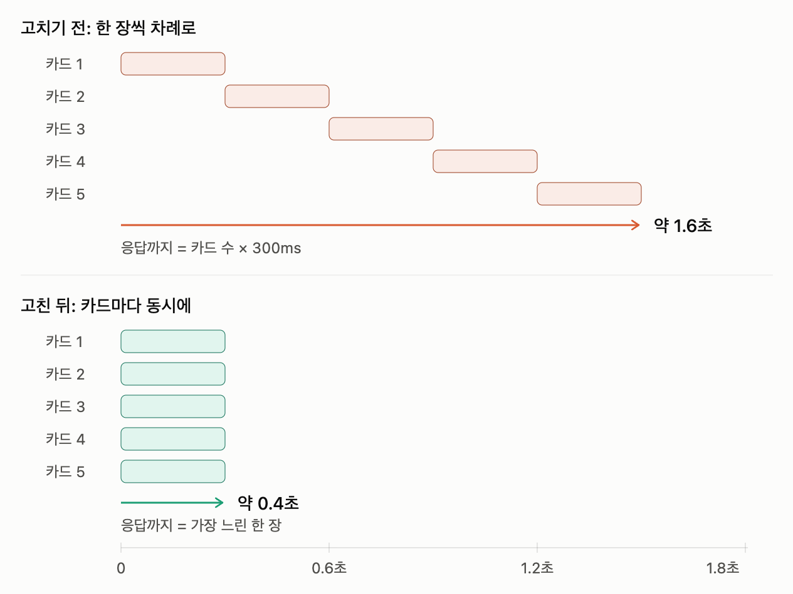
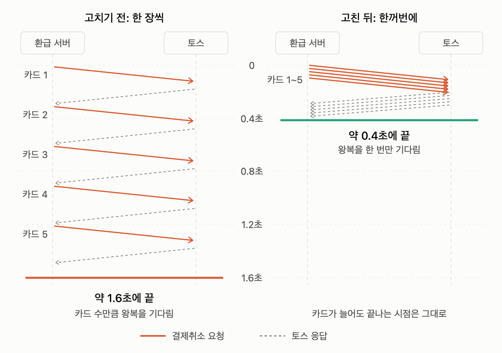
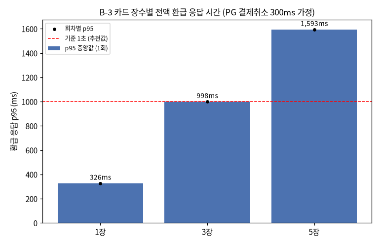
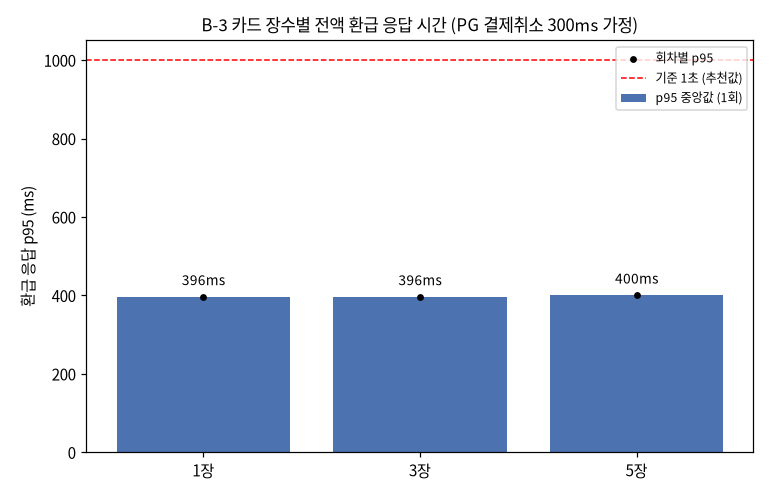

# 환급 카드 결제취소를 카드마다 동시에 불러 카드 5장 환급 p95 1,596ms → 421ms (2026-11-17)

- Linear: BUK-11
- 찾은 곳: 예치금 부하 측정 [연습](../measurements/2026-11-16-예치금-부하.md) 7장·9장 문제 3, [기준선](../measurements/2026-11-17-예치금-부하-기준선.md) P5
- 고친 코드: cash-service `CashWithdrawalUseCase` (커밋 `168e129f`)

## 1. 한 줄 요약

전액 환급이 카드로 충전한 몫마다 토스 결제취소를 한 장씩 차례로 불러서, 응답 시간이 카드 장수에 비례했어요.
카드 몫마다 가상 쓰레드로 동시에 부르고 모두 끝나면 결과를 반영하게 바꿨어요. 결과 반영과 재확인 흐름은 그대로예요.
같은 조건 A·B 3회 중앙값으로 카드 5장 환급 p95가 1,596ms에서 421ms로 줄었고, 장수와 상관없이 한 장 수준이 됐어요.

## 2. 증상

| | 기대 | 실제 (기준선 3회 중앙값) |
|---|---|---|
| 카드 5장 회원 전액 환급 p95 | 1초 아래 (판정 기준 P5, 추천값) | **1,797ms** |
| 카드 장수가 늘 때 응답 시간 | 크게 늘지 않음 | 1장 519ms · 3장 1,027ms · 5장 1,797ms |

맥에서 한 연습 측정(3회)도 같은 모양이었어요.

| 카드 장수 | 1장 | 3장 | 5장 |
|---|---|---|---|
| p95 중앙값 | 367ms | 994ms | 1,610ms |

- 실패는 0건이었어요. 90건 모두 환급이 끝났고 카드 결제취소 270건도 완료됐어요. 느릴 뿐 틀린 결과는 없었어요.
- 응답 시간이 「장수 × 300ms + 약 35ms」로 거의 정확히 맞았어요. 300ms는 가짜 PG에 넣은 결제취소 지연이에요.
- 회원이 화면에서 기다리는 요청이라, 3장부터 1초에 닿아요.

## 3. 가설

| 번호 | 가설 | 맞으면 보여야 할 것 | 판정 |
|---|---|---|---|
| H1 | 카드 몫마다 토스 결제취소를 한 장씩 차례로 불러, 응답 시간이 「장수 × 결제취소 시간」이 돼요 | 응답 시간 ≈ 장수 × 300ms + 고정. 동시에 부르면 장수와 상관없이 한 장 수준 | **맞음** (연습 367 · 994 · 1,610ms, 고친 뒤 396 · 421 · 421ms) |
| H2 | 지갑 잠금을 잡은 채 토스를 기다려, 동시에 환급하는 회원끼리 잠금에서 줄을 서요 | 잠금 대기 시간이 늘고, 동시 인원을 줄이면 빨라짐 | **틀림** (코드 확인. 환급은 이미 「잠금 → 잠금 밖 결제취소 → 잠금」 세 단계라 토스를 기다리는 동안 잠금이 없어요) |

## 4. 어떻게 확인했나

| 실행 | 바꾼 것 | 본 것 | 결과 | 판정한 가설 |
|---|---|---|---|---|
| 연습 측정 (11/16, 맥 bootRun, 3회) | 지금 코드, 가짜 PG 결제취소 300ms | 장수별 p95 | 367 · 994 · 1,610ms, 장수에 비례 | H1 맞음 |
| 코드 읽기 | | 결제취소를 부르는 곳과 잠금 범위 | `for` 문으로 한 장씩 부름. 지갑 잠금은 결제취소 앞뒤 트랜잭션에만 있음 | H1 맞음, H2 틀림 |
| 기준선 3회 (11/17, 컨테이너) | 지금 코드, 예치금 0.5 CPU | 장수별 p95 | 519 · 1,027 · 1,797ms | H1 맞음 |
| 동시 호출 테스트 `cancelsCardsConcurrently` | 고치기 전 코드 | 카드 5장의 결제취소가 동시에 몇 장 불리는지 | 1장 (차례로 부름) | H1 맞음 |

### 원인

1. 환급(`CashWithdrawalUseCase.requestWithdrawal`)은 세 단계예요. ① 잠금 트랜잭션에서 계획·차감·원장을 커밋 ② 트랜잭션 밖에서 카드 몫마다 토스 결제취소 ③ 잠금 트랜잭션에서 결과 반영.
2. ②에서 카드 몫을 `for` 문으로 한 장씩 불렀어요. 앞 장의 응답을 받아야 다음 장을 불러요.
3. → 카드가 N장이면 회원은 결제취소 N번을 차례로 기다려요. 결제취소 한 번이 300ms면 5장에 1.5초예요.

### 영향 범위

- 카드로 여러 번 충전한 회원의 전액 환급 요청이에요. 회원이 화면에서 기다려요.
- 환급 재확인 배치(`CashWithdrawalReconcileUseCase`)도 한 장씩 부르지만, 회원이 기다리지 않는 뒤쪽 배치라 이번에 바꾸지 않았어요.

## 5. 고친 내용

카드 몫마다 가상 쓰레드에서 결제취소를 부르고, 모두 끝날 때까지 기다린 뒤 ③ 결과 반영으로 넘어가요.





(그림의 1.6초·0.4초는 결제취소 지연 300ms로 그린 값이에요. 측정값은 카드 5장 p95 1,596ms → 421ms예요.)

```diff
- List<CardOutcome> outcomes = new ArrayList<>();
- for (CardCall call : requested.calls()) {
-     outcomes.add(callPg(call));
- }
+ List<CardOutcome> outcomes = callPgConcurrently(requested.calls());
```

```java
private final ExecutorService pgCancelExecutor = Executors.newVirtualThreadPerTaskExecutor();

private List<CardOutcome> callPgConcurrently(List<CardCall> calls) {
    List<CompletableFuture<CardOutcome>> futures = calls.stream()
        .map(call -> CompletableFuture.supplyAsync(() -> callPg(call), pgCancelExecutor))
        .toList();
    CompletableFuture.allOf(futures.toArray(CompletableFuture[]::new)).exceptionally(failure -> null).join();
    return futures.stream().map(CashWithdrawalUseCase::outcomeOf).toList();
}
```

**동작이 같다는 근거**
- 몫마다 받는 결과(성공·거절·모름)와 ③ 결과 반영, 재확인 흐름은 바꾸지 않았어요. 바뀐 건 ②에서 부르는 순서뿐이에요.
- 예상 못 한 예외는 **모든 호출이 끝난 뒤에** 던져요. 반영되지 않은 몫은 대기 상태로 남아 있어서, 재확인 배치가 같은 중복 방지 키로 이어받아요.
- 기존 환급 테스트를 고치지 않은 채 예치금 전체 테스트 421개가 통과했어요.

**다시 차례로 부르지 않게 막은 것**
- `CashWithdrawalByChargeTest.cancelsCardsConcurrently`가 카드 5장의 결제취소가 동시에 불리는지 봐요. 고치기 전 1장, 고친 뒤 5장이에요.

### 동시에 부르는 수단: 가상 쓰레드 (Java 21 이상이라 쓸 수 있었음)

결제취소 코드는 동기 클라이언트(`RestClient`)로 토스를 부르고 응답을 기다려요. 이 코드를 그대로 두고 카드 몫을 동시에 부르려면 몫마다 쓰레드가 필요해요.
예치금은 Java 25라 가상 쓰레드를 쓸 수 있었고, 이 조건에서는 다른 수단이 이길 장면이 없었어요.

- **가상 쓰레드:** 토스 응답을 기다리는 동안 운영체제 쓰레드를 붙잡지 않아서, 몇 개를 만들지 정할 필요가 없어요. 기존 토스 클라이언트와 「성공·거절·모름」 분류, 결과 반영을 그대로 써요. 만든 쓰레드의 클래스 로더를 이어받아서, 바로 전날 고친 [알림 Kafka 전송 실패](2026-11-17-알림-Kafka-전송-실패.md)(공용 ForkJoin 풀이 jar 안의 클래스를 못 찾음)와 같은 문제가 생기지 않아요.
- **전용 쓰레드 풀(크기를 정한 풀):** 풀 크기가 곧 토스 동시 호출의 상한이 되는 장점이 있지만, 토스 한도를 몰라 크기를 정할 근거가 없었어요.
- **비동기 HTTP 클라이언트(`HttpClient.sendAsync`, `WebClient`):** 쓰레드 없이 동시에 보낼 수 있지만, 테스트로 검증된 토스 클라이언트의 시간 제한과 오류 분류를 다시 써야 했어요. 카드 5장에 1.6초인 문제에 비해 위험이 컸어요.
- **공용 ForkJoin 풀(`supplyAsync`에 실행기를 넘기지 않음):** 전날 운영 jar에서 클래스를 못 찾는 문제를 겪어 처음부터 뺐어요.

**버전이 달랐다면**
- Java 21: 가상 쓰레드를 쓸 수 있어요. 다만 `synchronized` 안에서 응답을 기다리면 운영체제 쓰레드에 고정되는 문제(피닝)가 있어서, 토스를 부르는 HTTP 라이브러리에 그런 코드가 없는지 확인해야 했을 거예요. Java 24에서 고쳐져 지금은 신경 쓰지 않아도 돼요.
- Java 17 이하: 가상 쓰레드가 없어 전용 쓰레드 풀을 썼을 거예요. 크기는 「동시에 환급하는 회원 수 × 카드 장수」(부하 측정 조건이면 10명 × 5장 = 50)에서 시작해, 토스 거절이 보이면 줄였을 거예요.

### 고민한 결정

가상 쓰레드로 정한 뒤 실제로 두 쪽 다 일리가 있던 결정이 두 가지였어요.

**① 토스로 나가는 동시 호출 수를 지금 제한할까**

가상 쓰레드는 개수 제한이 없어서 카드 몫마다 바로 토스를 불러요. 회원 1명·카드 5장이면 동시에 5개지만, 회원 20명이 동시에 카드 5장씩 환급하면 동시에 100개예요. 토스가 연속 요청으로 거절할 수 있어요(`FORBIDDEN_CONSECUTIVE_REQUEST`).

| | 지금 제한 (세마포어로 예: 동시에 20개까지) | 나중에 제한 | 고름 |
|---|---|---|---|
| 좋은 점 | 토스 거절을 미리 막아요 | 토스 한도를 알게 된 뒤 근거 있는 숫자로 정해요 | |
| 나쁜 점 | 숫자에 근거가 없어요 | 몰리면 거절이 생길 수 있어요 | ✓ |

나중으로 정했어요. 거절이 나도 돈은 잃지 않아요. 그 몫은 「잠깐 생긴 문제」로 처리돼 예치금에 되돌아가고, 회원이 다시 신청할 수 있어요. 이 한계는 코드에 `shortcut:` 주석으로 남겼어요.

**② 카드 한 장의 호출이 예상 못 한 예외로 끝나면, 나머지는 어떻게 할까**

토스의 「거절」, 「모름」은 정상 결과라 원래대로 처리돼요. 여기서 말하는 건 그 밖의 예상 못 한 예외(코드 버그 등)예요. 카드 5장 중 3번에서 예외가 났고, 나머지 4장은 토스에서 이미 취소됐다고 할 때예요.

| | 바로 멈추고 오류를 돌려줌 | 모두 끝날 때까지 기다린 뒤 처리 | 고름 |
|---|---|---|---|
| 회원이 오류를 받는 시점 | 빨라요 | 가장 느린 카드까지 기다려요 (약 300ms) | |
| 토스에서 이미 취소된 4장 | 기록에 반영되지 않아, 실제 돈과 우리 기록이 어긋나요 | 정상으로 반영돼요 | |
| 예외 난 3번 | 대기 상태로 남아요 | 대기 상태로 남고, 재확인 배치가 같은 중복 방지 키로 이어받아요 | ✓ |

모두 기다리기로 했어요. 몇백 ms 빨리 오류를 보여 주는 것보다 돈과 기록이 어긋나지 않는 게 중요해서예요.
코드에서는 `allOf(...).exceptionally(failure -> null).join()`이 이 선택이에요. `exceptionally`가 없으면 `join()`이 첫 예외에서 바로 던져 「바로 멈춤」처럼 동작해요.

### 범위 밖으로 뺀 것

- **접수만 받고 결제취소는 나중에 처리하기:** 회원이 기다리는 시간은 줄지만, 결제취소를 모두 끝내는 시간은 그대로예요. 응답 모양과 프론트, 「처리 중」 상태까지 바꿔야 해서 이 문제의 범위를 넘는다고 봤어요.

## 6. 결과

| 카드 장수 (3회 중앙값) | 고치기 전 (A) p95 | 고친 뒤 (B) p95 | 변화 |
|---|---|---|---|
| 1장 | 340ms | 396ms | **56ms 늘어남** |
| 3장 | 998ms | **421ms** | 58% 줄어듦 |
| 5장 | 1,596ms | **421ms** | 74% 줄어듦 |
| 5장 ÷ 1장 | 4.7배 | **1.1배** | 판정 기준 G3(2배 안) 통과 |




- **기준선:** A예요. B에서 P4·P5·P6 커밋 세 개만 되돌린 코드라, A와 B의 차이는 고친 커밋뿐이에요.
- **조건:** GitHub Actions 머신, 예치금 컨테이너 0.5 CPU, 운영 프로필, 가짜 PG 결제취소 300ms. 장수마다 회원 30명이 동시 10명씩 전액 환급해요. 측정 전에 카드 1장 회원 10명으로 예열하고 그 숫자는 버려요.
- **횟수:** A·B를 번갈아 3번씩 재서 중앙값을 썼어요. 회차별 값은 A 1장 365 · 326 · 340ms, 5장 1,596 · 1,593 · 1,677ms이고, B 1장 390 · 396 · 404ms, 5장 522 · 400 · 421ms예요.
- **테스트:** 예치금 전체 421개와 `cancelsCardsConcurrently`가 통과했어요.
- **1장은 56ms 느려졌어요.** 가상 쓰레드로 넘기고 기다리는 비용이 있을 수 있지만 확인하지 않았어요. B 1회차는 다른 시나리오도 느렸던 회차라(3장 570ms, 5장 522ms) 머신 흔들림도 섞여 있어요.

## 7. 남은 문제

| 무엇 | 지금 상태 | 다음에 할 일 |
|---|---|---|
| 실제 토스 결제취소 시간 | 재지 않음. 300ms는 가정이에요 | 토스 테스트 환경에서 결제취소 시간을 재면 실제 개선 폭을 말할 수 있어요 |
| 토스 동시 호출 한도 | 모름 | 연속 요청 거절이 실제로 나오면 동시에 부르는 개수를 묶어요 (`shortcut:` 주석) |
| 1장일 때 56ms 늘어난 이유 | 확인 안 함 | 가상 쓰레드로 넘기는 비용인지, 머신 흔들림인지 다시 재 보기 |
| 환급 재확인 배치도 한 장씩 부름 | 바꾸지 않음 | 회원이 기다리지 않는 배치라 지금은 두기 |

## 8. 배운 점

- **응답 시간이 어떤 개수에 정확히 비례하면 차례로 부르는 곳부터 봐요.** 「장수 × 300ms + 35ms」처럼 식이 딱 맞으면 원인이 거의 정해져요. 가짜 PG에 지연을 일부러 넣어서 이 비례가 드러났어요.
- **기다리는 일이 대부분인 호출을 동시에 부를 때, Java 21 이상이고 동기 코드를 그대로 두고 싶다면 가상 쓰레드가 맞아요.** 쓰레드 풀처럼 크기를 정할 필요가 없어요. 대신 동시 호출에 상한이 없어지니, 바깥 서비스의 한도를 따로 봐야 해요.
- **동시에 부르면 실패 처리도 같이 봐요.** 차례로 부를 때는 한 장에서 예외가 나면 뒤 장을 부르지 않았지만, 동시에 부르면 모두 불린 뒤에 예외를 다뤄야 해요. 반영되지 않은 몫을 재확인이 이어받는 구조라 안전하게 바꿀 수 있었어요.
- **모르는 한도는 숫자를 지어내지 않고 한계로 남겨요.** 토스 동시 호출 한도를 추측해 묶는 대신 `shortcut:` 주석과 거절 처리로 남겼어요.
