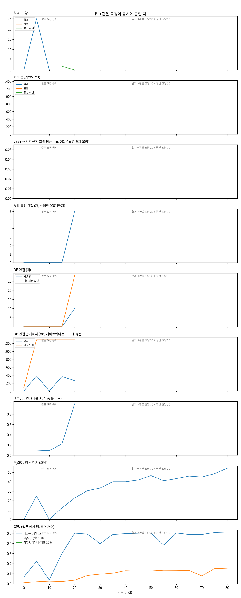
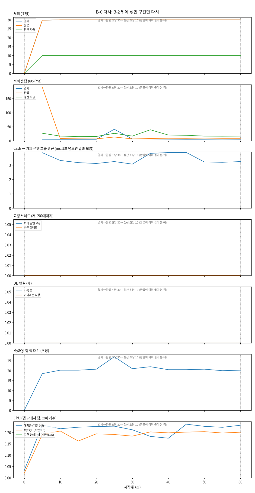
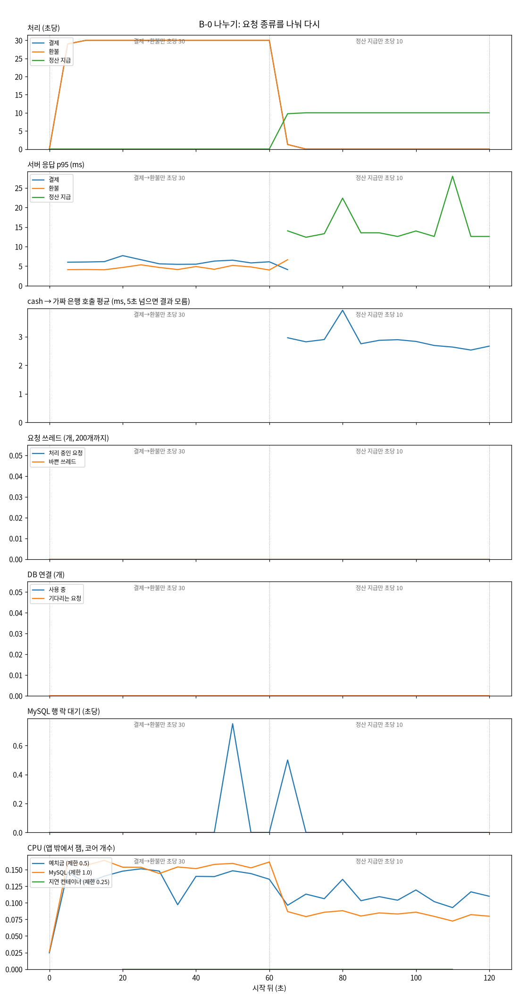

# 섞인 부하에서만 결제 p95가 4~10초 되던 원인을 두 번의 측정으로 「막 띄운 앱의 첫 실행 비용」으로 좁힘, 다시 돌리면 8ms (2026-11-19)

- Linear: BUK-11
- 찾은 곳: 예치금 부하 측정 [기준선](../measurements/2026-11-17-예치금-부하-기준선.md) P8, [전후](../measurements/2026-11-17-예치금-부하-전후.md) 6장, [2차 판정 기준](../measurements/2026-11-18-예치금-부하-2차-판정기준.md), [2차 결과](../measurements/2026-11-19-예치금-부하-2차.md) 4·5·6장
- 고친 코드: 결제 코드는 그대로. 조사 중 찾은 지표 문제만 고침 — cash-service `CashStuckMoneyMetrics` (커밋 `ce12b3523`). 측정 도구 `docs/loadtest/scenario-b/`

## 1. 한 줄 요약

B-0의 섞인 1분(결제→환불, 정산 지급)에서만 결제 p95가 4~10초였고, 다른 시나리오는 수십 ms였어요. 1차에서는 원인을 가리지 못했고, 처음 세운 후보 중 「예열」을 잘못 배제하기도 했어요.
측정 도구가 빈칸을 만들고 있던 곳(지표 끊김, 행 단위 잠금, CPU)을 채운 2차에서 같은 구간을 다시 돌리니 p95가 10초에서 8ms가 됐어요. → 원인은 막 띄운 앱이 그 경로를 처음 돌 때의 비용이었어요.
결제 코드는 고치지 않았어요. 대신 같은 비용이 배포 직후 홀딩 지갑 락을 2초 넘게 쥐게 만든다는 것을 JFR로 찾아 다음 할 일로 넘겼고, 조사 중 찾은 지표 구멍은 고쳤어요.

## 2. 증상

| | 기대 (판정 기준 P8) | 실제 |
|---|---|---|
| B-0 섞인 1분의 결제 p95 | 2초 아래 | 기준선 **4,579ms**, A 3,988ms, B 4,591ms, 2차 **9,998ms** (각 3회 중앙값) |
| 같은 결제를 B-1·B-2에서 | | p95 29~167ms |

- B-0은 처음 20초에 같은 요청을 동시에 보내고(같은 주문 결제 100번, 같은 정산 지급 50번, 같은 충전 승인 50번), 그 뒤 1분은 결제→환불(초당 30건)과 정산 지급(초당 10건)을 섞어요.
- B-0의 섞인 1분은 **B-1(초당 250건 이상)보다 요청이 적은데** 더 느렸어요.
- 같은 1분 동안 정산 지급 84~129건이 실패했어요. 실패 수가 로그의 「송금 결과를 알 수 없습니다」 수와 정확히 같았어요. 돈은 모든 회차에서 맞았어요.
- 1차에서는 이 구간의 **앱 지표가 비어서** 무엇이 막혔는지 볼 수 없었어요.

## 3. 가설

| 번호 | 가설 | 맞으면 보여야 할 것 | 1차 판단 | 최종 판정 (2차) |
|---|---|---|---|---|
| H1 | 막 띄운 앱이 그 경로를 처음 돌 때의 비용(클래스 읽기, JIT 컴파일)이에요 | 같은 구간을 데워진 뒤 다시 돌리면 빨라짐 | **아님**으로 봄 (처음 20초 CPU가 상한의 5~20%라 한가함) | **맞음** (B-0 다시 p95 8ms, 처음의 0.1%) |
| H2 | 결제·환불·정산이 함께 홀딩 지갑을 잠가서 줄을 서요 | 섞인 구간에서 오래 기다린 락. 다시 돌려도 느림 | 일부 | **틀림** (B-0 가장 오래 기다린 락 0.8~1.0초, 다시 돌리면 같은 잠금을 쓰는데도 8ms) |
| H3 | 요청이 늦어져도 도착 속도는 그대로라 계속 쌓이는 시나리오 모양이에요 | 같은 모양이면 언제 돌려도 느림 | **유력** | **틀림** (같은 모양을 B-2 뒤에 돌리면 8ms. 모양은 처음 느려진 것을 키웠을 뿐) |
| H4 | 앱 안의 가짜 은행을 예치금이 자기 자신에게 HTTP로 불러 요청 쓰레드를 두 배로 써요 | 정산 지급만 따로 돌려도 느림 | 확인 못 함 | **틀림** (정산 지급만 따로 p95 12ms) |
| H5 | GC 멈춤이에요 | GC 로그에 긴 멈춤 | 확인 못 함 (GC 로그 없음) | **틀림** (예열 구간 GC 멈춤 12~13ms) |
| H6 | 앱 지표가 비는 건 앱이 너무 바빠 Prometheus에 1초 안에 답하지 못해서예요 | 지표 포트를 따로 열면 지표가 이어짐 | 그렇게 봄 | **틀림** (포트를 나눠도 비었음. 지표 수집이 DB 연결을 기다리고 있었음) |

**1차에서 H1을 잘못 배제한 이유.** 「처음 20초 CPU가 한가하니 막 띄운 직후 문제는 아니다」라고 봤어요. 그런데 처음 20초는 같은 요청 동시 보내기라, 환불과 정산 지급 경로는 **섞인 구간(20초부터)에서 처음** 돌아요. 2차 판정 기준을 쓰면서 이 점을 다시 보고 H1을 후보로 되살렸어요.

## 4. 어떻게 확인했나

| 실행 | 바꾼 것 | 본 것 | 결과 | 판정한 가설 |
|---|---|---|---|---|
| 기준선 3회 (11/17) | | 결제 p95 | 4.3~5.2초. B-0에는 시간대별 그래프가 없어 후보를 가리지 못함 | (없음) |
| A·B 3회 (11/17) | B-0 그래프를 그리게 도구를 고침 | 예치금 CPU, DB 연결 대기, 행 락 대기 | 처음 20초 CPU 5~20%, 섞인 구간에서 74~100%. 그 뒤 앱 지표가 비고 MySQL 행 락 대기만 남음 | H1 아님(잘못), H3 유력 |
| 2차 판정 기준 (11/18, 측정 전 커밋) | 원인 고르는 규칙 R1을 먼저 정함 | | 「B-0 다시의 p95가 처음의 10분의 1 이하면 예열, 아니면 B-0 나누기와 JFR이 가리킨 곳」 | |
| 2차 도구 확인 QUICK (11/19) | cAdvisor, JFR, GC 로그, 시나리오별 잠금 기록. 지표가 끊겨 관리 포트(8091)를 따로 엶 | 앱 지표가 끝까지 이어지는지 | 포트를 나누기 전 B-6~B-8에서 시작 10초 만에 끊김 → 나눈 뒤 QUICK에서는 이어짐 | H6 맞아 보임 |
| 2차 본 측정의 지표 | 관리 포트 분리 그대로 | 같음 | 포트를 나눴는데도 B-6 첫 단계, B-7 초당 50건부터, B-8 전 구간에서 비었음 | H6 다시 의심 |
| **2차 3회 (11/19)** | 순서를 B-0 → B-2 → **B-0 다시** → **B-0 나누기**로 | 구간별 결제 p95, 시나리오별 가장 오래 기다린 락, JFR, GC | 처음 9,998ms → 다시 **8ms**, 환불만 5ms, 정산 지급만 12ms. B-0 가장 오래 기다린 락 0.8~1.0초 | **H1 맞음**, H2·H3·H4 틀림 |
| 2차 JFR (1회차 첫 예열) | | 2초 넘게 기다린 락을 쥔 쓰레드가 한 일 | 결제가 홀딩 지갑을 잠근 뒤 클래스를 처음 읽고(내부 예외 69번), JIT 컴파일을 1~1.6초씩 두 번. CPU는 상한(0.5개) 근처. GC 멈춤 12~13ms | H1 맞음, H5 틀림 |
| 2차 JFR (1회차 B-7) | | 지표 포트 쓰레드가 기다린 것 | DB 연결을 4,380번 기다림(4,122번이 1초 넘음). 멈춘 돈 지표가 수집마다 COUNT 쿼리 5개를 날림 | H6 틀림 |

### 원인

1. 예치금은 띄운 뒤 어떤 코드를 **처음** 돌 때 클래스를 읽고 JIT 컴파일을 해요. 예치금 컨테이너는 CPU 0.5개라 이 일이 느려요.
2. B-0은 띄우고 30초 예열(결제 동시 2개) 바로 뒤에 도는 첫 무거운 시나리오이고, 환불·정산 지급 경로는 섞인 구간에서 처음 돌아요.
3. 그래서 섞인 구간 시작에 응답이 늦어지고, 도착 속도는 그대로라 요청이 쌓여요. 쌓인 요청이 CPU를 상한까지 쓰면서 첫 실행 비용이 더 길어져요.
4. 결제는 홀딩 지갑을 먼저 잠그고 커밋까지 쥐어요. → 첫 실행 비용이 그대로 **락을 쥔 시간**이 돼요. → 뒤 결제가 기다려요. 처음 띄운 직후 예열(사용자 2명)에서도 락을 최대 2.6초 기다렸어요.

특정 코드가 잘못된 게 아니라, 「첫 실행 비용」과 「홀딩 지갑을 일찍 잠그는 순서」가 겹친 거예요.

### 영향 범위

- 측정에서는 측정 순서 탓이에요. 같은 구간을 데운 뒤 돌리면 문제없어요.
- **운영에서는 배포 직후가 같아요.** 주문은 예치금을 2초까지만 기다려서, 배포 직후 결제가 몰리면 주문이 포기하는 결제가 생길 수 있어요. 운영은 CPU 상한이 없어(요청 50m) 측정보다 덜할 수 있어요. 아직 보지 않았어요.
- 지표 구멍(H6)은 운영에도 있었어요. DB 연결이 다 찬 바로 그때 모니터링이 비고, 바쁠 때 지표 수집이 DB 연결을 더 가져가요.

## 5. 고친 내용

**결제 코드는 고치지 않았어요.** 2차 판정 기준에서 측정 전에 정한 대로 「예열이면 측정 순서 탓이라 기록만 한다」를 따랐어요.

**원인을 가리려고 고친 측정 도구**

| 1차에서 막힌 빈칸 | 고친 것 |
|---|---|
| B-0에 시간대별 그래프가 없음 | B-0 그래프 (CPU, 처리 중인 요청, DB 연결, 행 락) |
| 앱이 바쁘면 CPU도 함께 빔 | 앱 밖에서 재는 컨테이너 CPU(cAdvisor) |
| 회차 끝에 한 번 읽은 락이라 어느 시나리오인지 모름 | 시나리오 전에 비우고 끝나면 읽는 SQL별 잠금 대기(`sql/15`), 5초마다 잠금 스냅샷(`sql/14`) |
| 지표가 빈 구간에 누가 CPU를 썼는지 모름 | JFR, GC 로그 |
| 예열인지 섞인 부하 탓인지 가를 수 없음 | 순서를 바꿔 같은 구간 다시 돌리기(B-0 다시), 요청 종류 나눠 돌리기(B-0 나누기) |

**조사 중 찾아 고친 지표 문제 (`ce12b3523`)**
멈춘 돈 건수 지표(`CashStuckMoneyMetrics`)가 Prometheus가 가져갈 때마다 DB에 COUNT 쿼리 5개를 날렸어요. 30초마다 따로 세어 두고, 지표는 센 값만 읽게 바꿨어요. 세다 실패한 종류는 옛 값을 보이지 않게 값 없음으로 둬요.

| 방법 | 장점 | 단점 | 고름 |
|---|---|---|---|
| 지표용 DB 연결을 따로 두기 | 지표가 결제와 연결을 다투지 않아요 | 설정이 복잡해지고 연결 수가 늘어요 | |
| 측정에서만 수집 제한 시간을 늘리거나 이 지표를 끄기 | 바로 돼요 | 운영 문제는 그대로이고, 측정 환경이 운영과 달라져요 | |
| 30초마다 따로 세어 두고 지표는 읽기만 하기 | 지표 수집이 DB에 막히지 않고 DB 부하도 일정해요 | 값이 최대 30초 늦어요. 사람이 확인할 건수라 괜찮아요 | ✓ |

`CashStuckMoneyMetricsTest.readingGaugeDoesNotQueryDb`가 지표를 읽어도 DB를 조회하지 않는지 봐요.

### 검토한 방법 (배포 직후 첫 실행 비용)

[2차 고칠 것](../measurements/2026-11-20-예치금-부하-2차-고칠것.md) ④에서 고른 순서예요.

| 방법 | 장점 | 단점 | 고름 |
|---|---|---|---|
| 운영 지표로 배포 직후 결제가 느려지는지 먼저 확인 | 운영은 CPU 상한이 없어 측정보다 덜할 수 있어요. 고칠지 근거가 생겨요 | 고치는 건 아니에요 | ✓ (먼저) |
| 홀딩 지갑을 커밋 직전에 잠그기 | 첫 실행 비용이 잠금 전에 지나가요. 평소 잠금 시간도 짧아져 처리량 천장에도 도움돼요 | 결제·환불·정산의 잠금 순서를 모두 바꿔요. 교착 검토와 돈 테스트가 많이 필요해요 | 운영에서 보이면 |
| 요청을 받기 전에 결제 경로를 미리 돌리고 「준비됨」 | 잠금 순서를 안 바꿔요 | 운영에서 쓸 예열용 요청과 데이터를 설계해야 해요 | |
| 락 대기 시간 제한 + 503 | 주문이 2초에 포기하기 전에 깔끔한 실패를 받아요 | 원인은 그대로이고 실패가 늘 수 있어요 | |

### 고른 이유

결제 코드를 바로 고치지 않은 건, 측정에서 본 크기의 일부가 측정 환경(CPU 0.5개 상한, 띄우자마자 무거운 시나리오)에서 왔기 때문이에요. 운영에서도 생기는지 보고 정해요.
잠금 순서를 바꾸는 방법은 효과가 가장 크지만 돈이 움직이는 모든 경로를 건드려요. 주문 담당께 여쭌 「보관 지갑을 마지막에 잠그기」와 같은 이야기라 그 답과 함께 정해요.
지표 문제는 운영에서도 DB가 꽉 찬 바로 그때 모니터링을 비게 만들어서, 원인이 확인된 자리에서 바로 고쳤어요.

## 6. 결과

| 지표 (2차, 3회 중앙값) | 값 | 뜻 |
|---|---|---|
| B-0 섞인 구간 처음 결제 p95 | 9,998ms (10,084 · 9,998 · 9,451) | P8 걸림 |
| 같은 구간을 B-2 뒤에 다시 | **8ms** (6 · 8 · 8) | 처음의 0.1% → R1 「예열」 |
| 결제→환불만 / 정산 지급만 | 5ms / 12ms | 요청 종류 하나만으로는 느리지 않음 |
| B-0 가장 오래 기다린 행 락 | 794~997ms | 10초를 설명하지 못함 |
| 처음 띄운 직후 예열의 가장 오래 기다린 락 | 1,909~2,600ms (사용자 2명) | 붐벼서가 아니라 막 띄워서 |
| 다시 띄운 직후 예열 (회차마다 세 번 더) | 493~2,000ms | 띄울 때마다 되풀이 |
| 예열 구간 GC 멈춤 | 12~13ms | GC는 원인 아님 |

- **기준선:** 같은 회차 안의 「처음 B-0」이에요. 같은 코드, 같은 앱 프로세스에서 순서만 바꿔 비교했어요.
- **조건:** GitHub Actions 머신 한 대, 예치금 0.5 CPU·768MB, MySQL 1 CPU, 운영 프로필, 가짜 PG·회원·은행. 코드 `38105c12`.
- **횟수:** 3회, 중앙값. JFR로 본 락을 쥔 쪽과 지표 구멍의 원인은 각각 1회차 파일 하나로 확인했어요.
- 2차의 처음 B-0(약 10초)이 1차(약 4초)보다 커요. 2차에 JFR·cAdvisor·잠금 스냅샷을 더했지만, 이 차이의 이유는 확인하지 않았어요.

## 7. 남은 문제

| 무엇 | 지금 상태 | 다음에 할 일 |
|---|---|---|
| 운영에서 배포 직후 결제가 느려지는지 | 보지 않음 | 운영 Prometheus에서 배포 직후 몇 분의 결제 응답 시간과 락 대기 보기 (고칠 것 ④-가) |
| 보이면 홀딩 지갑을 커밋 직전에 잠그기 | 정하지 않음 | 주문 담당 답과 함께 정하고, 교착 검토와 돈 테스트 뒤 A·B로 재기 |
| 지표 고친 뒤 구멍이 사라졌는지 | 테스트만 함, 부하로 다시 재지 않음 | B-7을 다시 재서 앱 지표가 끝까지 이어지는지 보기 |
| 1차의 지표 빔도 같은 원인이었는지 | 확인 안 함 | 위 재측정으로 같이 봐요 |
| 2차 처음 B-0이 1차보다 두 배 넘게 느린 이유 | 확인 안 함 | 도구가 더한 CPU(JFR 1~2% 등)인지 가르려면 도구를 끄고 한 번 재기 |
| 측정 순서 | B-0이 띄우자마자 첫 무거운 시나리오 | 앞으로 판정용 측정은 예열을 늘리거나 B-0을 데워진 뒤로 옮기기 |

## 8. 배운 점

- **배제한 가설도 근거를 다시 봐요.** 「처음 20초가 한가하니 예열이 아니다」는 처음 20초와 섞인 구간이 **다른 코드 경로**라는 걸 놓친 판단이었어요. 2차 기준을 쓰며 되살린 H1이 정답이었어요.
- **원인을 고르는 규칙을 측정 전에 정해요.** 「다시 돌린 p95가 처음의 10분의 1 이하면 예열」을 먼저 커밋해 두어서, 숫자가 나왔을 때 해석을 두고 흔들리지 않았어요.
- **같은 조건에서 하나만 바꿔 비교하는 것이 가장 강한 실험이에요.** 같은 앱 프로세스에서 순서만 바꾼 「B-0 다시」 하나가 후보 넷을 한 번에 갈랐어요.
- **측정 도구가 빈칸을 만들면 그 빈칸부터 의심해요.** 지표가 비는 걸 「앱이 바빠서」로 넘겼는데, 실제로는 지표 수집이 DB 연결을 기다리는 운영 문제였어요.
- **첫 실행 비용은 그 자체보다 락과 겹칠 때 커요.** 홀딩 지갑을 먼저 잠그는 순서 때문에 클래스 읽기·컴파일 시간이 그대로 다른 결제의 대기 시간이 됐어요.
