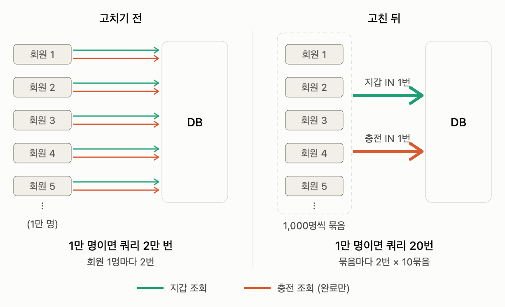
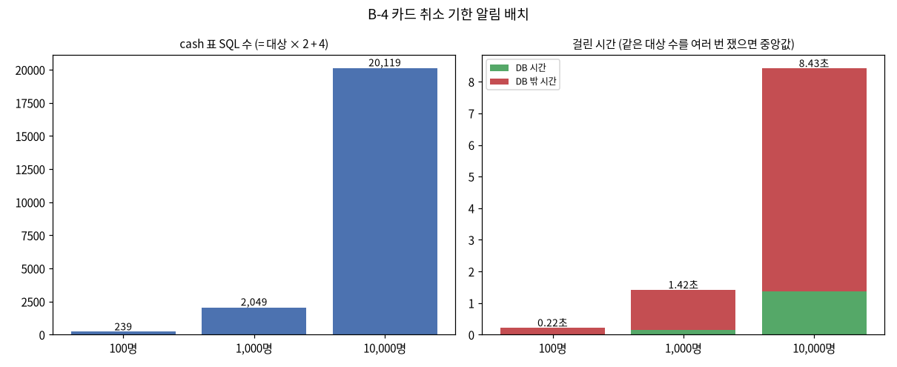
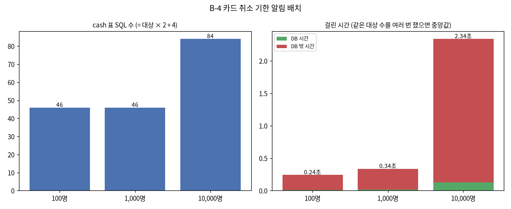

# 기한 알림 배치의 N+1 조회를 묶어 1만 명 SQL 20,119개 → 83개, 8.43초 → 2.34초

- Linear: BUK-11
- 고친 코드: cash-service `CashCardCancelDeadlineNoticeUseCase`, `CashRefundableChargeQueryUseCase`, `WalletChargeRepository` (커밋 `c0b1097c`)
- 비교 측정: `CashCardCancelDeadlineNoticeReadMeasureTest` (`CASH_MEASURE=true ./gradlew :cash-service:test --tests "*CashCardCancelDeadlineNoticeReadMeasureTest"`, 결과는 `cash-service/build/measure/`)
- 자세한 기록(가설, 측정 순서, 1차 비교, 재기 전에 정한 판정 기준): [2026-11-17-기한-알림-배치-SQL-줄이기.md](2026-11-17-기한-알림-배치-SQL-줄이기.md)

## 한 줄 요약

카드 결제취소 기한 알림 배치가 대상 회원마다 지갑과 충전을 따로 조회해서, SQL이 대상 수의 2배씩 늘었다(1만 명에 2만 개).
IN 두 번과 fetch join을 묶음 크기 1,000·2,000·3,000으로 나눈 여섯 후보를 같은 기준으로 비교해, 기존 조회와 계산 함수를 그대로 쓰는 IN 두 번·묶음 1,000을 골랐다. **누구에게 얼마를 알리는지는 그대로**다.
같은 조건 A·B 3회 중앙값으로 1만 명 SQL이 20,119개에서 83개로, 걸린 시간이 8.43초에서 2.34초로 줄었다.

## 문제

부하 측정에서 결제취소 기한 알림 배치를 대상 100명 → 1만 명으로 늘리자, SQL이 204개 → 20,004개(98배), 1만 명 걸린 시간이 7.67초가 됐다(기준선 3회 중앙값).

| 대상 | 100명 | 1,000명 | 10,000명 |
| --- | --- | --- | --- |
| SQL 수 | 204 | 2,004 | 20,004 |
| 걸린 시간 | 0.18초 | 1.55초 | 7.67초 |

## 원인

원인은 대상 회원마다 지갑 1번, 충전 1번을 따로 조회하는 N+1 구조였다. SQL이 정확히 「대상 × 2 + 4」로 늘었다. 다만 1만 명 7.67초 중 DB 시간은 17%(1.29초)뿐이라, 시간은 DB가 아니라 SQL마다 드는 앱 쪽 비용이 쌓인 것으로 봤다.

### 가설과 확인

| 번호 | 가설 | 맞으면 보여야 할 것 | 판정 |
|---|---|---|---|
| H1 | 대상 회원마다 지갑 1번, 충전 1번을 따로 조회해서 SQL이 대상 수에 비례한다 | SQL 수 = 대상 × 2 + 고정 몇 개 | **맞음** (204 · 2,004 · 20,004, 코드에서 회원마다 부르는 조회 확인) |
| H2 | 걸린 시간이 늘어나는 것도 DB가 SQL을 처리하는 시간 때문이다 | 걸린 시간 대부분이 DB 시간 | **틀림** (DB 시간은 17%, 나머지 6.4초는 DB 밖) |
| H3 | DB 밖 시간의 상당 부분은 알림 1만 건이 바로 실패하며 경고 로그를 찍은 시간이다 (기준선은 BUK-13 전이라 알림이 모두 실패했다) | 알림이 실제로 나가는 코드에서는 DB 밖 시간이 크게 준다 | **틀림 (정황)** BUK-13이 들어간 A에서도 DB 밖이 7.05초로 줄지 않았다 |

| 실행 | 바꾼 것 | 본 것 | 결과 | 판정한 가설 |
|---|---|---|---|---|
| 연습 측정 (11/16, 맥 bootRun) | 지금 코드 | SQL 수, 걸린 시간, DB 시간 | 1만 명 SQL 20,004개, 7.75초, DB 0.7초 | H1 맞음, H2 틀림 |
| 기준선 3회 (11/17, 컨테이너) | 지금 코드, 예치금 0.5 CPU | 같음 | 1만 명 SQL 20,004개, 7.67초, DB 1.29초 | H1 맞음, H2 틀림 |
| A 3회 (11/17, BUK-13 포함) | 기준선 코드 + 알림이 실제로 나가는 코드 | 같음 | 1만 명 SQL 20,119개, 8.43초, DB 1.38초 | H3 틀림 |
| SQL 수 테스트 | 고치기 전 코드 | Hibernate 통계로 SQL 수 | 회원 30명에 62개 (30 × 2 + 2) | H1 맞음 |

H2가 틀리면서 「SQL을 줄여도 걸린 시간은 그대로일 수 있다」는 걱정이 생겼다. 그래서 부하 측정 전후 판정 기준(G4)은 「SQL 수는 100명의 2배 안, **걸린 시간은 늘지 않으면 됨**」으로 고치기 전에 정했다. 시간이 줄어드는 것까지 약속하지 않았다.

### 동작

1. 기한 알림(`CashCardCancelDeadlineNoticeUseCase`, 정책 5장 2차 1)은 카드 결제취소 마지막 날이 3일 뒤·1일 뒤인 충전을 가진 회원을 먼저 찾는다. 알림에는 「그날까지 환급하면 카드로 돌려받는 금액」이 들어간다.
2. 그 뒤 회원마다 남은 금액 계산(`CashRefundableChargeQueryUseCase`)을 불렀다. 이 계산이 회원 한 명의 지갑과 충전을 각각 조회한다.
3. → 대상이 N명이면 SQL이 2N개 나간다.
4. 1만 명을 읽기 전용 트랜잭션 하나에서 처리해서, 읽은 지갑·충전 엔티티가 트랜잭션이 끝날 때까지 메모리에 쌓였다.

### 영향 범위

- 매일 09:00 도는 배치 하나다. 회원이 기다리는 요청이 아니라서 화면이 느려지지는 않는다.
- 대상 수가 늘수록 배치 시간, DB 왕복 수, 메모리가 같이 는다. 지금 실제 대상이 하루 몇 명인지는 보지 않았다.

## 선택지와 비교 방법

해결 방법으로 두 가지를 비교했다.

- **IN 두 번:** N명씩 묶어 지갑 IN 한 번, 충전 IN 한 번으로 읽고, 묶음마다 영속성 컨텍스트를 비운다.
- **fetch join:** N명씩 묶어 충전을 읽으면서 지갑을 함께 읽는다.

두 방법 모두 회원 ID를 묶음 크기만큼 끊어 IN에 넣으므로, 묶음 크기도 함께 비교했다.

| | 묶음 1,000 | 묶음 2,000 | 묶음 3,000 |
| --- | --- | --- | --- |
| IN 두 번 (지갑 IN + 충전 IN) | 후보1 | 후보2 | 후보3 |
| fetch join | 후보4 | 후보5 | 후보6 |

고르는 기준은 재기 전에 아래 순서로 정했다. 이 배치는 사용자가 기다리는 API가 아니라 하루 한 번(09:00) 도는 배치라, 성능 차이는 배치 전체 시간 기준으로 본다.

1. **동작이 같다.** 모든 대상 회원에게 같은 금액을 알린다.
2. **메모리와 실행 계획이 안전하다.** 묶음 하나가 들고 있는 힙이 늘지 않고, 표가 커져도 인덱스를 쓴다.
3. **의미 있는 성능 차이가 있다.** 배치 전체(1만 명 2.34초)의 5%, 약 120ms를 넘는 차이만 차이로 본다.
4. **차이가 없으면 앞으로도 안전한 쪽을 고른다.** 충전 기록이 쌓여도 불리해지지 않고, 받는 데이터가 적고, 잘못된 데이터가 드러나고, 기존 코드를 그대로 쓰는 쪽이다.

두 방법 모두 회원 ID 목록을 묶음 크기만큼 끊어 IN에 넣는다. IN 두 번은 묶음마다 쿼리 2번(지갑 IN, 충전 IN), fetch join은 1번(충전과 지갑을 함께)이다.

### 측정 방법

**범위.** 배치 전체가 아니라 묶음마다 지갑·충전을 읽고 남은 금액을 계산하는 부분만 잰다. 방법과 묶음 크기가 바꾸는 건 읽기뿐이라, 읽기의 차이가 배치 전체 차이의 최대치다. 맥의 MySQL 8.4 컨테이너(Testcontainers)에서 측정 테스트(`CashCardCancelDeadlineNoticeReadMeasureTest`)만 돌리고, 부하 테스트는 다시 돌리지 않는다.

**측정 조건.**

| 전체 회원 수 (표 크기) | 하루 알림 대상 수 | 회원당 완료 충전 기록 |
| --- | --- | --- |
| 1만 | 1,000 · 3,000 | 1 · 10 · 30건 |
| 10만 | 1,000 · 3,000 · 1만 | 1 · 10 · 30건 |

- 측정 조건은 15가지다(1만 명 표 2 × 3 = 6, 10만 명 표 3 × 3 = 9). 조건마다 여섯 후보를 모두 잰다.
- **1만 명 표에서 대상 1만 명은 재지 않는다.** 모든 회원이 같은 날 대상이 되는 경우라 IN 목록이 표 전체가 되고, 어느 후보든 표를 다 읽어 비교할 것이 없다. 실제로도 생기기 어렵다.
- **대상 1,000명은 대조군이다.** 묶음이 하나뿐이라 같은 방법이면 묶음 크기 세 개가 똑같이 동작해야 한다. 여기서 차이가 나면 측정이 흔들린 것이다. 이 조건에서는 읽는 방법만 비교된다.
- **대상 회원은 표 전체에 흩어지게 고른다.** 고정된 시드로 무작위로 뽑는다. 실제 대상은 ID가 이어져 있지 않고, 이어진 ID는 실행 계획을 실제보다 좋게 만들 수 있다.
- **충전 기록 모양.** 대상 회원마다 충전 1건은 결제취소 마지막 날이 정확히 3일 뒤가 되게 넣고, 나머지는 며칠씩 떨어뜨려 넣는다. 대상이 아닌 회원도 같은 수의 충전을 가진다. 충전 표 크기가 실행 계획에 영향을 주기 때문이다.
  - 회원당 충전 수는 동시에 한 충전 수가 아니라, 회원이 가진 완료 충전 기록의 수다. 배치는 남은 금액을 계산하려고 회원의 완료 충전을 날짜와 상관없이 모두 읽는다. 알림은 회원당 한 통이다.
- **데이터는 6번만 넣는다.** 표 크기 2 × 충전 수 3 조합마다 한 번 넣고, 하루 대상 수는 그 표에서 회원을 골라 바꾼다.

**재는 방법.**
- **재기 전에 확인한다.** 여섯 후보가 모든 대상 회원에게 같은 금액을 내는지 먼저 본다. 다르면 측정하지 않고 멈춘다.
- **시간.** 예열 3회 뒤 7회 잰다. 회차마다 여섯 후보의 순서를 돌려 가며 번갈아 재고, 중앙값과 최소~최대를 적는다. 함께 적는 것은 SQL 수, 걸린 시간, MySQL이 보낸 데이터, 만든 객체 총량이다.
- **힙 (시간과 따로).** GC를 부르면 시간이 흔들리므로 따로 돈다. 묶음을 비우기 직전마다 GC를 부르고 힙 사용량과 영속성 컨텍스트의 엔티티 수를 적어, 묶음 하나가 늘리는 힙의 최대를 구한다. 후보마다 3회 재서 중앙값과 최소~최대를 적는다.
- **실행 계획.** 조건마다 `EXPLAIN`으로 인덱스를 쓰는지(`type`이 `ALL`이 아닌지) 보고, `EXPLAIN ANALYZE`로 각 단계가 실제로 읽은 행 수와 시간을 남긴다. MySQL은 IN 목록의 ID가 표 전체의 몇 %인지 보고 인덱스로 찾을지 다 읽을지 정한다. 표 전체를 읽으면 배치 시간이 알림 대상 수가 아니라 표 크기에 따라 늘어나서, 회원이 많아질수록 대상이 적은 날에도 배치가 느려진다.

**참고하는 운영 값 (기준 2번의 메모리 판단).**

| 항목 | 값 |
| --- | --- |
| 예치금 컨테이너 메모리 상한 | 512MiB. 넘으면 예치금 서버만 다시 시작된다 |
| 예치금 힙 최대 | 상한의 60% ≈ 307MiB. JVM이 자동으로 지키는 한도다 |
| 배치 실행 시각 | 매일 09:00 |
| 09:00 전후 평소 힙 사용량 | 모름. 지금 운영은 회원과 요청이 적어서 재도 의미가 작다. 그래서 힙은 후보끼리 비교한다 |

- 「서버 하나」는 EC2 한 대가 아니라 컨테이너(Pod) 하나다. 운영 메인 EC2(7.6GB) 위에 Spring 서버 12개가 각자 컨테이너로 떠 있고, 예치금은 컨테이너 1개(`replicas: 1`)라 예치금 서버 전체가 512MiB 안에서 돈다.
- 512MiB는 프로그램 전체의 한도이고, 그중 힙(실행 중에 만드는 객체: 엔티티, DTO, 리스트 등)은 최대 약 307MiB다. 나머지 약 205MiB는 클래스 정보, 쓰레드 스택, JIT 코드 캐시 같은 힙 밖 메모리 몫이다.
- 「묶음 하나가 늘리는 힙」은 어느 한순간에 살아 있는 객체의 양이다. 배치는 묶음 하나를 읽는 동안 그 묶음의 지갑과 충전 엔티티를 영속성 컨텍스트에 들고 있다가, 묶음이 끝나면 비운다. 메모리 상한이 있는 컨테이너에서 메모리 부족으로 죽는지는 이 한순간의 양이 정한다.

## 결과

### 결과 1-1. 몰리는 날 (10만 명 표, 대상 1만 명)

묶음 크기 셋이 모두 여러 묶음으로 나뉘는 조건이라, 차이가 가장 잘 드러난다.

| | 후보1<br>IN 두 번 1,000 | 후보2<br>IN 두 번 2,000 | 후보3<br>IN 두 번 3,000 | 후보4<br>fetch join 1,000 | 후보5<br>fetch join 2,000 | 후보6<br>fetch join 3,000 |
| --- | --- | --- | --- | --- | --- | --- |
| SQL 수 (읽기 부분) | 20 | 10 | 8 | 10 | 5 | 4 |
| 충전 1건, 걸린 시간 | 94.1ms | 90.1ms | 91.7ms | 72.9ms | 70.4ms | 69.9ms |
| 충전 10건, 걸린 시간 | 343.9ms | 340.3ms | 347.4ms | 338.2ms | 341.6ms | 346.1ms |
| 충전 30건, 걸린 시간 | 1,236.6ms | 1,308.3ms | 1,322.9ms | 1,262.2ms | 1,325.2ms | 1,389.3ms |
| 충전 30건, MySQL이 보낸 데이터 | 47,969KB | 47,962KB | 47,961KB | 69,105KB | 69,098KB | 69,097KB |

### 결과 1-2. 전체 조건의 걸린 시간 (중앙값, ms)

| 회원 | 대상 | 충전 | 후보1<br>IN 1,000 | 후보2<br>IN 2,000 | 후보3<br>IN 3,000 | 후보4<br>FJ 1,000 | 후보5<br>FJ 2,000 | 후보6<br>FJ 3,000 |
| --- | --- | --- | --- | --- | --- | --- | --- | --- |
| 1만 | 1,000 | 1건 | 12.3 | 12.0 | 11.7 | 8.1 | 8.7 | 8.7 |
| 1만 | 1,000 | 10건 | 34.2 | 34.8 | 34.4 | 33.9 | 33.8 | 33.9 |
| 1만 | 1,000 | 30건 | 100.1 | 98.9 | 98.2 | 100.9 | 105.0 | 107.6 |
| 1만 | 3,000 | 1건 | 30.8 | 28.9 | 26.2 | 21.9 | 21.9 | 20.1 |
| 1만 | 3,000 | 10건 | 103.7 | 107.8 | 109.3 | 101.2 | 108.4 | 105.0 |
| 1만 | 3,000 | 30건 | 315.9 | 305.0 | 341.8 | 314.7 | 363.7 | 335.6 |
| 10만 | 1,000 | 1건 | 10.0 | 9.9 | 9.8 | 7.8 | 7.6 | 7.9 |
| 10만 | 1,000 | 10건 | 35.8 | 36.3 | 34.2 | 36.5 | 34.3 | 34.4 |
| 10만 | 1,000 | 30건 | 97.8 | 96.6 | 100.8 | 101.0 | 101.0 | 105.5 |
| 10만 | 3,000 | 1건 | 27.9 | 27.6 | 27.1 | 22.1 | 22.8 | 21.1 |
| 10만 | 3,000 | 10건 | 109.1 | 110.2 | 107.0 | 107.8 | 110.0 | 106.4 |
| 10만 | 3,000 | 30건 | 304.2 | 301.1 | 302.0 | 322.0 | 319.5 | 321.1 |
| 10만 | 1만 | 1건 | 94.1 | 90.1 | 91.7 | 72.9 | 70.4 | 69.9 |
| 10만 | 1만 | 10건 | 343.9 | 340.3 | 347.4 | 338.2 | 341.6 | 346.1 |
| 10만 | 1만 | 30건 | 1,236.6 | 1,308.3 | 1,322.9 | 1,262.2 | 1,325.2 | 1,389.3 |

(FJ = fetch join)

대상 1,000명은 모든 묶음 크기에서 묶음이 하나뿐이라 같은 방법끼리 같게 나와야 하는 대조군이다. 실제로 차이가 거의 없어(예: 1만 명·충전 1건 12.3 / 12.0 / 11.7ms) 측정이 흔들리지 않았다고 봤다.

### 결과 1-3. 묶음 하나가 늘린 힙 (GC 뒤, MiB)

이 값은 표 크기와 상관없이 묶음 크기와 회원당 충전 수로 정해진다. 아래는 묶음이 꽉 찬 조건(대상 3,000·1만 명)의 값이다.

| 충전 | 후보1<br>IN 1,000 | 후보2<br>IN 2,000 | 후보3<br>IN 3,000 | 후보4<br>FJ 1,000 | 후보5<br>FJ 2,000 | 후보6<br>FJ 3,000 |
| --- | --- | --- | --- | --- | --- | --- |
| 1건 | 1.5 | 3.0 | 4.5 | 1.4 | 2.8 | 4.3 |
| 10건 | 6.8 | 14.1 | 20.7 | 6.7 | 13.9 | 20.4 |
| 30건 | 18.9 | 38.6 | 57.4 | 18.9 | 38.4 | 57.2 |

예치금 서버의 힙 최대는 약 307MiB(컨테이너 상한 512MiB의 60%)다. 후보1이 가장 많이 늘린 18.9MiB는 그 6%다.

### 결과 2. 실행 계획 (EXPLAIN)

| | 후보1 | 후보2 | 후보3 | 후보4 | 후보5 | 후보6 |
| --- | --- | --- | --- | --- | --- | --- |
| 10만 명 표 (모든 조건) | 인덱스 | 인덱스 | 인덱스 | 인덱스 | 인덱스 | 인덱스 |
| 1만 명 표, 대상 3,000명 | 인덱스 | 충전 1건일 때 표 전체 | **표 전체** (충전 1·10·30건 모두) | 인덱스 | 충전 1건일 때 표 전체 | **표 전체** (충전 1·10·30건 모두) |

MySQL은 IN 목록이 표의 큰 비율을 덮으면 인덱스 대신 표 전체를 읽는다. 1만 명 표에서 묶음 3,000은 표의 30%라 표 전체를 읽었다.

### 결과 3. 판정

| 기준 | 후보1 | 후보2 | 후보3 | 후보4 | 후보5 | 후보6 |
| --- | --- | --- | --- | --- | --- | --- |
| 1. 동작이 같다 | 통과 | 통과 | 통과 | 통과 | 통과 | 통과 |
| 2. 메모리·실행 계획 | 통과 | ✗ 힙 2배, 표 전체 읽음 | ✗ 힙 3배, 표 전체 읽음 | 통과 | ✗ 힙 2배, 표 전체 읽음 | ✗ 힙 3배, 표 전체 읽음 |
| 3. 의미 있는 성능 차이 | 후보4와 가장 큰 차이 26ms → 같음 | | | 후보1과 가장 큰 차이 26ms → 같음 | | |
| 4. 차이가 없을 때 고르는 기준 | **충전 기록이 쌓일수록 유리함. 받는 데이터가 적음. 지갑이 없으면 오류로 드러남. 기존 조회·계산 함수를 그대로 씀** | | | 충전 30건에서 느려지고 데이터가 44% 많음. 지갑이 없으면 조용히 빠짐. JPQL을 새로 씀 | | |
| **결과** | **선택** | 탈락 | 탈락 | 탈락 (4에서) | 탈락 | 탈락 |

- **묶음 크기:** 묶음을 키우면 SQL은 줄지만 빨라지지 않았다. 충전 30건에서는 오히려 6~7% 느려졌고, 묶음 하나가 들고 있는 힙은 묶음 크기에 비례해 2~3배로 늘었다. 작은 표에서는 표 전체를 읽기도 했다.
- **읽는 방법:** fetch join은 회원당 충전 1건에서 21ms 빨랐지만 30건에서는 26ms 느렸다. 지금은 둘 다 배치 전체의 1% 안팎이라 같은 것으로 봤다. 대신 이 배치는 회원의 완료 충전을 날짜와 상관없이 모두 읽고 충전 기록은 계속 쌓이므로, 시간이 지날수록 fetch join이 불리해진다. 충전 행마다 지갑 칸이 반복돼 받는 데이터도 44% 많아, 앱과 DB가 다른 서버인 운영에서는 차이가 더 벌어질 수 있다. 또 fetch join은 inner join이라 지갑이 없는 회원이 결과에서 조용히 빠져, 알림이 안 나간 것을 모를 수 있다.
- 그래서 기존 조회와 환급 화면의 계산 함수를 그대로 쓰고, 지갑이 없으면 오류로 드러나는 **후보1(IN 두 번, 묶음 1,000)**을 골랐다.

### 비교 측정의 한계

- **네트워크 왕복이 없다.** 맥에서 MySQL을 같은 머신에 띄워 쟀다. 운영에서는 쿼리 수가 적은 후보(fetch join, 큰 묶음)가 조금 더 유리해지고, 데이터를 많이 받는 후보(충전이 많을 때의 fetch join)는 조금 더 불리해진다. 묶음 크기에 따른 쿼리 수 차이는 1만 명에 10~20번이라 왕복 비용의 차이는 크지 않다고 판단했다.
- **CPU가 운영과 다르다.** 맥은 CPU를 다 쓰고, 운영 예치금은 CPU 요청이 50m(상한 없음)이다. 그래서 절대 시간보다 후보 사이의 비율을 봤다.
- **표 크기와 회원당 충전 수는 가정이다.** 운영의 실제 값을 몰라 1만·10만 명, 1·10·30건으로 가정했다.
- **힙은 GC 뒤 남은 양만 쟀다.** MySQL 드라이버가 결과를 받는 동안 잠깐 쓰는 메모리는 이 방법으로 잡히지 않는다. fetch join은 결과가 커서 이 순간의 메모리가 더 클 수 있다.
- **복호화 비용이 빠져 있다.** 충전의 결제 키(암호화 칸)를 비워서 넣었다. 여섯 후보에 똑같이 드는 비용이다.

## 고친 내용

1,000명씩 묶어 지갑 한 번, 충전 한 번을 IN 조회로 읽는다. 묶음이 끝날 때마다 영속성 컨텍스트를 비운다.


남은 금액 계산은 「조회 결과를 받아 계산만 하는 함수」 `CashRefundableChargeQueryUseCase.refundable(...)`로 떼어 냈다.

```text
고치기 전: 대상 찾기 → 회원마다 [지갑 조회 → 충전 조회 → 남은 금액 계산] → 알림 요청
고친 뒤:   대상 찾기 → 1,000명씩 [지갑 IN 조회 → 충전 IN 조회 → 회원마다 남은 금액 계산 → 비우기] → 알림 요청
```

**동작이 같다는 근거**
- 환급 화면과 알림 배치가 **같은 계산 함수**를 쓴다. 두 곳의 금액이 따로 놀 수 없다.
- 기존 알림 테스트 7개(`CashCardCancelDeadlineNoticeTest`)와 환급 화면 테스트 7개가 고치지 않은 채 그대로 통과한다. 예치금 전체 테스트 431개도 통과했다.
- 알림을 보내는 쪽(배치는 요청만 남기고, 작업 실행기가 Kafka로 보냄)은 바꾸지 않았다.

**다시 늘지 않게 막은 것**
- `CashCardCancelDeadlineNoticeQueryCountTest`가 회원 30명일 때 SQL 수를 Hibernate 통계로 센다. 고치기 전 62개로 실패했고, 고친 뒤 4개 이하로 통과한다.

## 고친 결과

후보1로 고친 코드(B)와 고치기 전 코드(A)를 부하 측정에서 번갈아 3번씩 쟀다(GitHub Actions, 예치금 0.5 CPU, 배치 전체).

| 지표 (10,000명, 3회 중앙값) | 고치기 전 (A) | 고친 뒤 (B) | 변화 |
| --- | --- | --- | --- |
| SQL 수 | 20,119개 | **83개** | 242분의 1 |
| 걸린 시간 | 8.43초 | **2.34초** | 72% 줄어듦 |
| DB 시간 | 1.38초 | 0.13초 | 91% 줄어듦 |
| DB 밖 시간 (걸린 시간 − DB 시간) | 7.05초 | 2.21초 | 69% 줄어듦 |
| SQL 수, 10,000명 ÷ 100명 | 84배 (239 → 20,119) | **1.8배** (46 → 83) | 판정 기준 P6(10배 안) 통과 |

| 대상 | A SQL | B SQL | A 걸린 시간 | B 걸린 시간 |
| --- | --- | --- | --- | --- |
| 100명 | 239 | 46 | 0.22초 | 0.24초 |
| 1,000명 | 2,054 | 46 | 1.47초 | 0.46초 |
| 10,000명 | 20,119 | 83 | 8.43초 | 2.34초 |




- **기준선:** A다. B에서 P4·P5·P6 커밋 세 개만 되돌린 코드라, A와 B의 차이는 고친 커밋뿐이다.
- **조건:** GitHub Actions 머신, 예치금 컨테이너 0.5 CPU, 운영 프로필, 가짜 PG·회원. 대상마다 결제취소 마지막 날이 정확히 3일 뒤인 충전 1건(1만 원)을 만들었다.
- **횟수:** A·B를 번갈아 3번씩 재서 중앙값을 썼다. 1만 명 걸린 시간은 A 7.87 · 8.43 · 9.02초, B 2.38 · 2.34 · 2.16초다.
- **테스트:** 예치금 전체 431개, 기존 알림·환급 화면 테스트 14개, 새 SQL 수 테스트가 통과했다.
- 100명에서는 차이가 없다(0.22초 → 0.24초). 묶음이 하나라 SQL 수만 줄고 시간은 고정 비용이 대부분이다.
- 증상에서 본 20,004개·7.67초와 A의 20,119개·8.43초가 다른 것은, 두 측정 사이에 알림 전송 수정(BUK-13)이 들어와 알림이 실제로 나가게 됐기 때문이다. 그래서 증상 측정을 기준선으로 쓰지 않고, B에서 고친 커밋만 되돌린 A를 새로 재서 비교했다.
- SQL 수만 줄였는데 **DB 밖 시간도 7.05초 → 2.21초로 줄었다.** SQL마다 드는 앱 쪽 비용(DB 왕복, JDBC·Hibernate 처리, 엔티티 생성)이 DB 밖 시간의 큰 부분이었던 것으로 보인다. 추적으로 나눠 보지는 않았다.
- SQL 수 테스트(회원 30명에 4개 이하)를 남겨, 다시 회원마다 조회하게 바뀌면 바로 실패하게 했다.

## 남은 문제

| 무엇 | 지금 상태 | 다음에 할 일 |
|---|---|---|
| 고친 뒤 DB 밖 2.21초가 어디에 쓰이는지 | 확인 안 함. 알림 이벤트 1만 개를 만들고 넘기는 시간일 수 있다 | 추적으로 배치 구간을 나눠 보기. 1만 명 2.34초라 급하지 않다 |
| DB 밖 시간이 SQL마다 드는 앱 쪽 비용이었는지 | 정황만 있음 (SQL을 줄이자 함께 줄어듦) | 고치기 전 코드를 추적으로 나눠 보면 확인된다 |
| 배치 전체의 메모리가 실제로 줄었는지 | 비교 측정에서 묶음 하나가 늘리는 힙(최대 18.9MiB)만 쟀다. 고치기 전 배치의 힙은 재지 않았다 | 고치기 전후 1만 명 배치 중 힙을 비교하기 |
| 묶음이 여러 개일 때 옛 코드와 금액이 같은지 | 비교 측정에서 여러 묶음일 때 여섯 후보의 금액이 서로 같음은 확인했다. 회원마다 계산하던 옛 코드와 비교하는 단위 테스트는 없다 (테스트는 30명) | 묶음 경계(1,000명, 1,001명)에서 알림 대상과 금액이 같은지 보는 테스트 더하기 |
| 회원당 완료 충전 수 분포 | 모름. fetch join은 충전 1건일 때만 빨랐다 | 운영 데이터로 회원당 완료 충전 수를 보고, 대부분 1건이면 fetch join 1,000을 다시 보기 |
| 묶음이 클수록 충전 30건에서 느려지는 이유 | 확인 안 함 (1,236.6 → 1,322.9ms) | 결론(1,000 유지)에는 영향이 없어 급하지 않다 |
| 실제 운영 표 크기에서의 실행 계획 | 1만·10만 명 표로 가정해 봄. 10만 명 표에서는 모든 후보가 인덱스를 씀 | 회원이 10만 명을 크게 넘으면 다시 보기 |
| 09:00 전후 예치금 힙 사용량 | 모름. 지금 운영은 회원과 요청이 적어 재도 의미가 작다 | 묶음 크기를 키울 일이 생기면 운영 지표로 보기 |
| 실제 하루 알림 대상 수 | 보지 않음 | 운영 데이터로 하루 대상 수를 보면 이 개선이 체감되는 규모인지 알 수 있다 |

## 배운 점

- **SQL 수와 걸린 시간은 같이 줄지 않을 수 있다.** DB 시간이 17%뿐이라 시간은 안 줄 수도 있다고 보고, 판정 기준을 「시간이 늘지 않으면 됨」으로 정해 두었다. 결과가 좋았어도 고치기 전에 기대를 크게 잡지 않은 덕분에 숫자를 보고 기준을 바꿀 일이 없었다.
- **성능 차이는 그 코드가 도는 단위로 본다.** 읽기 부분만 보면 fetch join이 최대 25% 빨랐지만, 하루 한 번 도는 배치 전체에서는 1% 안팎이었다. 사용자가 기다리는 API였다면 같은 숫자로 다른 결론이 났을 것이다.
- **좋아 보이는 조건 하나로 고르지 않는다.** fetch join은 충전 1건에서 빨랐지만 충전이 쌓일수록 불리해졌다. 데이터가 시간이 지나며 어떻게 변하는지까지 조건에 넣어야 한다.
- **조회를 묶을 때는 계산을 먼저 떼어 낸다.** 계산이 조회 안에 섞여 있으면 묶는 순간 계산을 새로 써야 하고, 같은 금액을 내는 두 화면이 어긋난다. 계산을 「조회 결과를 받는 함수」로 떼면 조회 방식만 바꿀 수 있다.
- **N+1을 고친 뒤에는 SQL 수 테스트를 남긴다.** 걸린 시간은 머신에 따라 흔들리지만 SQL 수는 흔들리지 않아서, 누가 다시 회원마다 조회하게 바꾸면 바로 실패한다.
- **측정 조건이 바뀌면 이전 숫자를 기준선으로 쓰지 않는다.** 기준선 측정과 A 사이에 알림 수정(BUK-13)이 들어와서, 기준선 대신 「B에서 고친 커밋만 되돌린 A」를 새로 쟀다.
